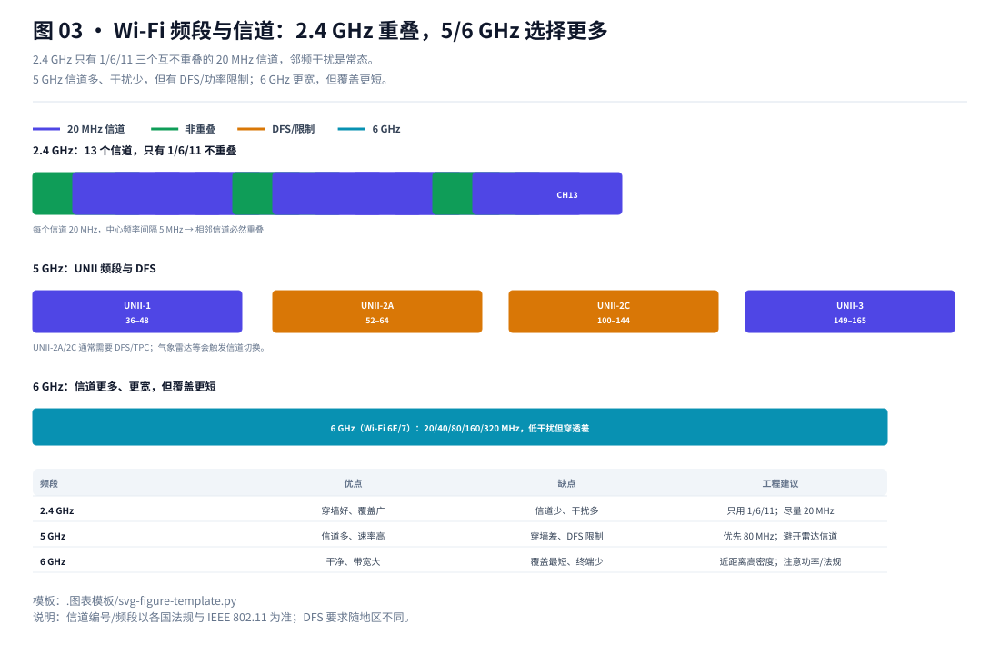

# Wi-Fi 频段信道与速率

Wi-Fi 的速率不是一个数字，而是“频段 × 带宽 × 调制编码 × 空间流 × 保护间隔”乘出来的结果。频段决定能用的信道和穿透，带宽决定能塞多少子载波，MCS 决定每子载波带几个比特。

> 本篇定位：2.4/5/6 GHz 信道规划、802.11 速率演进、MCS/空间流/带宽对速率的影响、DFS/TPC。协议接入流程去 [00-802.11原理与接入流程](./00-802.11原理与接入流程.md)，射频链路去 [01-射频与天线](../01-射频与天线/00-无线传播与射频基础.md)。

## 目录

- [1 一句话模型](#s1)
- [2 速览](#s2)
- [3 频段与信道](#s3)
- [4 速率是怎么算出来的](#s4)
- [5 状态机与定时器](#s5)
- [6 设计取舍与边界](#s6)
- [7 与相邻主题的关系](#s7)
- [名词解释](#名词解释)
- [8 参考与关联](#s8)

## 1 · 一句话模型：速率 = 子载波 × 比特/符号 × 码率 × 空间流

```text
理论速率 ≈ 数据子载波数 × 每子载波比特 × 码率 × 空间流数 / 符号时间
```

三个关键认知：

1. **频段决定“能不能用”和“穿不穿得动”**：2.4 GHz 覆盖好但信道少，5/6 GHz 信道多但穿透差。
2. **带宽翻倍，子载波翻倍，速率大约翻倍**：但占用频谱更宽，干扰/共存压力更大。
3. **MCS 越高，每符号比特越多，越依赖 SNR**：链路自适应会在 MCS 和重传之间取平衡。

## 2 · 速览

| 项 | 内容 |
| --- | --- |
| 所属领域 | 无线通信/WLAN |
| 核心对象 | 频段、信道、带宽、MCS、空间流 |
| 关键参数 | 信道宽度、子载波数、调制阶数、码率、GI |
| 常见标准 | 802.11n/ac/ax/be |
| 法规相关 | DFS、TPC、EIRP 限值、6 GHz 功率等级 |

## 3 · 频段与信道



**读图**：最上面是 2.4 GHz 的 13 个信道，只有 1/6/11 互不重叠；中间是 5 GHz 的 UNII 频段与 DFS 区域；下面是 6 GHz。先看“哪些信道能同时用”，再看“哪些信道要避让雷达”。

> 图源：`images/图03-WiFi频段与信道.svg`

### 3.1 2.4 GHz

- 信道 1–13（地区不同），每个 20 MHz，中心频率间隔 5 MHz。
- 只有 1/6/11 互不重叠（在 20 MHz 带宽下）。
- 蓝牙、微波炉、无线鼠标、邻区 Wi-Fi 都在这里，干扰最重。
- 建议：只开 20 MHz，优先 1/6/11；高密度场景尽量把终端往 5 GHz 引导。

### 3.2 5 GHz

| 频段 | 信道（示例） | 特点 |
| --- | --- | --- |
| UNII-1 | 36–48 | 室内、无 DFS |
| UNII-2A | 52–64 | DFS/TPC |
| UNII-2C | 100–144 | DFS/TPC，气象雷达 |
| UNII-3 | 149–165 | 室内/室外，功率限制因地区 |

5 GHz 信道多，可开 40/80/160 MHz；但带宽越宽，可用信道越少，DFS 避让也会造成瞬时中断。

### 3.3 6 GHz

Wi-Fi 6E/7 使用 6 GHz（5925–7125 MHz），信道多、干扰少，可开 320 MHz。代价是穿透更差、终端少、法规功率等级不同（LPI/VLP 等）。适合近距离高密度，不适合替代 2.4 GHz 做广覆盖。

## 4 速率是怎么算出来的

### 4.1 关键变量

| 变量 | 影响 | 说明 |
| --- | --- | --- |
| 信道带宽 | 子载波数 | 20/40/80/160/320 MHz |
| 调制阶数 | 每子载波比特 | BPSK→1024/4096-QAM |
| 码率 | 有效比特比例 | 1/2、2/3、3/4、5/6 等 |
| 空间流 | 并行数据流 | MIMO 层数 |
| GI | 保护间隔开销 | 0.8/1.6/3.2 μs |
| 前导码/导频 | 固定开销 | 控制/同步 |

### 4.2 速率演进

| 标准 | 频段 | 最大信道 | 最大空间流 | 最高调制 | 标称最高速率 |
| --- | --- | --- | --- | --- | --- |
| 802.11b | 2.4 | 22 MHz | 1 | DSSS/CCK | 11 M |
| 802.11a/g | 5/2.4 | 20 MHz | 1 | 64-QAM | 54 M |
| 802.11n | 2.4/5 | 40 MHz | 4 | 64-QAM | 600 M |
| 802.11ac | 5 | 160 MHz | 8 | 256-QAM | 6.9 G |
| 802.11ax | 2.4/5/6 | 160 MHz | 8 | 1024-QAM | 9.6 G |
| 802.11be | 2.4/5/6 | 320 MHz | 16 | 4096-QAM | 30 G 级 |

> **边界**：表中的“最高速率”是理论物理层速率，实际吞吐要扣除帧头、竞争、ACK、重传、协议开销，通常只有标称值的 30%–60%（视场景而定）。

### 4.3 一个算例（802.11ac 80 MHz，2 流，MCS9）

```text
80 MHz：234 个数据子载波（示意）
256-QAM：8 bit/子载波
码率 5/6
2 空间流
符号时间 ≈ 3.6 μs（含 GI）

速率 ≈ 234 × 8 × 5/6 × 2 / 3.6 μs ≈ 867 Mbps
```

这就是常见的“866 Mbps”档位。换成 160 MHz 或 4 流，速率再翻倍。

## 5 状态机与定时器

Wi-Fi 速率本身**没有状态机**，但链路自适应和信道选择有控制环：

| 控制环 | 输入 | 输出 | 时间尺度 |
| --- | --- | --- | --- |
| 速率自适应 | ACK/重传、RSSI/SNR | MCS/空间流 | 毫秒到秒 |
| 信道选择 | 扫描/干扰/雷达事件 | 工作信道 | 分钟到小时（或 DFS 触发） |
| 带宽切换 | 共存/干扰 | 20/40/80/160 | 秒到分钟 |
| 漫游 | 信号/负载 | 目标 AP | 秒级 |

DFS 是特殊的“被动状态”：检测到雷达信号后必须 vacate 信道，切换到其他信道，并等待 CAC（信道可用性检查）后才能使用。

## 6 设计取舍与边界

### 6.1 带宽越宽越好吗

| 带宽 | 优点 | 代价 |
| --- | --- | --- |
| 20 MHz | 抗干扰、信道多 | 速率低 |
| 40 MHz | 速率翻倍 | 2.4 GHz 基本不可用（重叠） |
| 80 MHz | 高速率 | 5 GHz 可用信道减少 |
| 160/320 MHz | 极高速率 | 信道少、DFS/干扰风险高 |

高密度场景宁可“多 AP × 20/40 MHz”，也不要“少 AP × 160 MHz”，因为宽信道更容易撞上干扰，且覆盖/容量难以复用。

### 6.2 2.4 GHz 的 1/6/11

2.4 GHz 只有三个不重叠信道，这是物理决定的。把 AP 设成 3/9 之类“看起来不重叠”的信道，实际上仍会互相干扰；正确做法是 1/6/11 复用，并降低功率/调整天线。

### 6.3 常见误判

1. **“标称速率 = 实际网速”**：实际吞吐受竞争、重传、协议开销、上行带宽限制。
2. **“160 MHz 一定比 80 MHz 快”**：干扰/DFS/信道少时，160 MHz 可能更不稳定。
3. **“Wi-Fi 6 开了就快”**：需要终端支持 OFDMA/1024-QAM，且信道条件允许。
4. **“2.4 GHz 信道 1/6/11 可以随便复用”**：同频复用要配合功率/物理隔离，否则同频干扰。
5. **“6 GHz 能替代 2.4 GHz”**：6 GHz 穿透差，覆盖需要更密的 AP。

## 7 · 与相邻主题的关系

| 相邻主题 | 关系 |
| --- | --- |
| [00-802.11原理与接入流程](./00-802.11原理与接入流程.md) | CSMA/CA、关联、漫游 |
| [01-射频与天线/00-无线传播与射频基础](../01-射频与天线/00-无线传播与射频基础.md) | 频率/穿透/链路预算 |
| [05-无线测试与优化/00-无线覆盖与干扰优化](../05-无线测试与优化/00-无线覆盖与干扰优化.md) | 信道规划与干扰处理 |
| [01-通信原理/01-调制与编码](../../01-通信原理/01-调制与编码.md) | QAM/OFDM/MCS 的通用原理 |
| [11-网络科学/02-链路层](../../../11-网络科学/02-链路层/.readme.md) | 以太网侧链路与 VLAN |

一句话：**Wi-Fi 速率是“频谱宽度 × 调制效率 × 空间复用”的乘积，实际体验还要乘上“空口竞争”的折扣。**

## 名词解释

> 缩写给出英文全称；非缩写用“—”表示。

| 术语 | 英文全称 | 解释 |
| --- | --- | --- |
| MCS | Modulation and Coding Scheme | 调制与编码组合。 |
| GI | Guard Interval | 保护间隔，OFDM 符号间留的空隙。 |
| OFDMA | Orthogonal Frequency Division Multiple Access | 正交频分多址。 |
| MU-MIMO | Multi-User Multiple-Input Multiple-Output | 多用户多输入多输出。 |
| DFS | Dynamic Frequency Selection | 动态频率选择，避让雷达。 |
| TPC | Transmit Power Control | 发射功率控制。 |
| CAC | Channel Availability Check | 信道可用性检查。 |
| UNII | Unlicensed National Information Infrastructure | 5 GHz 非授权频段划分。 |
| EIRP | Equivalent Isotropically Radiated Power | 等效全向辐射功率。 |
| MLO | Multi-Link Operation | 多链路操作（Wi-Fi 7）。 |
| QAM | Quadrature Amplitude Modulation | 正交幅度调制。 |

## 8 · 参考与关联

**标准**

- IEEE 802.11n/ac/ax/be：PHY 与速率。
- IEEE 802.11h：5 GHz DFS/TPC。
- Wi-Fi Alliance：Wi-Fi 6/6E/7 认证。
- 各国无线电法规（信道/功率/DFS）。

**关联**

- [00-802.11原理与接入流程](./00-802.11原理与接入流程.md)
- [01-射频与天线/00-无线传播与射频基础](../01-射频与天线/00-无线传播与射频基础.md)
- [05-无线测试与优化/00-无线覆盖与干扰优化](../05-无线测试与优化/00-无线覆盖与干扰优化.md)
- [01-通信原理/01-调制与编码](../../01-通信原理/01-调制与编码.md)

---

> **本篇定位**：Wi-Fi 频段/信道/速率的计算与取舍；不展开具体芯片/驱动配置。
> **素材来源**：`studyspace/1.知识体系/10.wifi/wifi记录.md` 的 802.11 标准/速率表、`1.知识体系/1.计算机网络/m-6-无线网络和移动网络.md` 的 2.4 GHz 信道说明；其余按 IEEE 802.11 公开知识补写。
> **待验证**：各国信道/功率/DFS 规则、各标准的最大速率与子载波数随标准版本和地区变化。
