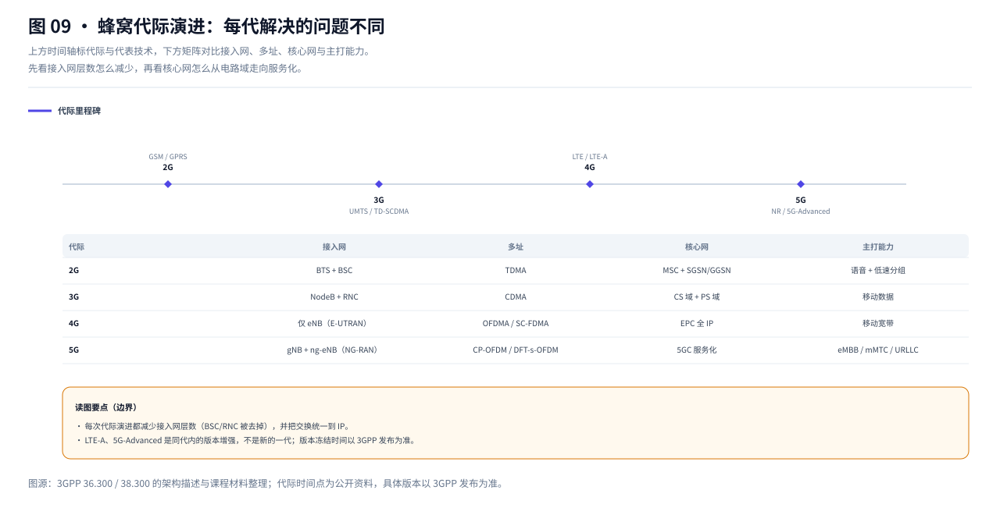
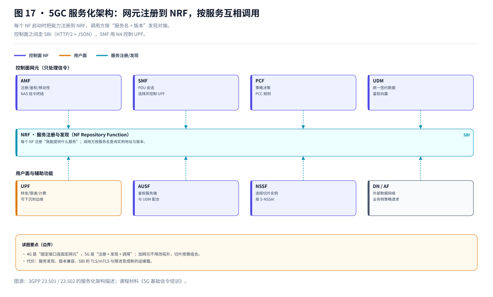

# 蜂窝网络架构与演进

蜂窝网络由“接入网 + 核心网”组成：接入网负责空口和无线资源，核心网负责移动性、会话、计费和安全。从 2G 到 5G，变化最大的是**接入网扁平化**（去掉 RNC）、**控制面与用户面分离**（MME/S-GW → AMF/SMF/UPF）和**接口服务化**（5GC 的 SBA）。

> 本篇定位：2G→5G 的演进线索、4G EPC / 5G 5GC 的网元与功能划分、S1/X2/NG/Xn 接口、NSA/SA 的 Option 家族、CU/DU 与 IAB。物理层去 [01-LTE与NR物理层](./01-LTE与NR物理层.md)，入网/切换去 [02-入网与移动性管理](./02-入网与移动性管理.md)，层二协议与承载去 [03-层二协议与调度](./03-层二协议与调度.md)、[05-QoS与承载](./05-QoS与承载.md)。

## 目录

- [1 一句话模型](#s1)
- [2 速览](#s2)
- [3 演进：从 2G 到 5G](#s3)
- [4 4G 与 5G 的网元](#s4)
- [5 接口：S1/X2 与 NG/Xn](#s5)
- [6 组网方式：NSA/SA 与 Option 家族](#s6)
- [7 5G 架构新增的东西](#s7)
- [8 从终端到核心网](#s8)
- [9 状态机与定时器](#s9)
- [10 设计取舍与边界](#s10)
- [11 与相邻主题的关系](#s11)
- [名词解释](#名词解释)
- [12 参考与关联](#s12)

## 1 · 一句话模型：接入网管“空口”，核心网管“连接”

```text
UE ──Uu── 接入网（eNB / gNB）──回传── 核心网（EPC / 5GC）── DN/互联网
                    │                        │
              无线资源、调度、切换        注册、会话、计费、策略
```

三个关键认知：

1. **4G 扁平化**：LTE 去掉了 RNC，eNB 直接连 EPC；5G 进一步把控制面拆成 AMF/SMF，用户面用 UPF。
2. **控制面与用户面分离**：信令走 MME/AMF，数据走 S-GW/P-GW/UPF。分离之后两条面可以独立扩容，也是网络切片的前提。
3. **NSA 与 SA 是组网方式，不是制式**：NSA 用 4G 锚点带 5G 覆盖，SA 用 5G 独立核心网；两者空口都可能是 NR。

## 2 · 速览

| 项 | 内容 |
| --- | --- |
| 所属领域 | 无线通信/蜂窝 |
| 核心对象 | UE、eNB/gNB、EPC/5GC、回传 |
| 关键接口 | Uu、S1/X2（4G）、NG/Xn（5G） |
| 关键网元 | MME、S-GW、P-GW；AMF、SMF、UPF |
| 组网方式 | NSA（Option 3/7）、SA（Option 2） |
| 主要标准 | 3GPP 23.002、23.501、23.401、36.300、38.300、37.340 |

## 3 · 演进：从 2G 到 5G



**读图**：时间轴左到右是代际，上方是接入网形态，下方是该代主打的能力和核心网形态。先看“接入网从几层变成几层”，再看“核心网从电路域变成全 IP、再变成服务化”。注意 LTE 与 LTE-A、5G 与 5G-Advanced 是同代内的版本增强，不是新代。

> 图源：`../images/图09-蜂窝演进时间线.svg`

| 代际 | 接入网 | 多址 | 核心网 | 主打能力 |
| --- | --- | --- | --- | --- |
| 2G（GSM/GPRS） | BTS + BSC | TDMA | MSC + SGSN/GGSN | 语音 + 低速分组 |
| 3G（UMTS/TD-SCDMA） | NodeB + RNC | CDMA | CS 域 + PS 域 | 移动数据 |
| 4G（LTE/LTE-A） | **仅 eNB**（E-UTRAN） | OFDMA / SC-FDMA | **EPC 全 IP** | 移动宽带 |
| 5G（NR/5G-A） | gNB + ng-eNB（NG-RAN） | CP-OFDM / DFT-s-OFDM | **5GC 服务化** | eMBB/mMTC/URLLC |

三条演进主线：

1. **接入网层数减少**：BTS+BSC → NodeB+RNC → eNB。少一层集中控制器，切换时延和单点故障都减少。
2. **交换方式统一到 IP**：2G/3G 还保留电路域（CS）跑语音；4G 起语音也要变成 IP（VoLTE，见 [06-VoLTE与语音方案](./06-VoLTE与语音方案.md)）。
3. **核心网从“网元互联”到“服务调用”**：EPC 的网元之间是固定接口（S5/S8/S11）；5GC 的网元把能力注册到 NRF，彼此按服务名调用，扩容和切片更容易。

三股力量在推着演进：

| 力量 | 表现 | 对架构的要求 |
| --- | --- | --- |
| 流量 | 每代约一个数量级的增长 | 更大带宽、更多站、更密的频率复用 |
| 成本 | 每 bit 成本必须持续下降 | 扁平化、池化、把专用硬件换成通用/云 |
| 新业务 | 低时延、大连接、高可靠 | 控制面与用户面分离、切片、边缘下沉 |

> **推论**：这三股力量经常互相打架。切片与边缘下沉能降时延，但网元变多、运维变复杂；扁平化能降成本，但基站职责变重、对回传要求更高。每一代架构都是这三者的折中，不存在“全面更优”。

> **边界**：代际名称和版本号不是一回事。LTE 对应 3GPP R8/R9，LTE-A 是 R10 以后；NR 从 R15 开始，R16/R17 补 URLLC、切片增强、RedCap，R18 起叫 5G-Advanced。具体冻结时间以 3GPP 发布为准。

## 4 · 4G 与 5G 的网元

### 4.1 4G EPC

| 网元 | 全称 | 主要职责 |
| --- | --- | --- |
| eNB | Evolved Node B | 空口、无线资源管理（RRM）、调度、切换、头压缩与加密 |
| MME | Mobility Management Entity | NAS 信令、鉴权、移动性、寻呼、S-GW/P-GW 选择 |
| S-GW | Serving Gateway | 用户面锚点、跨 eNB 切换锚定、空闲态下行缓存 |
| P-GW | Packet Data Network Gateway | IP 分配、计费、策略执行、外部网络出口 |
| HSS | Home Subscriber Server | 用户签约数据、鉴权向量 |
| PCRF | Policy and Charging Rules Function | 策略与计费规则（PCC） |

接口：**Uu**（UE–eNB）、**S1-MME / S1-U**（eNB–MME / S-GW）、**X2**（eNB–eNB）、**S5/S8**（S-GW–P-GW）、**S6a**（MME–HSS）、**Gx**（PCRF–P-GW）。

### 4.2 5G 5GC

| 网元 | 全称 | 主要职责 |
| --- | --- | --- |
| gNB | Next Generation Node B | NR 空口、RRM、调度、波束管理 |
| ng-eNB | Next Generation eNB | 用 LTE 空口连 5GC 的基站（eLTE） |
| AMF | Access and Mobility Management Function | 注册、鉴权、移动性、NAS 信令终结、SMF 选择 |
| SMF | Session Management Function | PDU 会话、UE IP 分配、UPF 选择与控制 |
| UPF | User Plane Function | 用户面转发、QoS 执行、计费上报、下行缓存 |
| UDM | Unified Data Management | 统一签约数据（合并了 HSS 的职责） |
| PCF | Policy Control Function | 策略控制（合并了 PCRF 的职责） |
| NRF | Network Repository Function | 网元注册/发现（SBA 的“通讯录”） |
| NSSF | Network Slice Selection Function | 选择网络切片实例 |
| AUSF | Authentication Server Function | 鉴权服务端 |

接口：**Uu**（UE–gNB）、**NG-C / NG-U**（gNB–AMF / UPF）、**Xn-C / Xn-U**（gNB–gNB）；核心网侧用 **N1/N2/N3/N4/N6/N11** 等参考点，其中网元之间的控制面调用走 SBI。

> **命名边界**：N1 是 UE 与 AMF 之间的 NAS 逻辑接口，N2 就是 NG-C，N3 就是 NG-U，N4 是 SMF 控制 UPF。同一件事在不同文档里可能用“NG-U”或“N3”，看到别慌。

### 4.3 接入网与核心网的功能划分

| 功能 | 归属 | 说明 |
| --- | --- | --- |
| 物理层、MAC、RLC、PDCP、RRC | 接入网 | 空口协议栈，eNB/gNB 终结 |
| 动态资源分配、接纳控制、RB 控制 | 接入网 | 毫秒级决策，必须在基站 |
| 连接态移动性（切换） | 接入网 | 基于测量，核心网只做路径更新 |
| 空闲态移动性（TA/RNA 管理） | 核心网（4G）/ 接入网+核心网（5G INACTIVE） | 5G 把 RAN 寻呼下放到 NG-RAN |
| NAS 信令、鉴权、安全 | 核心网 | MME/AMF 终结 |
| IP 地址分配、分组过滤、计费 | 核心网 | P-GW/UPF |
| 会话管理（承载/PDU 会话） | 核心网 | MME+ S/P-GW（4G）、SMF（5G） |

这张表就是“为什么切换由基站决定、为什么改 IP 要动核心网”的答案。

### 4.4 4G 与 5G 的网元对照：只换三样

两代的职责划分同构，差异集中在三处：

| 4G | 5G | 换掉了什么 |
| --- | --- | --- |
| MME（NAS + 移动性 + 会话管理都管） | AMF（NAS + 移动性）+ SMF（会话） | 把“会话”从 MME 拆出去 |
| S-GW + P-GW（用户面两级锚点） | UPF（一个网元，可多实例/下沉） | 把两级锚点合成一个可编排的转发面 |
| PCRF + HSS | PCF + UDM | 名字变了，职责基本一对一 |

> **推论**：所以“5G 核心网网元更多”只是表面。把 MME 拆成 AMF/SMF 之后，会话管理可以独立扩容、独立切片；把 S/P-GW 合成 UPF 之后，用户面可以按需下沉。代价是接口从点对点变成服务调用，排障要同时看 N2/N4/N11 三条边。

## 5 · 接口：S1/X2 与 NG/Xn

### 5.1 S1 接口（4G）

S1 把 eNB 连到 EPC，分两个面：

| 接口 | 承载 | 传输层 | 应用层 | 用途 |
| --- | --- | --- | --- | --- |
| S1-MME | 控制面 | IP + SCTP | S1-AP | NAS 透传、上下文、承载管理、寻呼、切换 |
| S1-U | 用户面 | IP + UDP + GTP-U | GTP-U | 每承载一个隧道（TEID） |

**建立过程**（控制面）：

```text
eNB 配置 MME 列表（池区内多个 MME 的 IP）
  → 与每个 MME 建立 SCTP 偶联（TNL 建立）
    → eNB 发起 S1 SETUP，交换基本应用配置
      → S1 可用
```

- **池区（pool area）+ S1-flex**：一个 eNB 可以连池区内多个 MME，MME 之间分担负荷；UE 进入池区时由 eNB 的 **NNSF**（NAS Node Selection Function）选一个 MME，之后该 UE 的上下文固定在这个 MME。
- **上下文管理**：UE 在池区内移动时上下文跟着走，不需要每次换 MME。
- **承载管理**：建立承载时，S-GW 在请求里给出自己的传输层地址和 TEID（上行终点），eNB 在响应里给出自己的地址和 TEID（下行终点）。
- **负荷管理**：负荷均衡、过载处理、MME 负荷再均衡（把部分 UE 迁到别的 MME）。

新站入网时 S1 不通，按这个顺序查，顺序错了会白查：

| 步骤 | 查什么 | 怎么判 | 答错的后果 |
| --- | --- | --- | --- |
| ① TNL | 到 MME 的 IP 可达、SCTP 端口通 | ping/端口探测、SCTP 偶联状态 | SCTP 没通就去查 S1-AP，永远没有回应 |
| ② S1 SETUP | 应用层配置是否交换成功 | 基站侧 S1 建立状态、MME 侧日志 | 跳过这步，会把“配置不匹配”当成“传输断” |
| ③ 池区与标识 | MME 池区配置、PLMN/TAC 是否一致 | 两侧 PLMN/TAC、池区列表 | TAC 不一致时 S1 能建，但 UE 注册被拒 |

### 5.2 X2 接口（4G）

| 项 | 内容 |
| --- | --- |
| 作用 | eNB 之间直连，用于切换、干扰协调、负荷均衡 |
| 控制面 | X2-C：SCTP + X2-AP |
| 用户面 | X2-U：GTP-U，切换时转发未送达的数据 |
| 建立 | 发现邻区 → 建 TNL → X2 SETUP |
| 附加信息 | UE 历史信息（最近访问过哪些小区、停留多久） |

X2 的价值是**切换不必绕核心网**：源 eNB 直接把上下文和数据转到目标 eNB，核心网只在最后做路径切换。

> **边界**：X2/NG 是逻辑接口，物理上可以跨传输网、可以不经直连光纤。所谓“Xn 切换”指信令走 Xn，不代表两个基站之间一定有专线。

### 5.3 NG 与 Xn（5G）

| 接口 | 对端 | 传输/应用 | 功能 |
| --- | --- | --- | --- |
| NG-C（N2） | gNB/ng-eNB ↔ AMF | SCTP + NG-AP | 接口管理、UE 上下文、移动性、NAS 传输、寻呼、PDU 会话管理、告警 |
| NG-U（N3） | gNB/ng-eNB ↔ UPF | UDP + GTP-U | 每 PDU 会话的隧道转发 |
| Xn-C | gNB/ng-eNB ↔ gNB/ng-eNB | SCTP + Xn-AP | 接口管理、移动性（含上下文转发、RAN 寻呼）、双连接 |
| Xn-U | 同左 | GTP-U | 数据转发、流控 |
| F1 | gNB-CU ↔ gNB-DU | SCTP/F1-AP、GTP-U | CU/DU 分离后的内部接口 |
| E1 | CU-CP ↔ CU-UP | SCTP/E1-AP | CU 内控制面与用户面分离 |

NG 支持 **多对多**：一个 gNB 可以连多个 AMF/UPF（切片、容灾），一个 AMF 也服务多个 gNB。这是 5G 比 4G 更“云化”的直接体现。

## 6 · 组网方式：NSA/SA 与 Option 家族

3GPP 用“Option + 数字”描述 LTE/NR 与 EPC/5GC 的组合：

| 架构 | 主节点（锚点） | 辅节点 | 核心网 | 通俗叫法 |
| --- | --- | --- | --- | --- |
| Option 2 | gNB | — | 5GC | **SA**，独立组网 |
| Option 3 | eNB（MeNB） | en-gNB（SgNB） | EPC | **NSA**，EN-DC，最常见的早期 5G |
| Option 3a/3x | eNB | en-gNB | EPC | NSA 的用户面分流变体 |
| Option 4 | gNB（MgNB） | ng-eNB（SgNB） | 5GC | NE-DC，Option 7 的镜像 |
| Option 5 | ng-eNB | — | 5GC | eLTE 独立接入 5GC |
| Option 7 | ng-eNB（MeNB） | gNB（SgNB） | 5GC | NGEN-DC，向 5GC 演进 |

三条判断规则：

1. **看核心网**：EPC → NSA；5GC 且只有 NR → SA。
2. **看谁当主节点**：主节点提供 RRC 锚点和信令面；辅节点主要加带宽。
3. **看用户面走哪**：Option 3/3a/3x 的差别就在“数据从哪个节点分出去”，直接决定 5G 速率能不能发挥。

**为什么早期运营商几乎都先上 Option 3**：SA 要新建 5GC、改造计费与运维、还要终端支持；NSA 只要在现有 EPC 上加一台 NR 基站和双连接配置，就能先把“5G 图标”和部分容量做出来。代价是**信令锚点和移动性都压在 LTE 上**——LTE 覆盖不行的地方，NR 再好也接不进去。

**为什么 Option 3 的 5G 速率可能上不去**：用户面默认全部走 LTE（Option 3），只有 3a/3x 才把部分承载分到 NR。即使分了，NR 侧还要满足覆盖、SCG 添加门限、终端能力、回传带宽四个条件。链路上任何一环不足，用户看到的都是“显示 5G、速率像 4G”。

> **边界**：NSA 的“5G 图标”不代表所有业务都走 NR。信令锚点在 LTE，用户面可能分流也可能不分流；体验要看实际承载与调度。反过来，SA 也不自动等于“低时延”，还要看 UPF 位置和切片配置。

双连接的通用术语（4G/5G 共用）：

| 术语 | 含义 |
| --- | --- |
| MN / SN | Master Node / Secondary Node，主/辅节点 |
| MCG / SCG | Master/Secondary Cell Group，主/辅小区组 |
| PCell / PSCell | 主小区 / 主辅小区（各自组内做定时与上行控制） |
| Split bearer | 一条承载在 MN 和 SN 之间分流（PDCP 在 MN 汇聚） |

## 7 · 5G 架构新增的东西

### 7.1 SBA：服务化架构

4G 的网元之间是“点对点接口 + 固定协议”；5GC 把每个网元的能力做成**服务**，通过 HTTP/2 + JSON（SBI，Service Based Interface）调用，网元启动时向 NRF 注册，调用方按“服务名 + 版本”发现。

```text
NF（AMF/SMF/...） ──注册/发现── NRF
       │
       └── 按服务调用 ──→ 其他 NF（如 SMF 调 UPF 的 N4）
```

收益是加网元不用改拓扑、切片可以按需组合；代价是服务发现、版本兼容、网络安全（TLS/mTLS）都变成新的运维面。



**读图**：中间横条是 NRF（服务注册表），上下两排网元都通过 SBI 向它注册/查询。箭头表示“注册与发现”，不是业务数据流；真正的业务流（N4、N3）在 SMF/UPF 之间。先看“谁注册、谁发现”，再看用户面在哪。

> 图源：`../images/图17-5GC服务化架构.svg`

### 7.2 CU/DU 分离

gNB 可以拆成 **gNB-CU**（集中单元，跑 RRC/PDCP，可再拆 CU-CP/CU-UP）和 **gNB-DU**（分布单元，跑 RLC/MAC/PHY-high），中间用 **F1** 连接。好处是集中调度、池化部署；代价是 F1 的时延和带宽要求很硬（尤其低层切分）。

### 7.3 IAB：接入与回传一体化

IAB（Integrated Access and Backhaul）让中继节点用 NR 同时做“接入”（服务终端）和“回传”（连上级）。节点叫 IAB-node，回传终点叫 IAB-donor；IAB-node 里有类似终端的 **IAB-MT** 和类似基站的 **IAB-DU**，层二多一个 **BAP** 子层做路由。适合没有光纤的补盲场景。

### 7.4 网络切片与非公共网

- **切片**：在同一套物理网上，用 NSSF/SMF/UPF 组合出多个逻辑网络，各自有 QoS、隔离等级。切片选择靠 S-NSSAI。
- **NPN**：非公共网。**SNPN**（独立组网，不依赖 PLMN）与 **PNI-NPN**（公网集成，靠 CAG 标识封闭小区）。

### 7.5 RAN 共享

多个运营商共用一套 NG-RAN。共享小区在系统信息里广播多个 PLMN，以及每个 PLMN 的 TAC 和小区标识；终端按归属 PLMN 选择。

## 8 · 从终端到核心网


**读图**：上半部分是 4G（UE–eNB–MME/S-GW/P-GW），下半部分是 5G（UE–gNB–AMF/SMF/UPF）。颜色区分控制面/用户面。先看“信令走哪条、数据走哪条”，再看接口名。

> 图源：`../images/图04-蜂窝网络架构.svg`

### 8.1 用户面路径

```text
4G：UE → eNB → S-GW → P-GW → 互联网
5G：UE → gNB → UPF → DN/互联网
```

5G 的 UPF 可以下沉到边缘，缩短时延；SMF 负责选择哪个 UPF，并在会话建立/移动时更新 N4 规则。

### 8.2 控制面路径

```text
4G：UE → eNB → MME → HSS/PCRF（S6a/Gx）
5G：UE → gNB → AMF → UDM/PCF/SMF（N8/N7/N11）
```

### 8.3 异常分支

| 异常 | 现象 | 原因 | 处理方向 |
| --- | --- | --- | --- |
| 有信号但无法上网 | 注册失败/PDU 会话失败 | 鉴权、APN/DNN、策略、核心网 | 查注册/会话信令 |
| 能上网但速率低 | 用户面拥塞 | 回传、UPF、QoS、套餐 | 分段测速、查 QoS |
| 切换掉线 | 移动中中断 | 邻区/切换参数/回传 | 优化覆盖与切换 |
| NSA 终端显示 5G 但慢 | 锚点/分流 | LTE 锚点拥塞、NR 覆盖不足、未配 SCG | 查锚点负荷与 NR 覆盖 |
| 漫游失败 | 无服务 | 漫游协议/PLMN 选择 | 查漫游配置与 FPLMN |
| 池区负荷不均 | 部分 MME 过载 | S1-flex 权重/NNSF | 查池区配置与负荷均衡 |

## 9 · 状态机与定时器

蜂窝网络的状态主要在 UE 与核心网/接入网之间：

| 状态/机制 | 4G | 5G |
| --- | --- | --- |
| 注册状态 | EMM-REGISTERED / DEREGISTERED | RM-REGISTERED / DEREGISTERED |
| 连接管理 | ECM-IDLE / CONNECTED | CM-IDLE / CONNECTED |
| RRC 状态 | RRC_IDLE / CONNECTED | RRC_IDLE / INACTIVE / CONNECTED |
| 寻呼 | MME 发起 | AMF 发起（CN 寻呼）/ NG-RAN 发起（RAN 寻呼） |
| 切换 | X2 / S1 切换 | Xn / NG 切换 |

定时器包括：周期性 TAU/注册更新（T3412）、寻呼重传（T3512 类）、切换保护（T304）、RRC 建立（T300）、PDU 会话去激活等。具体取值由运营商配置，状态细节见 [02-入网与移动性管理](./02-入网与移动性管理.md)。

## 10 · 设计取舍与边界

### 10.1 扁平化的收益与代价

去掉 RNC 后，eNB 直接连核心网，时延更低、结构更简单；代价是 eNB 承担更多无线资源管理职责，对回传和互操作要求更高，基站数量多时核心网的信令连接数也成倍增加。

**代价具体长什么样**：RNC 时代，“一个 RNC 管几百个站”的邻区关系是在一个网元内配的；扁平化之后，邻区关系变成基站之间的 Xn 连接，站越多，需要维护的关系越接近 O(n²)。所以 4G 起必须配 **ANR（自动邻区关系）**：让基站自己发现邻区、自己建 Xn，否则网规网优的人力跟不上。

> **推论**：扁平化不是“免费减一层”，而是把复杂度从“集中网元”转移到“邻区自配置 + 回传”。判断一张网是否真的扁平化，不看拓扑图，看它有没有能力自动维护邻区与 Xn。

### 10.2 为什么要把控制面和用户面分开

| 维度 | 合设（2G/3G） | 分离（4G/5G） |
| --- | --- | --- |
| 扩容 | 信令和流量一起扩 | 各自独立扩 |
| 用户面位置 | 集中在核心网 | 可下沉到边缘（UPF） |
| 切片 | 难 | 天然支持 |
| 复杂度 | 低 | 高（多网元、多接口） |

### 10.3 NSA 与 SA

| 维度 | NSA | SA |
| --- | --- | --- |
| 部署速度 | 快（复用 LTE 与 EPC） | 慢（需 5GC 与 NR 覆盖） |
| 覆盖 | 依赖 LTE 锚点 | 独立 NR 覆盖 |
| 切片/低时延 | 受限 | 原生支持 |
| 终端 | 早期终端多 | 新终端 |
| 典型阶段 | 5G 初期 | 5G 目标架构 |

### 10.4 常见误判

1. **“5G 一定比 4G 快”**：取决于频段、带宽、覆盖、回传和套餐；NSA 还要看 NR 是否真的加了 SCG。
2. **“NSA 不是真 5G”**：NSA 也用 NR 空口，只是锚点在 LTE；体验取决于承载。
3. **“核心网网元越多越慢”**：网元分离是为了扩展性/切片，路径可以优化（UPF 下沉）。
4. **“有信号就能上网”**：注册、鉴权、PDU 会话、DNS/路由任何一步失败都不通。
5. **“切换是核心网决定的”**：4G/5G 的连接态切换由接入网决策，核心网参与锚点/路径更新。
6. **“Option 3 一定是 5G 数据走 NR”**：Option 3 的用户面默认全走 LTE，只有 3a/3x 才把部分数据分到 NR。

## 11 · 与相邻主题的关系

| 相邻主题 | 关系 |
| --- | --- |
| [01-LTE与NR物理层](./01-LTE与NR物理层.md) | 空口资源、帧结构、信道 |
| [02-入网与移动性管理](./02-入网与移动性管理.md) | 注册、RRC、切换、寻呼 |
| [03-层二协议与调度](./03-层二协议与调度.md) | MAC/RLC/PDCP/SDAP 落在哪个网元 |
| [05-QoS与承载](./05-QoS与承载.md) | 承载/会话如何贯穿接入网与核心网 |
| [06-VoLTE与语音方案](./06-VoLTE与语音方案.md) | IMS 与语音承载 |
| [01-射频与天线/00-无线传播与射频基础](../01-射频与天线/00-无线传播与射频基础.md) | 频段、覆盖、链路预算 |
| [01-通信原理/02-多址与双工](../../01-通信原理/02-多址与双工.md) | OFDMA/TDD 的通用模型 |
| [30-产品与方案/33-CPE](../../../../30-产品与方案/33-CPE/.readme.md) | CPE/5G 网关产品 |
| [20-平台与系统](../../../../20-平台与系统/.readme.md) | 5G 拨号/模组实现（QMI/AT） |

一句话：**接入网决定“空口怎么用”，核心网决定“连接怎么建、怎么移动、怎么计费”。**

## 名词解释

> 缩写给出英文全称；非缩写用“—”表示。

| 术语 | 英文全称 | 解释 |
| --- | --- | --- |
| EPC | Evolved Packet Core | 4G 核心网。 |
| 5GC | 5G Core | 5G 核心网。 |
| RAN | Radio Access Network | 无线接入网。 |
| E-UTRAN | Evolved UMTS Terrestrial Radio Access Network | LTE 的接入网，仅由 eNB 组成。 |
| NG-RAN | Next Generation RAN | 5G 接入网，由 gNB 与 ng-eNB 组成。 |
| eNB | Evolved Node B | 4G 基站。 |
| gNB | Next Generation Node B | 5G 基站。 |
| ng-eNB | Next Generation eNB | 连 5GC 的 LTE 基站。 |
| en-gNB | E-UTRA-NR gNB | NSA 中作为辅节点的 NR 基站。 |
| MME | Mobility Management Entity | 4G 移动性管理实体。 |
| S-GW | Serving Gateway | 4G 服务网关，用户面锚点。 |
| P-GW | Packet Data Network Gateway | 4G 分组数据网关，出口与 IP 分配。 |
| HSS | Home Subscriber Server | 4G 签约数据库。 |
| PCRF | Policy and Charging Rules Function | 4G 策略与计费规则功能。 |
| AMF | Access and Mobility Management Function | 5G 接入与移动性管理功能。 |
| SMF | Session Management Function | 5G 会话管理功能。 |
| UPF | User Plane Function | 5G 用户面功能。 |
| UDM | Unified Data Management | 5G 统一数据管理。 |
| PCF | Policy Control Function | 5G 策略控制功能。 |
| NRF | Network Repository Function | 5G 网元注册/发现功能。 |
| NSSF | Network Slice Selection Function | 5G 切片选择功能。 |
| AUSF | Authentication Server Function | 5G 鉴权服务端。 |
| SBA | Service-Based Architecture | 服务化架构。 |
| SBI | Service Based Interface | 服务化接口（HTTP/2 + JSON）。 |
| NSA | Non-Standalone | 非独立组网。 |
| SA | Standalone | 独立组网。 |
| EN-DC | E-UTRA-NR Dual Connectivity | LTE 与 NR 双连接（Option 3）。 |
| MR-DC | Multi-RAT Dual Connectivity | 多制式双连接，含 EN-DC/NE-DC/NGEN-DC。 |
| MN | Master Node | 双连接中的主节点。 |
| SN | Secondary Node | 双连接中的辅节点。 |
| MCG | Master Cell Group | 主节点提供的小区组。 |
| SCG | Secondary Cell Group | 辅节点提供的小区组。 |
| CU | Centralized Unit | 集中单元，承载 RRC/PDCP。 |
| DU | Distributed Unit | 分布单元，承载 RLC/MAC/PHY。 |
| IAB | Integrated Access and Backhaul | 接入与回传一体化。 |
| NPN | Non-Public Network | 非公共网。 |
| SNPN | Standalone Non-Public Network | 独立组网的非公共网。 |
| PNI-NPN | Public Network Integrated NPN | 公网集成的非公共网。 |
| S1-AP | S1 Application Protocol | S1 控制面应用协议。 |
| X2-AP | X2 Application Protocol | X2 控制面应用协议。 |
| NG-AP | NG Application Protocol | NG 控制面应用协议。 |
| Xn-AP | Xn Application Protocol | Xn 控制面应用协议。 |
| SCTP | Stream Control Transmission Protocol | 流控制传输协议，承载信令。 |
| GTP-U | GPRS Tunnelling Protocol for User Plane | 用户面隧道协议（TEID 标识隧道）。 |
| TEID | Tunnel Endpoint Identifier | 隧道端点标识。 |
| TNL | Transport Network Layer | 传输网络层。 |
| NNSF | NAS Node Selection Function | NAS 节点选择功能，池区内选 MME。 |
| ANR | Automatic Neighbour Relation | 自动邻区关系，基站自己发现邻区并建 Xn。 |
| DN | Data Network | 数据网络（5G 的外部网络）。 |
| PDU | Protocol Data Unit | 协议数据单元；5G 会话单位。 |

## 12 · 参考与关联

**标准**

- 3GPP TS 23.002：网络架构（总体）。
- 3GPP TS 23.401：EPC 架构与流程。
- 3GPP TS 23.501：5G 系统架构。
- 3GPP TS 23.502：5G 系统流程。
- 3GPP TS 36.300：E-UTRAN 总体描述。
- 3GPP TS 38.300：NR 总体描述。
- 3GPP TS 37.340：MR-DC 多连接。
- 3GPP TS 38.401 / 38.473：NG-RAN 架构与 F1-AP。

**关联**

- [01-LTE与NR物理层](./01-LTE与NR物理层.md)
- [02-入网与移动性管理](./02-入网与移动性管理.md)
- [03-层二协议与调度](./03-层二协议与调度.md)
- [05-QoS与承载](./05-QoS与承载.md)
- [06-VoLTE与语音方案](./06-VoLTE与语音方案.md)
- [01-射频与天线/00-无线传播与射频基础](../01-射频与天线/00-无线传播与射频基础.md)
- [30-产品与方案/33-CPE](../../../../30-产品与方案/33-CPE/.readme.md)

---

> **本篇定位**：4G/5G 的网元、接口、组网方式与演进线索；不展开空口参数与厂商设备实现。
> **素材来源**：`studyspace/1.知识体系/9.lte5g相关/lte/lte-无线网接入网体系结构.md`、`lte/5g/中文资料/5G.md`、`lte/5g/3GPP官方资料/NR概述.md`、`lte/5g/中文资料/5G基础信令培训.pptx`（课程材料）；素材为二手整理，已按 3GPP 23.401/23.501/38.300 的公开结构核对。
> **待验证**：各运营商 NSA/SA 部署、网元命名与接口版本随 3GPP 版本和厂家实现变化；Option 3a/3x 的用户面分流细节以 37.340 对应版本为准。
