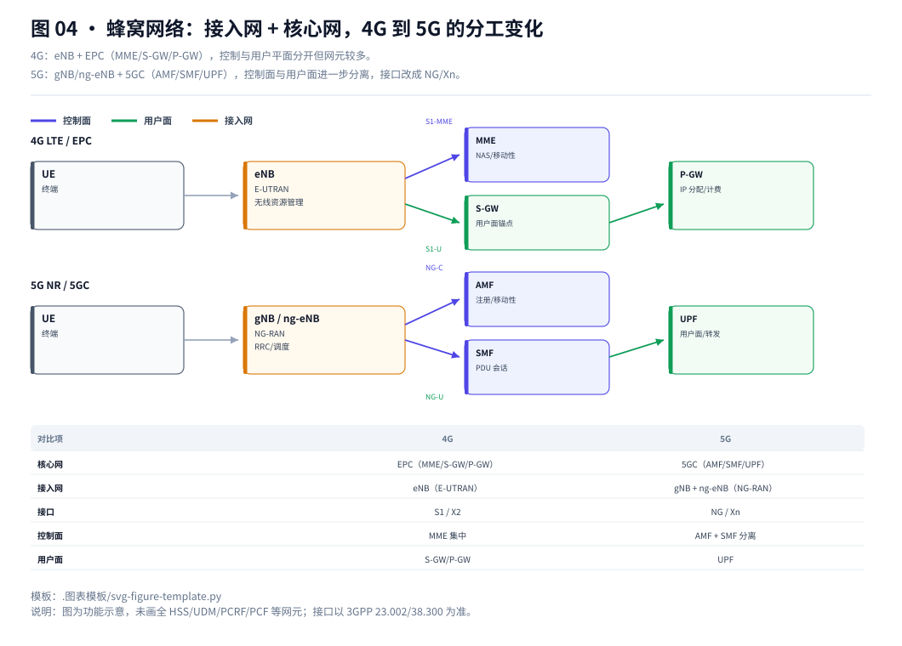

# 蜂窝网络架构与演进

蜂窝网络由“接入网 + 核心网”组成：接入网负责空口和无线资源，核心网负责移动性、会话、计费和安全。从 2G 到 5G，变化最大的是“控制面与用户面分离”和“网元扁平化”。

> 本篇定位：4G EPC 与 5G 5GC 的网元、接口、NSA/SA 架构与演进逻辑。物理层去 [01-LTE与NR物理层](./01-LTE与NR物理层.md)，入网/切换去 [02-入网与移动性管理](./02-入网与移动性管理.md)。

## 目录

- [1 一句话模型](#s1)
- [2 速览](#s2)
- [3 4G 与 5G 的网元](#s3)
- [4 从终端到核心网](#s4)
- [5 状态机与定时器](#s5)
- [6 设计取舍与边界](#s6)
- [7 与相邻主题的关系](#s7)
- [名词解释](#名词解释)
- [8 参考与关联](#s8)

## 1 · 一句话模型：接入网管“空口”，核心网管“连接”

```text
UE ──Uu── 接入网（eNB / gNB）──回传── 核心网（EPC / 5GC）── DN/互联网
```

三个关键认知：

1. **4G 扁平化**：LTE 去掉了 RNC，eNB 直接连 EPC；5G 进一步把控制面拆成 AMF/SMF，用户面用 UPF。
2. **控制面与用户面分离**：信令走 MME/AMF，数据走 S-GW/P-GW/UPF，便于独立扩容和网络切片。
3. **NSA 与 SA 是组网方式，不是制式**：NSA 用 4G 锚点带 5G 覆盖，SA 用 5G 独立核心网。

## 2 · 速览

| 项 | 内容 |
| --- | --- |
| 所属领域 | 无线通信/蜂窝 |
| 核心对象 | UE、eNB/gNB、EPC/5GC、回传 |
| 关键接口 | Uu、S1/X2（4G）、NG/Xn（5G） |
| 关键网元 | MME、S-GW、P-GW；AMF、SMF、UPF |
| 组网方式 | NSA（Option 3/7）、SA（Option 2） |
| 主要标准 | 3GPP 23.002、23.501、38.300 |

## 3 · 4G 与 5G 的网元

### 3.1 4G EPC

| 网元 | 全称 | 主要职责 |
| --- | --- | --- |
| eNB | Evolved Node B | 空口、无线资源管理、调度、切换 |
| MME | Mobility Management Entity | NAS 信令、鉴权、移动性、寻呼 |
| S-GW | Serving Gateway | 用户面锚点、跨 eNB 切换锚定 |
| P-GW | Packet Data Network Gateway | IP 分配、计费、策略执行、外部网络出口 |
| HSS | Home Subscriber Server | 用户签约数据 |
| PCRF | Policy and Charging Rules Function | 策略与计费规则 |

接口：**Uu**（UE–eNB）、**S1-MME/S1-U**（eNB–MME/S-GW）、**X2**（eNB–eNB）。

### 3.2 5G 5GC

| 网元 | 全称 | 主要职责 |
| --- | --- | --- |
| gNB | Next Generation Node B | NR 空口、无线资源管理、调度 |
| ng-eNB | Next Generation eNB | 用 LTE 空口连 5GC 的基站 |
| AMF | Access and Mobility Management Function | 注册、鉴权、移动性、NAS 信令 |
| SMF | Session Management Function | PDU 会话、IP 分配、UPF 选择 |
| UPF | User Plane Function | 用户面转发、QoS、计费 |
| UDM | Unified Data Management | 统一签约数据 |
| PCF | Policy Control Function | 策略控制 |
| NRF | Network Repository Function | 网元注册/发现（SBA） |

接口：**Uu**（UE–gNB）、**NG-C/NG-U**（gNB–AMF/UPF）、**Xn-C/Xn-U**（gNB–gNB）。

### 3.3 NSA 与 SA

| 架构 | 锚点 | 核心网 | 特点 |
| --- | --- | --- | --- |
| Option 3 | LTE eNB（主） | EPC | NSA，5G 作为辅载波，部署快 |
| Option 7 | LTE ng-eNB（主） | 5GC | NSA，向 5GC 演进 |
| Option 2 | NR gNB | 5GC | SA，独立 5G，支持切片/低时延 |
| Option 4/5 | NR/LTE | 5GC | 双连接变体 |

> **边界**：NSA 的“5G 图标”不代表所有业务都走 5G；信令锚点在 LTE，用户面可能分流。判断体验要看实际承载。

## 4 从终端到核心网



**读图**：上半部分是 4G（UE–eNB–MME/S-GW/P-GW），下半部分是 5G（UE–gNB–AMF/SMF/UPF）。颜色区分控制面/用户面。先看“信令走哪条、数据走哪条”，再看接口名。

> 图源：`images/图04-蜂窝网络架构.svg`

### 4.1 用户面路径

```text
4G：UE → eNB → S-GW → P-GW → 互联网
5G：UE → gNB → UPF → DN/互联网
```

5G 的 UPF 可以下沉到边缘，缩短时延；SMF 负责选择哪个 UPF。

### 4.2 控制面路径

```text
4G：UE → eNB → MME → HSS/PCRF
5G：UE → gNB → AMF → UDM/PCF/SMF
```

5G 采用服务化架构（SBA），网元通过 NRF 注册/发现，接口更“云化”。

### 4.3 异常分支

| 异常 | 现象 | 原因 | 处理方向 |
| --- | --- | --- | --- |
| 有信号但无法上网 | 注册失败/PDU 会话失败 | 鉴权、APN/DNN、策略、核心网 | 查注册/会话信令 |
| 能上网但速率低 | 用户面拥塞 | 回传、UPF、QoS、套餐 | 分段测速、查 QoS |
| 切换掉线 | 移动中中断 | 邻区/切换参数/回传 | 优化覆盖与切换 |
| NSA 终端显示 5G 但慢 | 锚点/分流 | LTE 锚点拥塞、NR 覆盖不足 | 查锚点与 NR 覆盖 |
| 漫游失败 | 无服务 | 漫游协议/PLMN 选择 | 查漫游配置 |

## 5 状态机与定时器

蜂窝网络的状态主要在 UE 与核心网/接入网之间：

| 状态/机制 | 4G | 5G |
| --- | --- | --- |
| 注册状态 | EMM-REGISTERED | RM-REGISTERED |
| 连接管理 | ECM-IDLE/CONNECTED | CM-IDLE/CONNECTED |
| RRC 状态 | RRC_IDLE/CONNECTED | RRC_IDLE/INACTIVE/CONNECTED |
| 寻呼 | MME 发起 | AMF/RAN 发起 |
| 切换 | X2/S1 切换 | Xn/NG 切换 |

定时器包括：周期性 TAU/注册更新、寻呼重传、切换超时、PDU 会话去激活等。具体取值由运营商配置。

## 6 设计取舍与边界

### 6.1 扁平化的收益与代价

去掉 RNC 后，eNB 直接连核心网，时延更低、结构更简单；代价是 eNB 承担更多无线资源管理职责，对回传和互操作要求更高。

### 6.2 NSA 与 SA

| 维度 | NSA | SA |
| --- | --- | --- |
| 部署速度 | 快（复用 LTE） | 慢（需 5GC） |
| 覆盖 | 依赖 LTE 锚点 | 独立 NR 覆盖 |
| 切片/低时延 | 受限 | 原生支持 |
| 终端 | 早期终端多 | 新终端 |
| 典型 | 5G 初期 | 5G 目标架构 |

### 6.3 常见误判

1. **“5G 一定比 4G 快”**：取决于频段、带宽、覆盖、回传和套餐。
2. **“NSA 不是真 5G”**：NSA 也用 NR 空口，只是锚点在 LTE；体验取决于承载。
3. **“核心网网元越多越慢”**：网元分离是为了扩展性/切片，路径可以优化（UPF 下沉）。
4. **“有信号就能上网”**：注册、鉴权、PDU 会话、DNS/路由任何一步失败都不通。
5. **“切换是核心网决定的”**：4G/5G 的切换主要由接入网决策，核心网参与锚点/路径更新。

## 7 · 与相邻主题的关系

| 相邻主题 | 关系 |
| --- | --- |
| [01-LTE与NR物理层](./01-LTE与NR物理层.md) | 空口资源、帧结构、信道 |
| [02-入网与移动性管理](./02-入网与移动性管理.md) | 注册、RRC、切换、寻呼 |
| [01-射频与天线/00-无线传播与射频基础](../01-射频与天线/00-无线传播与射频基础.md) | 频段、覆盖、链路预算 |
| [01-通信原理/02-多址与双工](../../01-通信原理/02-多址与双工.md) | OFDMA/TDD 的通用模型 |
| [40-产品与方案/43-CPE](../../../../40-产品与方案/43-CPE/.readme.md) | CPE/5G 网关产品 |
| [20-平台与系统](../../../../20-平台与系统/.readme.md) | 5G 拨号/模组实现 |

一句话：**接入网决定“空口怎么用”，核心网决定“连接怎么建、怎么移动、怎么计费”。**

## 名词解释

> 缩写给出英文全称；非缩写用“—”表示。

| 术语 | 英文全称 | 解释 |
| --- | --- | --- |
| EPC | Evolved Packet Core | 4G 核心网。 |
| 5GC | 5G Core | 5G 核心网。 |
| eNB | Evolved Node B | 4G 基站。 |
| gNB | Next Generation Node B | 5G 基站。 |
| ng-eNB | Next Generation eNB | 连 5GC 的 LTE 基站。 |
| MME | Mobility Management Entity | 4G 移动性管理实体。 |
| S-GW | Serving Gateway | 4G 服务网关。 |
| P-GW | Packet Data Network Gateway | 4G 分组数据网关。 |
| AMF | Access and Mobility Management Function | 5G 接入与移动性管理功能。 |
| SMF | Session Management Function | 5G 会话管理功能。 |
| UPF | User Plane Function | 5G 用户面功能。 |
| UDM | Unified Data Management | 5G 统一数据管理。 |
| PCF | Policy Control Function | 5G 策略控制功能。 |
| NRF | Network Repository Function | 5G 网元注册/发现功能。 |
| NSA | Non-Standalone | 非独立组网。 |
| SA | Standalone | 独立组网。 |
| SBA | Service-Based Architecture | 服务化架构。 |
| PDU | Protocol Data Unit | 协议数据单元；5G 会话单位。 |

## 8 · 参考与关联

**标准**

- 3GPP TS 23.002：网络架构。
- 3GPP TS 23.501：5G 系统架构。
- 3GPP TS 38.300：NR 总体描述。
- 3GPP TS 36.300：E-UTRAN 总体描述。

**关联**

- [01-LTE与NR物理层](./01-LTE与NR物理层.md)
- [02-入网与移动性管理](./02-入网与移动性管理.md)
- [01-射频与天线/00-无线传播与射频基础](../01-射频与天线/00-无线传播与射频基础.md)
- [40-产品与方案/43-CPE](../../../../40-产品与方案/43-CPE/.readme.md)

---

> **本篇定位**：4G/5G 的网元、接口与组网方式；不展开具体信令流程与厂商设备。
> **素材来源**：`studyspace/1.知识体系/9.lte5g相关/lte/lte-无线网接入网体系结构.md`、`lte/5g/中文资料/5G.md`、`lte/5g/3GPP官方资料/NR概述.md`。
> **待验证**：各运营商 NSA/SA 部署、网元命名与接口版本随 3GPP 版本和厂家实现变化。
