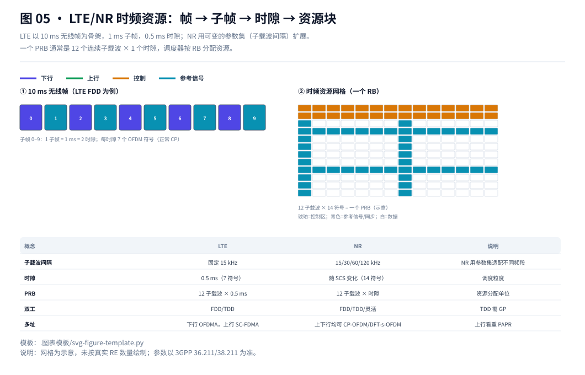

# LTE 与 NR 物理层

LTE/NR 物理层把“比特”变成“时频资源上的符号”：先编码、调制，再映射到资源块，最后用 OFDM 发出去。上行还要考虑终端的功率效率，所以 LTE 上行用 SC-FDMA；NR 则用可变参数集适配从低频到毫米波。

> 本篇定位：OFDMA/SC-FDMA、帧结构、PRB/RE、物理信道、MIMO 与编码。网络架构去 [00-蜂窝网络架构与演进](./00-蜂窝网络架构与演进.md)，入网/切换去 [02-入网与移动性管理](./02-入网与移动性管理.md)。

## 目录

- [1 一句话模型](#s1)
- [2 速览](#s2)
- [3 帧结构与资源单元](#s3)
- [4 从传输块到空口](#s4)
- [5 状态机与定时器](#s5)
- [6 设计取舍与边界](#s6)
- [7 与相邻主题的关系](#s7)
- [名词解释](#名词解释)
- [8 参考与关联](#s8)

## 1 · 一句话模型：把比特放进“时频网格”

```text
传输块（TB）
  → CRC/分段 → 信道编码 → 速率匹配 → 加扰 → 调制
    → 层映射/预编码 → 资源映射（RE/PRB）→ OFDM → 天线
```

三个关键认知：

1. **资源单位是 PRB**：频域 12 个子载波，时域 1 个时隙；调度器按 PRB 分配。
2. **LTE 参数固定，NR 参数可变**：LTE 子载波间隔 15 kHz；NR 支持 15/30/60/120 kHz 等，用参数集适配不同频段。
3. **上行看重 PAPR**：LTE 上行用 SC-FDMA 降低峰均比，NR 上行可选用 DFT-s-OFDM。

## 2 · 速览

| 项 | 内容 |
| --- | --- |
| 所属领域 | 无线通信/蜂窝物理层 |
| 核心对象 | 帧、子帧、时隙、PRB、RE、传输块 |
| 关键参数 | 子载波间隔、CP、带宽、MCS、层数 |
| 多址 | LTE：下行 OFDMA，上行 SC-FDMA；NR：CP-OFDM/DFT-s-OFDM |
| 编码 | LTE：Turbo；NR：LDPC（数据）、Polar（控制） |
| 标准 | 3GPP 36.211/36.212、38.211/38.212/38.214 |

## 3 · 帧结构与资源单元



**读图**：上半部分是 10 ms 无线帧拆成 10 个 1 ms 子帧；右边是一个 PRB 的时频网格（12 子载波 × 14 符号）；下方矩阵对比 LTE/NR 的参数。先看“帧怎么分”，再看“资源怎么数”。

> 图源：`images/图05-LTE-NR时频资源.svg`

### 3.1 LTE 帧结构

| 结构 | 内容 | 用途 |
| --- | --- | --- |
| Type 1（FDD） | 10 ms 帧 = 10 × 1 ms 子帧；子帧 = 2 × 0.5 ms 时隙 | 频分双工 |
| Type 2（TDD） | 10 ms 帧 = 2 × 5 ms 半帧；含特殊子帧（DwPTS/GP/UpPTS） | 时分双工 |

特殊子帧的 **GP（保护间隔）** 用于吸收上下行传播时延，配比决定上下行容量。

### 3.2 NR 帧结构

NR 也是 10 ms 帧、10 个子帧，但时隙长度随子载波间隔变化：

| 子载波间隔 | 每时隙符号数 | 每子帧时隙数 | 典型频段 |
| --- | --- | --- | --- |
| 15 kHz | 14 | 1 | 低频 |
| 30 kHz | 14 | 2 | 3.5 GHz |
| 60 kHz | 14 | 4 | 毫米波/低时延 |
| 120 kHz | 14 | 8 | 毫米波 |

### 3.3 PRB 与 RE

| 单位 | 定义 | 说明 |
| --- | --- | --- |
| RE | Resource Element | 1 子载波 × 1 OFDM 符号 |
| PRB | Physical Resource Block | 12 子载波 × 1 时隙 |
| REG | Resource Element Group | 控制信道映射单位 |
| CCE | Control Channel Element | PDCCH 的基本单位 |

> **边界**：PRB 的“时隙”长度随参数集变化，跨制式比较 RB 数量没有意义，要换算成带宽/时间。

## 4 从传输块到空口

### 4.1 发送链

```text
MAC 传输块（TB）
  → CRC 附着
  → 码块分割（超长时）
  → 信道编码（Turbo/LDPC/Polar）
  → 速率匹配
  → 加扰
  → 调制（QPSK/16-QAM/64-QAM/256-QAM）
  → 层映射
  → 预编码
  → 资源映射
  → OFDM（IFFT + CP）
  → 射频
```

### 4.2 物理信道

| 方向 | 信道 | 作用 |
| --- | --- | --- |
| 下行 | PSS/SSS | 小区搜索/同步 |
| 下行 | PBCH | 广播 MIB |
| 下行 | PDCCH | 调度/控制信息（DCI） |
| 下行 | PDSCH | 下行数据 |
| 下行 | PCFICH/PHICH | 控制格式/HARQ 指示（LTE） |
| 上行 | PRACH | 随机接入 |
| 上行 | PUCCH | 上行控制（SR/ACK/CSI） |
| 上行 | PUSCH | 上行数据 |

### 4.3 MIMO 与波束

| 技术 | 作用 | 前提 |
| --- | --- | --- |
| 发送分集 | 抗衰落、提高可靠性 | 多天线 |
| 空间复用 | 提高峰值速率 | 信道相关性低、终端多流 |
| 波束赋形 | 提高覆盖/抑制干扰 | 阵列/信道估计 |
| 大规模 MIMO | 多用户空分 | 5G 基站阵列 |

NR 的波束管理是重点：低频用宽波束，毫米波用窄波束扫描/跟踪。

### 4.4 异常分支

| 异常 | 现象 | 原因 | 处理方向 |
| --- | --- | --- | --- |
| 解调失败 | 误块率高 | SNR 低、干扰、MCS 过高 | 降 MCS、查覆盖/干扰 |
| 随机接入失败 | 无法建立连接 | PRACH 资源/功率/冲突 | 查 RACH 配置/覆盖 |
| 上行受限 | 下行好、上行差 | 终端功率/PAPR/干扰 | 查功控/上行干扰 |
| 切换失败 | 移动中掉线 | 邻区/测量/门限 | 优化切换参数 |
| 控制信道受限 | 调度不进去 | PDCCH 资源不足/聚合等级 | 调 CCE/调度策略 |

## 5 状态机与定时器

物理层本身没有“连接状态机”，但有以下过程/定时：

| 过程 | 作用 | 关键点 |
| --- | --- | --- |
| 小区搜索 | 找 PSS/SSS、读 MIB | 时频同步、小区 ID |
| 随机接入 | 建立上行同步 | PRACH 前导、RAR 窗口 |
| HARQ | 快速重传/合并 | RTT、软合并 |
| 功率控制 | 控制上行/下行功率 | 闭环/开环 |
| 波束管理 | 选择/跟踪波束 | 测量/上报周期 |

> RRC 状态（IDLE/INACTIVE/CONNECTED）在 [02-入网与移动性管理](./02-入网与移动性管理.md) 讲，不在物理层。

## 6 设计取舍与边界

### 6.1 OFDMA 与 SC-FDMA

| 维度 | OFDMA | SC-FDMA |
| --- | --- | --- |
| PAPR | 高 | 低 |
| 频域调度 | 细 | 较粗 |
| 功放效率 | 低 | 高 |
| 典型 | 下行/Wi-Fi | LTE 上行 |

LTE 上行选 SC-FDMA，是为了终端功放效率和覆盖；NR 上行两种都支持，按场景选。

### 6.2 参数集

| 选择 | 收益 | 代价 |
| --- | --- | --- |
| 子载波间隔大 | 符号短、低时延、抗多普勒 | CP 开销大、覆盖短 |
| 子载波间隔小 | 符号长、抗多径、覆盖远 | 时延大、对频偏敏感 |

### 6.3 常见误判

1. **“带宽越大速率越高”**：还受 MCS、层数、控制开销、调度限制。
2. **“MIMO 一定能多流”**：信道相关性高/终端能力不足时，只能做分集。
3. **“PRB 数可以直接跨制式比较”**：时隙长度/子载波间隔不同，必须换算。
4. **“上行和下行对称”**：功率、天线、干扰都不同，上行往往是瓶颈。
5. **“物理层通了业务就通”**：还要 RRC、NAS、PDU 会话、IP 配置。

## 7 · 与相邻主题的关系

| 相邻主题 | 关系 |
| --- | --- |
| [00-蜂窝网络架构与演进](./00-蜂窝网络架构与演进.md) | 网元/接口/组网 |
| [02-入网与移动性管理](./02-入网与移动性管理.md) | 小区搜索、随机接入、RRC、切换 |
| [01-通信原理/01-调制与编码](../../01-通信原理/01-调制与编码.md) | OFDM/QAM/LDPC/Polar 的通用原理 |
| [01-通信原理/02-多址与双工](../../01-通信原理/02-多址与双工.md) | OFDMA/TDD 的通用模型 |
| [01-射频与天线/00-无线传播与射频基础](../01-射频与天线/00-无线传播与射频基础.md) | 频段/波束/链路预算 |

一句话：**物理层决定“一个时频网格能装多少比特”，MAC/调度决定“这些比特归谁、什么时候发”。**

## 名词解释

> 缩写给出英文全称；非缩写用“—”表示。

| 术语 | 英文全称 | 解释 |
| --- | --- | --- |
| OFDMA | Orthogonal Frequency Division Multiple Access | 正交频分多址。 |
| SC-FDMA | Single-Carrier Frequency Division Multiple Access | 单载波频分多址。 |
| DFT-s-OFDM | DFT-spread OFDM | DFT 扩展 OFDM，低 PAPR。 |
| PRB | Physical Resource Block | 物理资源块。 |
| RE | Resource Element | 资源元素。 |
| REG | Resource Element Group | 资源元素组。 |
| CCE | Control Channel Element | 控制信道单元。 |
| TB | Transport Block | 传输块。 |
| MCS | Modulation and Coding Scheme | 调制与编码组合。 |
| HARQ | Hybrid Automatic Repeat reQuest | 混合自动重传。 |
| PDCCH | Physical Downlink Control Channel | 物理下行控制信道。 |
| PDSCH | Physical Downlink Shared Channel | 物理下行共享信道。 |
| PUCCH | Physical Uplink Control Channel | 物理上行控制信道。 |
| PUSCH | Physical Uplink Shared Channel | 物理上行共享信道。 |
| PRACH | Physical Random Access Channel | 物理随机接入信道。 |
| PSS/SSS | Primary/Secondary Synchronization Signal | 主/辅同步信号。 |
| PBCH | Physical Broadcast Channel | 物理广播信道。 |
| MIB | Master Information Block | 主信息块。 |
| DCI | Downlink Control Information | 下行控制信息。 |
| PAPR | Peak-to-Average Power Ratio | 峰均功率比。 |

## 8 · 参考与关联

**标准**

- 3GPP TS 36.211：LTE 物理信道与调制。
- 3GPP TS 36.212：LTE 复用与信道编码。
- 3GPP TS 38.211：NR 物理信道与调制。
- 3GPP TS 38.212：NR 复用与信道编码。
- 3GPP TS 38.214：NR 物理层数据传输过程。

**关联**

- [00-蜂窝网络架构与演进](./00-蜂窝网络架构与演进.md)
- [02-入网与移动性管理](./02-入网与移动性管理.md)
- [01-通信原理/01-调制与编码](../../01-通信原理/01-调制与编码.md)
- [01-通信原理/02-多址与双工](../../01-通信原理/02-多址与双工.md)

---

> **本篇定位**：LTE/NR 物理层的帧结构、资源单位、信道与编码；不展开具体参数表与芯片实现。
> **素材来源**：`studyspace/1.知识体系/9.lte5g相关/lte/lte-PHY.md`、`lte/5g/中文资料/5G.md`、`lte/5g/3GPP官方资料/NR概述.md`。
> **待验证**：各参数集/带宽下的 PRB 数、信道配置与 MCS 表以 3GPP 对应版本为准。
