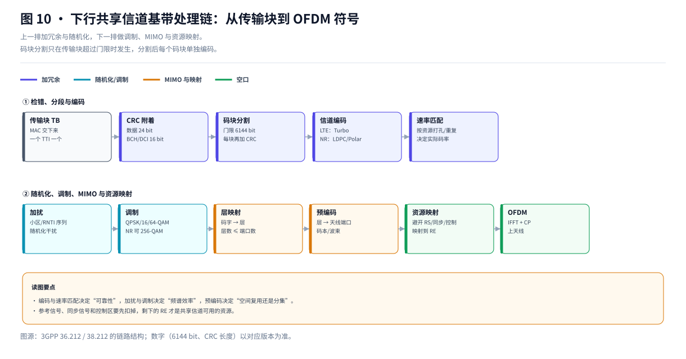

# LTE 与 NR 物理层

LTE/NR 物理层把“比特”变成“时频资源上的符号”：先加 CRC、编码、调制，再映射到资源块，最后用 OFDM 发出去。上行还要考虑终端的功率效率，所以 LTE 上行用 SC-FDMA；NR 用可变参数集（numerology）适配从低频到毫米波，并用 SSB 波束扫描解决高频覆盖。

> 本篇定位：帧结构、RE/RB/PRB/REG/CCE、下行基带处理链、参考信号、物理信道、物理层过程与功控。网络架构去 [00-蜂窝网络架构与演进](./00-蜂窝网络架构与演进.md)，入网流程去 [02-入网与移动性管理](./02-入网与移动性管理.md)，层二调度去 [03-层二协议与调度](./03-层二协议与调度.md)。

## 目录

- [1 一句话模型](#s1)
- [2 速览](#s2)
- [3 帧结构与资源单位](#s3)
- [4 从传输块到空口](#s4)
- [5 物理信道与信号](#s5)
- [6 物理层过程与定时](#s6)
- [7 设计取舍与边界](#s7)
- [8 与相邻主题的关系](#s8)
- [名词解释](#名词解释)
- [9 参考与关联](#s9)

## 1 · 一句话模型：把比特放进“时频网格”

```text
传输块（TB）
  → CRC/分段 → 信道编码 → 速率匹配 → 加扰 → 调制
    → 层映射/预编码 → 资源映射（RE/PRB）→ OFDM → 天线
```

三个关键认知：

1. **资源单位是 RE 和 RB**：RE = 1 子载波 × 1 OFDM 符号；RB = 频域 12 个子载波。调度器按 RB 分配，不按 Hz 分配。
2. **LTE 参数固定，NR 参数可变**：LTE 子载波间隔 15 kHz（另有 7.5 kHz 的 MBSFN 场景）；NR 支持 15/30/60/120/240 kHz，用参数集适配不同频段与移动速度。
3. **上行看重 PAPR**：LTE 上行用 SC-FDMA（DFT-s-OFDM）降低峰均比，NR 上行两种都支持，按覆盖/速率权衡。

## 2 · 速览

| 项 | 内容 |
| --- | --- |
| 所属领域 | 无线通信/蜂窝物理层 |
| 核心对象 | 无线帧、子帧、时隙、RB/PRB、RE、REG/CCE、传输块 |
| 关键参数 | 子载波间隔、CP 长度、带宽、MCS、层数（rank） |
| 多址 | LTE：下行 OFDMA，上行 SC-FDMA；NR：CP-OFDM / DFT-s-OFDM |
| 编码 | LTE：Turbo（数据）+ 卷积/块码（控制）；NR：LDPC（数据）+ Polar（控制） |
| 调制 | QPSK / 16-QAM / 64-QAM；NR 数据可到 256-QAM |
| 标准 | 3GPP 36.201/211/212/213/214、38.201/211/212/213/214 |

## 3 · 帧结构与资源单位


**读图**：上半部分是 10 ms 无线帧拆成 10 个 1 ms 子帧；右边是一个 RB 的时频网格（12 子载波 × 若干符号）；下方矩阵对比 LTE/NR 的参数。先看“帧怎么分”，再看“资源怎么数”。

> 图源：`../images/图05-LTE-NR时频资源.svg`

### 3.1 LTE 两种帧结构

| 结构 | 组成 | 用途 |
| --- | --- | --- |
| Type 1（FDD） | 10 ms 帧 = 10 × 1 ms 子帧；子帧 = 2 × 0.5 ms 时隙 | 频分双工 |
| Type 2（TDD） | 10 ms 帧 = 2 × 5 ms 半帧；每半帧 5 × 1 ms 子帧（4 个普通 + 1 个特殊） | 时分双工 |

特殊子帧由三个特殊时隙组成：

| 时隙 | 全称 | 作用 |
| --- | --- | --- |
| DwPTS | Downlink Pilot Time Slot | 下行传输（可承载少量数据/控制） |
| GP | Guard Period | 吸收上下行传播时延，避免上下行互相干扰 |
| UpPTS | Uplink Pilot Time Slot | 上行传输（可发 PRACH/SRS） |

TDD 有 7 种上下行配比（配置 0~6）。配比越偏下行，下行容量越大，但上行时隙少、上行时延和反馈周期变长；GP 长度决定小区半径上限。

> **边界**：TDD 配比是全网（邻区）协同参数。相邻小区配比不一致会形成“基站对基站”的上下行干扰，这不是终端能解决的问题。

### 3.2 NR 帧结构与参数集

NR 也是 10 ms 帧、10 个子帧，但**时隙长度随子载波间隔变化**（μ = 参数集索引）：

| 子载波间隔 | μ | 每子帧时隙数 | 每时隙符号数（常规 CP） | 典型场景 |
| --- | --- | --- | --- | --- |
| 15 kHz | 0 | 1 | 14 | FR1 低频，与 LTE 对齐 |
| 30 kHz | 1 | 2 | 14 | 3.5 GHz 主力 |
| 60 kHz | 2 | 4 | 14（扩展 CP 为 12） | 毫米波、低时延 |
| 120 kHz | 3 | 8 | 14 | 毫米波（FR2） |
| 240 kHz | 4 | 16 | 14 | SSB 专用 |

子载波间隔翻倍 → 符号长度减半 → 时隙变短（时延降低），但 CP 占比和相位噪声敏感性上升。

### 3.3 从 RE 到 CCE

| 单位 | 定义 | 作用 | 边界 |
| --- | --- | --- | --- |
| RE | Resource Element | 1 子载波 × 1 OFDM 符号，最小资源颗粒 | 单个 RE 不单独分配给用户 |
| RB | Resource Block | 频域 12 个连续子载波 | NR 的 RB 只是频域定义；LTE 的 RB 还隐含 0.5 ms 时隙（7 符号） |
| PRB | Physical Resource Block | 实际映射到物理频谱的 RB | 调度以 PRB 为单位 |
| VRB | Virtual Resource Block | 逻辑编号的 RB，经映射才落到 PRB | 分集中式 LVRB、分布式 DVRB，LTE 上行只用 LVRB |
| REG | Resource Element Group | 控制信道映射单位，LTE 为 4 个 RE；NR 为 1 符号 × 1 RB | 只用于控制信道，不用于共享信道 |
| CCE | Control Channel Element | PDCCH 的聚合单位；LTE 为 9 个 REG，NR 为 6 个 REG | 聚合等级越高越抗干扰、占用越多 |
| CORESET | Control Resource Set | NR 的控制资源集合：频域若干 RB、时域 1~3 符号 | 可放在时隙内任意位置，取代 LTE 的“控制区固定占前 n 个符号” |

**LTE 带宽与 RB 数**（子载波间隔 15 kHz）：

| 带宽 | 1.4 MHz | 3 MHz | 5 MHz | 10 MHz | 15 MHz | 20 MHz |
| --- | --- | --- | --- | --- | --- | --- |
| PRB 数 | 6 | 15 | 25 | 50 | 75 | 100 |

> **校正一个常见说法**：很多资料写“1 个 PRB = 12 子载波 × 1 时隙”。这在 LTE 里成立（0.5 ms 时隙 = 7 符号，共 84 RE）；在 NR 里 RB 只定义频域 12 子载波，时域要看资源网格的时隙长度。跨制式比较“RB 数”必须先换算带宽和时间。

再算两笔账，把“带宽”翻译成“速率”和“时延余量”。

**速率**（LTE 20 MHz 的粗算）：

```text
20 MHz / 15 kHz → 100 个 PRB
每 PRB 每时隙 12 × 14 = 168 个 RE，扣参考信号与控制区约 20% → 约 134 个可用 RE
64-QAM（6 bit/符号）× 码率 0.75 → 每 RE 约 4.5 bit
单层单 PRB 每时隙 ≈ 134 × 4.5 ≈ 600 bit
100 PRB × 2 层 × 600 bit ÷ 0.5 ms ≈ 240 Mbps（理论上限）
```

现网单用户峰值通常只有这个数的一半到七成：控制信道、参考信号、调度空档、HARQ 重传都要占。

**时延余量**：

| CP 类型 | 长度 | 折算距离 | 说明 |
| --- | --- | --- | --- |
| 常规 CP | 约 4.7 µs | 约 1.4 km | 抗多径时延扩展的余量 |
| 扩展 CP | 约 16.7 µs | 约 5 km | 开销更大，用于多径特别严重的场景 |

> **边界**：这里的“距离”是**多径时延扩展**的余量，不是小区半径。小区半径由保护间隔（TDD 的 GP）、链路预算和干扰决定，不能拿 CP 长度直接换算覆盖。“CP 越长覆盖越远”只在多径受限的农村/海面成立；城区是干扰受限，拉长 CP 只是白增开销。

## 4 · 从传输块到空口

### 4.1 下行发送链



**读图**：从左到右是 MAC 交给物理层的一个传输块如何变成天线上的 OFDM 符号。上面一排是“加冗余/加扰”，下面一排是“MIMO 与资源映射”。注意码块分割只在传输块很大时发生，分割后每个码块各自编码、各自 CRC。

> 图源：`../images/图10-下行基带处理链.svg`

| 步骤 | 做什么 | 关键数字/边界 |
| --- | --- | --- |
| CRC 附着 | 给传输块加校验，用于检错 | LTE 用 24 bit（数据）/16 bit（BCH、DCI）/8 bit（UCI on PUSCH） |
| 码块分割 | 超长 TB 切成多个码块 | LTE 分割门限 6144 bit（含 CRC）；每块再加 24 bit CRC |
| 信道编码 | 加纠错冗余 | LTE：Turbo（数据）、卷积码、块码；NR：LDPC（数据）、Polar（控制） |
| 速率匹配 | 按实际资源打孔/重复 | 决定实际码率，与 MCS 对应 |
| 加扰 | 用小区/RNTI 相关序列异或 | 随机化干扰，不影响信息 |
| 调制 | 比特映射为星座点 | QPSK/16-QAM/64-QAM（NR 可 256-QAM），阶数越高越依赖 SINR |
| 层映射 | 码字 → 层（layer） | 层数 ≤ 天线端口数，也 ≤ 终端能力 |
| 预编码 | 层 → 天线端口 | 空间复用用码本选择；发送分集用 SFBC/SFBC+FSTD |
| 资源映射 | 映射到 RE | 避开参考信号、同步信号、控制区 |
| OFDM | IFFT + 加 CP | CP 长度是覆盖与开销的折中 |

**为什么 CRC 要加两次**：传输块外层 CRC 管“整块对不对”，码块内层 CRC 管“哪一块错了”。有了内层 CRC，接收端可以**提前终止**（某码块译不出来就不用继续算），也支持按码块反馈 HARQ。没有内层 CRC，一个码块出错就得整块重传，重传粒度和译码时延都会被放大。

**码块分割的代价**：分割点固定（每块不超过 6144 bit），所以传输块越大，码块越多、CRC 开销越多、并行译码的调度也越复杂。这也是为什么“最大 TB 大小”是终端能力的一部分，而不是随便配。

### 4.2 MIMO 的四种用法

| 技术 | 目的 | 前提 | 代价 |
| --- | --- | --- | --- |
| 发送分集（SFBC/FSTD） | 抗衰落、提高可靠性 | 多天线，信道相关无所谓 | 不提升峰值速率 |
| 空间复用 | 提升峰值速率 | 信道相关性低、终端支持多流 | 对 SINR 和秩（rank）敏感 |
| 波束赋形 | 提升覆盖、抑制干扰 | 阵列与信道估计 | 需要波束管理与测量 |
| 大规模 MIMO | 多用户空分、能效 | 基站大规模阵列 | 导频开销、波束扫描时延 |

LTE 的空间复用基于**码本**选择预编码向量；NR 支持更灵活的预编码与波束赋形，并通过 **SSB 波束扫描 + CSI 上报**做波束选择与跟踪。

**能不能多流，由三件事共同决定**：

| 条件 | 看什么 | 不满足时 |
| --- | --- | --- |
| 信道相关性 | 收发天线间的散射是否足够丰富 | 相关性高 → 只能分集，强行复用会互相干扰 |
| 终端能力 | 支持几层、几根接收天线 | 终端只报 rank 1，基站再想也没用 |
| SINR | 解调余量够不够 | 边缘用户层数一高就误码，实际被调度成单层 |

> **推论**：所以“4×4 MIMO 基站 + 单天线手机”不会变成 4 流；室分里信道相关性高，空间复用也常常退化成发送分集。看到“标称峰值”时，先问它在什么秩、什么 SINR 下成立。

**波束管理是 NR 高频段的命门**，分三段：

```text
① 扫描：gNB 用不同 SSB 波束轮流发，UE 测哪个最强并上报
② 精跟：用 CSI-RS 在候选波束内细测，选最优波束与预编码
③ 恢复：波束失效（beam failure）时快速换波束，而不是等 RLF
```

没有第①段，毫米波小区连“门在哪”都不知道；没有第③段，人一转身就掉线——这就是为什么高频段必须把“波束”当成一种资源来管理，而不是普通的天线方向。

### 4.3 参考信号

| 方向 | 信号 | 用途 |
| --- | --- | --- |
| 下行 | CRS（Cell-specific RS） | 解调、信道估计、RSRP/RSRQ 测量 |
| 下行 | MBSFN RS | 多播单频网解调 |
| 下行 | UE-specific RS / DRS | 专用解调（波束赋形场景） |
| 上行 | DMRS | 解调 |
| 上行 | SRS | 上行信道探测，供基站调度与功控 |
| NR 下行 | CSI-RS | 信道状态测量、波束管理 |
| NR 上行 | SRS / DMRS | 探测与解调（NR 不再用 CRS） |

> **边界**：NR 取消了常开的 CRS，改成按需的 CSI-RS。所以“没有 CRS 就没有测量”是错的——测量改为 CSI-RS/SSB，代价是网络要显式配置测量资源。

## 5 · 物理信道与信号

### 5.1 三层信道与映射

| 层 | 信道类型 | 说明 |
| --- | --- | --- |
| 逻辑信道 | BCCH/PCCH/CCCH/DCCH/DTCH（LTE 另有 MCCH/MTCH） | “传的是什么信息” |
| 传输信道 | BCH/PCH/DL-SCH/MCH；UL-SCH/RACH | “怎么传”，MAC 与 PHY 的接口 |
| 物理信道 | PBCH/PDCCH/PDSCH/PMCH/PCFICH/PHICH/PRACH/PUSCH/PUCCH | 真正占时频资源 |

映射关系（LTE）：BCCH→BCH 与 DL-SCH；PCCH→PCH；CCCH/DCCH/DTCH→DL-SCH（下行）/UL-SCH（上行）；RACH→PRACH。NR 结构相同，只是没有 PMCH/PCFICH/PHICH（NR 的 HARQ 指示走 PDCCH 上的 DCI）。

### 5.2 物理信道清单

| 方向 | 信道/信号 | 全称 | 作用 |
| --- | --- | --- | --- |
| 下行 | PSS / SSS | Primary / Secondary Synchronization Signal | 时频同步、物理小区 ID |
| 下行 | PBCH | Physical Broadcast Channel | 广播 MIB（带宽、SFN、CORESET#0 等） |
| 下行 | PDCCH | Physical Downlink Control Channel | 调度信息（DCI）、功控命令 |
| 下行 | PDSCH | Physical Downlink Shared Channel | 下行数据、寻呼、SIB |
| 下行 | PMCH | Physical Multicast Channel | 多播业务（LTE） |
| 下行 | PCFICH | Physical Control Format Indicator Channel | 指示控制区符号数（仅 LTE） |
| 下行 | PHICH | Physical HARQ Indicator Channel | 上行 HARQ ACK/NACK（仅 LTE） |
| 上行 | PRACH | Physical Random Access Channel | 随机接入前导 |
| 上行 | PUCCH | Physical Uplink Control Channel | SR、HARQ-ACK、CSI |
| 上行 | PUSCH | Physical Uplink Shared Channel | 上行数据，也可携带 UCI |

### 5.3 控制信道怎么读

- **PDCCH 承载 DCI**：DCI 里是“这块资源给谁、用什么 MCS、是上行还是下行”。终端不知道网络用哪种格式/聚合等级，所以要**盲检测**（blind decoding）一组候选，这些候选的集合叫**搜索空间**。
- **聚合等级**（1/2/4/8/16 个 CCE）越高，抗干扰越好、开销越大。控制信道受限时，典型现象是“信道质量不差但调度不进去”。
- **NR 的 CORESET** 让控制资源可配在时隙内任意位置，配合 BWP 支持更灵活的调度；代价是配置复杂度上升。

## 6 · 物理层过程与定时

物理层没有“连接状态机”，只有过程与定时：

| 过程 | 作用 | 关键点 |
| --- | --- | --- |
| 小区搜索 | 找 PSS/SSS、读 MIB | LTE 有 504 个 PCI = 168 组 × 3；PSS 给组内 ID，SSS 给组号 |
| 上行时间同步（TA） | 让不同距离的终端信号同时到基站 | 由 RAR 或 TA command 下发，超范围要重新随机接入 |
| 随机接入 | 建立上行同步、拿 C-RNTI | 前导、RAR 窗口、竞争解决，详见 [02-入网与移动性管理](./02-入网与移动性管理.md) |
| 功率控制 | 控制上行/下行发射功率 | LTE 上行闭环、下行开环分配；NR 增加 BWP/波束相关参数 |
| HARQ | 快速重传与软合并 | 物理层重传，RTT 远小于 RLC 的 ARQ |
| 链路自适应 | 按 CSI 选 MCS/层数 | 外环调整补偿测量误差 |
| 波束管理 | 选波束、跟踪波束 | NR 特有，SSB/CSI-RS 测量 + 上报 |

**上行功控**的核心是抵消“远近效应”：近处终端少发、远处终端多发，使得到达基站的功率大致相等。参数里有目标接收功率、路损补偿系数、MCS 偏移、闭环累积量；LTE 还通过过载指示（OI）和高干扰指示（HII）在邻区之间协调。

一条简化的开环公式，够用来判断方向：

```text
P_上行 = P0（目标接收功率） + α·PL（路损补偿） + ΔMCS + f（闭环修正）
```

| 参数 | 含义 | 边界与误判 |
| --- | --- | --- |
| P0 | 基站期望的接收功率基线 | 调高能提升边缘速率，但抬高整网干扰底噪 |
| α | 路损补偿系数（0~1） | α=1 全补偿，边缘好但干扰大；α<1 让边缘“认命”，换全网容量 |
| ΔMCS | 按调制编码补的偏移 | 高阶 MCS 需要更高功率，否则解不出来 |
| f | 闭环累积量 | 累积型会“记住”历史，长期偏差要复位；绝对型每次重算 |

**为什么上行总是瓶颈**：终端功率有上限（常见 23 dBm）、天线少，还要兼顾 SAR 与功耗；基站侧可以几百瓦、几十根天线。上下行链路预算天然不对称，NR 才要加 SUL（补充上行）来补。

> **推论**：看到“下行 500 Mbps、上行 20 Mbps”，先别怀疑设备故障——先算上下行链路预算和时隙配比。TDD 配比偏下行时，上行资源本来就少。

HARQ 的时序在两种制式里讲法不同：

| 制式 | 下行 HARQ | 上行 HARQ | 工程含义 |
| --- | --- | --- | --- |
| LTE FDD | 异步、自适应 | **同步、非自适应**（PHICH 指示） | 上行重传时机固定，RTT 约 8 ms |
| LTE TDD | 异步、自适应 | 同步，时机随上下行配比变 | 配比越偏下行，上行 HARQ RTT 越长 |
| NR | 异步、自适应 | 异步、自适应（DCI 指示 K1/K2） | 时机可配，适配灵活帧结构与自包含时隙 |

> **待验证**：RTT、K1/K2 的候选集合与参数集、终端能力有关，具体取值以 36.213/38.213 对应版本为准；不同厂家的调度实现还会再加一层偏移。

**上行受限的走查顺序**（下行好、上行差时用）：

| 步骤 | 问什么 | 看什么 | 答错的后果 |
| --- | --- | --- | --- |
| ① 终端是否顶到功率上限 | 功率余量（PHR）是否为 0 | 终端上报的 PHR、发射功率 | 不先看这个，会把“功率不够”当成“基站调度不给资源” |
| ② 路损与干扰哪个占主导 | 上行 SINR 与底噪 | SRS/上行测量、每 PRB 干扰 | 把干扰当路损，去加功率只会抬高整网底噪 |
| ③ 参数与资源配额 | P0/α 是否合理、上行时隙够不够 | 功控参数、TDD 配比、PRB 配额 | 参数问题当成覆盖问题，越优化越偏 |

> **边界**：PHR 为 0 只说明“终端想发更多但发不出去”，不代表一定是覆盖差；也可能是上行干扰把目标功率推高了。必须结合第②步一起看。

> 定时器（T300/T304、RAR 窗口、竞争解决定时器）属于 RRC/MAC，不在物理层，见 [02-入网与移动性管理](./02-入网与移动性管理.md) 与 [03-层二协议与调度](./03-层二协议与调度.md)。

## 7 · 设计取舍与边界

### 7.1 OFDMA 与 SC-FDMA

| 维度 | OFDMA | SC-FDMA（DFT-s-OFDM） |
| --- | --- | --- |
| PAPR | 高 | 低 |
| 功放效率 | 低（终端代价大） | 高 |
| 频域调度粒度 | 细（逐子载波） | 较粗（成簇分配） |
| 典型用途 | 下行、Wi-Fi | LTE 上行；NR 上行可选 |

LTE 上行选 SC-FDMA 是为了终端功放效率和覆盖；NR 上行两者都支持，边缘用 DFT-s-OFDM 保覆盖，近点用 CP-OFDM 提速。

### 7.2 参数集怎么选

| 选择 | 收益 | 代价 |
| --- | --- | --- |
| 子载波间隔大 | 符号短、时延低、抗多普勒/相位噪声好 | CP 开销大、覆盖短、实现功耗高 |
| 子载波间隔小 | 符号长、抗多径、覆盖远 | 时延大、对频偏敏感 |

### 7.3 带宽与速率

单载波带宽有上限（LTE 20 MHz；NR FR1 100 MHz、FR2 400 MHz），要更高速率就靠**载波聚合**和**多流**。理论峰值 ≈ 带宽 × 每 RE 比特数 × 层数 × 开销系数，实际还要扣控制开销、参考信号、调度空档。

### 7.4 常见误判

1. **“带宽越大速率越高”**：还受 MCS、层数、控制开销、回传和调度限制。
2. **“MIMO 一定能多流”**：信道相关性高、终端能力不足时只能做分集。
3. **“PRB 数可以直接跨制式比较”**：时隙长度/子载波间隔不同，必须换算成带宽和时间。
4. **“上行和下行对称”**：功率、天线、干扰都不同，上行往往是瓶颈（NR 用 SUL 补上行覆盖）。
5. **“物理层通了业务就通”**：还要 RRC、NAS、PDU 会话、IP 配置。
6. **“RE 数就是可用比特数”**：要扣参考信号、同步信号、控制区和 CP 开销。

## 8 · 与相邻主题的关系

| 相邻主题 | 关系 |
| --- | --- |
| [00-蜂窝网络架构与演进](./00-蜂窝网络架构与演进.md) | 网元/接口/组网 |
| [02-入网与移动性管理](./02-入网与移动性管理.md) | 小区搜索、随机接入、RRC、切换 |
| [03-层二协议与调度](./03-层二协议与调度.md) | MAC 调度、HARQ、逻辑/传输信道映射 |
| [01-通信原理/01-调制与编码](../../01-通信原理/01-调制与编码.md) | OFDM/QAM/LDPC/Polar 的通用原理 |
| [01-通信原理/02-多址与双工](../../01-通信原理/02-多址与双工.md) | OFDMA/TDD 的通用模型 |
| [01-射频与天线/00-无线传播与射频基础](../01-射频与天线/00-无线传播与射频基础.md) | 频段/波束/链路预算 |

一句话：**物理层决定“一个时频网格能装多少比特”，MAC/调度决定“这些比特归谁、什么时候发”。**

## 名词解释

> 缩写给出英文全称；非缩写用“—”表示。

| 术语 | 英文全称 | 解释 |
| --- | --- | --- |
| OFDM | Orthogonal Frequency Division Multiplexing | 正交频分复用。 |
| OFDMA | Orthogonal Frequency Division Multiple Access | 正交频分多址。 |
| SC-FDMA | Single-Carrier Frequency Division Multiple Access | 单载波频分多址。 |
| DFT-s-OFDM | DFT-spread OFDM | DFT 扩展 OFDM，低 PAPR。 |
| CP | Cyclic Prefix | 循环前缀，吸收多径时延扩展。 |
| RE | Resource Element | 1 子载波 × 1 OFDM 符号。 |
| RB | Resource Block | 频域 12 个连续子载波。 |
| PRB | Physical Resource Block | 物理资源块。 |
| VRB | Virtual Resource Block | 虚拟资源块，经映射落到 PRB。 |
| LVRB / DVRB | Localized / Distributed VRB | 集中式 / 分布式虚拟资源块。 |
| REG | Resource Element Group | 控制信道映射单位。 |
| CCE | Control Channel Element | PDCCH 聚合单位。 |
| CORESET | Control Resource Set | NR 控制资源集合。 |
| BWP | Bandwidth Part | 带宽部分，NR 为终端配置的子带。 |
| TB | Transport Block | 传输块，MAC 交给物理层的数据单位。 |
| MCS | Modulation and Coding Scheme | 调制与编码组合。 |
| PCI | Physical Cell Identity | 物理小区标识，LTE 共 504 个。 |
| PSS / SSS | Primary / Secondary Synchronization Signal | 主 / 辅同步信号。 |
| PBCH | Physical Broadcast Channel | 物理广播信道。 |
| MIB | Master Information Block | 主信息块。 |
| SIB | System Information Block | 系统信息块。 |
| PDCCH | Physical Downlink Control Channel | 物理下行控制信道。 |
| PDSCH | Physical Downlink Shared Channel | 物理下行共享信道。 |
| PUCCH | Physical Uplink Control Channel | 物理上行控制信道。 |
| PUSCH | Physical Uplink Shared Channel | 物理上行共享信道。 |
| PRACH | Physical Random Access Channel | 物理随机接入信道。 |
| PMCH | Physical Multicast Channel | 物理多播信道。 |
| PCFICH | Physical Control Format Indicator Channel | 物理控制格式指示信道。 |
| PHICH | Physical HARQ Indicator Channel | 物理 HARQ 指示信道。 |
| DCI | Downlink Control Information | 下行控制信息。 |
| UCI | Uplink Control Information | 上行控制信息。 |
| CQI | Channel Quality Indicator | 信道质量指示。 |
| PMI | Precoding Matrix Indicator | 预编码矩阵指示。 |
| RI | Rank Indicator | 秩指示。 |
| CSI | Channel State Information | 信道状态信息。 |
| CRS | Cell-specific Reference Signal | 小区专用参考信号。 |
| DMRS | Demodulation Reference Signal | 解调参考信号。 |
| SRS | Sounding Reference Signal | 探测参考信号。 |
| CSI-RS | Channel State Information Reference Signal | 信道状态信息参考信号。 |
| SSB | Synchronization Signal Block | 同步信号块（PSS+SSS+PBCH）。 |
| PAPR | Peak-to-Average Power Ratio | 峰均功率比。 |
| SFBC | Space Frequency Block Code | 空频块码（发送分集）。 |
| FSTD | Frequency Switched Transmit Diversity | 频率切换发送分集。 |
| HARQ | Hybrid Automatic Repeat reQuest | 混合自动重传。 |
| TA | Timing Advance | 定时提前量，用于上行同步。 |
| GP | Guard Period | 保护间隔。 |
| DwPTS / UpPTS | Downlink / Uplink Pilot Time Slot | TDD 特殊子帧的下行/上行时隙。 |
| SUL | Supplementary Uplink | 补充上行，改善上行覆盖。 |
| SINR | Signal to Interference plus Noise Ratio | 信号与干扰噪声比。 |
| RSRP | Reference Signal Received Power | 参考信号接收功率。 |
| PHR | Power Headroom Report | 功率余量报告，表示还能再加多少发射功率。 |

## 9 · 参考与关联

**标准**

- 3GPP TS 36.201：LTE 物理层总体描述。
- 3GPP TS 36.211：LTE 物理信道与调制。
- 3GPP TS 36.212：LTE 复用与信道编码。
- 3GPP TS 36.213：LTE 物理层过程。
- 3GPP TS 36.214：LTE 物理层测量。
- 3GPP TS 38.211：NR 物理信道与调制。
- 3GPP TS 38.212：NR 复用与信道编码。
- 3GPP TS 38.213：NR 控制相关物理层过程。
- 3GPP TS 38.214：NR 数据传输相关物理层过程。

**关联**

- [00-蜂窝网络架构与演进](./00-蜂窝网络架构与演进.md)
- [02-入网与移动性管理](./02-入网与移动性管理.md)
- [03-层二协议与调度](./03-层二协议与调度.md)
- [01-通信原理/01-调制与编码](../../01-通信原理/01-调制与编码.md)
- [01-通信原理/02-多址与双工](../../01-通信原理/02-多址与双工.md)

---

> **本篇定位**：LTE/NR 物理层的帧结构、资源单位、基带链、信道与物理层过程；不展开完整参数表、MCS 表与芯片实现。
> **素材来源**：`studyspace/1.知识体系/9.lte5g相关/lte/lte-PHY.md`、`lte/5g/中文资料/5G.md`、`lte/5g/3GPP官方资料/NR概述.md`、`lte/LTE/7-LTE-物理层概述(未完).pptx`（课程材料）。素材为二手整理，参数已按 36.211/38.211 公开结构核对。
> **待验证**：各带宽下的 PRB 数、NR 各参数集的可用带宽与最大 RB 数、MCS/CCE 聚合等级配置以 3GPP 对应版本和运营商配置为准。
