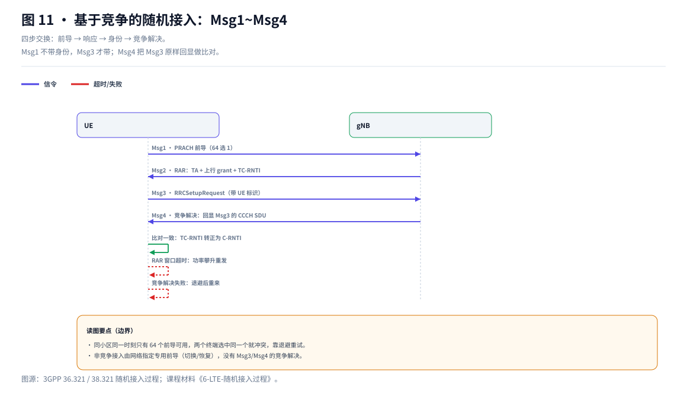
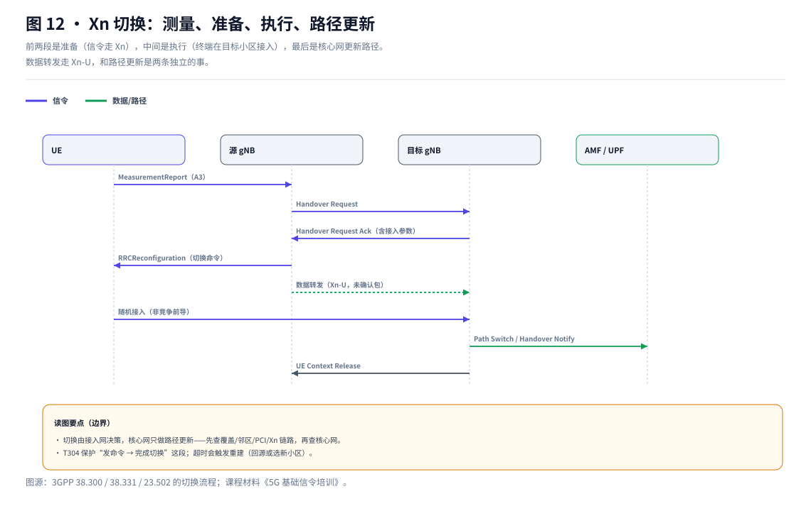

# 入网与移动性管理

终端开机后要经过“选网 → 找小区 → 随机接入 → 建 RRC → 注册到核心网 → 建默认承载/会话”才能上网；移动过程中还要“测量 → 上报 → 切换”，空闲态则靠“重选 → 位置更新”保持可达。这条链路任何一步失败，用户看到的就是“有信号但上不了网”或“移动中掉线”。

> 本篇定位：入网全流程（含 NAS 注册与默认承载）、RRC 连接管理、随机接入四步、切换与重选、TAU/RNAU 与寻呼。选网与小区选择准则去 [04-小区选择重选与PLMN](./04-小区选择重选与PLMN.md)，网元/接口去 [00-蜂窝网络架构与演进](./00-蜂窝网络架构与演进.md)，物理层资源去 [01-LTE与NR物理层](./01-LTE与NR物理层.md)，承载与 QoS 去 [05-QoS与承载](./05-QoS与承载.md)。

## 目录

- [1 一句话模型](#s1)
- [2 速览](#s2)
- [3 入网的关键步骤](#s3)
- [4 从开机到上网](#s4)
- [5 随机接入四步](#s5)
- [6 切换与重选](#s6)
- [7 状态机与定时器](#s7)
- [8 设计取舍与边界](#s8)
- [9 与相邻主题的关系](#s9)
- [名词解释](#名词解释)
- [10 参考与关联](#s10)

## 1 · 一句话模型：先同步，再接入，再注册，最后建会话

```text
选网/扫频 → 小区搜索 → 小区选择/驻留 → 随机接入 → RRC 建立
  → NAS 注册（鉴权/安全） → 默认承载/PDU 会话 → 数据
```

三个关键认知：

1. **随机接入解决“上行同步”**：终端先发前导，基站回 RAR 分配上行资源和 TA，之后才能发 RRC 消息。
2. **RRC 管空口连接，NAS 管核心网注册**：RRC 建立不等于注册成功，注册成功也不等于能上网（还要默认承载/PDU 会话）。
3. **切换是“先测量、再决策、后接入”**：终端上报邻区质量，源基站决定是否切换，目标基站准备资源，终端在新小区随机接入，最后核心网更新路径。

## 2 · 速览

| 项 | 内容 |
| --- | --- |
| 所属领域 | 无线通信/蜂窝 |
| 核心对象 | UE、eNB/gNB、MME/AMF、RRC、NAS |
| 关键过程 | 小区搜索、RACH、RRC 建立、Attach/注册、默认承载/PDU 会话、切换、TAU/RNAU、寻呼 |
| 关键状态 | RRC_IDLE/INACTIVE/CONNECTED；EMM/ECM（4G）、RM/CM（5G） |
| 关键标识 | C-RNTI、TC-RNTI、GUTI/5G-GUTI、TAI、RNA |
| 主要标准 | 3GPP 36.300/36.331/24.301、38.300/38.331/23.502 |

## 3 · 入网的关键步骤

### 3.1 小区搜索

| 步骤 | 看什么 | 得到什么 |
| --- | --- | --- |
| PSS/SSS | 同步信号 | 时频同步、物理小区 ID（PCI） |
| PBCH/MIB | 广播 | 帧定时、带宽、CORESET#0 等最基本配置 |
| SIB1 | 剩余最小系统信息（RMSI） | PLMN 列表、TAC、小区接入控制、其他 SIB 的调度 |
| SIB2 及以后 | 其他系统信息 | 重选参数、邻区频率、RACH 配置等 |

LTE 的 MIB 在 PBCH 固定资源上，SIB 在 DL-SCH 上按调度块传输；NR 的 SIB1 也叫 RMSI，部分 SIB 支持 **按需请求（on-demand SI）**——终端发前导或专用请求才下发，用于减少常播开销。

### 3.2 RRC 建立

```text
UE → gNB：RRCSetupRequest（携带初始 UE 标识、建立原因）
gNB → UE：RRCSetup（配置 SRB1）
UE → gNB：RRCSetupComplete（携带 NAS 消息，如 Registration Request）
```

LTE 对应 RRCConnectionRequest / RRCConnectionSetup / RRCConnectionSetupComplete。**SRB0（CCCH）承载建立前的信令，SRB1 建立后才走 DCCH，SRB2 在安全激活后建立**——所以“RRC 建立”这一步同时完成了 SRB1 配置和第一次 NAS 透传。

### 3.3 NAS 注册（4G Attach / 5G Registration）

```text
UE → MME/AMF：Attach Request / Registration Request
MME/AMF ↔ HSS/UDM：鉴权向量、签约
MME/AMF → UE：Security Mode Command（NAS 加密/完保）
MME/AMF → UE：Attach Accept / Registration Accept（含 GUTI、TAI 列表）
UE → MME/AMF：Attach Complete / Registration Complete
```

4G 的 Attach Request 里可以带 **ESM 容器（PDN Connectivity Request）**，网络在 Attach Accept 里一并下发默认承载的 IP 地址和 QCI——这就是 LTE“永远在线”的实现方式。5G 把注册和会话彻底分开：Registration 只解决“我在哪、我是谁”，PDU 会话另外建立。

### 3.4 默认承载与 PDU 会话

```text
4G：Attach 时建立默认 EPS 承载（一个 APN 一条），IP 由 P-GW 分配
5G：UE → SMF：PDU Session Establishment Request（DNN、S-NSSAI）
    SMF → UPF：N4 会话建立
    SMF → UE：PDU Session Establishment Accept（IP、QoS 规则）
```

只有承载/会话建立、IP 配置完成，终端才能真正收发数据。承载与 QoS 的细节见 [05-QoS与承载](./05-QoS与承载.md)。

### 3.5 4G Attach 与 5G 注册：骨架相同，差异在四处

两者的骨架完全同构，对着看一遍就够：

| 维度 | 4G Attach | 5G Registration |
| --- | --- | --- |
| 触发 | 开机、去附着后重连 | 开机、进入新 TA、周期性 |
| 身份标识 | GUTI 或 IMSI | 5G-GUTI 或 SUCI（加密的签约标识） |
| 鉴权 | MME ↔ HSS（EPS AKA） | AMF ↔ AUSF/UDM（5G AKA） |
| 承载/会话 | **Attach 里顺带建默认承载**（永远在线） | **注册与会话分开**，另发 PDU Session Establishment |
| 位置区 | TA List | TA List（+ INACTIVE 态的 RNA） |

> **推论**：5G 把“注册”和“建会话”拆开，是为了让一张卡同时连多个切片/多个 DNN，也让“只注册不建会话”的物联网终端省电。反过来，4G 的 Attach 失败往往连带“没有 IP”，而 5G 注册成功但会话失败时，现象是“已注册、无数据”——排障入口完全不同。

## 4 · 从开机到上网


**读图**：上半部分是开机入网五步（小区搜索→随机接入→RRC→NAS 注册→PDU 会话），下半部分是切换五步（测量→决策→准备→重配→接入）。先看“每一步谁和谁交互”，再看“失败会卡在哪”。

> 图源：`../images/图06-入网与切换.svg`

### 4.1 正常路径（含前置步骤）

```text
上电 → USIM 识别（读 IMSI/PLMN 列表/NV 配置）
  → PLMN 选择（自动/手动）→ 按 RAT 优先级扫频
    → 小区搜索（PSS/SSS → MIB → SIB1）
      → 小区选择（S 准则通过且 PLMN/TA 允许）→ 驻留
        → 触发业务/注册 → 随机接入 → RRC Setup
          → NAS 注册 + 鉴权 + 安全 → 默认承载/PDU 会话 → 数据
```

前置的选网与驻留条件在 [04-小区选择重选与PLMN](./04-小区选择重选与PLMN.md)；这里从“已驻留”开始。

### 4.2 异常分支

| 异常 | 现象 | 卡在哪 | 处理方向 |
| --- | --- | --- | --- |
| 搜不到网 | 无服务 | 频段/PLMN/射频 | 查频段支持、SIM、天线、RAT 获取顺序 |
| 有信号但驻留不上 | 显示限制服务 | S 准则/禁止列表/TAC | 查 RSRP/RSRQ、FPLMN、小区禁止位 |
| 随机接入失败 | 有信号但连不上 | PRACH 功率/资源/冲突 | 查覆盖、RACH 配置、preamble 冲突 |
| RRC 建立被拒 | RRC Reject | 接入控制/负载/统一接入控制 | 查小区禁止、接入等级、负载 |
| 注册失败 | 无法上网 | 鉴权/签约/AMF/MME | 查 SIM/签约/核心网、Attach Reject 原因值 |
| 有注册无 IP | 显示已注册但无数据 | 默认承载/PDU 会话失败 | 查 APN/DNN、SMF/UPF、策略 |
| 切换掉线 | 移动中中断 | 邻区/门限/回传/目标小区拒绝 | 优化覆盖/切换参数，查 Xn/NG 链路 |
| 寻呼不到 | 空闲态收不到来电 | 寻呼区域/DRX/终端休眠 | 查 TAU/RNA 更新、寻呼配置 |
| 反复重建 | 数据断续 | 无线链路失败（RLF） | 查覆盖、干扰、T310/N310 参数 |

**判断顺序**（比“逐条对现象”更快）：

| 步骤 | 先判什么 | 看什么 | 答错的后果 |
| --- | --- | --- | --- |
| ① 有没有驻留 | 服务状态、小区是否可用 | RSRP/RSRQ、S 准则、禁止列表 | 没驻留就去查注册，永远查不到 |
| ② 过没过接入控制 | RRC 是否被拒 | RRC Reject 原因、接入等级/统一接入控制 | 把“被禁止”当成“信号差”，越优化越糟 |
| ③ 卡在注册还是会话 | 4G 看 Attach，5G 看 Registration/PDU | NAS 原因值、默认承载/会话状态 | 注册失败去查 APN，方向就错了 |
| ④ 无线还是核心网 | 同一位置换终端/换卡 | 交叉验证 | 不交叉验证，容易把核心网问题归到基站 |

## 5 · 随机接入四步



**读图**：竖线是 UE 与 gNB 的生命线，横向箭头是消息。Msg1 只带前导（不带身份），Msg2 由基站用 RA-RNTI 寻址，Msg3 才带 UE 身份，Msg4 把 Msg3 的内容原样回显做竞争解决。虚线是“超时/冲突”分支。

> 图源：`../images/图11-随机接入四步.svg`

| 步骤 | 消息 | 携带什么 | 作用 |
| --- | --- | --- | --- |
| Msg1 | PRACH Preamble | 前导序列（64 个可用，分 A/B 组与非竞争组） | 告诉基站“有人要接入”，让基站估计时延 |
| Msg2 | RAR（DL-SCH，RA-RNTI 寻址） | 前导序号、TA 调整量、上行 grant、TC-RNTI | 给终端上行同步和第一块上行资源 |
| Msg3 | RRCSetupRequest / RRCReestablishmentRequest（UL-SCH） | 初始 UE 标识、建立原因；重建时带 C-RNTI | 竞争接入里唯一带身份的消息 |
| Msg4 | 竞争解决（TC-RNTI 寻址） | Msg3 的 CCCH SDU 回显（UE Contention Resolution Identity） | 终端比对一致则竞争成功，TC-RNTI 转正为 C-RNTI |

四个工程要点：

1. **前导只有 64 个**，同一时刻同一小区里两个终端选到同一个前导就冲突；冲突后靠退避重试。所以高负载时 RACH 成功率会下降。
2. **Msg3 是唯一由 Msg2 的 grant 调度的上行初传**；之后的上行初传都靠 PDCCH 上的 DCI 调度。Msg3 起就进入 HARQ。
3. **非竞争接入**由基站通过 PDCCH 指定专用前导（切换、恢复等场景），没有竞争解决；若专用前导不够，基站把 preamble index 置全 0，终端回落到竞争接入。
4. **Msg3 的内容要保存**，因为 Msg4 要回显它做竞争解决标识；这也是为什么 Msg4 之前不能认为接入成功。

**收不到 RAR 之后会发生什么**：终端不会无限重试，而是按“功率攀升 + 计数上限”循环：

```text
发前导(power = 初始功率)
  → RAR 窗口内没收到
    → 功率 += powerRampingStep，重发
      → 直到 preambleTransmissionCounter 达到上限（preambleTransMax）
        → 向 RRC 上报随机接入问题（触发 RLF 或建立失败）
```

三个后果要分清：

| 现象 | 含义 | 处理方向 |
| --- | --- | --- |
| 前导很快成功 | 覆盖与资源都够 | 无需处理 |
| 攀升到上限才成功 | 初始功率配低或路损估计偏大 | 查 preambleInitialReceivedTargetPower 与路损 |
| 攀升到上限仍失败 | 覆盖空洞、PRACH 资源冲突或基站侧问题 | 查 RSRP/干扰/PRACH 配置，别继续加功率 |

> **边界**：并非所有 RACH 失败都值得“加功率”。基站侧 PRACH 检测门限配高了，终端加到最大也没用；这时现象是“所有终端在同一小区都接不上”，而不是个别终端弱覆盖。

> **边界**：RAR 窗口、退避参数、前导分组、功率攀升步长都在 SIB 里广播，取值由运营商配置。看到“RACH 失败”先分清是**没收到 RAR**（覆盖/功率/资源）还是**竞争解决失败**（冲突/干扰）。

## 6 · 切换与重选

### 6.1 连接态切换



**读图**：四条竖线分别是 UE、源 gNB、目标 gNB、核心网（AMF/UPF）。前两段是“准备”（信令走 Xn），中间是“执行”（UE 在目标小区接入），最后是“路径更新”（核心网把 N3 隧道切到目标）。数据转发（Xn-U）与路径更新是两条独立的事。

> 图源：`../images/图12-切换三阶段.svg`

```text
UE 测量邻区 → MeasurementReport
  → 源 gNB 决策 → Handover Request（Xn）
    → 目标 gNB 接纳控制 → Handover Request Ack（含 RRC 重配参数）
      → 源 gNB 发 RRCReconfiguration（切换命令，含目标小区接入信息）
        → UE 在目标小区随机接入（可用非竞争前导）
          → RRCReconfigurationComplete
            → 目标 gNB → AMF：Path Switch / Handover Notify
              → 源 gNB 释放资源
```

**切换失败的三条去向**（先分清失败在哪一段，再决定查什么）：

| 失败点 | 典型现象 | 终端动作 | 排查对象 |
| --- | --- | --- | --- |
| T304 超时：目标小区没接上 | 切换命令后业务中断 | RRC 重建：优先回源小区，源不可用则选新小区 | 目标覆盖、PRACH 配置、切换门限 |
| 目标小区准入拒绝 | 该切不切，速率下降但不掉线 | 继续留在源小区 | 目标小区负载、接纳控制参数 |
| 空口切了、路径没更新 | 有信号但无数据 | 目标侧保持，核心网重试路径更新 | Xn/NG 链路、AMF/UPF 侧会话 |

> **推论**：前两种是“空口问题”，第三种是“核心网问题”。看到“切换后上不了网”，先看空口是否已经完成（RRC 重配完成），再看路径更新——顺序反了会在无线侧白查半天。

测量事件（LTE 与 NR 通用）：

| 事件 | 触发条件 | 典型用途 |
| --- | --- | --- |
| A1 | 服务小区好于门限 | 停止异频测量、省电 |
| A2 | 服务小区差于门限 | 启动异频/异系统测量 |
| A3 | 邻区比服务小区好一个偏移量 | 同频切换的主力事件 |
| A4 | 邻区好于门限 | 负载均衡、定向迁移 |
| A5 | 服务小区差于门限 1 且邻区好于门限 2 | 覆盖漏洞兜底 |
| A6 | 邻区比辅小区好 | 载波聚合的辅小区变更 |
| B1 | 异系统邻区好于门限 | 跨制式切换（如 NR→LTE） |
| B2 | 服务小区差于门限 3 且异系统邻区好于门限 2 | 跨制式兜底 |

> **边界**：切换由**接入网**决策，核心网只做路径更新。所以“切换失败”优先查无线侧（覆盖、邻区、PCI 冲突、Xn 链路），不要一上来就查核心网。

### 6.2 空闲态重选

| 维度 | 切换（Connected） | 重选（Idle/Inactive） |
| --- | --- | --- |
| 谁决定 | 网络（基于测量报告） | 终端（基于广播的重选参数） |
| 中断 | 有短暂中断（毫秒~百毫秒级） | 无连接，用户基本无感 |
| 触发 | 测量事件 | 小区质量/优先级/定时器 |
| 目标 | 网络指定的邻区 | 满足条件且优先级最高的小区 |
| 信令 | RRC 重配 + 随机接入 | 只在跨 TA/RNA 时才做位置更新 |

重选的判据、优先级与 S 准则见 [04-小区选择重选与PLMN](./04-小区选择重选与PLMN.md)。

### 6.3 位置更新与寻呼

| 机制 | 4G | 5G |
| --- | --- | --- |
| 位置区 | TA（Tracking Area），以 TA List 为单位分配 | TA + RNA（RAN Notification Area） |
| 位置更新 | TAU（进入新 TA 或周期性） | 注册更新（RM）+ RNAU（INACTIVE 态） |
| 谁发起寻呼 | MME（CN 寻呼） | AMF（CN 寻呼）或 NG-RAN（RAN 寻呼） |
| 省电 | DRX / eDRX / PSM | DRX / eDRX / PSM |

## 7 · 状态机与定时器

### 7.1 三层状态并排

| 层 | 4G | 5G |
| --- | --- | --- |
| NAS 注册 | EMM-DEREGISTERED / REGISTERED（含 NORMAL-SERVICE、ATTEMPTING-TO-UPDATE 等子状态） | RM-DEREGISTERED / REGISTERED |
| NAS 连接 | ECM-IDLE / CONNECTED | CM-IDLE / CONNECTED |
| AS/RRC | RRC_IDLE / RRC_CONNECTED | RRC_IDLE / RRC_INACTIVE / RRC_CONNECTED |

### 7.2 RRC 三态（重点看 5G）

| 状态 | 有 RRC 连接 | 上下文在哪 | 移动性 | 典型动作 |
| --- | --- | --- | --- | --- |
| RRC_IDLE | 无 | 无（只有 NAS 注册） | 终端重选 + CN 寻呼 | 注册、寻呼、重选 |
| RRC_INACTIVE | 挂起 | UE 与 NG-RAN 都保存 AS 上下文 | 终端重选 + RAN 寻呼（RNA 内不通知） | 快速恢复、小包传输（SDT） |
| RRC_CONNECTED | 有 | UE 与 NG-RAN | 网络控制切换 | 测量、切换、数据 |

INACTIVE 的价值是“省信令但不丢上下文”：恢复（Resume）比重新建立快，适合小包和低时延；代价是 RAN 要维护上下文和 RNA。

### 7.3 关键定时器

| 定时器 | 管什么 | 超时后果 |
| --- | --- | --- |
| T300 | RRC 建立请求 → 收到 Setup | 重试/选别的频点，次数用尽则上报失败 |
| T301 | 发重建请求 → 收到重建/建立 | 转 IDLE，重新选小区 |
| T304 | 收到切换命令 → 切换完成 | 触发重建（回源或选新小区） |
| T310 | 物理层失步 → 判定无线链路失败 | 触发 RLF 流程（重建） |
| T311 | RLF 后选小区 | 超时转 IDLE |
| T319 | 5G 恢复请求（Resume） | 回退到建立流程 |
| T3410 | 4G Attach | 重发 Attach，计数用尽则失败 |
| T3412 | 周期性 TAU | 周期位置更新 |
| T3402 | Attach 失败后的禁止期 | 期间不再尝试 Attach（影响“一直无服务”） |
| T380 | 5G 周期性 RNAU | 周期位置更新 |

> 具体取值在 36.331 / 38.331 的定时器常量表里，由网络通过 SIB 或专用信令下发；现网差异很大，排障时必须看实际配置而不是背默认值。

### 7.4 两个定时器怎么一起看

T3412（周期 TAU/注册）和 T3402（失败后的禁止期）经常被混为一谈，其实一个管“正常心跳”，一个管“失败冷却”：

| 定时器 | 什么时候启动 | 超时后 | 误判 |
| --- | --- | --- | --- |
| T3412 | 注册成功后 | 主动做一次周期位置更新 | 配得太长，网络侧寻呼不到人；太短则耗电、增信令 |
| T3402 | Attach/注册失败 | 进入禁止期，期间不再尝试 | 现场“一直无服务”可能是冷却期没到，不是没覆盖 |

> **推论**：设备重启后仍长时间不注册，先看是不是落在 T3402 的禁止期里；基站侧看不到任何请求，容易被误判成“终端死机”。

## 8 · 设计取舍与边界

### 8.1 注册与会话分离

注册是“告诉网络我在哪、我是谁”，会话/承载是“建立一条数据通道”。分离的好处：终端可以注册但不建会话（省资源），也可以建多个会话（多 DNN/切片）。4G 把默认承载塞进 Attach 里，是为了“永远在线”；5G 拆开，是为了切片和多样化会话。

### 8.2 为什么要有 INACTIVE

| 方案 | 信令开销 | 恢复时延 | 上下文 |
| --- | --- | --- | --- |
| 回 IDLE | 低 | 高（重新建立+注册） | 丢 |
| 保持 CONNECTED | 高（切换、测量、心跳） | 低 | 保留 |
| INACTIVE | 中 | 中 | 保留（RAN 侧） |

### 8.3 常见误判

1. **“有信号就能上网”**：注册、鉴权、承载/会话、IP 配置任何一步失败都不通。
2. **“RRC 建立成功就注册成功”**：RRC 只是空口连接，NAS 注册是另一层。
3. **“切换是核心网决定的”**：接入网基于测量决策，核心网只做路径更新。
4. **“RRC_INACTIVE 等于断网”**：它保留上下文，能快速恢复。
5. **“寻呼不到是基站坏了”**：可能是寻呼区域、DRX/PSM、终端休眠或信号问题。
6. **“驻留成功就一定能接入”**：还要过接入控制（AC barring / 统一接入控制）和小区负载。
7. **“切换失败一定是覆盖差”**：也可能是 PCI 冲突、邻区漏配、Xn 链路断、目标小区准入拒绝。

## 9 · 与相邻主题的关系

| 相邻主题 | 关系 |
| --- | --- |
| [00-蜂窝网络架构与演进](./00-蜂窝网络架构与演进.md) | 网元与接口（S1/NG/Xn、MME/AMF） |
| [01-LTE与NR物理层](./01-LTE与NR物理层.md) | 小区搜索/PRACH/物理信道/功控 |
| [03-层二协议与调度](./03-层二协议与调度.md) | RRC 之下的 MAC/RLC/PDCP，SRB/DRB |
| [04-小区选择重选与PLMN](./04-小区选择重选与PLMN.md) | 选网、S 准则、重选 |
| [05-QoS与承载](./05-QoS与承载.md) | 默认承载、专用承载、QoS 流 |
| [01-射频与天线/00-无线传播与射频基础](../01-射频与天线/00-无线传播与射频基础.md) | 覆盖/信号质量 |
| [05-无线测试与优化/00-无线覆盖与干扰优化](../05-无线测试与优化/00-无线覆盖与干扰优化.md) | 现场掉线/切换问题定位 |
| [20-平台与系统](../../../../20-平台与系统/.readme.md) | 5G 模组/拨号实现（QMI/NAS 接口） |

一句话：**入网是“同步 → 接入 → 注册 → 建会话”的串联，任何一环失败都会表现为“上不了网”。**

## 名词解释

> 缩写给出英文全称；非缩写用“—”表示。

| 术语 | 英文全称 | 解释 |
| --- | --- | --- |
| RRC | Radio Resource Control | 无线资源控制。 |
| NAS | Non-Access Stratum | 非接入层，UE 与核心网之间的信令。 |
| AS | Access Stratum | 接入层，UE 与基站之间的协议。 |
| RACH | Random Access Channel | 随机接入信道。 |
| PRACH | Physical Random Access Channel | 物理随机接入信道。 |
| RAR | Random Access Response | 随机接入响应（Msg2）。 |
| TA | Timing Advance | 定时提前量；也指 Tracking Area（跟踪区），看上下文。 |
| TAI | Tracking Area Identity | 跟踪区标识。 |
| TAU | Tracking Area Update | 跟踪区更新。 |
| RNA | RAN Notification Area | RAN 通知区（5G INACTIVE 态）。 |
| RNAU | RAN Notification Area Update | RNA 更新。 |
| SRB | Signalling Radio Bearer | 信令无线承载（SRB0/1/2）。 |
| DRB | Data Radio Bearer | 数据无线承载。 |
| C-RNTI | Cell Radio-Network Temporary Identifier | 小区无线网络临时标识。 |
| TC-RNTI | Temporary C-RNTI | 随机接入过程中的临时 C-RNTI。 |
| RA-RNTI | Random Access RNTI | 随机接入响应的寻址标识。 |
| GUTI | Globally Unique Temporary Identifier | 全球唯一临时标识。 |
| 5G-GUTI | 5G Globally Unique Temporary Identifier | 5G 的临时标识。 |
| SUCI | Subscription Concealed Identifier | 签约隐藏标识（5G 用公钥加密的长期身份）。 |
| EMM | EPS Mobility Management | 4G 移动性管理子层。 |
| ESM | EPS Session Management | 4G 会话管理子层。 |
| ECM | EPS Connection Management | 4G 连接管理状态。 |
| RM | Registration Management | 5G 注册管理。 |
| CM | Connection Management | 5G 连接管理。 |
| PDU | Protocol Data Unit | 协议数据单元；5G 会话单位。 |
| DNN | Data Network Name | 数据网络名称（5G 的 APN）。 |
| APN | Access Point Name | 接入点名称。 |
| PLMN | Public Land Mobile Network | 公共陆地移动网络。 |
| PCI | Physical Cell Identity | 物理小区标识。 |
| RLF | Radio Link Failure | 无线链路失败。 |
| DRX | Discontinuous Reception | 非连续接收。 |
| PSM | Power Saving Mode | 省电模式。 |
| SDT | Small Data Transmission | 小包传输（INACTIVE 态直接传）。 |
| MIB | Master Information Block | 主信息块。 |
| SIB | System Information Block | 系统信息块。 |
| RMSI | Remaining Minimum System Information | 剩余最小系统信息（即 SIB1）。 |
| DCI | Downlink Control Information | 下行控制信息。 |

## 10 · 参考与关联

**标准**

- 3GPP TS 36.300 / 38.300：E-UTRAN / NR 总体描述（流程与状态）。
- 3GPP TS 36.331 / 38.331：RRC 协议（状态、定时器、测量事件）。
- 3GPP TS 24.301：4G NAS（EMM/ESM）。
- 3GPP TS 24.501：5G NAS（RM/CM）。
- 3GPP TS 23.502：5G 系统流程（注册、PDU 会话、切换）。
- 3GPP TS 36.321 / 38.321：MAC（随机接入过程）。

**关联**

- [00-蜂窝网络架构与演进](./00-蜂窝网络架构与演进.md)
- [01-LTE与NR物理层](./01-LTE与NR物理层.md)
- [03-层二协议与调度](./03-层二协议与调度.md)
- [04-小区选择重选与PLMN](./04-小区选择重选与PLMN.md)
- [05-无线测试与优化/00-无线覆盖与干扰优化](../05-无线测试与优化/00-无线覆盖与干扰优化.md)
- [20-平台与系统](../../../../20-平台与系统/.readme.md)

---

> **本篇定位**：蜂窝入网、注册、承载/会话建立、随机接入、切换与位置更新的流程与状态；不展开具体信令字段与厂商日志。
> **素材来源**：`studyspace/1.知识体系/9.lte5g相关/lte-从入网流程开始/lte 入网.md`、`lte/5g/中文资料/5G.md`、`lte/5g/3GPP官方资料/NR概述.md`、`lte/LTE/6-LTE-随机接入过程.pptx`、`lte/LTE/3-LTE-RRC概述.pptx`、`lte/LTE/2-LTE-NAS概述.pptx`、`lte/5g/中文资料/5G基础信令培训.pptx`（课程材料）。素材为二手整理，流程已按 38.300/38.331/23.502 公开结构核对。
> **待验证**：定时器取值、RACH 配置、切换门限、测量事件偏移与运营商策略相关；Msg2/Msg3 的具体字段以 36.321/38.321 对应版本为准。
