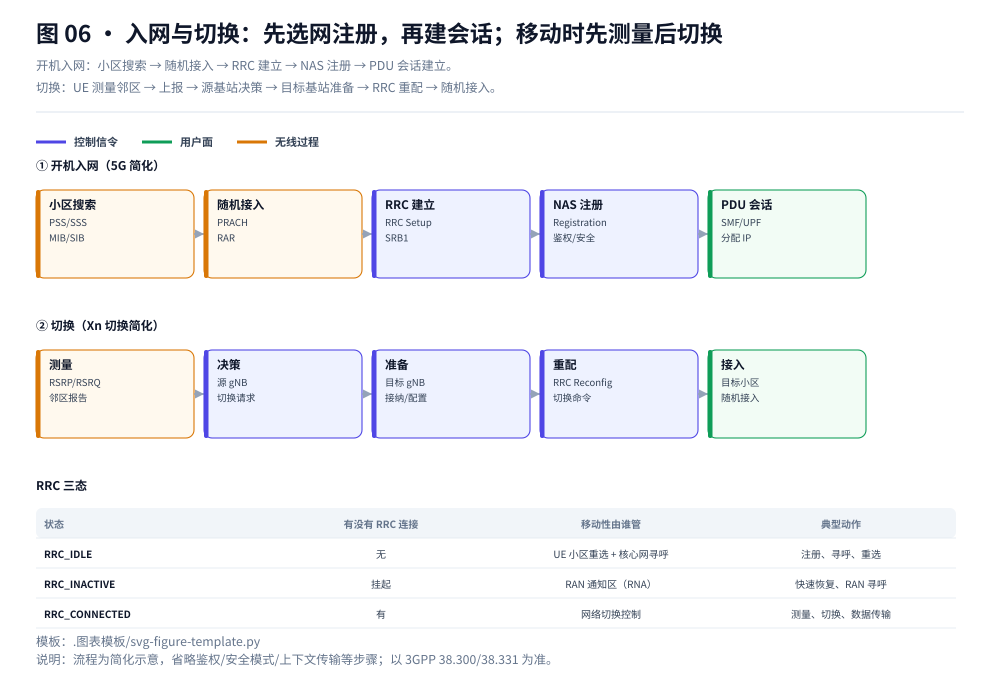

# 入网与移动性管理

终端开机后要经过“找小区 → 随机接入 → 建立 RRC → 注册到核心网 → 建立 PDU 会话”才能上网；移动过程中还要“测量 → 上报 → 切换”。这条链路任何一步失败，用户看到的就是“有信号但上不了网”或“移动中掉线”。

> 本篇定位：小区搜索、随机接入、RRC 建立、NAS 注册、PDU 会话、RRC 三态、切换与寻呼。网元/接口去 [00-蜂窝网络架构与演进](./00-蜂窝网络架构与演进.md)，物理层资源去 [01-LTE与NR物理层](./01-LTE与NR物理层.md)。

## 目录

- [1 一句话模型](#s1)
- [2 速览](#s2)
- [3 入网的关键步骤](#s3)
- [4 从开机到上网](#s4)
- [5 状态机与定时器](#s5)
- [6 设计取舍与边界](#s6)
- [7 与相邻主题的关系](#s7)
- [名词解释](#名词解释)
- [8 参考与关联](#s8)

## 1 · 一句话模型：先同步，再接入，再注册，最后建会话

```text
小区搜索 → 随机接入 → RRC 建立 → NAS 注册 → PDU 会话 → 数据
                                      ↑
                                  鉴权/安全
```

三个关键认知：

1. **随机接入解决“上行同步”**：终端先发前导，基站回 RAR 分配上行资源，之后才能发 RRC 消息。
2. **RRC 管空口连接，NAS 管核心网注册**：RRC 建立不等于注册成功，注册成功也不等于能上网（还要 PDU 会话）。
3. **切换是“先测量、再决策、后接入”**：终端上报邻区质量，源基站决定是否切换，目标基站准备资源，终端在新小区随机接入。

## 2 · 速览

| 项 | 内容 |
| --- | --- |
| 所属领域 | 无线通信/蜂窝 |
| 核心对象 | UE、gNB/eNB、AMF/MME、RRC、NAS |
| 关键过程 | 小区搜索、RACH、RRC 建立、注册、PDU 会话、切换 |
| 关键状态 | RRC_IDLE/INACTIVE/CONNECTED；RM/CM 注册/连接 |
| 主要标准 | 3GPP 38.300、38.331、23.502 |

## 3 · 入网的关键步骤

### 3.1 小区搜索

| 步骤 | 看什么 | 得到什么 |
| --- | --- | --- |
| PSS/SSS | 同步信号 | 时频同步、物理小区 ID |
| PBCH/MIB | 广播 | 帧定时、部分系统配置 |
| SIB | 系统信息 | 接入参数、邻区、PLMN |

### 3.2 随机接入（RACH）

```text
UE 发前导（Preamble）
  → gNB 回 RAR（Random Access Response）
    → UE 发 RRC 请求（Msg3）
      → 竞争解决（Msg4）
```

竞争接入可能冲突；冲突时终端退避重试。非竞争接入由基站分配专用前导，用于切换等场景。

### 3.3 RRC 建立

RRC 建立后，终端有了 SRB1，可以传 NAS 消息。RRC 连接是“空口连接”，不等于核心网注册。

### 3.4 NAS 注册

```text
UE → AMF：Registration Request
AMF ↔ UDM：鉴权/签约
AMF → UE：Registration Accept
```

注册成功后，终端处于 RM-REGISTERED；如果没有数据，可能进入 CM-IDLE。

### 3.5 PDU 会话

```text
UE → SMF：PDU Session Establishment Request
SMF → UPF：建立 N4 会话
SMF → UE：分配 IP/ QoS 规则
```

只有 PDU 会话建立、IP 配置完成，终端才能真正上网。

## 4 从开机到上网



**读图**：上半部分是开机入网五步（小区搜索→随机接入→RRC→NAS 注册→PDU 会话），下半部分是切换五步（测量→决策→准备→重配→接入）。先看“每一步谁和谁交互”，再看“失败会卡在哪”。

> 图源：`images/图06-入网与切换.svg`

### 4.1 正常路径

```text
开机 → 选 PLMN → 小区搜索 → 随机接入 → RRC Setup
  → NAS Registration → 鉴权/安全 → PDU Session → 数据
```

### 4.2 切换路径

```text
UE 测量邻区 → Measurement Report
  → 源 gNB 决策 → Handover Request
    → 目标 gNB 接纳/准备
      → 源 gNB 发 RRC Reconfiguration（切换命令）
        → UE 在目标小区随机接入
          → 路径更新（核心网）
```

### 4.3 异常分支

| 异常 | 现象 | 卡在哪 | 处理方向 |
| --- | --- | --- | --- |
| 搜不到网 | 无服务 | 频段/PLMN/射频 | 查频段支持、SIM、天线 |
| 随机接入失败 | 有信号但连不上 | PRACH 功率/资源/冲突 | 查覆盖、RACH 配置 |
| RRC 建立失败 | 连接被拒 | 接入控制/负载 | 查小区负载/禁止列表 |
| 注册失败 | 无法上网 | 鉴权/签约/AMF | 查 SIM/签约/核心网 |
| PDU 会话失败 | 有注册无 IP | DNN/UPF/策略 | 查 APN/DNN、SMF/UPF |
| 切换掉线 | 移动中断 | 邻区/门限/回传 | 优化覆盖/切换参数 |
| 寻呼不到 | 空闲态收不到来电 | 寻呼区域/DRX | 查 TAU/寻呼配置 |

## 5 状态机与定时器

### 5.1 RRC 三态

| 状态 | 有 RRC 连接 | 移动性 | 典型动作 |
| --- | --- | --- | --- |
| RRC_IDLE | 无 | UE 小区重选 + 核心网寻呼 | 注册、寻呼、重选 |
| RRC_INACTIVE | 挂起 | RAN 通知区（RNA） | 快速恢复、RAN 寻呼 |
| RRC_CONNECTED | 有 | 网络控制切换 | 测量、切换、数据 |

### 5.2 关键定时器

| 定时器/机制 | 作用 | 失败后果 |
| --- | --- | --- |
| RAR 窗口 | 等随机接入响应 | 超时重发前导 |
| 竞争解决定时器 | 等 Msg4 | 判定冲突，退避重试 |
| T300/T301 | RRC 建立/重配 | 超时回退/重建 |
| 周期性注册更新 | 保持注册有效 | 过期可能被去注册 |
| 寻呼 DRX | 空闲态省电 | 寻呼周期越长，响应越慢 |
| 切换超时 | 切换完成保护 | 失败则重建/回退 |

> 具体定时器名称/取值以 3GPP 38.331 与运营商配置为准；这里只给工程理解。

## 6 设计取舍与边界

### 6.1 注册与 PDU 会话分离

注册是“告诉网络我在哪、我是谁”，PDU 会话是“建立一条数据通道”。分离的好处是：终端可以注册但不建会话（省资源），也可以建多个会话（多 DNN/切片）。

### 6.2 切换 vs 重选

| 维度 | 切换（Connected） | 重选（Idle） |
| --- | --- | --- |
| 谁决定 | 网络 | 终端 |
| 中断 | 有短暂中断 | 无连接，感知弱 |
| 触发 | 测量报告 | 小区质量/优先级 |
| 目标 | 邻区 | 满足条件的最高优先级小区 |

### 6.3 常见误判

1. **“有信号就能上网”**：注册、鉴权、PDU 会话、IP 配置任何一步失败都不通。
2. **“RRC 建立成功就注册成功”**：RRC 只是空口连接，NAS 注册是另一层。
3. **“切换是核心网决定的”**：接入网基于测量决策，核心网参与路径更新。
4. **“RRC_INACTIVE 等于断网”**：它保留上下文，能快速恢复，适合小包/低时延。
5. **“寻呼不到是基站坏了”**：可能是寻呼区域、DRX、终端休眠/信号问题。

## 7 · 与相邻主题的关系

| 相邻主题 | 关系 |
| --- | --- |
| [00-蜂窝网络架构与演进](./00-蜂窝网络架构与演进.md) | 网元与接口 |
| [01-LTE与NR物理层](./01-LTE与NR物理层.md) | 小区搜索/PRACH/物理信道 |
| [01-射频与天线/00-无线传播与射频基础](../01-射频与天线/00-无线传播与射频基础.md) | 覆盖/信号质量 |
| [05-无线测试与优化/00-无线覆盖与干扰优化](../05-无线测试与优化/00-无线覆盖与干扰优化.md) | 现场掉线/切换问题定位 |
| [20-平台与系统](../../../../20-平台与系统/.readme.md) | 5G 模组/拨号实现 |

一句话：**入网是“同步 → 接入 → 注册 → 建会话”的串联，任何一环失败都会表现为“上不了网”。**

## 名词解释

> 缩写给出英文全称；非缩写用“—”表示。

| 术语 | 英文全称 | 解释 |
| --- | --- | --- |
| RRC | Radio Resource Control | 无线资源控制。 |
| NAS | Non-Access Stratum | 非接入层，核心网信令。 |
| AS | Access Stratum | 接入层。 |
| RACH | Random Access Channel | 随机接入信道。 |
| PRACH | Physical Random Access Channel | 物理随机接入信道。 |
| RAR | Random Access Response | 随机接入响应。 |
| SRB | Signaling Radio Bearer | 信令无线承载。 |
| DRB | Data Radio Bearer | 数据无线承载。 |
| PDU | Protocol Data Unit | 协议数据单元。 |
| DNN | Data Network Name | 数据网络名称（5G 的 APN）。 |
| APN | Access Point Name | 接入点名称。 |
| TAU | Tracking Area Update | 跟踪区更新。 |
| RNA | RAN Notification Area | RAN 通知区。 |
| DRX | Discontinuous Reception | 非连续接收。 |
| PLMN | Public Land Mobile Network | 公共陆地移动网络。 |

## 8 · 参考与关联

**标准**

- 3GPP TS 38.300：NR 总体描述（RRC 状态、流程）。
- 3GPP TS 38.331：RRC 协议。
- 3GPP TS 23.502：5G 系统流程（注册、PDU 会话、切换）。
- 3GPP TS 36.300：E-UTRAN 总体描述。

**关联**

- [00-蜂窝网络架构与演进](./00-蜂窝网络架构与演进.md)
- [01-LTE与NR物理层](./01-LTE与NR物理层.md)
- [05-无线测试与优化/00-无线覆盖与干扰优化](../05-无线测试与优化/00-无线覆盖与干扰优化.md)
- [20-平台与系统](../../../../20-平台与系统/.readme.md)

---

> **本篇定位**：蜂窝入网、注册、PDU 会话与切换的流程与状态；不展开具体信令字段与厂商日志。
> **素材来源**：`studyspace/1.知识体系/9.lte5g相关/lte/5g/中文资料/5G.md` 的接入设计/RRC 状态、`lte/5g/3GPP官方资料/NR概述.md` 的 RRC/系统信息；其余按 3GPP 公开知识补写。
> **待验证**：定时器取值、RACH 配置、切换门限与运营商策略相关，需以现网配置为准。
