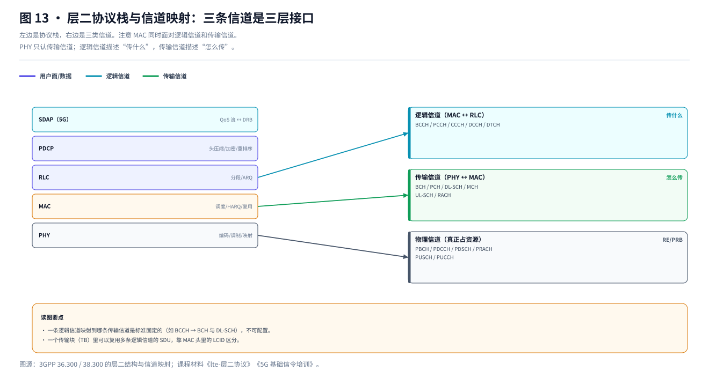
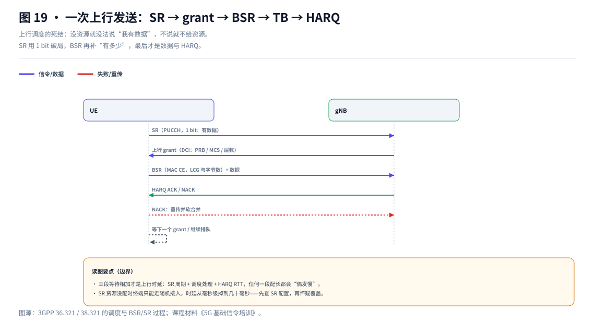

# 层二协议与调度

层二（L2）是“空口资源怎么分给多个用户、数据怎么可靠又高效地送出去”的地方：MAC 负责调度与 HARQ，RLC 负责分段与 ARQ，PDCP 负责头压缩、加密与重排序，5G 再加一层 SDAP 做 QoS 流到无线承载的映射。物理层只管“一个时频网格能装多少比特”，L2 决定“这些比特归谁、按什么顺序、错了怎么补”。

> 本篇定位：逻辑/传输/物理三层信道映射、MAC 调度与 HARQ、RLC 三种模式与 ARQ、PDCP 功能、SDAP 与 QoS 映射、层二数据流与定时器。物理层资源去 [01-LTE与NR物理层](./01-LTE与NR物理层.md)，承载与 QoS 参数去 [05-QoS与承载](./05-QoS与承载.md)，RRC 与入网去 [02-入网与移动性管理](./02-入网与移动性管理.md)。

## 目录

- [1 一句话模型](#s1)
- [2 速览](#s2)
- [3 三层信道与映射](#s3)
- [4 MAC：调度与 HARQ](#s4)
- [5 RLC：三种模式](#s5)
- [6 PDCP 与 SDAP](#s6)
- [7 层二数据流](#s7)
- [8 状态机与定时器](#s8)
- [9 设计取舍与边界](#s9)
- [10 与相邻主题的关系](#s10)
- [名词解释](#名词解释)
- [11 参考与关联](#s11)

## 1 · 一句话模型：L2 是三段流水线 + 一个调度器

```text
IP 包 → SDAP（映射 QoS 流到 DRB）
      → PDCP（头压缩/加密/编号/重排序/复制）
      → RLC（分段/级联/ARQ）
      → MAC（复用成 TB、调度、HARQ）
      → PHY（编码调制，走传输信道）
```

三个关键认知：

1. **三层信道是三个“接口”**：逻辑信道（MAC↔RLC，管信息类型）、传输信道（PHY↔MAC，管传输方式）、物理信道（真正占资源）。
2. **两级重传分工不同**：HARQ 在 MAC/PHY，快但只能软合并；ARQ 在 RLC，慢但能按序号补洞。两者叠加是因为空口误码率远高于有线。
3. **调度器是 L2 的大脑**：它每个 TTI/时隙看一遍“谁有数据、信道怎么样、QoS 什么级别”，输出 DCI 告诉终端用哪块资源、什么 MCS。

## 2 · 速览

| 项 | 内容 |
| --- | --- |
| 所属领域 | 无线通信/蜂窝层二 |
| 核心子层 | MAC、RLC、PDCP；5G 增加 SDAP |
| 关键单位 | SDU/PDU、TB、逻辑信道/传输信道、DRB/SRB、QoS 流 |
| 关键机制 | 动态调度、半静态调度、HARQ、ARQ、头压缩、加密、复制 |
| 关键参数 | MCS、PRB 分配、HARQ 进程数、RLC 模式、PDCP SN 长度 |
| 主要标准 | 3GPP 36.321/322/323、38.321/322/323、37.324（SDAP） |

## 3 · 三层信道与映射



**读图**：左侧是协议栈（PHY→MAC→RLC→PDCP→SDAP），中间是三层信道（传输/逻辑/物理），右侧标出每层的服务接入点（SAP）。箭头表示“哪一层把什么交给哪一层”。注意物理层只认传输信道，MAC 是唯一同时面对传输信道和逻辑信道的层。

> 图源：`../images/图13-层二协议栈与信道映射.svg`

### 3.1 两种信道、两种视角

| 信道类型 | 定义 | 谁和谁的接口 | 例子 |
| --- | --- | --- | --- |
| 逻辑信道 | 传的是**什么类型**的信息 | MAC ↔ RLC | BCCH、PCCH、CCCH、DCCH、DTCH |
| 传输信道 | 信息**怎么传**（有无调度、有无广播） | PHY ↔ MAC | BCH、PCH、DL-SCH、MCH、UL-SCH、RACH |

### 3.2 逻辑信道

| 信道 | 全称 | 方向 | 用途 |
| --- | --- | --- | --- |
| BCCH | Broadcast Control Channel | 下行 | 系统信息广播 |
| PCCH | Paging Control Channel | 下行 | 寻呼 |
| CCCH | Common Control Channel | 双向 | 无 RRC 连接时的控制信息（如 Msg3） |
| DCCH | Dedicated Control Channel | 双向 | 有 RRC 连接时的专用控制信息 |
| DTCH | Dedicated Traffic Channel | 双向 | 用户数据 |
| MCCH / MTCH | Multicast Control / Traffic Channel | 下行 | 多播控制/业务（LTE MBMS） |

### 3.3 映射关系

| 逻辑信道 | 下行映射 | 上行映射 |
| --- | --- | --- |
| BCCH | BCH（MIB）+ DL-SCH（SIB） | — |
| PCCH | PCH | — |
| CCCH | DL-SCH | UL-SCH |
| DCCH | DL-SCH | UL-SCH |
| DTCH | DL-SCH | UL-SCH |

> 传输信道 **RACH** 映射到物理信道 **PRACH**；它是唯一“先接入、后调度”的传输信道，其余上行都走 UL-SCH。

NR 去掉了 PMCH/PCFICH/PHICH 这类 LTE 专用信道，映射主干（BCCH/PCCH/CCCH/DCCH/DTCH ↔ BCH/PCH/DL-SCH/UL-SCH/RACH）保持不变。

## 4 · MAC：调度与 HARQ

### 4.1 MAC 的功能

| 功能 | 说明 | 边界 |
| --- | --- | --- |
| 逻辑/传输信道映射 | 决定一条逻辑信道的数据进哪个传输信道 | 映射由标准固定，不可配 |
| 复用/解复用 | 把多条逻辑信道的 SDU 拼成一个 TB（MAC PDU） | 拼接以字节对齐，靠 LCID 区分来源 |
| 调度信息上报 | BSR（有多少数据待发）、SR（请求上行资源） | BSR 有周期和触发条件 |
| HARQ | 快速重传与软合并 | 进程数有限，HARQ 堵住会拖慢整个 UE |
| 动态调度 | 每个 TTI 按需分配 | 控制开销大 |
| 逻辑信道优先级（LCP） | 按优先级和 PBR 决定先装谁 | 高优先级饿死低优先级是设计内行为 |
| 随机接入 | 前导、RAR、Msg3/4 | 详见 [02-入网与移动性管理](./02-入网与移动性管理.md) |

### 4.2 调度器怎么工作

```text
每个调度周期：
  1. 收集输入：CSI（信道质量）、BSR/SR（有多少数据）、QoS（QCI/5QI、GBR）、缓存状态
  2. 排序：按优先级/公平性/时延预算选 UE
  3. 分配：频域 PRB + 时域符号 + MCS + 层数
  4. 下发：PDCCH 上的 DCI（上行 grant / 下行 assignment）
```

| 调度方式 | 怎么做 | 适用 |
| --- | --- | --- |
| 动态调度 | 每个 TTI 发 DCI | 普通数据业务 |
| 半静态调度（SPS） | 周期性预配置资源，必要时激活/释放 | VoIP 等小包、周期业务，省 PDCCH |
| 非连续调度/DRX | 终端按周期醒来听 PDCCH | 省电 |

调度器的三个现实约束：

1. **控制信道容量**：每个调度的 UE 都要占 PDCCH 资源，用户数多时“调度不进去”往往不是没 PRB，而是没 CCE。
2. **HARQ 进程**：一个 UE 的并行 HARQ 进程有限，往返时延（RTT）内进程用满就得等。
3. **QoS 与公平性**：GBR 业务要保底速率，non-GBR 才能谈公平；调度策略（PF、RR、Max C/I）直接决定“边缘用户”的体验。

#### 4.2.1 谁告诉调度器“有数据要发”

上行调度有个死结：终端要发数据得先有上行资源，而上行资源由基站调度——**没资源就没法说“我有数据”，不说就不会给资源**。解开它靠两条通道：

| 通道 | 走哪 | 说什么 | 什么时候用 | 边界 |
| --- | --- | --- | --- | --- |
| SR（调度请求） | PUCCH 专用资源 | 只有 1 bit：有 / 没有 | 手上没有上行 grant 时 | 只说“有”，不说“多少”；SR 资源没配时只能改用随机接入 |
| BSR（缓存状态报告） | MAC CE，占上行 grant | 哪个逻辑信道组（LCG）、多少字节 | 已经有 grant 时 | 按 LCG 汇总，粒度粗；grant 装不下时发 padding BSR |

所以一次上行发送的真实顺序是 **SR → grant → BSR → 数据**。反过来说，SR 资源配得少或没配，终端就得走 RACH，时延从毫秒级掉到几十毫秒——**“偶发小包时延大”经常不是覆盖问题，是 SR 配置问题**。



**读图**：纵向是时间，UE 与 gNB 两条生命线。注意 grant 之前没有任何上行数据，BSR 必须搭在 grant 上才能发；HARQ 的 ACK 又占一个往返。三步各有自己的等待，叠起来就是“上行时延”。

> 图源：`../images/图19-上行调度时序.svg`

#### 4.2.2 有了资源，先装谁：LCP

MAC 在每个 grant 里按逻辑信道优先级装包，参数是 **优先级 + PBR（优先比特率）+ BSD（桶大小）**：

| 参数 | 作用 | 边界与误判 |
| --- | --- | --- |
| priority | 谁先装 | 高优先级持续有数据时低优先级会被饿死——这是设计内行为，不是故障 |
| PBR | 每 TTI 至少给多少 | 各信道 PBR 之和大于 grant 时，按优先级顺序分，排在后面的拿不到保底 |
| BSD | 允许多长时间累积令牌 | 配大了会让低优先级攒出“欠账”，突发时反过来抢占高优先级 |

> **推论**：一条低优先级承载长期拿不到资源，先别怀疑调度器“坏了”，先算它的 PBR 是否被高优先级之和压住。这是配置问题，不是算法问题。

#### 4.2.3 “调度不进去”怎么判

| 步骤 | 问什么 | 看什么 | 答错的后果 |
| --- | --- | --- | --- |
| ① 有没有资源 | 小区 PRB 用满了吗 | 每 TTI 的 PRB 利用率 | 误判成“控制信道不足”，去调聚合等级，白忙 |
| ② 有没有控制信道 | PDCCH 的 CCE 够吗 | 聚合等级、同时调度用户数 | 明明有 PRB 却调度不进去，会误判成“终端问题” |
| ③ 终端等不等得起 | HARQ 进程是否用满、SR 是否及时 | HARQ 进程占用、SR 周期 | 把“排队”当成“丢包”，去查覆盖 |

### 4.3 HARQ 与 ARQ 的分工

| 维度 | HARQ | ARQ（RLC AM） |
| --- | --- | --- |
| 位置 | MAC/PHY | RLC |
| 粒度 | 传输块/码块 | RLC PDU/分段 |
| 反馈 | ACK/NACK（PHICH 或 PDCCH 上的 DCI） | RLC 状态报告 |
| 重传方式 | 软合并（Chase/IR），可自适应改冗余版本 | 重新分段/重传缺失部分 |
| 时延 | 一个 HARQ RTT（几 ms~几十 ms） | 更慢，依赖状态报告周期 |
| 残留错误 | 交给 ARQ 补 | 交给上层（TCP）或丢弃 |

**为什么需要两层**：HARQ 快但反馈信道有限、进程有限，不能保证零错；ARQ 慢但能补长洞。没有 HARQ，TCP 会把空口误码当成拥塞，吞吐塌方；没有 ARQ，残留错误会一路传到 IP 层。

### 4.4 进程、RTT 与软合并

HARQ 不是“发一个等一个”，而是开多个并行进程轮流发：

| 概念 | 含义 | 影响 |
| --- | --- | --- |
| HARQ 进程（process） | 一个“发—等—重发”的状态机 | 进程数决定能同时挂多少块数据 |
| HARQ RTT | 同一进程两次使用的间隔 | RTT 内若只有一个进程，链路就空等 |
| 软合并 | 重传的副本与初传在解码前合并 | 合并增益让“多次弱信号”抵得上“一次强信号” |
| Chase 合并 | 每次重传相同冗余版本 | 实现简单，增益有限 |
| 增量冗余（IR） | 每次重传不同冗余版本 | 增益更高，需要更多缓存 |

LTE 与 NR 的差别：LTE 的**上行 HARQ 是同步的**（重传时机由时序固定，靠 PHICH 指示），下行是异步自适应；NR 上下行都改成**异步自适应**，重传时机由 DCI 指定。

> **推论**：LTE 上行同步 HARQ 的好处是省信令，代价是“重传必须卡在固定时刻”，TDD 配比一变就要重算时序；NR 改成异步，就是为了适配灵活帧结构和自包含时隙。
> **待验证**：具体进程数与 RTT 取值随参数集、双工方式和终端能力变化，以 36.321/38.321 对应版本为准。


## 5 · RLC：三种模式

| 模式 | 有无确认 | 典型承载 | 适用 |
| --- | --- | --- | --- |
| TM（Transparent Mode） | 无 | BCCH、PCCH、CCCH | 不需要分段/重传的广播与接入消息 |
| UM（Unacknowledged Mode） | 无 | VoIP、部分 SRB | 时延敏感、可容忍少量丢失 |
| AM（Acknowledged Mode） | 有（ARQ） | 普通数据 DRB、SRB1/2 | 要求可靠交付 |

RLC 的功能（AM 为主）：

| 功能 | 说明 | 边界 |
| --- | --- | --- |
| SDU 分段/级联 | 按 MAC 给的 grant 大小切分 | 级联只在 LTE；NR 不级联 |
| 重分段（仅 AM） | 重传时按新 grant 再切 | 重分段会改变 PDU 边界，接收端必须能重组 |
| 按序递交 | UM/AM 维护序号，AM 还做重复检测 | 按序递交会把“一个包丢了”传导成“后面全等” |
| ARQ 重传 | 基于状态报告（STATUS PDU），可轮询（poll） | 窗口满时停发，等报告 |
| SDU 丢弃 | 超时或上层取消 | 丢弃要通知对端，否则对端一直在等 |
| 重建 | 切换/重建时处理未完成的数据 | 重建会重置状态，未确认数据要靠 PDCP 兜底 |

AM 的可靠交付靠三件套：

| 机制 | 作用 | 边界与误判 |
| --- | --- | --- |
| 发送窗口 | 限制“已发未确认”的 PDU 数量 | 窗口满就停发；窗口配小会直接压住吞吐上限（≈ 窗口/RTT） |
| 状态报告 | 告诉发送端哪些收到、哪些缺失 | 可周期发、也可被 poll 触发；t-StatusProhibit 防反馈风暴 |
| 轮询（poll） | 发送端主动要状态报告 | 太频繁浪费上行；太少则重传发现得晚，表现为“偶发卡顿” |

> **推论**：AM 的吞吐上限 ≈ 窗口大小 ÷ RTT。所以“RLC AM 但速率上不去”时，除了看空口质量，还要看窗口和 RTT 是否匹配——高时延链路上窗口太小，带宽再大也填不满。

NR 的变化：**RLC 取消级联（concatenation）和重排序**，改由 MAC 做复用、PDCP 做重排序。

**为什么 4G 要级联、5G 反而不要？** 4G 的 grant 大小可变，RLC 把多个小 SDU 拼进一个 PDU 能减少填充；代价是一个 PDU 的组装依赖多个 SDU 到达，接收端要等齐才能处理，时延不可预测。NR 的时隙更短、调度更灵活，MAC 复用已经足以填满 TB，RLC 再级联只会增加依赖；改成“一个 SDU 一个 PDU”，把等待挪到 PDCP 的重排序窗口，换来可预测的处理时延和更简单的实现。

> **边界**：TM 不是“没有 RLC”，而是 RLC 不做分段/重传/编号。看到“TM 承载”不要以为是透传到物理层。

## 6 · PDCP 与 SDAP

### 6.1 PDCP

| 功能 | 说明 | 为什么在这层 |
| --- | --- | --- |
| 头压缩/解压缩 | ROHC（IP/UDP/RTP 头）、EHC（以太网头）、UDC（上行数据压缩） | 空口带宽最贵，压缩收益直接 |
| 加密/解密 | 用户面与控制面都加密 | 密钥在 PDCP 之上统一管理 |
| 完整性保护 | 控制面必做，用户面可选 | 防篡改 |
| 序号维护 | PDCP SN，支持重排序与重复检测 | 跨小区/跨节点切换时保持顺序 |
| 重排序与按序递交 | 弥补 HARQ/ARQ 乱序 | 切换、双连接场景必需 |
| 复制（duplication） | 同一 PDCP PDU 走两条路径，提高可靠性 | URLLC |
| 分流路由（split bearer） | 一个承载的数据分到 MN/SN 两条腿 | 双连接 |

PDCP 是**切换时唯一不丢的层**：切换过程中 PDCP 序号连续，未确认的包可以在目标小区重传，所以 TCP 不会因为切换而误判拥塞。

三个容易被忽略的点：

| 点 | 说明 | 边界与误判 |
| --- | --- | --- |
| SN 长度可配 | LTE/NR 都有 12 bit 与 18 bit 两种 | 短 SN 头开销小、重排序窗口也小；高速业务配 12 bit 会窗口回绕 |
| 复制（duplication） | 同一 PDU 在 CA/DC 的两条腿上各发一份，接收端去重 | 资源翻倍，只在 URLLC 且单腿质量不稳时开 |
| 分流（split bearer） | 一个承载分到 MN/SN 两条腿，PDCP 在 MN 汇聚 | 两条腿的回传时延差越大，重排序等待越久，反而拖慢时延敏感业务 |

> **推论**：双连接的峰值速率是两条腿之和，但时延不是两者取小——PDCP 要等慢腿的包按序递交。所以“加了辅节点反而更卡”不是玄学，是重排序窗口在等慢腿。

### 6.2 SDAP（仅 5G）

| 功能 | 说明 |
| --- | --- |
| QoS 流 ↔ DRB 映射 | 把多个 QFI 相同的 QoS 流放到同一条 DRB |
| QFI 标记 | 在上/下行包上打 QoS Flow ID |

SDAP 的存在是 5G QoS 框架的直接结果：4G 是“承载即 QoS”，5G 是“QoS 流 + 承载两级映射”，接入网可以自己决定怎么把流塞进承载。细节见 [05-QoS与承载](./05-QoS与承载.md)。

## 7 · 层二数据流

```text
应用 IP 包
  └─ SDAP：加 SDAP 头（QFI），映射到 DRB
      └─ PDCP：加 PDCP 头（SN），压缩、加密、完整性
          └─ RLC：加 RLC 头（SN/LI），分段
              └─ MAC：加 MAC 头（LCID/L），复用到 TB
                  └─ PHY：加 CRC、编码、调制、映射
```

| 概念 | 定义 | 边界 |
| --- | --- | --- |
| SDU | Service Data Unit | 上层交下来、本层还没处理的数据 |
| PDU | Protocol Data Unit | 本层加完头、交给下层的数据 |
| TB | Transport Block | MAC 交给物理层的一次传输单位，一个 TTI 一个 |
| DRB | Data Radio Bearer | 用户面的一条“管道”，对应一组 PDCP/RLC 配置 |
| SRB | Signalling Radio Bearer | 控制面的管道（SRB0/1/2） |
| LCID | Logical Channel ID | MAC 头里标识这条 SDU 属于哪条逻辑信道 |

> **边界**：头部开销不是小事。小包（VoIP、游戏心跳）的 IP 头 40 字节，若不压缩，空口效率会低到无法接受——这就是 ROHC 存在的理由。

算一笔账，判断“什么时候该压缩”：

| 场景 | 载荷 | 头部（不压缩） | 空口效率 | 结论 |
| --- | --- | --- | --- | --- |
| AMR-WB 语音，20 ms 一包 | 32 B | 40 B（IPv4/UDP/RTP） | 32/72 ≈ 44% | 必须压缩，ROHC 可把 40 B 压到 2~4 B |
| 网页大包 | 1400 B | 40 B | 1400/1440 ≈ 97% | 压不压差别很小 |
| 层二自身头 | 1400 B | PDCP 2 + RLC 2 + MAC 2 ≈ 6 B | ≈ 99.6% | 可忽略 |

> **推论**：头压缩的收益只在小包上成立。所以语音/游戏必须开 ROHC，大流量下载开不开差别不大，反而多耗 CPU；把“所有业务都开压缩”当成优化是常见误解。

## 8 · 状态机与定时器

L2 没有“连接状态机”（那是 RRC 的事），但有大量定时器：

| 定时器 | 所在层 | 作用 | 超时后果 |
| --- | --- | --- | --- |
| HARQ RTT / 重传定时器 | MAC | 等 ACK/NACK、安排重传 | 重传或交给 RLC |
| sr-ProhibitTimer | MAC | 限制 SR 发送频率 | 防止 SR 风暴 |
| retxBSR-Timer | MAC | BSR 重传定时 | 重新上报缓存 |
| periodicBSR-Timer | MAC | 周期上报 BSR | 触发 BSR |
| t-PollRetransmit | RLC AM | 轮询状态报告 | 重发 poll |
| t-Reassembly | RLC | 等缺失分段 | 放弃/上报 |
| t-StatusProhibit | RLC | 限制状态报告频率 | 防止反馈风暴 |
| t-Reordering | PDCP | 等乱序包 | 跳过缺口、向上递交 |
| discardTimer | PDCP | 包的最大缓存时间 | 丢弃（保时延） |

> 取值都在 36.321/322/323、38.321/322/323 的配置参数里，由 RRC 下发。排障时“重传多”“时延抖动”经常就是这些定时器的配置与业务特征不匹配。

## 9 · 设计取舍与边界

### 9.1 为什么 RLC 要有三种模式

- TM：广播/接入消息不需要重传，越简单越快。
- UM：VoIP 这类业务宁可直接丢一帧也不要等重传（等就变卡顿）。
- AM：网页/文件必须可靠，宁可慢一点。

### 9.2 调度器的公平与效率

| 策略 | 收益 | 代价 |
| --- | --- | --- |
| Max C/I | 小区总吞吐最高 | 边缘用户饿死 |
| 轮询（RR） | 最公平 | 总吞吐低 |
| 比例公平（PF） | 折中，兼顾吞吐与公平 | 参数调优复杂 |
| QoS 感知 | GBR 有保障 | 需要核心网策略配合 |

### 9.3 常见误判

1. **“HARQ 重传多就是覆盖差”**：也可能是 MCS 过高、干扰、HARQ 进程不足、CSI 上报不准。
2. **“RLC AM 一定比 UM 好”**：AM 的确认与重传会带来时延，实时业务用 UM 更合适。
3. **“MAC 只做复用”**：调度、HARQ、优先级、随机接入都在 MAC。
4. **“PDCP 只做加密”**：头压缩、重排序、复制、分流都在 PDCP，切换不断流主要靠它。
5. **“层二加头是浪费”**：没有这些头就没法复用、重传、加密和映射 QoS。
6. **“5G 的 L2 和 4G 一样”**：多了 SDAP，RLC 去掉级联/重排序，PDCP 增加复制与分流。

> **回到模型**：开头那句“L2 是三段流水线 + 一个调度器”，落到运维上就是三句话：**PDCP 保顺序、RLC 保完整、MAC 保时效**。丢包、卡顿、切换断续，先判断是哪一层的职责出了偏差，再去调参数。

## 10 · 与相邻主题的关系

| 相邻主题 | 关系 |
| --- | --- |
| [00-蜂窝网络架构与演进](./00-蜂窝网络架构与演进.md) | PDCP/RRC 终结在哪个网元（CU/DU 切分） |
| [01-LTE与NR物理层](./01-LTE与NR物理层.md) | 传输信道、TB、HARQ 的物理实现 |
| [02-入网与移动性管理](./02-入网与移动性管理.md) | RRC 配置 SRB/DRB，切换时 PDCP 保持序号 |
| [05-QoS与承载](./05-QoS与承载.md) | QCI/5QI → 承载 → DRB 的映射链 |
| [11-网络科学/04-传输层](../../../11-网络科学/.readme.md) | TCP 如何被空口重传影响 |

一句话：**物理层给“容量”，层二给“秩序”——谁先发、错了怎么补、不同业务怎么区别对待。**

## 名词解释

> 缩写给出英文全称；非缩写用“—”表示。

| 术语 | 英文全称 | 解释 |
| --- | --- | --- |
| L2 | Layer 2 | 层二，数据链路层。 |
| MAC | Medium Access Control | 媒体接入控制。 |
| RLC | Radio Link Control | 无线链路控制。 |
| PDCP | Packet Data Convergence Protocol | 分组数据汇聚协议。 |
| SDAP | Service Data Adaptation Protocol | 服务数据适配协议（5G 新增）。 |
| SAP | Service Access Point | 服务接入点。 |
| SDU | Service Data Unit | 服务数据单元。 |
| PDU | Protocol Data Unit | 协议数据单元。 |
| TB | Transport Block | 传输块。 |
| DRB | Data Radio Bearer | 数据无线承载。 |
| SRB | Signalling Radio Bearer | 信令无线承载。 |
| LCID | Logical Channel ID | 逻辑信道标识。 |
| LCP | Logical Channel Prioritization | 逻辑信道优先级排序。 |
| PBR | Prioritised Bit Rate | 逻辑信道的优先比特率（LCP 的保底参数）。 |
| BSD | Bucket Size Duration | 桶大小持续时间，控制令牌累积时长。 |
| LCG | Logical Channel Group | 逻辑信道组，BSR 按组汇总。 |
| IR | Incremental Redundancy | 增量冗余，HARQ 每次重传不同冗余版本。 |
| BSR | Buffer Status Report | 缓存状态报告。 |
| SR | Scheduling Request | 调度请求。 |
| HARQ | Hybrid Automatic Repeat reQuest | 混合自动重传。 |
| ARQ | Automatic Repeat reQuest | 自动重传请求。 |
| RTT | Round Trip Time | 往返时间。 |
| MCS | Modulation and Coding Scheme | 调制与编码组合。 |
| CSI | Channel State Information | 信道状态信息。 |
| DCI | Downlink Control Information | 下行控制信息。 |
| SPS | Semi-Persistent Scheduling | 半静态调度。 |
| DRX | Discontinuous Reception | 非连续接收。 |
| TM | Transparent Mode | RLC 透明模式。 |
| UM | Unacknowledged Mode | RLC 非确认模式。 |
| AM | Acknowledged Mode | RLC 确认模式。 |
| ROHC | Robust Header Compression | 健壮头压缩。 |
| EHC | Ethernet Header Compression | 以太网头压缩。 |
| UDC | Uplink Data Compression | 上行数据压缩。 |
| SN | Sequence Number | 序号。 |
| QFI | QoS Flow Identifier | QoS 流标识。 |
| GBR | Guaranteed Bit Rate | 保证比特速率。 |
| MN / SN | Master / Secondary Node | 双连接的主/辅节点。 |
| URLLC | Ultra-Reliable Low-Latency Communication | 低时延高可靠通信。 |

## 11 · 参考与关联

**标准**

- 3GPP TS 36.321 / 38.321：MAC 协议。
- 3GPP TS 36.322 / 38.322：RLC 协议。
- 3GPP TS 36.323 / 38.323：PDCP 协议。
- 3GPP TS 37.324：SDAP 协议。
- 3GPP TS 36.300 / 38.300：层二总体结构与信道映射。

**关联**

- [00-蜂窝网络架构与演进](./00-蜂窝网络架构与演进.md)
- [01-LTE与NR物理层](./01-LTE与NR物理层.md)
- [02-入网与移动性管理](./02-入网与移动性管理.md)
- [05-QoS与承载](./05-QoS与承载.md)

---

> **本篇定位**：LTE/NR 层二的子层分工、信道映射、调度与重传机制；不展开具体头格式字段与厂商调度算法。
> **素材来源**：`studyspace/1.知识体系/9.lte5g相关/lte/lte-层二协议.md`、`lte/lte.md`、`lte/5g/3GPP官方资料/NR概述.md`、`lte/5g/中文资料/5G基础信令培训.pptx`（课程材料）。素材为二手整理，子层功能已按 36.321/38.321/38.322/38.323 公开结构核对。
> **待验证**：各定时器默认值、HARQ 进程数、PDCP SN 长度、调度器实现细节随版本与厂家不同；NR RLC 取消级联的范围以 38.322 对应版本为准。
