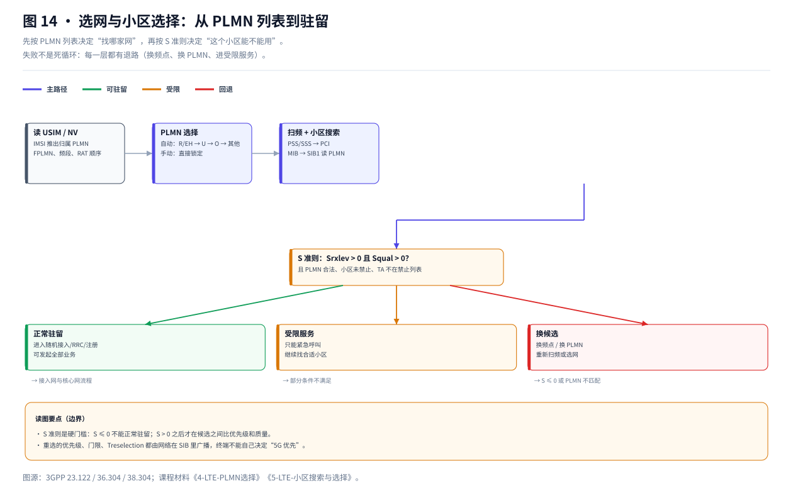
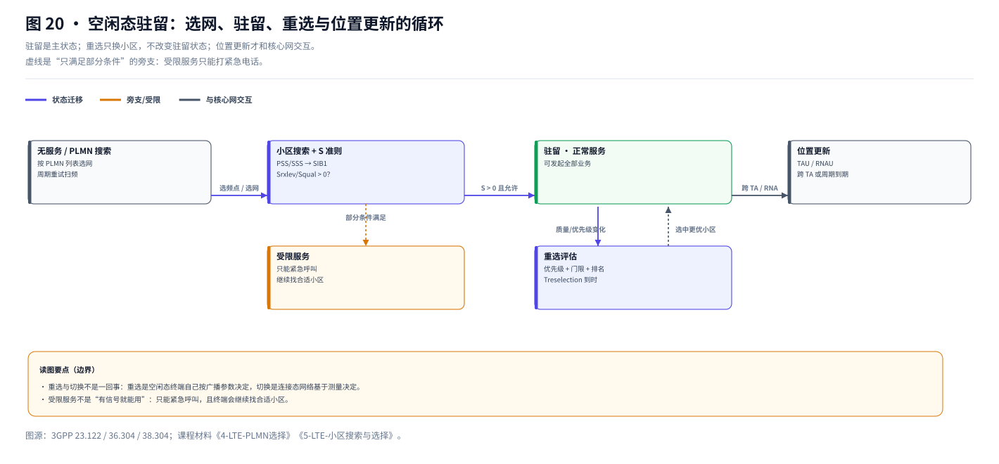

# 小区选择重选与 PLMN

终端“连不上网”的第一层原因往往不是注册失败，而是**根本没驻留到一个合法小区**。选网分两步：先用 PLMN 选择决定“找哪家网”，再用小区选择/重选决定“驻留哪个小区”。前者是运营商与用户偏好问题，后者是无线质量与优先级问题。

> 本篇定位：PLMN 列表与选网时机、扫频与小区搜索、S 准则、小区选择、小区重选（同频/异频/异系统）、禁止与受限服务。入网后的注册与切换去 [02-入网与移动性管理](./02-入网与移动性管理.md)，物理层同步信号去 [01-LTE与NR物理层](./01-LTE与NR物理层.md)。

## 目录

- [1 一句话模型](#s1)
- [2 速览](#s2)
- [3 PLMN：先决定找哪家网](#s3)
- [4 扫频与小区搜索](#s4)
- [5 小区选择：S 准则](#s5)
- [6 小区重选：谁更值得驻留](#s6)
- [7 状态机与定时器](#s7)
- [8 设计取舍与边界](#s8)
- [9 与相邻主题的关系](#s9)
- [名词解释](#名词解释)
- [10 参考与关联](#s10)

## 1 · 一句话模型：先选网，再选小区，用 S 值判断“能不能用”

```text
PLMN 选择（找哪家网）
  → 扫频（在哪些频点上找）
    → 小区搜索（PSS/SSS → MIB → SIB1，读出 PLMN）
      → S 准则（Srxlev/Squal > 0 才可用）
        → 驻留（正常服务 / 受限服务 / 无服务）
          → 空闲时持续重选（按优先级 + 质量）
```

三个关键认知：

1. **PLMN 与小区是两级过滤**：先按 PLMN 列表筛“是不是我要的网”，再按 S 准则筛“这个小区信号够不够用”。
2. **S 准则是硬门槛，重选排名是软比较**：S ≤ 0 的小区根本不能驻留（除非受限服务）；S > 0 之后才在候选之间比优先级和质量。
3. **重选的优先级由网络给**：终端不是单纯“哪强驻哪”，而是先看频点/制式优先级，再看门限和排名。

## 2 · 速览

| 项 | 内容 |
| --- | --- |
| 所属领域 | 无线通信/蜂窝空闲态 |
| 核心对象 | PLMN 列表、频点、PCI、S 准则、重选优先级 |
| 关键参数 | Qrxlevmin、Qqualmin、Qhyst、Qoffset、threshX-High/Low、Treselection |
| 关键状态 | 正常服务 / 受限服务 / 无服务（PLMN 搜索中） |
| 主要标准 | 3GPP 23.122（PLMN 选择）、36.304（LTE 空闲态）、38.304（NR 空闲态） |

## 3 · PLMN：先决定找哪家网

### 3.1 PLMN 是什么

PLMN = **MCC + MNC**，例如 `46000`（中国移动）、`46001`（中国联通）、`46011`（中国电信）。SIM/USIM 里的 IMSI 前几位就是归属 PLMN。

### 3.2 六种 PLMN 列表

| 缩写 | 全称 | 含义 | 工程意义 |
| --- | --- | --- | --- |
| HPLMN | Home PLMN | 归属 PLMN（IMSI 里的 MCC/MNC） | 用户唯一归属 |
| EHPLMN | Equivalent HPLMN | 等效归属 PLMN | 与 HPLMN 同优先级（如新老网络号并存） |
| VPLMN | Visited PLMN | 拜访 PLMN（漫游时） | 与 HPLMN 不同 |
| RPLMN | Registered PLMN | 上次成功注册的 PLMN | 开机优先尝试，加快入网 |
| EPLMN | Equivalent PLMN | 等效 PLMN，由网络下发 | 与当前 PLMN 同优先级，可互相重选 |
| FPLMN | Forbidden PLMN | 被禁止的 PLMN | 接入被拒后写入，避免反复撞墙 |

### 3.3 选网时机与模式

| 时机 | 说明 |
| --- | --- |
| 开机 | 先试 RPLMN，失败再按优先级搜 |
| 脱网（no service） | 周期性重试，按 PLMN 列表重新搜 |
| 位置更新被拒 | 可能把该 PLMN 加入 FPLMN 并重选 |
| 用户手动选网 | 跳过优先级，直接锁定用户选择（重启后可能恢复自动） |
| 漫游 | 在 VPLMN 中按优先列表选网 |

自动选网顺序（简化）：

```text
RPLMN（若可用）
  → HPLMN / EHPLMN
    → 用户自定义 PLMN 列表（UPLMN）
      → 运营商自定义列表（OPLMN）
        → 其他 PLMN（按信号质量）
```

手动选网则把所有搜到的 PLMN 列给用户，不按优先级排序。

> **边界**：EPLMN 是网络下发的“等效网”，终端会把它当成自己人；FPLMN 是“黑名单”，通常有有效期。排障时看到“某张卡在这台设备上不选网”，先查 FPLMN 与 RAT 获取顺序，而不是只看信号。

## 4 · 扫频与小区搜索

### 4.1 扫频

| 方式 | 做法 | 代价 |
| --- | --- | --- |
| 存储频点优先 | 先扫上次用过/配置的频点 | 快，但换城市可能漏网 |
| 全频段扫描 | 按支持的频段逐个 raster 扫 | 慢、耗电，通常作为兜底 |

扫频的粒度由标准定义（LTE 的 channel raster 100 kHz；NR 的 synchronization raster 用 GSCN）。设备支持哪些频段由射频能力和 NV/配置决定——**“同一张卡换设备搜不到网”经常是频段或 RAT 顺序问题**。

### 4.2 小区搜索与系统信息

```text
PSS/SSS → 时频同步 + PCI（LTE 504 个 = 168 组 × 3；NR 1008 个）
  → PBCH/MIB → 帧定时、带宽、CORESET#0（NR）
    → SIB1 → PLMN 列表、TAC、小区禁止位、S 准则参数
      → 其他 SIB → 重选参数、邻区频点、RACH 配置
```

MIB/SIB 的分工：MIB 是“能读下去的最小集合”，SIB1 是“能不能接入的判断依据”，其余 SIB 是“怎么重选、怎么接入”的参数。

## 5 · 小区选择：S 准则

### 5.1 两个 S 值

LTE（36.304）：

```text
Srxlev = Qrxlevmeas − (Qrxlevmin + Qrxlevminoffset) − Pcompensation
Squal  = Qqualmeas − (Qqualmin + Qqualminoffset)
Pcompensation = max(PEMAX − PPowerClass, 0)
```

| 符号 | 含义 | 来源 |
| --- | --- | --- |
| Qrxlevmeas | 实测接收电平（RSRP） | 终端测量 |
| Qrxlevmin | 小区要求的最小接收电平 | SIB1 |
| Qrxlevminoffset | 搜网时的额外偏移 | SIB1 |
| PEMAX | 小区允许的最大上行发射功率 | SIB1 |
| PPowerClass | 终端功率等级 | 终端能力 |
| Qqualmeas | 实测质量（RSRQ） | 终端测量 |

NR（38.304）形式相同，多了 `Qoffsettemp`（连接建立失败后的临时偏移）和 `q-RxLevMinSUL`（用补充上行时的门限）。

**判据**：`Srxlev > 0` 且（若配置了质量门限）`Squal > 0`，小区才可用于正常驻留。

代入一组数看看量级：

```text
q-RxLevMin = -120 dBm，实测 RSRP = -105 dBm，q-RxLevMinOffset = 0
PEMAX = 23 dBm，终端功率等级 23 dBm → Pcompensation = max(23-23, 0) = 0
Srxlev = -105 - (-120) - 0 = 15 dB > 0  → 可用

若换成功率等级 20 dBm 的终端：Pcompensation = 3 dB → Srxlev = 12 dB，仍可用
若实测 RSRP 掉到 -122 dBm：Srxlev = -2 dB → 不可用（即使“有信号”）
```

> **推论**：S 值是“相对门限的余量”，不是绝对信号强度。同一个小区的 Srxlev 对不同终端并不相同——**“别人能驻留、我这台不行”很可能不是设备坏了，而是功率等级或天线差异让 Pcompensation 不同**。

### 5.2 小区选择的两种起点

| 类型 | 前提 | 做法 |
| --- | --- | --- |
| 初始小区选择 | 没有任何频点信息 | 全频段扫描，找到第一个满足 S 准则且 PLMN 合法的小区 |
| 基于存储信息的选择 | 有上次的频点/小区信息 | 先试存储频点，失败再全扫 |

### 5.3 能不能驻留：四个条件

1. 小区所属 PLMN 是所选/注册/等效 PLMN。
2. 小区未被禁止（cellBarred）、未被保留给运营商专用（cellReservedForOperatorUse）。
3. 小区至少属于一个不在禁止列表里的 TA。
4. 满足 S 准则。

四条全过才是“正常服务”；只满足部分条件时可能进入“受限服务”（只能打紧急电话）。



**读图**：从左到右是主路径（读 SIM/NV → PLMN 选择 → 扫频与小区搜索），向下进入 S 准则判断，再分成“正常驻留 / 受限服务 / 换候选”三条出路。注意失败不是死循环：每一层都有退路（换频点、换 PLMN、进受限服务）。

> 图源：`../images/图14-选网与小区选择.svg`

## 6 · 小区重选：谁更值得驻留

### 6.1 三个层次

| 层次 | 比较对象 | 主要参数 |
| --- | --- | --- |
| 同频重选 | 同频邻区 | Qhyst、Qoffset、Treselection |
| 异频重选 | 不同频点（同制式） | 频点优先级、threshX-High/Low、threshServingLow |
| 异系统重选 | 不同 RAT（LTE↔NR↔3G/2G） | 制式优先级、门限 |

### 6.2 优先级规则（简化）

设服务小区优先级为 P_s，邻区优先级为 P_n：

| 条件 | 行为 |
| --- | --- |
| P_n > P_s | 邻区 S 值持续高于 `threshX-High` 超过 Treselection，则重选过去 |
| P_n < P_s | 只有服务小区 S 值低于 `threshServingLow` 且邻区高于 `threshX-Low` 才重选（保底） |
| P_n = P_s | 用排名比较，见下 |

同优先级排名：

```text
Rs = Qmeas,s + Qhyst − Qoffsettemp     （服务小区）
Rn = Qmeas,n − Qoffset − Qoffsettemp   （邻区）
Rn > Rs 持续 Treselection → 重选到邻区
```

`Qhyst` 是“粘性”，防止在两个质量接近的小区之间来回跳；`Qoffset` 是对特定邻区的偏置（正偏置让终端更愿意切过去）。

> **边界**：优先级、门限、Treselection 全部由网络在 SIB 里广播。终端不能自己决定“5G 优先”——如果网络把 LTE 优先级设得更高，终端就会留在 LTE，即使 NR 信号更强。

### 6.3 移动速度的影响

高速移动时，重选参数会按速度缩放（缩短 Treselection、调整 Qhyst），避免“来不及重选就掉出覆盖”。这就是为什么高铁场景要单独配一套重选参数。

缩放不是线性的“越快越短”，而是按速度分档套用一组系数：

| 速度档 | 判定依据 | 参数变化趋势 | 误判 |
| --- | --- | --- | --- |
| 低速（步行/城区） | 默认档 | 标准 Treselection/Qhyst | 把高速终端按低速配，重选滞后、易掉话 |
| 中速 | 连续满足“中速判据”的计数 | Treselection 缩短、Qhyst 减小 | 判据计数配得太敏感，会在边界反复切档 |
| 高速 | 更严格的计数门限 | 更短的重选等待、更小的迟滞 | 参数过激会导致“来回重选”，反而更差 |

> **边界**：速度分档的参数在 SIB 里广播，终端自己判断档位。所以同一小区里步行用户和车内用户用的是同一套广播参数、不同的档位系数——**“高铁专网”不是单独的制式，而是这套系数加专用频点/定向覆盖**。

## 7 · 状态机与定时器

### 7.1 驻留状态

| 状态 | 含义 | 能做什么 |
| --- | --- | --- |
| 正常服务 | 驻留在合适小区 | 全部业务 |
| 受限服务 | 只能驻留在可接受小区 | 紧急呼叫、部分系统信息 |
| 无服务 / PLMN 搜索 | 没有可驻留小区 | 周期重试扫频 |

对应 NAS 的 EMM-DEREGISTERED.PLMN-SEARCH、NO-IMSI、LIMITED-SERVICE 等子状态（见 [02-入网与移动性管理](./02-入网与移动性管理.md)）。



**读图**：一个环形状态机。起点是“无服务/PLMN 搜索”，选到小区后进入“驻留”，之后有三条边：质量变化触发**重选**、跨 TA/RNA 触发**位置更新**、彻底失联回到“无服务”。受限服务是驻留的一个旁支——能待着，但只能打紧急电话。

> 图源：`../images/图20-驻留状态与重选.svg`

### 7.2 “驻留不上”怎么判

| 步骤 | 问什么 | 看什么 | 答错的后果 |
| --- | --- | --- | --- |
| ① 小区能不能用 | S 准则过了吗、小区被禁止吗 | Srxlev/Squal、cellBarred、TA 禁止列表 | 没看禁止位就调天线，白折腾 |
| ② PLMN 对不对 | 是不是所选/等效/注册 PLMN | SIB1 的 PLMN 列表、FPLMN | 把“不是我的网”当成“没覆盖” |
| ③ 频段/制式支持吗 | 设备的 band 与 RAT 顺序 | 频段能力、RAT 获取顺序 | 换城市搜不到网，常是频段不支持 |
| ④ 接入控制拦了吗 | 是否被 barring/保留 | 接入等级、统一接入控制参数 | 把“被禁止接入”当成“注册失败” |

### 7.3 关键定时器/参数

| 名称 | 作用 |
| --- | --- |
| Treselection | 邻区必须“持续好”多久才重选，防乒乓 |
| Qhyst | 服务小区的排名加成，防乒乓 |
| threshServingLow | 服务小区低于此值才考虑低优先级邻区 |
| threshX-High / Low | 高/低优先级邻区的进入门限 |
| 周期性搜网间隔 | 无服务时重试扫频的间隔（实现/配置相关） |
| FPLMN 有效期 | 禁用列表的保留时长（实现/规范相关） |

> **推论**：这些参数互相牵制——Treselection 调大能防乒乓，但重选变慢；Qhyst 调大同样防乒乓，但会让终端“赖在差小区”；threshServingLow 调低则让终端更晚才肯走。调参不是越大越好，是在“掉线率”和“乒乓率”之间找一个点，而这个点随场景（城区/高铁/室分）变。

## 8 · 设计取舍与边界

### 8.1 为什么用 S 准则而不是“有信号就行”

RSRP 高不代表能用：可能上行受限（终端功率不够）、可能质量差（干扰大）、可能小区禁止接入。S 准则同时看电平和质量，并把终端功率能力（Pcompensation）算进去，避免“显示满格却打不出电话”。

### 8.2 为什么重选优先级由网络控制

运营商需要按频段做分层组网：低频做覆盖层、高频做容量层。如果让终端“谁强驻谁”，容量层会把用户全吸走、覆盖层闲置。优先级 + 门限让网络能主动引导用户分布。

### 8.3 常见误判

1. **“信号满格就能上网”**：可能没驻留成功（PLMN 不匹配/小区禁止）、可能受限服务、可能注册失败。
2. **“5G 信号强就一定驻 5G”**：重选看优先级和门限，不看绝对强度。
3. **“搜不到网就是设备坏了”**：先查频段支持、RAT 获取顺序、FPLMN、SIM 是否合法。
4. **“重选和切换是一回事”**：重选是空闲态终端自己决定，切换是连接态网络决定。
5. **“PCI 相同就是同一个小区”**：PCI 只有 504/1008 个，必须 PCI + 频点才能唯一确定，否则就是 PCI 冲突。
6. **“S 准则只算下行”**：Pcompensation 把上行功率能力算进去了，上下行不对称时它会起作用。

## 9 · 与相邻主题的关系

| 相邻主题 | 关系 |
| --- | --- |
| [02-入网与移动性管理](./02-入网与移动性管理.md) | 驻留之后的随机接入、注册、切换 |
| [01-LTE与NR物理层](./01-LTE与NR物理层.md) | PSS/SSS、MIB/SIB、RSRP/RSRQ 测量 |
| [00-蜂窝网络架构与演进](./00-蜂窝网络架构与演进.md) | PLMN、TA/RNA、共享网络 |
| [05-无线测试与优化/00-无线覆盖与干扰优化](../05-无线测试与优化/00-无线覆盖与干扰优化.md) | 弱覆盖、乒乓重选、PCI 冲突定位 |
| [01-射频与天线/00-无线传播与射频基础](../01-射频与天线/00-无线传播与射频基础.md) | 频段与传播对覆盖的影响 |

一句话：**PLMN 决定“找谁”，S 准则决定“能不能用”，重选优先级决定“用哪个更划算”。**

## 名词解释

> 缩写给出英文全称；非缩写用“—”表示。

| 术语 | 英文全称 | 解释 |
| --- | --- | --- |
| PLMN | Public Land Mobile Network | 公共陆地移动网络。 |
| MCC | Mobile Country Code | 移动国家码。 |
| MNC | Mobile Network Code | 移动网络码。 |
| HPLMN | Home PLMN | 归属 PLMN。 |
| EHPLMN | Equivalent HPLMN | 等效归属 PLMN。 |
| VPLMN | Visited PLMN | 拜访 PLMN。 |
| RPLMN | Registered PLMN | 上次注册的 PLMN。 |
| EPLMN | Equivalent PLMN | 等效 PLMN（网络下发）。 |
| FPLMN | Forbidden PLMN | 禁用 PLMN。 |
| UPLMN / OPLMN | User / Operator controlled PLMN list | 用户/运营商自定义 PLMN 列表。 |
| RAT | Radio Access Technology | 无线接入制式。 |
| PCI | Physical Cell Identity | 物理小区标识。 |
| PSS / SSS | Primary / Secondary Synchronization Signal | 主/辅同步信号。 |
| MIB | Master Information Block | 主信息块。 |
| SIB | System Information Block | 系统信息块。 |
| RSRP | Reference Signal Received Power | 参考信号接收功率。 |
| RSRQ | Reference Signal Received Quality | 参考信号接收质量。 |
| RSSI | Received Signal Strength Indicator | 接收信号强度指示。 |
| Srxlev | Cell selection RX level value | 小区选择接收电平值。 |
| Squal | Cell selection quality value | 小区选择质量值。 |
| Qrxlevmin | Minimum required RX level | 小区要求的最小接收电平。 |
| Qqualmin | Minimum required quality level | 小区要求的最小质量。 |
| Qhyst | Hysteresis for reselection | 重选迟滞。 |
| Qoffset | Offset for neighbour cells | 邻区偏移。 |
| Treselection | Reselection timer | 重选定时器。 |
| TA | Tracking Area | 跟踪区。 |
| TAC | Tracking Area Code | 跟踪区码。 |
| GSCN | Global Synchronization Channel Number | NR 同步栅格编号。 |
| NV | Non-Volatile | 非易失存储，设备侧配置项。 |

## 10 · 参考与关联

**标准**

- 3GPP TS 23.122：空闲态 NAS 与 PLMN 选择。
- 3GPP TS 36.304：LTE 空闲态流程（小区选择/重选）。
- 3GPP TS 38.304：NR 空闲态与 INACTIVE 态流程。
- 3GPP TS 36.331 / 38.331：SIB 中的选择/重选参数。

**关联**

- [02-入网与移动性管理](./02-入网与移动性管理.md)
- [01-LTE与NR物理层](./01-LTE与NR物理层.md)
- [00-蜂窝网络架构与演进](./00-蜂窝网络架构与演进.md)
- [05-无线测试与优化/00-无线覆盖与干扰优化](../05-无线测试与优化/00-无线覆盖与干扰优化.md)

---

> **本篇定位**：空闲态的选网、小区选择与重选判据；不展开 NAS 注册流程与厂家搜网实现（NV/EFS 配置见 20-平台与系统）。
> **素材来源**：`studyspace/1.知识体系/9.lte5g相关/lte-从入网流程开始/lte 入网.md`、`lte/LTE/4-LTE-PLMN选择.pptx`、`lte/LTE/5-LTE-小区搜索与选择.pptx`、`lte/5g/中文资料/5G基础信令培训.pptx`（课程材料）。素材为二手整理，S 准则公式已按 36.304/38.304 公开结构核对。
> **待验证**：各运营商频点优先级、门限取值、FPLMN 有效期、搜网重试间隔与设备 NV 实现相关；NR 的 q-RxLevMinSUL 使用条件以 38.304 对应版本为准。
