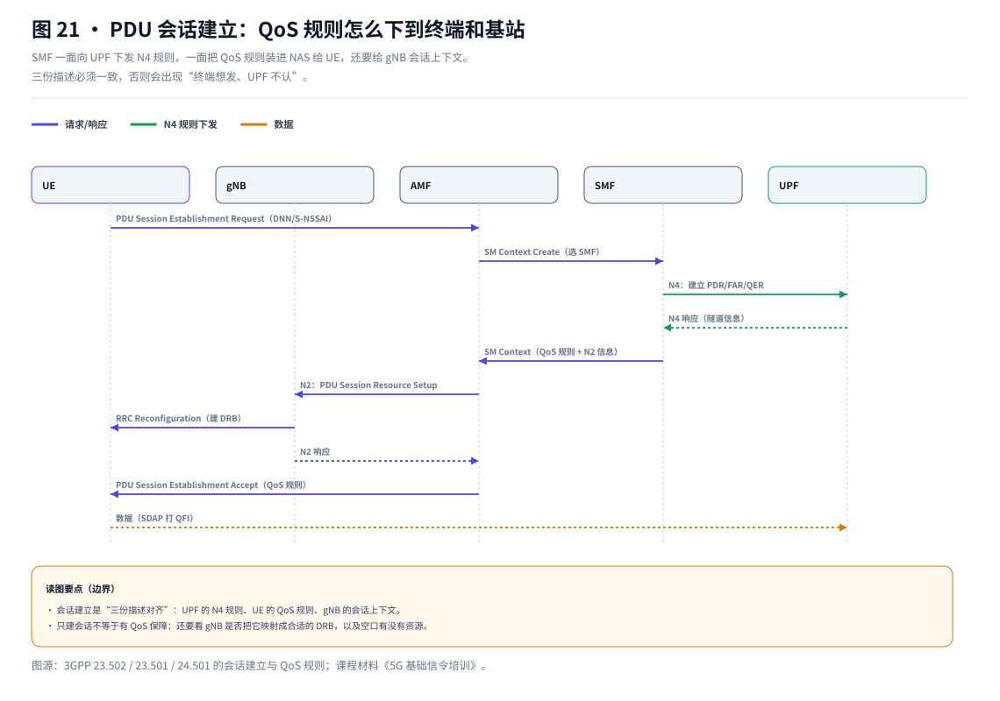
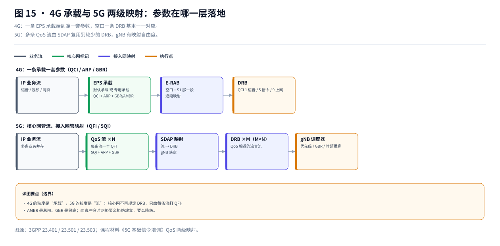

# QoS 与承载

蜂窝网要同时跑语音、视频、网页、游戏和物联网小包，这些业务对时延、丢包、速率的要求完全不同。**QoS 机制解决的就是“拥塞时先保谁、每条业务至少给多少”**：4G 用“EPS 承载”一刀切地描述一条管道，5G 改成“QoS 流 + 数据无线承载”两级映射，让核心网管策略、接入网管调度各司其职。

> 本篇定位：EPS 承载与 QCI、PCC 策略链、5G 的 PDU 会话/QoS 流/QFI/5QI、两级映射与反射式 QoS、GBR/AMBR 的执行点。层二怎么把流塞进 DRB 去 [03-层二协议与调度](./03-层二协议与调度.md)，语音业务怎么用这些承载去 [06-VoLTE与语音方案](./06-VoLTE与语音方案.md)。

## 目录

- [1 一句话模型](#s1)
- [2 速览](#s2)
- [3 4G：EPS 承载](#s3)
- [4 5G：PDU 会话与 QoS 流](#s4)
- [5 两级映射怎么落地](#s5)
- [6 策略链与执行点](#s6)
- [7 状态机与定时器](#s7)
- [8 设计取舍与边界](#s8)
- [9 与相邻主题的关系](#s9)
- [名词解释](#名词解释)
- [10 参考与关联](#s10)

## 1 · 一句话模型：核心网定“待遇”，接入网定“怎么发”

```text
业务流（IP flow）
  → 核心网：分类、打 QoS 标记（QCI/5QI、ARP、GBR/AMBR）
    → 承载/会话：一条“有待遇的管道”（EPS bearer / PDU session + QoS flow）
      → 接入网：映射到 DRB，交给调度器按优先级发
```

三个关键认知：

1. **QoS 不是“限速”**，而是“分类 + 保证 + 上限”三件事：分类靠 QCI/5QI，保证靠 GBR，上限靠 MBR/AMBR。
2. **4G 的粒度是承载，5G 的粒度是流**：4G 一条承载一套参数，5G 一条会话里可以有多条 QoS 流，各流参数不同。
3. **空口是最终执行点**：核心网给的标记只有在 gNB 调度器里被翻译成“优先级、调度权重、队列”才真正生效。

## 2 · 速览

| 项 | 内容 |
| --- | --- |
| 所属领域 | 无线通信/蜂窝 QoS |
| 核心对象 | EPS 承载、PDU 会话、QoS 流、DRB |
| 关键参数 | QCI / 5QI、ARP、GBR/MBR、UE-AMBR、Session-AMBR |
| 4G 机制 | 默认承载 + 专用承载，PCC（PCRF → P-GW/PCEF） |
| 5G 机制 | QoS 流 + QFI，两级映射（QoS 流 ↔ DRB），反射式 QoS |
| 主要标准 | 3GPP 23.401、23.203、23.501、23.503、24.301、24.501 |

## 3 · 4G：EPS 承载

### 3.1 承载的层级

```text
UE ──E-RAB（eNB↔S-GW）── S5/S8 承载（S-GW↔P-GW）── 外部 PDN
     └────────── EPS 承载（UE↔P-GW，端到端）──────────┘
```

| 概念 | 范围 | 说明 |
| --- | --- | --- |
| EPS 承载 | UE ↔ P-GW | 端到端的“管道”，QoS 参数的载体 |
| E-RAB | UE ↔ S-GW | 空口 + S1 那一段 |
| 默认承载 | UE ↔ P-GW | Attach 时建立，必须有且只有一条（每 APN） |
| 专用承载 | UE ↔ P-GW | 有特定 QoS 需求时另建，可多条 |

默认承载的意义是“永远在线”：终端一附着就有 IP，不需要每次上网都建通道。专用承载用于语音、视频等需要差异化待遇的业务。

**ARP 不只是“排队号”**。它有三个部分，工程上经常只被当成一个数字：

| 字段 | 含义 | 工程含义 |
| --- | --- | --- |
| 优先级（1~15） | 越小越优先 | 拥塞/准入时先保谁 |
| 抢占能力（pre-emption capability） | 能否抢低优先级的资源 | 开得太随意会互相踢承载，语音都建不稳 |
| 被抢占易感性（pre-emption vulnerability） | 是否允许被别人抢 | 全设成“不可被抢”，新语音在高负载时根本建不起来 |

> **推论**：ARP 只决定“能不能抢、会不会被抢”，不决定“给多少速率”。速率保障永远看 GBR/MBR/AMBR。把 ARP 当成限速手段，是概念错位。

### 3.2 QCI 与四个参数

| 参数 | 作用 | 边界 |
| --- | --- | --- |
| QCI | 标定 QoS 类别（时延预算、丢包率、是否 GBR） | 取值 1~9 是标准化的，运营商可扩展 |
| ARP | 分配与保留优先级（拥塞时谁能抢到资源） | 数值越小优先级越高；也用于准入控制 |
| GBR / MBR | 保证速率 / 最大速率（上/下行各自一套） | 只有 GBR 类承载有 GBR |
| APN-AMBR | 每个 APN 的聚合最大速率 | 非 GBR 业务的“总闸” |
| UE-AMBR | 每个 UE 的聚合最大速率 | 对所有非 GBR 承载求和限制 |

常见 QCI（LTE 标准取值，具体以 23.203 对应版本为准）：

| QCI | 业务 | 资源类型 | 典型特点 |
| --- | --- | --- | --- |
| 1 | 会话语音 | GBR | 时延最敏感，20 ms 级 |
| 2 | 会话视频 | GBR | 时延敏感，可容忍少量丢包 |
| 3 | 实时游戏 | GBR | 低时延、低速率 |
| 4 | 非会话视频 | GBR | 缓冲流，时延要求稍宽 |
| 5 | IMS 信令 | 非 GBR | 高优先级信令 |
| 6 | 缓冲视频/流媒体 | 非 GBR | 比默认承载优先 |
| 7 | 语音/视频/交互游戏 | 非 GBR | 时延较敏感 |
| 8 | TCP 类业务 | 非 GBR | 比 9 优先 |
| 9 | 默认上网 | 非 GBR | 默认承载通常用 9 |

> **边界**：QCI 是“类别”，不是“具体速率”。同一个 QCI 1 的语音承载，在不同运营商那里 GBR 可能配 20 kbps 也可能更高；看到 QCI 只能推断待遇级别，不能推断实际带宽。

### 3.3 专用承载怎么建立

```text
PCRF 决策（收到 P-CSCF 的 AAR 或本地策略）
  → P-GW/PCEF 发起 Create Bearer Request（Gx）
    → S-GW 转发 → MME → eNB：E-RAB Setup
      → UE：RRC 重配（建立 DRB）
        → 逐级回响应
```

语音专用承载（QCI 1）就是这样被“叫”出来的：SIP 信令里协商好媒体，P-CSCF 向 PCRF 申请资源，PCRF 让 P-GW 建 GBR 承载。

## 4 · 5G：PDU 会话与 QoS 流

### 4.1 三层概念

| 概念 | 范围 | 说明 |
| --- | --- | --- |
| PDU 会话 | UE ↔ UPF/DN | 提供一条到某个数据网络的连接（有 IP/以太网/非结构化类型） |
| QoS 流 | UE ↔ UPF | 会话内**最细的 QoS 粒度**，用 QFI 标识 |
| DRB | UE ↔ gNB | 空口上的数据无线承载，一条 DRB 对应一个 PDCP 实体 |

一个 PDU 会话可以有多条 QoS 流；多条流可以复用到同一条 DRB（如果 QoS 需求接近）。**核心网不再规定“承载”，只规定“流”；怎么装进承载由 gNB 决定**——这是 5G 给 RAN 的自由度。



**读图**：从上到下是“UE 请求 → AMF 选 SMF → SMF 选 UPF 并下发 N4 → 把 QoS 规则装进 NAS 回给 UE → gNB 建 DRB”。注意同一个会话里，SMF 给 UPF 的是包检测/转发规则（N4），给 UE 的是 QoS 规则（N1），给 gNB 的是会话上下文（N2）——三份描述必须一致，否则就会出现“终端想发、UPF 不认”的怪现象。

> 图源：`../images/图21-PDU会话建立.svg`

### 4.2 5G QoS 参数

| 参数 | 作用 | 与 4G 的对应 |
| --- | --- | --- |
| 5QI | QoS 类别（时延、丢包、GBR 与否） | 类似 QCI，取值体系重新定义 |
| ARP | 分配与保留优先级 | 同名同义 |
| GBR / MBR | 保证/最大速率 | 同 4G |
| Session-AMBR | 每个 PDU 会话的聚合上限 | 类似 APN-AMBR |
| UE-AMBR | 每个 UE 的聚合上限 | 同 4G |
| QFI | QoS 流标识（6 bit） | 4G 没有的“流标识” |
| RQA | 反射式 QoS 指示 | 5G 新增 |
| Notification Control | 保证速率做不到时是否通知 | 5G 增强 |

常见 5QI（取值以 23.501 表 5.7.4-1 为准）：

| 5QI | 业务 | 资源类型 |
| --- | --- | --- |
| 1 | 会话语音 | GBR |
| 2 | 会话视频 | GBR |
| 3 | 实时游戏/机器控制类 | GBR |
| 4 | 非会话视频 | GBR |
| 5 | IMS 信令 | 非 GBR |
| 6/7/8/9 | 视频、语音/交互、TCP 类、默认上网 | 非 GBR |
| 65/66 | 关键任务语音/视频 | GBR |
| 69 | 关键任务时延敏感信令 | 非 GBR |
| 79/80 | 低时延 eMBB | 非 GBR |
| 82~85 | 离散自动化、智能电网等 URLLC 场景 | GBR / 非 GBR |

**SDAP 头只有 1 字节，信息不少**：

| 字段 | 位宽 | 作用 | 边界 |
| --- | --- | --- | --- |
| RDI | 1 bit | 反射式 QoS 指示：要求接收端按这个包建立上行规则 | 只有承载允许反射时才看；普通承载置 0 |
| RQI | 1 bit | 反射式 QoS 流标识 | 与 RDI 配合，单独出现没有意义 |
| QFI | 6 bit | 这个包属于哪条 QoS 流 | 最多 64 条流；QFI 0 保留 |

> **推论**：反射式 QoS 省掉的是“每条流都发一次信令”，代价是终端要维护“下行包 → 上行规则”的映射。实现偷懒时，上行会把 QFI 打错，现象是“下行正常、上行被限速或走错切片”。

### 4.3 默认 QoS 规则与反射式 QoS

- **默认 QoS 规则**：每条 PDU 会话至少有一条，保证“没匹配到任何规则”的包也有去处（通常是默认 5QI 9）。
- **反射式 QoS（Reflective QoS）**：下行包带 RQI 标记，终端据此**自动**在上行建立对应的 QoS 规则，不必每条流都发信令。适合大量小流（IoT、应用多开）。
- **上行分类器（UL CL）**：UPF 里的分流点，把上行流量导到不同数据网络。

## 5 · 两级映射怎么落地



**读图**：上半部分是 4G：一条 EPS 承载端到端对应一套 QCI/GBR，空口一条 DRB 一一对应。下半部分是 5G：多条 QoS 流（QFI 不同）在核心网侧由 UPF 分类，在接入网侧由 gNB 的 SDAP 决定复用到哪条 DRB。先看“哪一层做映射”，再看“参数在哪一层执行”。

> 图源：`../images/图15-QoS两级映射.svg`

### 5.1 映射链

| 环节 | 谁做 | 动作 |
| --- | --- | --- |
| 业务流 → QoS 流 | SMF/UPF（核心网） | 按 PDR/FAR 分类，打 QFI |
| QoS 流 → DRB | gNB（SDAP） | 把 QoS 需求相近的流复用到同一 DRB |
| DRB → 空口资源 | gNB（调度器） | 按优先级/GBR 分配 PRB 与 MCS |
| 上行分类 | UE（SDAP）+ UPF | 按 QoS 规则或反射式规则打 QFI |

**为什么把映射权下放给 gNB**：核心网看不到空口的瞬时状态。同样 20 ms 的时延预算，在 2 层 MIMO 和 4 层 MIMO 下能同时塞的流数不同；把“流 → DRB”写死在核心网，就只能在“资源浪费”和“无法调度”之间二选一。下放之后，gNB 可以按当前信道与负载动态合流，代价是**同一套 QoS 规则在 UE、gNB、UPF 三处各有一份描述，必须保持一致**。

### 5.2 执行点

| 执行点 | 执行什么 | 观测方式 |
| --- | --- | --- |
| gNB 调度器 | 优先级、GBR 保底、时延预算 | 每 DRB 的吞吐/时延/丢包 |
| UPF | MBR/AMBR 限速、门控、计费 | N3/N6 流量统计 |
| UE | 上行 QoS 规则、UL 速率限制 | 终端侧统计（不易获取） |
| PCF | 策略决策 | 策略下发日志 |

> **边界**：AMBR 是“总闸”，GBR 是“保底”。两者冲突时（比如 UE-AMBR 小于各 GBR 之和），网络要么拒绝建承载，要么降级——这也是“套餐限速后语音还正常、视频卡”的原因。

## 6 · 策略链与执行点

### 6.1 4G PCC

```text
AF（如 P-CSCF）──AAR──→ PCRF ──Gx──→ P-GW（PCEF）──→ 承载
                                   └─ Gy ──→ OCS（计费）
```

| 网元 | 全称 | 作用 |
| --- | --- | --- |
| PCRF | Policy and Charging Rules Function | 策略决策 |
| PCEF | Policy and Charging Enforcement Function | 策略执行（通常在 P-GW） |
| AF | Application Function | 业务侧发起资源请求（如 IMS） |
| OCS/OFCS | Online/Offline Charging System | 在线/离线计费 |
| TDF | Traffic Detection Function | 应用检测（DPI） |

### 6.2 5G PCC

```text
AF ──N5──→ PCF ──N7──→ SMF ──N4──→ UPF（执行）
                          └── N1/N2 ──→ UE/gNB（QoS 规则与 DRB）
```

5G 把“策略”和“会话管理”彻底分开：PCF 只给规则（PCC rule → QoS flow），SMF 负责翻译成 N4 规则和 NAS QoS 规则，gNB 负责落到 DRB。

## 7 · 状态机与定时器

QoS 本身没有连接状态机，但有**承载/会话的生命周期**：

| 阶段 | 4G | 5G |
| --- | --- | --- |
| 建立 | 默认承载随 Attach；专用承载按需 | PDU 会话建立时带默认 QoS 规则；后续可加流 |
| 修改 | Modify Bearer / Update Bearer | PDU Session Modification（QoS 流增删改） |
| 释放 | 去附着或去激活承载 | PDU Session Release |
| 空闲 | 承载保留、空口资源释放 | 会话保留、空口资源释放 |

相关定时器：承载去激活定时器、会话空闲定时器（SMF 侧）、GBR 流的“无数据时是否释放”、Notification Control 的通知周期。具体值由核心网策略配置，终端侧不可见。

## 8 · 设计取舍与边界

### 8.1 4G 承载 vs 5G 流

| 维度 | 4G 承载 | 5G QoS 流 |
| --- | --- | --- |
| 粒度 | 一条承载一套参数 | 一条会话内多条流，各自参数 |
| 映射 | 承载 ↔ DRB 基本一一对应 | 流 ↔ DRB 由 gNB 决定，可多对一 |
| 信令开销 | 每条专用承载都要建 | 加流可以只改会话 |
| 灵活性 | 低（核心网定死） | 高（RAN 有调度自由度） |
| 复杂度 | 低 | 高（规则多、映射多） |

### 8.2 为什么 GBR 不能滥用

GBR 是“预留”，网络必须为它留资源。GBR 承载越多，可用于 non-GBR 的容量越少；如果配置超过实际容量，拥塞时要么违约（体验掉），要么拒绝新用户。所以运营商通常只给语音/视频通话这类业务配 GBR。

### 8.3 “被限速”还是“网络拥塞”

两者现象都是“速率上不去”，但执行点不同：

| 步骤 | 问什么 | 看什么 | 答错的后果 |
| --- | --- | --- | --- |
| ① 单流还是总和 | 单线程慢、多线程快？ | 单/多线程测速对比 | 把 AMBR 总闸当成空口问题，越优化越偏 |
| ② 换位置还慢吗 | 换个小区/时段 | 分时段、分位置测速 | 不交叉验证，会把核心网限速归到基站 |
| ③ 语音还正常吗 | GBR 业务是否保住 | 语音/视频通话质量 | 忽略 GBR，会把“拥塞”误判成“限速” |

> **推论**：限速是“每条流/每个会话有上限但时延稳定”，拥塞是“时延和丢包一起恶化”。先看时延曲线，再看速率，比只看速率快得多。

### 8.4 常见误判

1. **“QCI 9 就是没 QoS”**：它是 non-GBR 的默认待遇，仍有优先级、AMBR 和调度权重。
2. **“5QI 和 QCI 一一对应”**：部分取值语义相近（1↔1、5↔5、9↔9），但两套表独立定义，不能机械换算。
3. **“限速是基站做的”**：AMBR/MBR 主要在 UPF/P-GW 执行；空口做的是调度与优先级。
4. **“有 GBR 就不会卡”**：GBR 只保证速率下限，空口覆盖差/干扰大时仍会丢包。
5. **“QoS 流越多越好”**：流越多，规则和映射越复杂，空口调度开销越大。
6. **“语音一定走 QCI 1”**：VoLTE 用 QCI 1 + 5；VoNR 用 5QI 1 + 5；CSFB 则根本不在 LTE 承载上。

## 9 · 与相邻主题的关系

| 相邻主题 | 关系 |
| --- | --- |
| [03-层二协议与调度](./03-层二协议与调度.md) | SDAP 做流到 DRB 映射，MAC 调度执行优先级 |
| [02-入网与移动性管理](./02-入网与移动性管理.md) | Attach/PDU 会话是承载与流的建立入口 |
| [00-蜂窝网络架构与演进](./00-蜂窝网络架构与演进.md) | P-GW/UPF、PCRF/PCF、SMF 的角色 |
| [06-VoLTE与语音方案](./06-VoLTE与语音方案.md) | QCI 1/5 与 5QI 1/5 的实际用法 |
| [11-网络科学](../../../11-网络科学/.readme.md) | IP 层的 DSCP/队列与蜂窝 QoS 的对应关系 |

一句话：**QoS 是“分类—保证—上限”三件套：核心网分类，接入网保待遇，UPF 卡总闸。**

## 名词解释

> 缩写给出英文全称；非缩写用“—”表示。

| 术语 | 英文全称 | 解释 |
| --- | --- | --- |
| QoS | Quality of Service | 服务质量。 |
| EPS | Evolved Packet System | 演进分组系统（LTE + EPC）。 |
| E-RAB | E-UTRAN Radio Access Bearer | 接入网承载（UE↔S-GW）。 |
| QCI | QoS Class Identifier | 4G QoS 类别标识。 |
| 5QI | 5G QoS Identifier | 5G QoS 类别标识。 |
| ARP | Allocation and Retention Priority | 分配与保留优先级。 |
| GBR | Guaranteed Bit Rate | 保证比特速率。 |
| MBR | Maximum Bit Rate | 最大比特速率。 |
| AMBR | Aggregate Maximum Bit Rate | 聚合最大比特速率。 |
| APN-AMBR | APN Aggregate Maximum Bit Rate | 每 APN 的聚合上限。 |
| UE-AMBR | UE Aggregate Maximum Bit Rate | 每 UE 的聚合上限。 |
| PCC | Policy and Charging Control | 策略与计费控制。 |
| PCRF | Policy and Charging Rules Function | 4G 策略决策网元。 |
| PCEF | Policy and Charging Enforcement Function | 策略执行功能（P-GW）。 |
| PCF | Policy Control Function | 5G 策略控制网元。 |
| AF | Application Function | 业务侧功能（如 IMS）。 |
| TDF | Traffic Detection Function | 流量检测功能。 |
| OCS | Online Charging System | 在线计费系统。 |
| OFCS | Offline Charging System | 离线计费系统。 |
| PDU | Protocol Data Unit | 协议数据单元；5G 会话单位。 |
| QFI | QoS Flow Identifier | QoS 流标识。 |
| RQI | Reflective QoS Indicator | 反射式 QoS 指示。 |
| RQA | Reflective QoS Attribute | 反射式 QoS 属性。 |
| SDAP | Service Data Adaptation Protocol | 服务数据适配协议。 |
| DRB | Data Radio Bearer | 数据无线承载。 |
| PDR | Packet Detection Rule | 包检测规则（UPF）。 |
| QER | QoS Enforcement Rule | QoS 执行规则（限速、门控），随 N4 下发。 |
| FAR | Forwarding Action Rule | 转发动作规则（UPF）。 |
| UL CL | Uplink Classifier | 上行分类器。 |
| DN | Data Network | 数据网络。 |
| URLLC | Ultra-Reliable Low-Latency Communication | 低时延高可靠通信。 |
| VoLTE / VoNR | Voice over LTE / NR | LTE / NR 上的 IMS 语音。 |

## 10 · 参考与关联

**标准**

- 3GPP TS 23.203：PCC 架构。
- 3GPP TS 23.401：EPC 承载与 QoS。
- 3GPP TS 23.501：5G 系统架构与 QoS 框架（5QI 表）。
- 3GPP TS 23.503：5G PCC 框架。
- 3GPP TS 24.301 / 24.501：NAS 中的承载/会话与 QoS 规则。

**关联**

- [03-层二协议与调度](./03-层二协议与调度.md)
- [02-入网与移动性管理](./02-入网与移动性管理.md)
- [00-蜂窝网络架构与演进](./00-蜂窝网络架构与演进.md)
- [06-VoLTE与语音方案](./06-VoLTE与语音方案.md)

---

> **本篇定位**：4G EPS 承载与 5G QoS 流的参数、映射与执行点；不展开具体运营商套餐、计费规则与 5QI 全表。
> **素材来源**：`studyspace/1.知识体系/9.lte5g相关/lte/5g/中文资料/5G基础信令培训.pptx`（QoS 两级映射）、`lte/LTE/2-LTE-NAS概述.pptx`（承载/QCI）、`lte/VoLTE/VoLTE笔记.md`、`lte/lte-层二协议.md`。素材为二手整理，参数体系已按 23.401/23.501/23.203 公开结构核对。
> **待验证**：5QI/QCI 的具体时延预算与丢包率、各运营商 GBR/AMBR 取值、Notification Control 行为以规范对应版本和现网策略为准。
