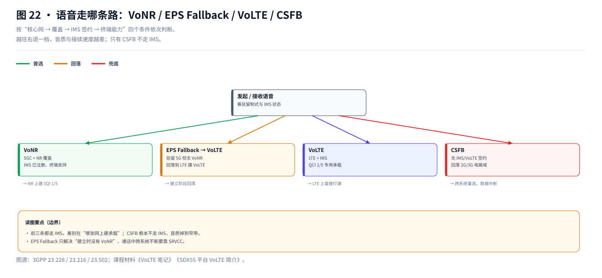
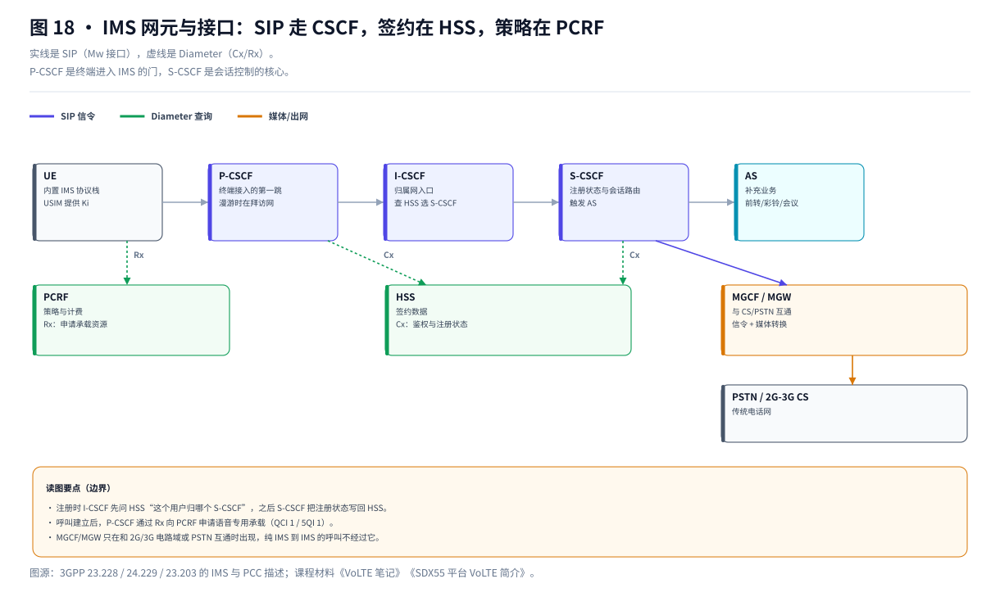
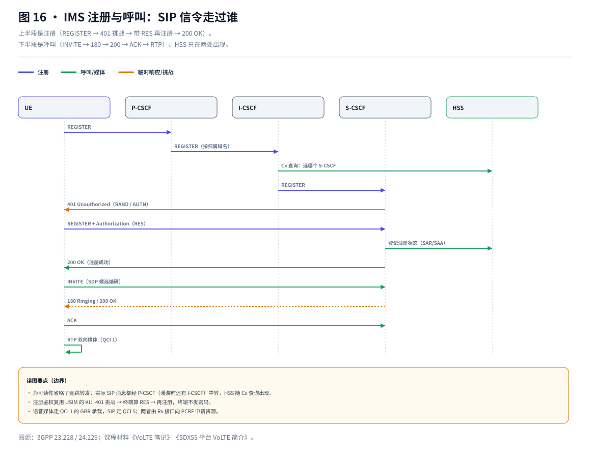

# VoLTE 与语音方案

LTE 是纯分组网，没有电路域，语音必须变成 IP 包。VoLTE 的做法是“IMS 管会话、LTE 只当管道”：SIP 走 QCI 5，语音 RTP 走 QCI 1 的 GBR 承载，空口拥塞时语音优先。没有 IMS 或没开 VoLTE 时，终端要么回落 2G/3G（CSFB），要么在 5G 上回落到 LTE（EPS Fallback）。

> 本篇定位：**语音在蜂窝网上怎么承载、怎么回落**。IMS 网元、SIP 协议、编码与媒体质量的正本在 [06-语音与实时通信](../../06-语音与实时通信/.readme.md)，本篇只保留蜂窝视角的结论与链接。QoS 参数去 [05-QoS与承载](./05-QoS与承载.md)，入网与切换去 [02-入网与移动性管理](./02-入网与移动性管理.md)。

## 目录

- [1 一句话模型](#s1)
- [2 速览](#s2)
- [3 语音方案怎么演化](#s3)
- [4 IMS 在 VoLTE 里的位置](#s4)
- [5 注册与呼叫一眼](#s5)
- [6 空口承载：QCI 5 与 QCI 1](#s6)
- [7 回落与连续性](#s7)
- [8 状态机与定时器](#s8)
- [9 设计取舍与边界](#s9)
- [10 与相邻主题的关系](#s10)
- [名词解释](#名词解释)
- [11 参考与关联](#s11)

## 1 · 一句话模型：IMS 谈会话，蜂窝给管道

```text
IMS：SIP 建会话、协商编码           （信令，QCI 5）
蜂窝：建一条 QCI 1 的 GBR 承载       （媒体，QCI 1）
兜底：没 VoLTE 就 CSFB，没 VoNR 就 EPS Fallback
```

三个关键认知：

1. **语音是“应用层的事”**：LTE 只保证承载的 QoS，振铃、接听、补充业务全在 IMS。
2. **两条承载分工明确**：QCI 5 走 SIP（非 GBR），QCI 1 走语音（GBR），拥塞时语音不被信令挤掉。
3. **连续性靠“回落”而不是“无缝”**：CSFB 回 2G/3G；EPS Fallback 回 LTE；通话中跨系统不断要靠 SRVCC。

## 2 · 速览

| 项 | 内容 |
| --- | --- |
| 所属领域 | 无线通信/蜂窝语音 |
| 核心对象 | IMS、SIP、EPS 承载、CSFB/SRVCC |
| 关键承载 | QCI 5（信令）、QCI 1（语音）、QCI 2（视频）、QCI 9（默认） |
| 关键机制 | Rx 资源申请、专用承载、EPS Fallback、SRVCC |
| 主要标准 | 3GPP 23.228、24.229、23.203、23.216、23.502 |

## 3 语音方案怎么演化



**读图**：从“发起语音”往下按四个条件分流：核心网是不是 5GC、NR 覆盖够不够、IMS/VoLTE 是否开通、终端是否支持。每往下走一层，语音质量与接续速度都退一档。

> 图源：`../images/图22-语音方案分流.svg`

| 方案 | 语音走哪 | 数据能否并发 | 接续速度 | 前提 |
| --- | --- | --- | --- | --- |
| CSFB | 回落 2G/3G 电路域 | 通话时数据中断（或降级） | 慢（跨系统重选） | MSC 支持 SGs |
| SVLTE | 语音走 2G/3G，数据留在 LTE | 可以 | 中 | 终端双射频 |
| VoLTE | LTE + IMS | 可以 | 快（约 1~2 秒） | 部署 IMS、开通业务 |
| VoNR | NR + IMS | 可以 | 快 | 5GC + IMS + NR 覆盖 |
| EPS Fallback | 5G 发起，回落 LTE 用 VoLTE | 可以 | 中（多一次回落） | 5G 无 VoNR 时的过渡 |

> **边界**：EPS Fallback 与 CSFB 不是一回事。EPS Fallback 是 5G→LTE（仍走 IMS/VoLTE），CSFB 是 LTE→2G/3G 电路域。前者语音质量仍是 HD，后者会掉到窄带。

## 4 IMS 在 VoLTE 里的位置



**读图**：左到右是 SIP 路径（UE → P-CSCF → I-CSCF → S-CSCF → AS），下方虚线是 Diameter 查询（P-CSCF→PCRF 的 Rx、I/S-CSCF→HSS 的 Cx）。只有要和 2G/3G/PSTN 互通时才走 MGCF/MGW。

> 图源：`../images/图18-IMS网元与接口.svg`

| 网元 | 在语音里的角色 | 蜂窝视角的关注点 |
| --- | --- | --- |
| P-CSCF | 终端第一跳，发起 Rx | 漫游时在拜访网，决定就近申请承载 |
| S-CSCF | 注册与会话路由 | 业务触发（iFC）决定要不要进 AS |
| HSS | 签约与鉴权 | 没开 VoLTE 签约 → 注册失败 |
| PCRF | 策略决策 | Rx 申请成功与否，决定 QCI 1 能不能建 |
| MGCF/MGW | 与 PSTN/CS 互通 | 跨网才用，转码会增加时延 |

网元与接口的完整说明在 [04-IMS架构与VoLTE](../../06-语音与实时通信/04-IMS架构与VoLTE.md)。

## 5 注册与呼叫一眼



**读图**：上半段注册（REGISTER → 401 挑战 → 带 RES 再注册 → 200 OK），下半段呼叫（INVITE → 180 → 200 → ACK → RTP）。对蜂窝侧来说，关键只有一句：**注册成功 + QCI 5 承载建立 → 才能发起呼叫**。

> 图源：`../images/图16-VoLTE-SIP注册与呼叫.svg`

```text
注册：USIM 鉴权（401 挑战）→ 200 OK → 建 QCI 5 承载
呼叫：INVITE（SDP）→ Rx 申请 → 建 QCI 1 承载 → 180/200 → RTP
```

SIP 的事务/对话、SDP 协商、NAT 细节在 [03-SIP协议](../../06-语音与实时通信/03-SIP协议.md)；编码与 MOS 在 [01-语音编码与媒体质量](../../06-语音与实时通信/01-语音编码与媒体质量.md)。

## 6 空口承载：QCI 5 与 QCI 1

| 承载 | QCI | 资源类型 | 用途 | 建立时机 |
| --- | --- | --- | --- | --- |
| 默认承载 | 9 | 非 GBR | 上网 | Attach / PDU 会话 |
| IMS 信令 | 5 | 非 GBR | SIP | 注册后 |
| 语音媒体 | 1 | GBR | RTP 语音 | 呼叫建立时（Rx 触发） |
| 视频媒体 | 2 | GBR | 视频通话 | 呼叫建立时 |

语音专用承载的建立是“策略触发”的：

```text
P-CSCF 收到 INVITE/200 OK（含 SDP）
  → Rx AAR（描述媒体流与带宽）
    → PCRF 决策 → Gx 下发 → P-GW 发起专用承载（QCI 1）
      → MME → eNB → RRC 重配建 DRB → 语音开始
```

> **推论**：“能振铃、接通后没声音”先查 QCI 1 的 DRB 有没有建起来，再查 RTP。只查 SIP 会漏掉这半边。

空口上的效率问题（包头占 2.3 倍、SPS、ROHC）见 [01-语音编码与媒体质量](../../06-语音与实时通信/01-语音编码与媒体质量.md) 与 [03-层二协议与调度](./03-层二协议与调度.md)。

## 7 回落与连续性

| 机制 | 场景 | 做法 | 边界 |
| --- | --- | --- | --- |
| CSFB | LTE → 2G/3G，呼叫建立时 | 回落电路域，MSC 接管 | 接续慢，数据中断 |
| EPS Fallback | 5G → LTE，呼叫建立时 | 在 LTE 上建 VoLTE 承载 | 只解决建立阶段 |
| SRVCC | LTE → 2G/3G，**通话中** | 语音锚点从 IMS 切到 CS 域 | 需 MSC 支持 Sv 接口，有数百毫秒中断 |
| 重定向/切换 | 数据业务跨系统 | RRC Release 重定向或切换 | 语音会断，不是连续性方案 |

> **边界**：真正“通话中不断”的只有 SRVCC；EPS Fallback 解决的是“5G 没 VoNR 时怎么打通”。

## 8 状态机与定时器

| 状态/定时器 | 作用 | 失败表现 |
| --- | --- | --- |
| IMS 注册（未注册/注册中/已注册/鉴权失败） | 决定能否收呼 | 未注册 → 来电直接失败 |
| 注册有效期 | 到期前刷新 | 过期未刷新 → 掉注册 |
| 会话定时器 | 周期刷新会话 | 超时自动 BYE（固定时长断线） |
| QCI 1 承载生命周期 | 语音资源占用 | 释放不及时 → 资源泄漏 |

> “通话固定时长断线”优先查会话定时器与刷新，不是空口掉线。

## 9 设计取舍与边界

### 9.1 VoLTE vs CSFB

| 维度 | VoLTE | CSFB |
| --- | --- | --- |
| 承载网络 | LTE + IMS | 回落 2G/3G 电路域 |
| 接续时延 | 快（约 1~2 s） | 慢（跨系统重选） |
| 音质 | 高清（AMR-WB/EVS） | 窄带为主 |
| 数据并发 | 可以 | 通话时中断或降级 |
| 网络改造 | 需 IMS 与 PCC | 需 MSC 支持 SGs |

### 9.2 为什么语音一定要 GBR

语音是恒定小速率、强时延约束的业务。不预留带宽，拥塞时 TCP 会把队列塞满，语音包排队几百毫秒就废了。GBR + 高优先级 + 短排队（AQM）是语音可用的三件套。

> **推论**：语音质量的三条腿是“带宽（GBR）+ 时延（调度优先级与 SPS）+ 抗丢包（编码/FEC/jitter buffer）”。缺一条都表现为“卡”，但修法完全不同。

### 9.3 常见误判

1. **“能上网就能打电话”**：上网走默认承载，语音要 IMS 注册 + 专用承载。
2. **“显示 5G 就是 VoNR”**：可能还是 EPS Fallback 回落到 LTE 打电话。
3. **“通话断流是基站坏了”**：可能是 IMS 注册过期、Rx 未申请到资源、切换无 SRVCC。
4. **“VoLTE 一定比 CSFB 清晰”**：取决于协商到的编码与空口质量。
5. **“单通是终端问题”**：也可能是 NAT/防火墙挡了 RTP、媒体面不通。

## 10 · 与相邻主题的关系

| 相邻主题 | 关系 |
| --- | --- |
| [06-语音与实时通信](../../06-语音与实时通信/.readme.md) | 语音协议、IMS、编码与媒体的正本 |
| [05-QoS与承载](./05-QoS与承载.md) | QCI/5QI、PCC 与 AMBR |
| [02-入网与移动性管理](./02-入网与移动性管理.md) | 附着、PDU 会话、切换与回落 |
| [00-蜂窝网络架构与演进](./00-蜂窝网络架构与演进.md) | EPC/5GC 与 IMS 的连接 |
| [03-层二协议与调度](./03-层二协议与调度.md) | 语音小包的调度与 ROHC |
| [30-产品与方案/36-ONU-ONT/02-VoIP与IPTV业务](../../../../30-产品与方案/36-ONU-ONT/02-VoIP与IPTV业务.md) | 有线侧语音口的产品配置 |

一句话：**蜂窝语音 = IMS 的会话控制 + 一条 QCI 1 的 GBR 管道 + 一套能兜底的回落方案。**

## 名词解释

> 缩写给出英文全称；非缩写用“—”表示。

| 术语 | 英文全称 | 解释 |
| --- | --- | --- |
| VoLTE | Voice over LTE | LTE 上的 IMS 语音。 |
| VoNR | Voice over NR | NR 上的 IMS 语音。 |
| IMS | IP Multimedia Subsystem | IP 多媒体子系统。 |
| SIP | Session Initiation Protocol | 会话发起协议。 |
| CSFB | Circuit Switched Fallback | 电路域回落。 |
| SVLTE | Simultaneous Voice and LTE | 语音与 LTE 数据并发。 |
| SRVCC | Single Radio Voice Call Continuity | 单射频语音连续性。 |
| EPS Fallback | — | 5G 语音回落到 LTE（EPS）。 |
| QCI | QoS Class Identifier | 4G QoS 类别标识。 |
| GBR | Guaranteed Bit Rate | 保证比特速率。 |
| DRB | Data Radio Bearer | 数据无线承载。 |
| RTP | Real-time Transport Protocol | 实时传输协议。 |
| SDP | Session Description Protocol | 会话描述协议。 |
| Rx | — | P-CSCF 与 PCRF 之间的策略接口。 |
| AQM | Active Queue Management | 主动队列管理。 |
| AMR-WB | Adaptive Multi-Rate Wideband | 宽带自适应多速率语音编码。 |

## 11 · 参考与关联

**标准**

- 3GPP TS 23.228：IMS 架构。
- 3GPP TS 24.229：IMS 呼叫控制协议。
- 3GPP TS 23.203：PCC（Rx/Gx）。
- 3GPP TS 23.216：SRVCC。
- 3GPP TS 23.502：5G 流程（EPS Fallback）。

**关联**

- [06-语音与实时通信](../../06-语音与实时通信/.readme.md)
- [05-QoS与承载](./05-QoS与承载.md)
- [02-入网与移动性管理](./02-入网与移动性管理.md)
- [00-蜂窝网络架构与演进](./00-蜂窝网络架构与演进.md)

---

> **本篇定位**：语音在蜂窝网上的承载、回落与连续性；IMS/SIP/编码细节去 06-语音与实时通信。
> **素材来源**：`studyspace/1.知识体系/9.lte5g相关/lte/VoLTE/VoLTE笔记.md`、`lte/VoLTE/SDX55平台VoLTE简介.pptx`（课程材料）；3GPP 23.228/24.229/23.203/23.216 的公开结构。
> **待验证**：接续时延、各运营商 VoLTE/VoNR 开通策略与回落配置、SRVCC 的 MSC 支持情况以现网为准。
