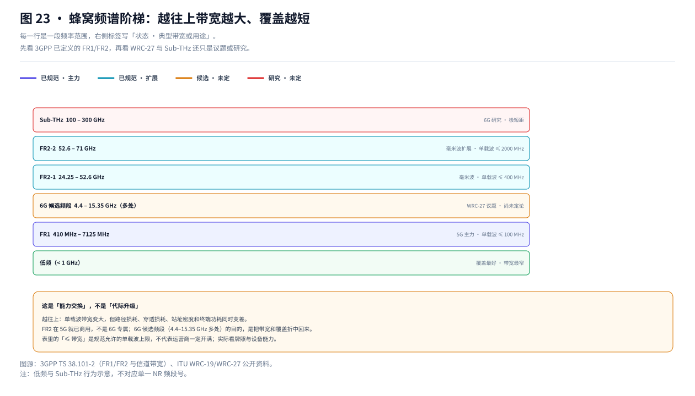
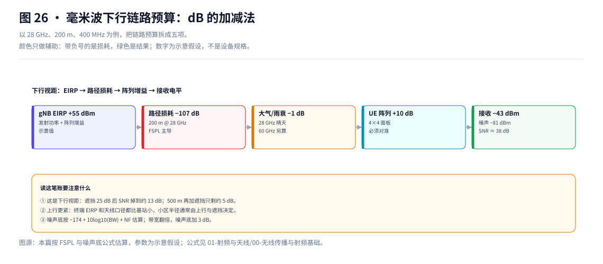
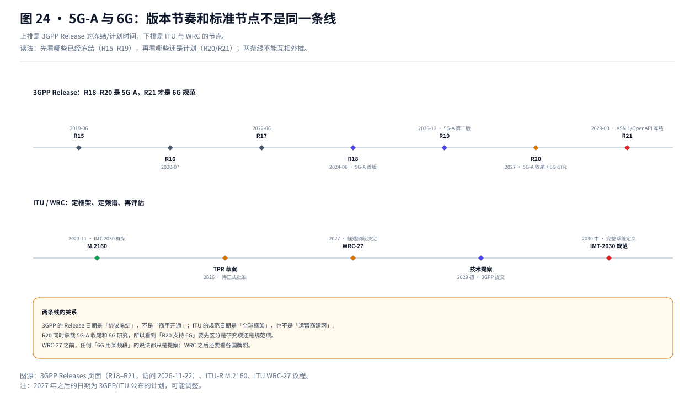
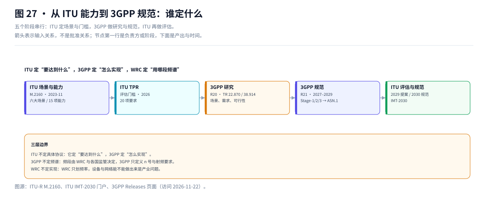
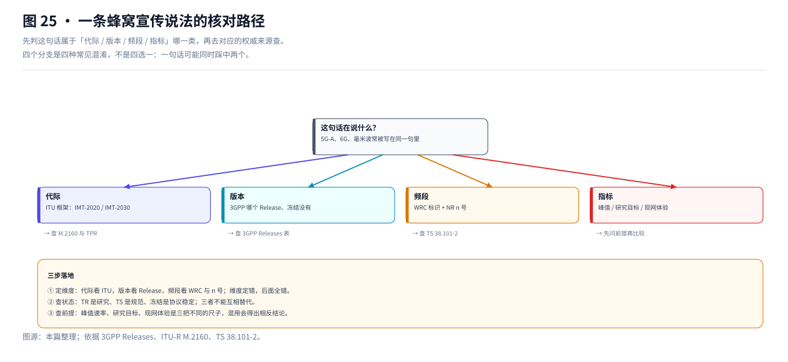
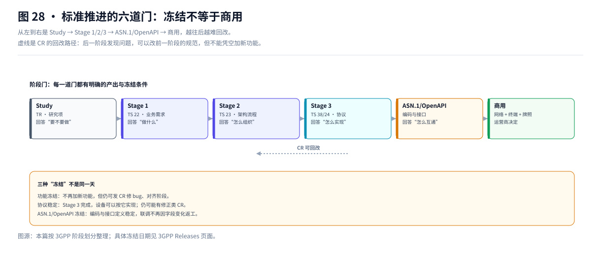

# 5G-Advanced、6G 与毫米波

5G-Advanced 是 5G 的**版本增强**（3GPP R18–R20），6G 是 ITU IMT-2030 框架下的**下一代**（3GPP 从 R21 开始规范化），毫米波是给两者提供带宽的**频段**（FR2）。三者经常被写成同一句话，实际分属“代际 / 版本 / 频谱”三个维度，混在一起就推不出正确结论。

> 本篇定位：覆盖 5G-A 三个 Release 各自解决了什么、ITU 与 3GPP 在 6G 上的分工与时间表、毫米波（FR2-1/FR2-2）与候选中频段的频谱边界，以及“用覆盖换带宽”的工程取舍。读完能回答四个问题：① 5G-A 到底补了哪三块；② 6G 与 5G-A 的分界线在哪；③ 毫米波能覆盖多远、瓶颈是什么；④ 一条“5G-A / 6G / 毫米波”说法该去哪里核对。物理层帧结构与波束细节去 [01-LTE与NR物理层](./01-LTE与NR物理层.md)，网络架构去 [00-蜂窝网络架构与演进](./00-蜂窝网络架构与演进.md)，射频链路预算公式去 [01-射频与天线/00-无线传播与射频基础](../01-射频与天线/00-无线传播与射频基础.md)，现网优化去 [05-无线测试与优化](../05-无线测试与优化/.readme.md)。

## 目录

- [1 一句话模型](#s1)
- [2 速览](#s2)
- [3 频谱地图：毫米波在哪、带宽从哪来](#s3)
- [4 毫米波的物理代价](#s4)
- [5 5G-Advanced：版本包，不是新代际](#s5)
- [6 6G：ITU 定能力，3GPP 定实现](#s6)
- [7 怎么核对一条“5G-A / 6G / 毫米波”说法](#s7)
- [8 标准阶段与状态机](#s8)
- [9 设计取舍与边界](#s9)
- [10 与相邻主题的关系](#s10)
- [名词解释](#名词解释)
- [11 参考与关联](#s11)

## 1 · 一句话模型：代际、版本、频谱是三件事

```text
代际（ITU 定能力）      5G ──────────────→ 6G（IMT-2030）
版本（3GPP 定实现）     R15…R17 │ R18–R20（5G-A） │ R21（首个 6G 规范）
频谱（WRC + 3GPP 定频段）  FR1（410 MHz–7.125 GHz） │ FR2-1 / FR2-2（24.25–71 GHz） │ 6G 候选中频段
```

只记三句话：

1. **代际看 ITU**：ITU-R 定义 IMT-2020（5G）和 IMT-2030（6G）的能力与评估口径，3GPP 只是“候选技术”的实现方。
2. **版本看 3GPP Release**：5G-A 不是一个新制式，而是 R18/R19/R20 三个版本的能力打包；6G 的规范工作从 R21 开始。
3. **毫米波看频段**：FR2 不是“第六代”，它是 24.25 GHz 以上的频率范围；带宽大、覆盖短，定位是热点与容量补充。

用公路打个比方：代际是“公路等级”，版本是“这条路的第几次改扩建”，频谱是“路的宽度”。**类比失效的地方**是——路可以新修，频谱不能凭空新增，它同时受物理传播和 WRC 协调两道约束。

> **一句话判断**：看到任何蜂窝新名词，先问它落在哪一行——代际、版本还是频谱。三行里有两行对不上，后面的结论基本不可信。

## 2 · 速览

| 项 | 内容 |
| --- | --- |
| 一句话结论 | 5G-A 是版本包，6G 是新代际，毫米波是频段；三者不能互相替代 |
| 常见误读 | “5G-A = 6G”“毫米波 = 6G”“峰值速率 = 现网体验” |
| 所属领域 | 无线通信 / 蜂窝 |
| 核心对象 | 3GPP Release、ITU IMT-2030、NR 频段（FR1/FR2） |
| 5G-A 范围 | R18（2024-06 完成，功能冻结 2024-03）、R19（2025-12 完成）、R20（预计 2027 年冻结） |
| 6G 节奏 | R20 做研究，R21 做规范；ITU 技术提案 2029 年初、完整规范 2030 年中 |
| 毫米波范围 | FR2-1：24.25–52.6 GHz；FR2-2：52.6–71 GHz（R17 扩展） |
| 单载波带宽 | FR1 最大 100 MHz；FR2-1 最大 400 MHz；FR2-2 最大 2000 MHz |
| 主要标准 | ITU-R M.2160；3GPP TS 38.101-2、TR 21.918/21.919、TR 22.870、TR 38.914 |
| 关键取舍 | 带宽 ↔ 覆盖；峰值速率 ↔ 现网体验；研究目标 ↔ 商用能力 |

## 3 · 频谱地图：毫米波在哪、带宽从哪来

### 3.1 3GPP 的频率范围



**读图**：从下往上是频率升高，行内标签是频率范围，右侧是每一段的“能力交换”——越往上单载波带宽越大，但覆盖与穿透越差。先看哪几段已经写进 3GPP 规范，再看哪几段还只是 WRC 议题或研究。

> 图源：`../images/图23-蜂窝频谱阶梯.svg`

| 名称 | 3GPP 定义 | 定位 | 读表时的边界 |
| --- | --- | --- | --- |
| FR1 | 410 MHz – 7125 MHz | 覆盖与容量平衡，5G 主力 | 含 6 GHz 段，不能等同于“Sub-6” |
| FR2-1 | 24.25 – 52.6 GHz | 毫米波主力，热点/固定无线 | 不是所有国家都发牌照 |
| FR2-2 | 52.6 – 71 GHz | 更大带宽，R17 新增 | 目前主要落在非授权频段 n263 |
| 6G 候选频段 | 4.4–15.35 GHz 多处（讨论中） | 覆盖与带宽的折中 | **尚未定论**，WRC-27 才做决定 |
| Sub-THz | 100 GHz 以上（研究） | 6G 研究，极短距 | 离标准化很远，不能当规划依据 |

FR2-2 不是新制式，而是把 FR2 的上界从 52.6 GHz 推到 71 GHz；目的是把 57–71 GHz 的非授权频谱纳入 NR，给高密度热点更多连续带宽。

“毫米波”没有统一的法定边界。工程上说毫米波，通常指 FR2；严格按波长算，30–300 GHz 才是毫米波（波长 1–10 mm），所以 24.25 GHz 的下边界其实是“厘米波/毫米波交界”。**名称是习惯，频段号才是依据。**

行业里还常把 7–24 GHz 叫 **FR3**。注意：FR3 不是 3GPP 的正式频率范围名称，TS 38.101 只有 FR1、FR2-1、FR2-2；它是产业界对“上中频段”的简称。看到 FR3，先确认对方说的是 7–24 GHz 这一段，而不是某个已定义的 NR 频段。

### 3.2 监管划“频率”，3GPP 划“频段”

WRC 决定哪些频率可以给 IMT 用，3GPP 再把它定义成 NR 频段（nXXX）。两者不是一一对应：

| WRC-19 标识给 IMT | 3GPP NR 频段 | 说明 |
| --- | --- | --- |
| 24.25–27.5 GHz | n258（24.25–27.5） | 全球协调程度最高的一段 |
| 26.5–29.5 GHz | n257 | 与 n258 部分重叠，按地区使用 |
| 27.5–28.35 GHz | n261 | 美国等市场 |
| 37–40 GHz | n260 | 与 n259 部分重叠 |
| 39.5–43.5 GHz | n259 | 与 n260 在 39.5–40 GHz 重叠 |
| 47.2–48.2 GHz | n262 | 区域使用 |
| 45.5–47 GHz | **无对应 NR 频段** | 已划给 IMT，但 3GPP 未定义 band |
| 66–71 GHz | n263（57–71，非授权） | FR2-2 的主要落点 |

三层决策各管一段，混起来就会把“能规划”当成“能建网”：

| 层级 | 谁决定 | 产物 | 不决定什么 |
| --- | --- | --- | --- |
| 频率划分 | WRC + 各国监管 | Radio Regulations、IMT 标识、牌照 | 具体协议与终端 |
| 频段与射频要求 | 3GPP RAN4 | nXXX、FR、信道带宽、UE/BS 射频指标 | 某国是否发牌 |
| 产品与网络 | 运营商 + 设备商 | 站址、带宽配置、开通策略 | 频谱归属 |

> **边界**：WRC-19 一共标识了 17.25 GHz 给 IMT，其中 14.75 GHz 全球协调；但“标识”不等于“每个国家都发牌照”，也不等于“3GPP 已定义频段”。看到“某频段已给 5G”时，要追问三件事：哪个 Region、是否发牌、有没有 n 号。

6G 的频谱还没定。WRC-27 议程 1.7 正在研究 4.4–4.8 GHz、7.125–8.4 GHz、14.8–15.35 GHz 三段；GSMA 等行业组织把 6–8 GHz 视为 6G 的主要候选频段，但这仍是提案，不是监管结论。WRC-27 议程 1.7 的起草材料引用行业研究：到 2035–2040 年，高密度地区平均需要约 2–3 GHz 中频段频谱。**频谱是 6G 的第一道门槛，不是最后一个细节。**

### 3.3 带宽、子载波间隔与速率

毫米波能提供大带宽，靠的是“更宽的单载波 + 更大的子载波间隔”：

| 频率范围 | 典型 SCS | 单载波带宽 | 为什么这样配 |
| --- | --- | --- | --- |
| FR1 | 15 / 30 kHz | 5–100 MHz | 带宽小，靠多载波聚合 |
| FR2-1 | 60 / 120 kHz | 50 / 100 / 200 / 400 MHz | 相位噪声大，SCS 必须加宽 |
| FR2-2 | 120 / 480 / 960 kHz | 400 / 800 / 1600 / 2000 MHz | 960 kHz 才能在 2 GHz 内放下足够 RB |

峰值速率的粗略关系：

```text
峰值速率 ≈ 带宽 × log2(调制阶数) × 层数 × (1 − 控制/参考开销)
```

以 400 MHz、256QAM（8 bit）、4 层、75% 效率估算：`400 MHz × 8 × 4 × 0.75 ≈ 9.6 Gbit/s`；同样条件下 100 MHz 只有约 2.4 Gbit/s。所以“带宽翻 4 倍”在理想条件下才接近“速率翻 4 倍”。FR2-2 的 2 GHz 单载波把频谱宽度再放大 5 倍，但实际速率还要受 SCS、RB 数和开销影响，不能直接按 20 倍算。

> **边界**：这是单用户、理想信道的峰值，不是现网体验。400 MHz 是小区/载波的资源，由所有用户共享；用户实际速率还取决于调度、层数、SINR、回传和套餐。把峰值当“每人都有”是毫米波宣传里最常见的偷换。

带宽不够时靠**载波聚合（CA）**把多个载波拼起来；但 CA 受终端能力、频段组合和射频链数量限制。FR2 终端同时开多个 400 MHz 载波，功耗和散热先顶不住。

**推论**：毫米波的价值是“把一段很宽的连续频谱交给一个小区域”，不是“让每个用户都跑到 10 Gbit/s”。前者是容量密度，后者是峰值演示。

### 3.4 双工：为什么毫米波几乎全是 TDD

| 频率范围 | 双工 | 原因 | 代价 |
| --- | --- | --- | --- |
| FR1 低段 | FDD 为主 | 有成对频谱，上下行互不干扰 | 频谱利用率受配对限制 |
| FR1 中段 | TDD 为主 | 非成对频谱多，可按业务配比 | 上下行共享时间，需全网同步 |
| FR2 | TDD | 高频段难有成对频谱；信道互易利于波束赋形 | 上行覆盖与时延受时隙配比约束 |

TDD 的上下行共用同一段频率，只是时间上错开。好处是配比可调（下行多、上行少），坏处是**上行只能占一部分时间**，覆盖和时延都吃亏。5G-A 的 SBFD 就是在这个约束下做文章：把下行时隙中的一小段频率临时改成上行子带，让上行不必等整个时隙翻转。

> **边界**：SBFD 不是“全双工”，它仍是子带级别的频分复用，基站侧还要处理自干扰和交叉链路干扰。终端是否支持、网络是否开通，决定了它是不是纸面功能。

## 4 · 毫米波的物理代价

### 4.1 链路预算：把 dB 加减一遍

先说结论：**毫米波的下行视距链路并不难闭合，难的是遮挡和上行。** 用一个示意算例把账算清：

| 假设 | 取值 | 说明 |
| --- | --- | --- |
| 频率 / 距离 | 28 GHz / 200 m | FR2-1 典型热点 |
| 带宽 | 400 MHz | 单载波 |
| gNB EIRP | 55 dBm | 发射功率 + 阵列增益，示意值 |
| UE 阵列增益 | 10 dB | 4×4 面板，需对准 |
| 噪声系数 | 7 dB | 接收机 |
| 大气/雨衰 | 1 dB | 28 GHz 视距，晴天 |



**读图**：从左到右依次加减：gNB EIRP 加 55 dB，路径损耗减 107 dB，大气减 1 dB，UE 阵列加 10 dB，得到接收电平约 −43 dBm；再与 400 MHz 带宽、7 dB 噪声系数下的噪声底 −81 dBm 相比，SNR 约 38 dB。**先看哪一项最大，再看哪一项最不确定**——路径损耗和遮挡是主导项。

> 图源：`../images/图26-毫米波链路预算.svg`

| 场景 | 路径损耗 | 接收电平 | SNR（400 MHz，NF 7 dB） | 判读 |
| --- | --- | --- | --- | --- |
| 200 m 视距 | 107 dB | −43 dBm | 38 dB | 高阶调制/MIMO 有余量 |
| 500 m 视距 | 115 dB | −51 dBm | 30 dB | 仍可跑，但已到边缘 |
| 200 m + 遮挡 25 dB | 132 dB | −68 dBm | 13 dB | 掉到低阶 MCS |
| 500 m + 遮挡 25 dB | 140 dB | −76 dBm | 5 dB | 接近失链 |

**为什么算出来“能覆盖几百米”，现网却常只有一两百米？** 因为上表是下行、视距、无遮挡、波束对准的理想值。现网还要扣：人体/车辆遮挡、雨衰、终端握持、波束跟踪误差、上行功率受限、站高与下倾。**下行链路预算决定“理论上能到哪”，上行与遮挡决定“实际小区多大”。**

> **边界**：EIRP、噪声系数、阵列增益都是示意假设，不是设备规格。真正做链路预算要用天线方向图、波束赋形增益、MIMO 层数和实测穿透损耗；同一组参数换个站高就能差 10 dB 以上。

### 4.2 大气、雨衰与遮挡

| 因素 | 影响 | 不能忽略的条件 |
| --- | --- | --- |
| 氧吸收 | 60 GHz 附近约 15 dB/km（ITU-R P.676） | 链路超过几百米，或使用 n263（57–71 GHz） |
| 水汽/雨衰 | 频率越高越明显，按雨强与可用度设计 | 覆盖半径大、可用度要求高（如 99.9%） |
| 建筑穿透 | 混凝土、镀膜玻璃可达数十 dB | 室外站想覆盖室内 |
| 人体/车辆遮挡 | 工程经验常见 20–30 dB 量级，随角度变化 | 有人流、车流、货架等动态遮挡 |
| 树叶/植被 | 有雨时进一步恶化，且随季节变化 | 郊区、园区、道路沿线 |

60 GHz 的账最好算：15 dB/km 意味着 200 m 加 3 dB、1 km 加 15 dB。所以 n263 更适合室内、场馆、短距回传，而不是广域覆盖。28/39 GHz 的氧吸收小得多，瓶颈主要不是大气，而是遮挡和穿透。

> **边界**：上表的损耗不是常数，随材质、入射角、湿度、雨强变化很大。链路预算必须用目标地区的雨衰模型和实测穿透损耗；拿别人的数字直接套，误差可能比余量还大。

### 4.3 波束：从扫描到恢复

毫米波必须把能量压成窄波束，否则覆盖不够；但波束越窄，越依赖“对准”。这就产生一条比 Sub-6 更长的状态链：

| 状态 | 在做什么 | 失败表现 | 恢复动作 |
| --- | --- | --- | --- |
| 初始扫描 | SSB 波束轮询，终端测 RSRP | 搜不到小区 | 换波束/换频点，检查覆盖与站高 |
| 连接态波束管理 | 测量、上报、波束切换 | 速率掉、波束漂移 | 调波束周期与测量配置 |
| 波束失败检测 | 候选波束低于阈值 | 链路失败 | 触发 BFR 或 RRC 重建 |
| 恢复后 | 重新对齐、恢复传输 | 反复失败 | 查遮挡、站距、移动性参数 |

具体流程（SSB 扫描、波束指示、TCI 状态、BFR）见 [01-LTE与NR物理层](./01-LTE与NR物理层.md) 的波束管理一节，本篇不重复。

| 现象 | 根因方向 | 处理方向 |
| --- | --- | --- |
| 静止时很快，一移动就断 | 波束跟踪慢、站距大、切换不及时 | 调波束周期与切换门限，补站 |
| 雨天速率明显下降 | 雨衰余量不足 | 提高功率/调整 MCS 与调度，必要时加站 |
| 室内几乎无服务 | 穿透损耗大 | 室分、窗边 CPE、室外站靠近窗 |
| 贴近基站也慢 | 回传、调度、干扰，而非覆盖 | 查回传带宽、PRB 利用率、干扰 |

> **边界**：波束管理不是毫米波独有，Sub-6 的 Massive MIMO 也要做；但毫米波没有它就连不上，所以它是“必需项”而不是“优化项”。

### 4.4 覆盖与容量的取舍

| 维度 | FR1（3.5 GHz 为例） | FR2-1（28 GHz 为例） | 结论 |
| --- | --- | --- | --- |
| 单载波带宽 | 100 MHz | 400 MHz | 毫米波带宽是 4 倍 |
| 典型站间距 | 数百米到公里级 | 数十米到数百米 | 毫米波需要更密的站 |
| 穿透 | 可穿一两堵墙 | 基本不穿 | 室内覆盖要单独解决 |
| 终端功耗 | 较低 | 射频链多、功耗高 | 终端散热与续航是硬约束 |
| 部署成本 | 站少、租金低 | 站多、回传与供电贵 | 单位面积成本可能更高 |
| 适用场景 | 广覆盖、移动性 | 热点、固定无线、场馆 | 不是替代关系，是分工 |

**为什么毫米波先出现在场馆和固定无线，而不是广域？** 因为它的经济性不取决于峰值，而取决于“每平方米成本能不能被高密度流量摊薄”。广域覆盖要按面积铺站，毫米波的站距短，站址、回传、供电、租金都会成倍上升；场馆和固定无线则是“点状高密度”，一份回传可以服务大量流量。

> **推论**：毫米波划算需要同时满足三条——流量密度足够高、有视距或可控反射、回传与供电能到位。缺一条，单位流量成本就可能高于中频段。

## 5 · 5G-Advanced：版本包，不是新代际



**读图**：上面一条是 3GPP Release 的冻结节奏，下面一条是 ITU/WRC 的节点。先看“哪个 Release 已经冻结”，再看“哪个节点还只是计划”。R20 同时承担 5G-A 收尾和 6G 研究，R21 才是 6G 的规范版本。

> 图源：`../images/图24-5GA与6G时间线.svg`

| Release | 状态与时间 | 定位 | 代表工作 | 读它时容易误判 |
| --- | --- | --- | --- | --- |
| R18 | 2024-06 完成（功能冻结 2024-03） | 5G-A 第一版 | AI/ML、能效、XR、NTN、MBS、切片、UAV、Sidelink/定位 | “5G-A 就是 R18”不准确，它是 R18–R20 的统称 |
| R19 | 2025-12 完成 | 5G-A 第二版 | 空口 AI/ML（CSI 预测、波束管理、定位）、SBFD、Ambient IoT、LP-WUS/WUR、7–24 GHz 与 ISAC 信道模型 | 把“信道模型研究”当成“功能已商用” |
| R20 | 预计 2027 年冻结 | 最后一个纯 5G-A 版本，同时做 6G 研究 | 能效、AI/ML、NTN、移动性、覆盖、公共安全、通感 | “R20 是 6G”错，R20 是研究 + 5G-A 收尾 |

5G-A 的功能不是“越多越好”，每一项都在补一个具体的洞，同时带一个代价：

| 功能 | 不解决会怎样 | 代价/前提 | 什么时候收益不明显 |
| --- | --- | --- | --- |
| 覆盖增强 | 小区边缘速率低、上行先断 | 重复传输/更多参考信号，吃时延与频谱 | 站距本来就小、边缘不忙 |
| 移动性增强 | 高速场景切换失败、掉话 | 更多测量与切换准备 | 室内低速、固定无线 |
| SBFD | TDD 上行覆盖差、时延高 | 自干扰/交叉链路干扰，基站复杂度高 | 终端不支持、干扰难协调 |
| 空口 AI/ML | CSI 反馈开销大、波束管理靠规则 | 训练数据、模型泛化、终端算力 | 场景简单、数据不足 |
| RedCap（R17 引入，R18/R19 增强） | 物联终端成本/功耗下不来 | 峰值、带宽、天线数都降档 | 需要宽带或高速上传的业务 |
| NTN | 偏远地区无覆盖 | 传播时延大、多普勒、终端天线受限 | 城市密集区、低成本终端 |
| Ambient IoT | 电池更换成本高、无源标签接不进网 | 速率极低、距离短、依赖反向散射 | 需要连续高速上传 |
| LP-WUS/WUR | 待机功耗高 | 额外接收机、误唤醒 | 常在线、对时延敏感的设备 |
| 网络节能 | 电费与碳排高 | 容量/时延的折中 | 高负荷时段、保覆盖场景 |
| MBS | 场馆/热点重复传输浪费资源 | 资源分配与同步复杂 | 点对点业务为主 |
| ISAC（研究） | 通信网无法提供感知 | 目前主要是信道模型与场景研究，规范能力有限 | 需要精确定位/成像的业务 |

5G-A 的价值可以归成三类“补课”：

1. **补覆盖与移动性**：NR 覆盖增强、移动性增强，解决 5G 初期“站密但体验不稳”的问题。**为什么需要**：5G 的峰值是按理想条件设计的，边缘用户先被上行和切换拖垮。
2. **补上行与能效**：SBFD 让 TDD 的部分下行频谱临时改成上行子带，缓解上行覆盖与时延；网络节能直接对应运营成本。**为什么需要**：TDD 的上下行共用时间，上行永远是短板；而电费是运营商长期 OPEX 的重要一项。
3. **补新场景**：通感一体（ISAC）、无源物联（Ambient IoT）、低功耗唤醒（LP-WUS/WUR）、NTN，都是为 6G 做技术预演。**为什么需要**：6G 的新场景不能等到 R21 才开始验证，先在 5G-A 上试错，成本和风险都低。

> **边界**：5G-A 的功能是否可用，取决于“网络开了没有 + 终端支持没有”。R18 冻结不等于现网支持，R19 完成也不等于终端能跑。看到“5G-A”标志，先问是哪个 Release 的哪项功能；标志由运营商与终端厂商定义，不等于能力全集。

## 6 · 6G：ITU 定能力，3GPP 定实现

### 6.1 ITU：先定场景与能力，再定评估门槛

6G 不是 3GPP 一家说了算。ITU-R 先给“未来移动通信要解决什么”，3GPP 再回答“用什么技术实现”，WRC 决定“用哪段频谱”。这条链是串行的，任何一环没完成，下一环就只能做假设：



**读图**：从左到右是五个阶段，节点第一行是负责方或阶段，下面是产出与时间。ITU 负责场景、能力和评估门槛；3GPP 负责研究与规范；最后的评估又回到 ITU。**箭头是“输入”，不是“批准”**——3GPP 的规范不会自动变成 IMT-2030 规范。

> 图源：`../images/图27-ITU至3GPP分工.svg`

ITU-R M.2160（2023-11）给出 IMT-2030 的框架。它在 IMT-2020 的三个场景（eMBB/URLLC/mMTC）之外，扩展并新增为六个：

| 场景 | 英文全称 | 相对 5G 的变化 |
| --- | --- | --- |
| 沉浸式通信 | Immersive Communication | eMBB 的增强，面向 XR、全息、多感官 |
| 超可靠低时延通信 | Hyper Reliable and Low-Latency Communication | URLLC 的增强，时延与可靠性更严 |
| 大规模通信 | Massive Communication | mMTC 的增强，连接密度更高 |
| 泛在连接 | Ubiquitous Connectivity | **新增**，重点是缩小数字鸿沟 |
| AI 与通信 | Artificial Intelligence and Communication | **新增**，网络内生 AI 与算力 |
| 通感一体 | Integrated Sensing and Communication | **新增**，通信网同时做感知 |

能力项扩展到 15 项：9 项增强 + 6 项新增（覆盖、定位、感知、AI、可持续性、互操作等）。研究目标（示例值，不是单一硬指标）：

| 能力 | IMT-2030 研究目标（示例） | 怎么读 |
| --- | --- | --- |
| 峰值速率 | 50 / 100 / 200 Gbit/s | 三个示例值，按场景选取，不是“必须 200G” |
| 用户体验速率 | 300 / 500 Mbit/s | 比 5G 的 100 Mbit/s 目标提高 |
| 时延 | 0.1–1 ms（空口） | 区间，不是所有场景都取 0.1 ms |
| 连接密度 | 10⁶–10⁸ 设备/km² | 上限比 5G 高两个数量级 |
| 移动性 | 500–1000 km/h | 面向高速铁路与航空 |
| 定位精度 | 1–10 cm | 新增能力，5G 定位目标为米级 |
| 可靠性 | 1−10⁻⁵ 到 1−10⁻⁷ | 区间，按业务选取 |
| 频谱效率 | 1.5–3 倍于 IMT-2020 | 相对值 |
| 区域流量 | 30–50 Mbit/s/m² | 相对 5G 的 10 Mbit/s/m² 提高 |

> **边界**：M.2160 明确写的是“研究目标范围”，同一能力在不同场景取不同值，且不可能同时达到。把它当成“6G 手机必须 200 Gbps”是误读；真正的门槛在 ITU 后续的 TPR（最小技术性能要求），而 TPR 只约束候选技术评估，不承诺现网体验。ITU 的 TPR 草案在 2026 年 2 月由 WP 5D 达成一致，含 20 项要求、其中 7 项为 6G 新增，预计 2026-12 由 SG5 正式批准（以 ITU 发布为准）。

### 6.2 3GPP：R20 研究，R21 规范

| 阶段 | 时间（以 3GPP 公告为准） | 产出 | 作用 |
| --- | --- | --- | --- |
| 6G 需求研究 | R20（2025–2027） | TR 22.870（用例与业务需求，SA#111 已批准）、TR 38.914（RAN 场景与需求，计划 2026-06 批准，以 3GPP 发布为准） | 回答“6G 要解决什么问题” |
| 6G 系统研究 | R20 | SA2 架构、SA3 安全、SA5 管理与计费、SA6 应用使能等研究项 | 回答“系统怎么组织” |
| 6G 规范 | R21（2027–2029） | 首个 6G 规范性版本 | 回答“怎么实现” |
| ITU 技术提案 | 2029 年初 | 3GPP 提交的候选技术 | 参与 IMT-2030 评估 |
| ITU 完整规范 | 2030 年中 | IMT-2030 规范 | 全球框架落地 |

R21 的时间点已经排定：Stage-1 2027-03、Stage-2 2028-06、Stage-3 2028-12、ASN.1/OpenAPI 2029-03。

**为什么研究要单独占一个 Release？** 6G 的场景、信道、架构、安全都要先验证；直接进规范，等于把还没收敛的方案写死。R20 的研究项就是给 R21 探路，研究结论可以否定某些方向，规范一旦冻结就只能发 CR 修补。

> **边界**：这是“规范完成”的时间，不是“商用开通”的时间。历史上 R15 在 2019 年完成，5G 规模商用还用了数年；6G 的商用节奏取决于频谱、终端和投资，不能从 Release 日期直接外推。

### 6.3 6G 的候选技术：分清“已研究”和“已确定”

| 方向 | 现状 | 证据等级 | 不能怎么说 |
| --- | --- | --- | --- |
| 新频段（WRC-27 候选段） | WRC-27 议题 1.7 研究 4.4–4.8 / 7.125–8.4 / 14.8–15.35 GHz；3GPP R19 已做 7–24 GHz 信道模型 | 研究/议题 | “6G 一定用 7 GHz” |
| Sub-THz | 学术界与预研，3GPP 未定频段 | 预研 | “6G 用太赫兹” |
| 通感一体（ISAC） | R19 做信道模型，R20 继续 | 研究 | “5G-A 已全面支持通感” |
| AI 原生空口 | R18 研究、R19 规范 CSI/波束/定位用例 | 部分规范 | “6G 空口由 AI 端到端替代” |
| 天地一体（NTN） | R17 起逐步增强，R18/R19 继续 | 已规范/增强 | “6G 才支持卫星” |
| 新波形/新多址 | TR 38.914 之后才系统研究 | 未定 | 现在给出参数的都是猜测 |

**6G 会不会换一套全新空口？** 目前没有结论。3GPP 的研究顺序是“先场景与需求，再评估是否需要新空口”；R20 的 TR 38.914 只做场景与需求，空口方案要到 R21 才定。NR 从 R15 起就强调后向兼容与可扩展 numerology，这是“在 NR 框架上演进”的技术基础，但不是结论。任何“6G 一定用某某波形”的说法，在 R21 立项前都只能算提案。

### 6.4 为什么还需要 6G

如果只看峰值速率，5G-A 已经能覆盖大部分 eMBB 需求，6G 确实像“更快的 5G”。但 ITU 新增的三个场景（UC/AIAC/ISAC）都不是速率问题：

| 压力 | 5G/5G-A 的不足 | 6G 的目标 |
| --- | --- | --- |
| 新能力 | 感知、AI、泛在连接不是原生能力 | ISAC、AIAC、UC 成为系统能力 |
| 覆盖 | 偏远地区建站不经济 | 天地一体、低成本覆盖 |
| 可持续性 | 能耗随流量上升 | 能效成为设计约束 |
| 频谱 | 中频段资源紧张 | 新频段 + 更高频段 |

> **边界**：6G 的正当性目前仍是“能力论证”，不是“商业论证”。ISAC、AI 原生、泛在连接能不能形成足够大的收入，运营商自己也在验证；5G-A 已经把其中一部分提前做了。**如果只按“更快的 5G”理解 6G，会高估它的短期价值、低估它的长期不确定性。**

## 7 · 怎么核对一条“5G-A / 6G / 毫米波”说法



**读图**：从顶部问题出发，先判这句话属于“代际 / 版本 / 频段 / 指标”哪一类，再分别去 ITU、3GPP Release 表、WRC 与 TS 38.101-2 查证。四个分支不是并列选项，而是四种最常见的混淆。

> 图源：`../images/图25-蜂窝说法核对路径.svg`

| 步骤 | 问什么 | 怎么答 | 答错的后果 |
| --- | --- | --- | --- |
| ① 定维度 | 这句话在说代际、版本、频段还是指标？ | 5G-A → 版本；6G → 代际；毫米波 → 频段；200 Gbps → 指标 | 把频段当制式，后面查什么都对不上 |
| ② 查版本 | 对应 3GPP 哪个 Release，冻结了吗？ | 查 3GPP Releases 表：R18 2024-06、R19 2025-12、R20 预计 2027 | 把研究项当商用功能，或把计划当既成事实 |
| ③ 查频谱 | 频段是否已划分、3GPP 是否定义了 n 号？ | WRC 决议 + TS 38.101-2 频段表 | 把 WRC 候选频段当成可建网频段 |
| ④ 查能力前提 | 指标是峰值、研究目标还是现网体验？ | IMT-2030 是研究目标；现网看带宽、站距、回传、终端 | 拿 200 Gbit/s 对比现网测速，得出“6G 是骗局” |

具体查证位置：

| 说法 | 查哪里 | 具体位置 | 判据 |
| --- | --- | --- | --- |
| “5G-A 支持 X” | 3GPP Release 页 + TR 21.918/21.919 | R18/R19 工作项摘要 | 是 Study 还是 WI；冻结不等于开通 |
| “毫米波频段 nXXX” | TS 38.101-2 | 表 5.1-1、5.2-1 | 频率范围、双工、是否非授权 |
| “单载波能到 X MHz” | TS 38.101-2 | 表 5.3.5-1 | 频段 + SCS + 带宽三者绑定 |
| “6G 用某频段” | ITU WRC-27 议程 + 最终法案 | 议程 1.7、Res. 256 | 是“研究”还是“标识” |
| “6G 峰值 200 Gbps” | ITU-R M.2160 | §4 能力项 | 研究目标示例，不是门槛 |
| “R21 已冻结” | 3GPP Release 21 页 | 时间表 | Stage-3 与 ASN.1 是不同节点 |
| “手机支持 5G-A” | 终端能力/网络配置 | UE capability、功能开关 | 标志 ≠ 能力 |

三个高频混淆，按这个顺序拆：

- **“5G-A 就是 6G”**：5G-A 仍在 IMT-2020 框架内，6G 才是 IMT-2030。
- **“毫米波是 6G 技术”**：毫米波在 5G（FR2）就已商用，6G 只是继续用并向更高频延伸。
- **“R21 冻结就能用 6G”**：规范、频谱、终端、网络四件事都到位才可能商用。

三种最常见的错误推理：

1. **把 Release 当商用时间**：R15 在 2019 年完成，5G 规模商用却用了数年；规范是“能实现”，不是“已建网”。
2. **把 WRC 候选当牌照**：WRC-27 还在研究 7.125–8.4 GHz，离“某国可建网”还有牌照、设备、干扰协调三道关。
3. **把峰值当体验**：峰值是单用户、理想信道、空载小区；现网体验看的是边缘速率、时延和稳定性。

## 8 · 标准阶段与状态机

本篇**没有运行态状态机**（UE 的 RRC 状态、波束状态在 [01-LTE与NR物理层](./01-LTE与NR物理层.md) 与 [02-入网与移动性管理](./02-入网与移动性管理.md)）。这里的状态机是“标准推进的阶段门”：

| 阶段 | 谁负责 | 产出 | 进入下一阶段的条件 | 容易误判 |
| --- | --- | --- | --- | --- |
| Study（研究） | 3GPP WG/TSG | TR | 场景、需求、可行性有结论 | 把 TR 当规范 |
| Stage 1 | TSG SA1 | 业务需求（TS 22.xxx） | 需求冻结 | 把需求当功能 |
| Stage 2 | TSG SA2 | 架构与流程（TS 23.xxx） | 架构冻结 | 把架构图当可实施 |
| Stage 3 | TSG RAN/CT | 协议细节（TS 38.xxx/24.xxx 等） | 协议冻结 | 把协议冻结当终端支持 |
| ASN.1 / OpenAPI | TSG CT | 编码与接口定义 | 冻结 | 忽略编解码，联调才发现不兼容 |
| 商用 | 运营商 + 终端厂 | 网络、终端、牌照 | 运营商决定 | 把标准时间当建网时间 |



**读图**：从左到右六道门，每一道门都有产出和冻结条件；虚线是 CR 的回改路径，表示后一阶段发现问题可以回头改前一阶段的规范。先看“门”的顺序，再看“冻结”到底冻的是功能、协议还是编码——三者不是同一天。

> 图源：`../images/图28-标准阶段门.svg`

三个“冻结”不是一回事：

| 说法 | 含义 | 还能改什么 |
| --- | --- | --- |
| 功能冻结（functional freeze） | 不再加新功能 | 可以发 CR 修 bug、对齐阶段 |
| 协议稳定（protocol stable） | Stage 3 完成，可实现 | 仍可有修正类 CR |
| ASN.1/OpenAPI 冻结 | 编码与接口定义稳定 | 只做必要的兼容性修正 |

“定时器”在这里对应的是 Release 的冻结里程碑：Stage-1 → Stage-2 → Stage-3 → ASN.1，一级比一级晚，且**后一级可以回改前一级**（发 CR）。所以“某版本已冻结”仍可能有后续修正，只是不再加新功能。

> **边界**：3GPP 的时间表由 PCG/TSG 决定，媒体上的“某年商用”多数是运营商或设备商的预测，不是标准组织的承诺。

## 9 · 设计取舍与边界

### 9.1 毫米波与中频段：不是替代，是分工

| 维度 | 中频段（3.5 GHz / 6–7 GHz） | 毫米波（FR2） |
| --- | --- | --- |
| 覆盖 | 广，可连续组网 | 短，适合热点与补盲 |
| 带宽 | 100 MHz 级 | 400 MHz–2 GHz |
| 移动性 | 好 | 差，波束易断 |
| 穿透 | 可穿一两堵墙 | 基本不穿 |
| 终端 | 射频链少、功耗低 | 阵列多、功耗高、散热难 |
| 成本 | 单位面积较低 | 站密、回传贵，单位面积可能更高 |
| 典型用途 | 广域 eMBB、室内覆盖 | 场馆、固定无线、回传、高密度热点 |

> **推论**：一张网的最优解通常是“低频保覆盖 + 中频保容量 + 毫米波补热点”，而不是全用毫米波。谁把毫米波当广覆盖手段，谁就会先被站址和电费打败。

### 9.2 选型规则：先问需求，再问技术

| 需求 | 首选 | 不选什么 | 理由 |
| --- | --- | --- | --- |
| 广域覆盖、高速移动 | 低频/中频 | 毫米波 | 覆盖与移动性优先 |
| 热点容量密度 | 毫米波 + 中频 | 只加中频 | 带宽密度决定容量 |
| 固定无线接入（LOS） | 毫米波 | 非视距场景 | 定向 CPE 可补回部分损耗 |
| 新能力试点（通感/AI） | 5G-A | 等 6G | 现网可验证，成本低 |
| 长期频谱投资 | 看 WRC-27 / R21 | 提前锁频 | 频谱与规范都未定 |

> **边界**：这张表是“默认顺序”，不是绝对规则。站址、回传、终端生态、监管都可能推翻它；真正决策要按项目算单位流量成本。

### 9.3 常见误判

1. **“5G-A 是 6G 的过渡，所以不用关心”**：5G-A 仍是未来数年的现网主力（具体周期看运营商），6G 首商用也在它之后。
2. **“毫米波一定比 Sub-6 快”**：峰值取决于带宽与信号质量；覆盖边缘的毫米波可能不如中频段。
3. **“带宽翻倍，速率就翻倍”**：还要看层数、调制、开销、回传和调度。
4. **“6G 的目标是 200 Gbps”**：那是 M.2160 的示例上限之一，不是统一门槛。
5. **“标准冻结 = 现网可用”**：网络开通、终端支持、频谱牌照缺一不可。
6. **“Sub-THz 是 6G 的确定方向”**：目前只是研究，3GPP 没有定频段。
7. **“手机显示 5G-A 就是 5G-A 全功能”**：标志可能只代表某个版本或某频段，具体看终端能力与网络配置。

### 9.4 可观测的判据

| 现象 | 先查什么 | 判据 |
| --- | --- | --- |
| 手机显示 5G-A 但体验没变 | 网络是否开通对应 Release 功能、终端能力 | 对比 R18/R19 功能开关与终端能力上报 |
| 毫米波小区速率高但一移动就断 | 站距、波束覆盖、切换/波束恢复参数 | 看波束切换与链路失败计数 |
| 同一位置毫米波白天快、雨天慢 | 雨衰余量、发射功率、自适应调制 | 对比雨衰前后的 MCS 与误码 |
| 室内毫米波几乎无服务 | 穿透损耗、是否室分 | 看室外站入射角与室内接收电平 |
| 近站速率也上不去 | 回传、调度、干扰、终端能力 | 查回传带宽、PRB 利用率、SINR |

## 10 · 与相邻主题的关系

| 相邻主题 | 关系 | 本篇不覆盖的部分 |
| --- | --- | --- |
| [00-蜂窝网络架构与演进](./00-蜂窝网络架构与演进.md) | 代际与网元演进；本篇只讲“下一步” | EPC/5GC 网元与接口细节 |
| [01-LTE与NR物理层](./01-LTE与NR物理层.md) | numerology、SSB 波束、帧结构 | 物理层过程与参考信号 |
| [02-入网与移动性管理](./02-入网与移动性管理.md) | 波束失败后的重建、切换 | RRC/NAS 流程与定时器 |
| [05-QoS与承载](./05-QoS与承载.md) | 新场景如何映射到 QoS 流 | 5QI/承载建立细节 |
| [01-射频与天线/00-无线传播与射频基础](../01-射频与天线/00-无线传播与射频基础.md) | 路径损耗、雨衰、链路预算 | 天线方向图与链路预算公式 |
| [05-无线测试与优化](../05-无线测试与优化/.readme.md) | 现网覆盖/干扰/容量优化 | 测试方法与优化参数 |
| [05-协议与标准](../../05-协议与标准/.readme.md) | 标准组织与文档体系 | 标准清单与获取方式 |
| [40-平台与芯片](../../../../40-平台与芯片/.readme.md) | 毫米波射频前端、基带芯片 | 芯片型号与射频架构 |
| [30-产品与方案/33-CPE](../../../../30-产品与方案/33-CPE/.readme.md) | 5G CPE / 固定无线产品 | 产品形态与成本 |

一句话：**00 讲“现在的网怎么构成”，本篇讲“下一版加什么、下一代的边界在哪、频谱够不够”。**

## 名词解释

> 缩写给出英文全称；非缩写用“—”表示。

| 术语 | 英文全称 | 解释 |
| --- | --- | --- |
| IMT | International Mobile Telecommunications | 国际移动通信，ITU 的移动通信总称。 |
| IMT-2020 | International Mobile Telecommunications-2020 | 5G 的 ITU 框架名称。 |
| IMT-2030 | International Mobile Telecommunications-2030 | 6G 的 ITU 框架名称。 |
| ITU-R | ITU Radiocommunication Sector | 国际电信联盟无线电通信部门。 |
| WP 5D | Working Party 5D | ITU-R 负责 IMT 标准的工作组。 |
| SG5 | Study Group 5 | ITU-R 地面业务研究组，WP 5D 的上级。 |
| WRC | World Radiocommunication Conference | 世界无线电通信大会，负责频谱划分。 |
| CPM | Conference Preparatory Meeting | WRC 准备会议，产出技术基础文本。 |
| TPR | Technical Performance Requirements | 最小技术性能要求，用于评估候选技术。 |
| 3GPP | 3rd Generation Partnership Project | 移动通信标准组织。 |
| TSG | Technical Specification Group | 3GPP 技术规范组（SA/RAN/CT）。 |
| Release | — | 3GPP 的版本单位，用“R+数字”表示（如 R18）。 |
| SI | Study Item | 研究项，产出 TR。 |
| WI | Work Item | 工作项，产出 TS。 |
| CR | Change Request | 变更请求，用于修改已冻结的规范。 |
| 5G-A | 5G-Advanced | 5G 的增强版本，覆盖 R18–R20。 |
| 6G | — | 第六代移动通信，对应 IMT-2030。 |
| NR | New Radio | 5G 的空口制式。 |
| FR1 | Frequency Range 1 | 410 MHz–7125 MHz。 |
| FR2 | Frequency Range 2 | 24.25–71 GHz，含 FR2-1/FR2-2。 |
| FR2-1 | Frequency Range 2-1 | 24.25–52.6 GHz。 |
| FR2-2 | Frequency Range 2-2 | 52.6–71 GHz，R17 新增。 |
| FR3 | Frequency Range 3 | 行业对 7–24 GHz 的称呼；3GPP 规范无此定义。 |
| mmWave | Millimetre Wave | 毫米波，通常指 FR2。 |
| Sub-THz | Sub-Terahertz | 100 GHz 以上的亚太赫兹频段。 |
| SCS | Subcarrier Spacing | 子载波间隔。 |
| RB | Resource Block | 资源块。 |
| BWP | Bandwidth Part | 带宽部分，终端在载波内的工作带宽。 |
| CA | Carrier Aggregation | 载波聚合。 |
| SSB | Synchronization Signal Block | 同步信号块，波束扫描的载体。 |
| TCI | Transmission Configuration Indicator | 传输配置指示，关联波束与信道。 |
| BFR | Beam Failure Recovery | 波束失败恢复。 |
| RSRP | Reference Signal Received Power | 参考信号接收功率。 |
| SINR | Signal to Interference plus Noise Ratio | 信号与干扰加噪声比。 |
| MCS | Modulation and Coding Scheme | 调制编码方案。 |
| EIRP | Effective Isotropic Radiated Power | 等效全向辐射功率。 |
| TDD | Time Division Duplex | 时分双工。 |
| FDD | Frequency Division Duplex | 频分双工。 |
| FWA | Fixed Wireless Access | 固定无线接入。 |
| CAPEX | Capital Expenditure | 资本支出。 |
| OPEX | Operational Expenditure | 运营支出。 |
| eMBB | enhanced Mobile Broadband | 增强移动宽带。 |
| URLLC | Ultra-Reliable Low-Latency Communication | 超可靠低时延通信。 |
| mMTC | massive Machine-Type Communication | 大规模机器通信。 |
| HRLLC | Hyper Reliable and Low-Latency Communication | IMT-2030 的超可靠低时延场景。 |
| IC | Immersive Communication | 沉浸式通信。 |
| MC | Massive Communication | 大规模通信。 |
| UC | Ubiquitous Connectivity | 泛在连接。 |
| AIAC | Artificial Intelligence and Communication | AI 与通信融合场景。 |
| ISAC | Integrated Sensing and Communication | 通感一体。 |
| NTN | Non-Terrestrial Network | 非地面网络（卫星/高空平台）。 |
| SBFD | Sub-Band Full Duplex | 子带全双工，TDD 内部分频谱改上行。 |
| AI/ML | Artificial Intelligence / Machine Learning | 人工智能/机器学习。 |
| Ambient IoT | Ambient Internet of Things | 环境能量供能的无源/极低功耗物联。 |
| LP-WUS | Low-Power Wake-Up Signal | 低功耗唤醒信号。 |
| WUR | Wake-Up Receiver | 唤醒接收机。 |
| MBS | Multicast and Broadcast Services | 多播广播业务。 |
| XR | Extended Reality | 扩展现实（含 AR/VR/MR）。 |
| RedCap | Reduced Capability | 精简能力终端。 |
| UAV | Unmanned Aerial Vehicle | 无人机。 |
| FSPL | Free Space Path Loss | 自由空间路径损耗。 |
| ASN.1 | Abstract Syntax Notation One | 抽象语法记法，协议编码定义。 |
| OpenAPI | Open Application Programming Interface | 开放接口描述规范，5GC 服务化接口使用。 |

## 11 · 参考与关联

**标准与官方资料**

- ITU-R M.2160（2023-11）：IMT-2030 框架与总体目标。<https://www.itu.int/rec/R-REC-M.2160/en>
- ITU-R P.676-13（2022-08）：大气气体衰减，60 GHz 氧吸收峰约 15 dB/km。<https://www.itu.int/rec/R-REC-P.676-13-202208-I/>
- ITU：WRC-19 为 IMT 新增毫米波频段。<https://www.itu.int/hub/2020/01/wrc-19-identifies-additional-frequency-bands-for-5g/>
- ITU-R：WRC-27 议程 1.7（4.4–4.8 / 7.125–8.4 / 14.8–15.35 GHz）。<https://www.itu.int/en/ITU-R/study-groups/rcpm/Pages/wrc-27-studies.aspx>
- ITU：IMT-2030 技术性能要求草案（2026-03 报道，预计 2026-12 批准）。<https://www.itu.int/hub/2026/03/imt-2030-technical-requirements-for-the-6g-future/>
- ITU-R：IMT-2030 门户（时间表与评估资料）。<https://www.itu.int/en/ITU-R/study-groups/rsg5/rwp5d/imt-2030/Pages/default.aspx>
- 3GPP Releases 与时间表。<https://www.3gpp.org/specifications-technologies/releases>
- 3GPP Release 18（首个 5G-A 版本）。<https://www.3gpp.org/specifications-technologies/releases/release-18>
- 3GPP Release 19（第二个 5G-A 版本）。<https://www.3gpp.org/specifications-technologies/releases/release-19>
- 3GPP Release 20（5G-A 收尾 + 6G 研究）。<https://www.3gpp.org/specifications-technologies/releases/release-20>
- 3GPP Release 21（首个 6G 规范版本与时间点）。<https://www.3gpp.org/specifications-technologies/releases/release-21>
- 3GPP RAN：Rel-19 状态与 6G 之前的技术方向（SBFD、AI/ML、Ambient IoT）。<https://www.3gpp.org/technologies/ran-rel-19>
- 3GPP TR 21.918 / 21.919：R18 / R19 工作项摘要。
- 3GPP TR 22.870：6G 用例与业务需求；TR 38.914：6G 无线场景与需求。
- 3GPP TS 38.101-1 / 38.101-2：FR1 / FR2 频段、信道带宽与 SCS（表 5.1-1、5.2-1、5.3.5-1）。

**关联**

- [00-蜂窝网络架构与演进](./00-蜂窝网络架构与演进.md)
- [01-LTE与NR物理层](./01-LTE与NR物理层.md)
- [01-射频与天线/00-无线传播与射频基础](../01-射频与天线/00-无线传播与射频基础.md)
- [05-无线测试与优化](../05-无线测试与优化/.readme.md)
- [05-协议与标准](../../05-协议与标准/.readme.md)

---

> **本篇定位**：5G-A/6G 的代际与版本边界、毫米波与候选中频段的频谱边界、链路预算与部署取舍；不展开空口参数、网元流程与厂商实现。
> **素材来源**：3GPP 官方 Release 页面（R18–R21）与 RAN Rel-19 文章、ITU-R M.2160、ITU-R P.676-13、ITU WRC-19/WRC-27 与 IMT-2030 公开资料、3GPP TS 38.101-1/2，访问日期 2026-11-22；本篇结论以这些一手资料为准。
> **待验证**：IMT-2030 TPR 的正式批准（预计 2026-12）、R20/R21 冻结日期（3GPP 标注为 projected）、6G 是否引入全新空口/波形（TR 38.914 之后再定）、毫米波现网站距与穿透损耗的具体数值（随地区、材质、运营商差异大，需实测）。
