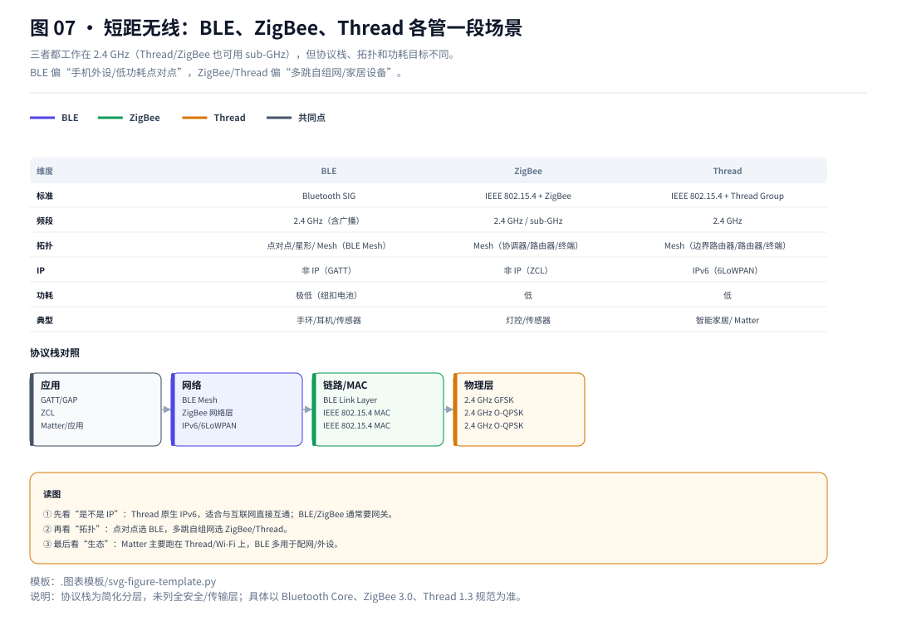

# BLE / ZigBee / Thread

三者都面向“低功耗、短距离、大量设备”，但目标不同：BLE 偏手机外设与低功耗点对点，ZigBee 偏多跳自组网与灯控/传感器，Thread 偏“原生 IPv6 的家庭 Mesh”，也是 Matter 的主要承载之一。

> 本篇定位：BLE、ZigBee、Thread 的频段、拓扑、协议栈、功耗与典型场景对比。Wi-Fi 去 [02-Wi-Fi](../02-Wi-Fi/.readme.md)，蜂窝去 [03-蜂窝通信](../03-蜂窝通信/.readme.md)。

## 目录

- [1 一句话模型](#s1)
- [2 速览](#s2)
- [3 三者怎么选](#s3)
- [4 组网与数据路径](#s4)
- [5 状态机与定时器](#s5)
- [6 设计取舍与边界](#s6)
- [7 与相邻主题的关系](#s7)
- [名词解释](#名词解释)
- [8 参考与关联](#s8)

## 1 · 一句话模型：都省电，但“怎么组网、是不是 IP”不同

```text
BLE：广播/连接 → GATT 读写 → 手机/网关
ZigBee：协调器建网 → 路由器多跳 → 终端节点 → 网关
Thread：边界路由器 → Mesh 路由器 → 终端 → IPv6/互联网
```

三个关键认知：

1. **BLE 不是“蓝牙经典”**：BLE 为低功耗设计，靠广播/连接和 GATT 属性交互，适合小数据、间歇通信。
2. **ZigBee/Thread 都是 IEEE 802.15.4 之上的 Mesh**：区别在 ZigBee 用私有网络层/ZCL，Thread 用 IPv6/6LoWPAN。
3. **“低功耗”是用占空比换的**：休眠越深、上报越少，功耗越低，但时延/实时性越差。

## 2 · 速览

| 项 | 内容 |
| --- | --- |
| 所属领域 | 无线通信/短距无线 |
| 核心对象 | 广播、连接、Mesh、边界路由器 |
| 关键参数 | 频段、速率、功耗、拓扑、最大跳数 |
| 主要标准 | Bluetooth Core、IEEE 802.15.4、ZigBee 3.0、Thread 1.3 |
| 典型生态 | 手环/耳机、灯控/传感器、Matter/智能家居 |

## 3 · 三者怎么选



**读图**：上半部分是 BLE/ZigBee/Thread 的维度对比，下半部分是协议栈分层。先看“是不是 IP”，再看“拓扑”和“生态”。

> 图源：`images/图07-短距无线对比.svg`

| 维度 | BLE | ZigBee | Thread |
| --- | --- | --- | --- |
| 标准组织 | Bluetooth SIG | IEEE 802.15.4 + ZigBee Alliance | IEEE 802.15.4 + Thread Group |
| 频段 | 2.4 GHz | 2.4 GHz / sub-GHz | 2.4 GHz |
| 速率 | 1–2 Mbps（LE） | 250 kbps（2.4 GHz） | 250 kbps（2.4 GHz） |
| 拓扑 | 点对点/星形/BLE Mesh | Mesh（协调器/路由器/终端） | Mesh（边界路由器/路由器/终端） |
| IP | 非 IP（GATT） | 非 IP（ZCL） | IPv6（6LoWPAN） |
| 功耗 | 极低 | 低 | 低 |
| 时延 | 低（连接间隔可调） | 中（多跳） | 中（多跳） |
| 典型 | 手环/耳机/传感器/配网 | 灯控/传感器/楼宇 | 智能家居/Matter |

### 3.1 BLE 的关键概念

| 概念 | 作用 |
| --- | --- |
| Advertising | 广播，未连接时也能发数据/被发现 |
| Connection | 连接后按连接间隔收发 |
| GAP | 广播/连接的角色与流程 |
| GATT | 属性/服务/特征的读写与通知 |
| MTU | 单次可传的数据长度 |

BLE 的“低功耗”来自短报文、低占空比、可调连接间隔；代价是吞吐低、拓扑简单（Mesh 也是较新扩展）。

### 3.2 ZigBee 的关键概念

| 概念 | 作用 |
| --- | --- |
| Coordinator | 建网、选信道/PAN ID |
| Router | 多跳转发 |
| End Device | 终端，可休眠 |
| ZCL | 应用层集群/属性/命令 |
| PAN | 个人区域网 |

ZigBee 的 Mesh 覆盖靠路由器扩展，但多跳会带来时延和带宽下降；电池终端通常做 End Device，由父节点代收。

### 3.3 Thread 的关键概念

| 概念 | 作用 |
| --- | --- |
| Border Router | 连接 Thread Mesh 与 IPv6/互联网 |
| Router | 多跳转发 |
| REED | 可升级为路由器的节点 |
| SLE | 睡眠终端 |
| 6LoWPAN | 把 IPv6 压缩到 802.15.4 |
| Matter | 应用层生态，常跑在 Thread/Wi-Fi 上 |

Thread 的优势是“原生 IP + Mesh + 低功耗”，边界路由器把 Mesh 接入家庭网络；Matter 用 Thread 承载设备通信。

## 4 组网与数据路径

### 4.1 BLE

```text
传感器 → 广播/连接 → 手机/网关 → 云
```

点对点为主；BLE Mesh 通过中继节点扩展，但吞吐/时延不如 Wi-Fi/ZigBee 稳定。

### 4.2 ZigBee

```text
终端 → 父节点（路由器）→ ... → 协调器/网关 → 云
```

协调器建网，路由器多跳，终端可休眠。网络规模大时，路由表和广播风暴要控制。

### 4.3 Thread

```text
终端 → Mesh 路由器 → 边界路由器 → 家庭路由 → 互联网
```

Thread 用 IPv6 寻址，边界路由器做 6LoWPAN 转换；Matter 设备通过 Thread 通信，手机/云通过边界路由器访问。

### 4.4 异常分支

| 异常 | 现象 | 原因 | 处理方向 |
| --- | --- | --- | --- |
| BLE 连不上 | 扫描不到/连接失败 | 广播间隔、配对、距离 | 查广播/配对/干扰 |
| BLE 吞吐低 | 传输慢 | 连接间隔、MTU、重传 | 调连接参数/MTU |
| ZigBee 掉网 | 设备离线 | 父节点丢失、信道干扰 | 换信道、补路由器 |
| ZigBee 时延大 | 控制慢 | 多跳/广播风暴 | 减少跳数/优化路由 |
| Thread 边界路由器离线 | 全屋设备失联 | 边界路由器故障/网络密钥 | 重启/重新入网 |
| 2.4 GHz 拥塞 | 三者都变差 | Wi-Fi/微波/蓝牙共存 | 换信道/降低占空比 |

## 5 状态机与定时器

### 5.1 BLE

| 状态 | 含义 |
| --- | --- |
| Advertising | 广播，等待连接/扫描 |
| Connected | 已连接，按连接间隔收发 |
| Sleep | 休眠，靠定时器唤醒 |
| Mesh Provisioning | 入网/配网 |

关键参数：广播间隔、连接间隔、从机延迟（Slave Latency）、监督超时。

### 5.2 ZigBee

| 状态 | 含义 |
| --- | --- |
| 建网/入网 | 协调器建网，设备加入 |
| 路由 | 路由器维护路由表 |
| 休眠 | 终端休眠，父节点代收 |
| 重入网 | 父节点丢失后重新扫描 |

### 5.3 Thread

| 状态 | 含义 |
| --- | --- |
| 入网/配网 | 获取网络密钥/前缀 |
| Router/REED/Child | 角色迁移 |
| 休眠 | SLE 低功耗 |
| 边界路由 | 与 IPv6 网络互通 |

> 三者的“状态机”主要在入网/角色/休眠，具体参数以 Bluetooth Core、ZigBee 3.0、Thread 1.3 规范为准。

## 6 设计取舍与边界

### 6.1 功耗 vs 时延

| 策略 | 功耗 | 时延 |
| --- | --- | --- |
| 长连接间隔/深休眠 | 低 | 高 |
| 短连接间隔/常唤醒 | 高 | 低 |
| 广播式上报 | 低 | 不可靠/无确认 |

### 6.2 Mesh vs 星形

| 拓扑 | 优点 | 缺点 |
| --- | --- | --- |
| 星形 | 简单、时延低 | 覆盖依赖中心节点 |
| Mesh | 覆盖扩展、冗余 | 多跳时延/带宽下降、复杂度高 |

### 6.3 常见误判

1. **“BLE 只能点对点”**：BLE Mesh 也能组网，但吞吐/时延与 ZigBee/Thread 不同。
2. **“ZigBee 一定比 Wi-Fi 省电”**：取决于占空比；Wi-Fi 也有低功耗模式。
3. **“Thread 就是 ZigBee”**：都用 802.15.4，但 Thread 原生 IPv6、ZigBee 用 ZCL。
4. **“Mesh 跳数越多覆盖越好”**：跳数增加会带来时延、丢包和带宽下降。
5. **“2.4 GHz 短距设备不会互相干扰”**：Wi-Fi/蓝牙/ZigBee 共享频段，共存需要规划。

## 7 · 与相邻主题的关系

| 相邻主题 | 关系 |
| --- | --- |
| [02-Wi-Fi](../02-Wi-Fi/.readme.md) | 2.4/5/6 GHz 与 Wi-Fi 共存 |
| [03-蜂窝通信](../03-蜂窝通信/.readme.md) | 广域蜂窝与短距的分工 |
| [01-射频与天线/00-无线传播与射频基础](../01-射频与天线/00-无线传播与射频基础.md) | 2.4 GHz 传播/干扰 |
| [05-无线测试与优化/00-无线覆盖与干扰优化](../05-无线测试与优化/00-无线覆盖与干扰优化.md) | 2.4 GHz 干扰排查 |
| [30-产品与方案](../../../../30-产品与方案/.readme.md) | 智能家居/网关产品 |

一句话：**BLE 解决“低功耗外设”，ZigBee/Thread 解决“多跳自组网”，Thread 的差异是“原生 IP”。**

## 名词解释

> 缩写给出英文全称；非缩写用“—”表示。

| 术语 | 英文全称 | 解释 |
| --- | --- | --- |
| BLE | Bluetooth Low Energy | 低功耗蓝牙。 |
| GAP | Generic Access Profile | 通用访问规范（广播/连接）。 |
| GATT | Generic Attribute Profile | 通用属性规范（服务/特征）。 |
| MTU | Maximum Transmission Unit | 最大传输单元。 |
| Mesh | Mesh Network | 网状网络。 |
| ZigBee | ZigBee | 基于 IEEE 802.15.4 的低功耗 Mesh 协议栈。 |
| ZCL | ZigBee Cluster Library | ZigBee 应用层集群库。 |
| PAN | Personal Area Network | 个人区域网。 |
| Thread | Thread | 基于 IPv6/6LoWPAN 的低功耗 Mesh 协议。 |
| 6LoWPAN | IPv6 over Low-Power Wireless Personal Area Networks | 低功耗网络上的 IPv6 适配。 |
| Border Router | Border Router | Thread 边界路由器。 |
| REED | Router Eligible End Device | 可升级为路由器的终端。 |
| SLE | Sleepy End Device | 睡眠终端。 |
| Matter | Matter | 智能家居应用层标准。 |

## 8 · 参考与关联

**标准**

- Bluetooth Core Specification（LE Advertising/Connection/GATT）。
- IEEE 802.15.4：低速率无线个人区域网。
- ZigBee 3.0：网络层/应用层。
- Thread 1.3：IPv6/6LoWPAN Mesh。
- Matter 1.x：应用层生态。

**关联**

- [02-Wi-Fi](../02-Wi-Fi/.readme.md)
- [03-蜂窝通信](../03-蜂窝通信/.readme.md)
- [01-射频与天线/00-无线传播与射频基础](../01-射频与天线/00-无线传播与射频基础.md)
- [05-无线测试与优化/00-无线覆盖与干扰优化](../05-无线测试与优化/00-无线覆盖与干扰优化.md)

---

> **本篇定位**：BLE/ZigBee/Thread 的定位、拓扑与取舍；不展开具体配网/固件实现。
> **素材来源**：`studyspace/1.知识体系/1.计算机网络/m-6-无线网络和移动网络.md` 的蓝牙/ZigBee 提及；其余按 Bluetooth Core、IEEE 802.15.4、ZigBee 3.0、Thread 1.3 公开知识补写。
> **待验证**：各标准的速率/跳数/功耗参数、Matter 支持的传输层随版本与厂商实现变化。
