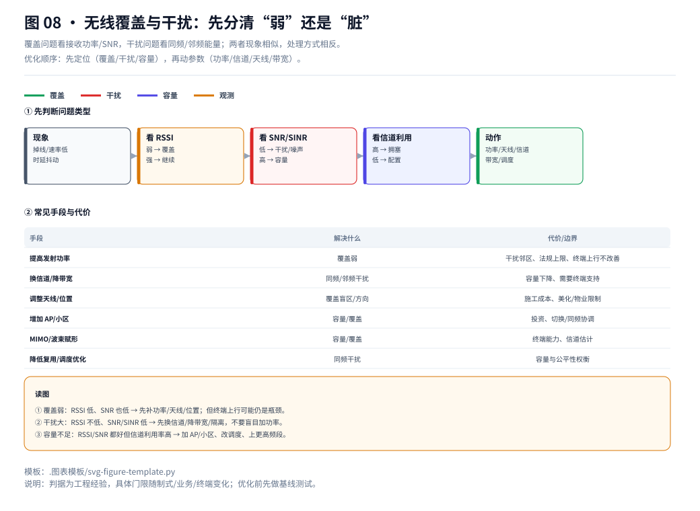

# 无线覆盖与干扰优化

无线问题看起来都是“慢/掉线”，但根因只有三类：**覆盖不足、干扰太大、容量不够**。三者的现象相似、处理方式相反；先分类，再动参数，否则越调越乱。

> 本篇定位：RSSI/SNR/SINR/信道利用率等观测量的读法，覆盖/干扰/容量三类问题的判断顺序与优化手段。协议细节去 02/03，射频链路去 [01-射频与天线](../01-射频与天线/00-无线传播与射频基础.md)。

## 目录

- [1 一句话模型](#s1)
- [2 速览](#s2)
- [3 观测量的读法](#s3)
- [4 从现象到根因](#s4)
- [5 状态机与定时器](#s5)
- [6 设计取舍与边界](#s6)
- [7 与相邻主题的关系](#s7)
- [名词解释](#名词解释)
- [8 参考与关联](#s8)

## 1 · 一句话模型：先分清“弱”还是“脏”，再谈“挤”

```text
覆盖不足：RSSI 低、SNR 低 → 补功率/天线/位置/补点
干扰太大：RSSI 不低、SNR/SINR 低 → 换信道/降带宽/隔离
容量不足：RSSI/SNR 好、信道利用率高 → 加 AP/小区、调度/分流
```

三个关键认知：

1. **RSSI 只说明“收到得强”**，不说明“干净”；判断质量要看 SNR/SINR。
2. **提高功率能救覆盖，但会加重干扰**：覆盖和干扰是一对反向操作。
3. **容量问题不能靠“加功率”解决**：空口时间就那么多，要让更多 AP/信道/频段来分担。

## 2 · 速览

| 项 | 内容 |
| --- | --- |
| 所属领域 | 无线通信/测试与优化 |
| 核心对象 | RSSI、SNR、SINR、信道利用率、重传率 |
| 关键判断 | 覆盖 / 干扰 / 容量 |
| 常用手段 | 功率、天线、信道、带宽、加 AP、调度 |
| 适用 | Wi-Fi、蜂窝、短距无线的现场优化 |

## 3 观测量的读法

| 观测量 | 含义 | 高/低说明 | 注意 |
| --- | --- | --- | --- |
| RSSI | 接收信号强度 | 低 → 覆盖弱 | 高不代表质量好 |
| RSRP | 参考信号接收功率（蜂窝） | 低 → 覆盖弱 | 与带宽/负载无关 |
| RSRQ | 参考信号接收质量 | 低 → 干扰/噪声 | 与负载相关 |
| SNR | 信噪比 | 低 → 噪声大 | 只看噪声 |
| SINR | 信号与干扰加噪声比 | 低 → 干扰/噪声 | 无线更常用 |
| 信道利用率 | 空口忙的时间比例 | 高 → 拥塞/干扰 | 高不等于坏，看业务 |
| 重传率 | 重传占比 | 高 → 碰撞/弱信号 | 结合 SNR 判断 |
| 噪声底 | 背景噪声 | 高 → 干扰源 | 看频谱形状 |

> **一个实用组合**：RSSI 正常 + SNR 低 = 干扰/噪声；RSSI 低 + SNR 低 = 覆盖弱；RSSI/SNR 都好 + 利用率高 = 容量不足。

## 4 从现象到根因



**读图**：上半部分是判断链（现象 → RSSI → SNR/SINR → 利用率 → 动作），下半部分是手段与代价矩阵。先定位类型，再选手段，避免“一上来就加功率”。

> 图源：`images/图08-无线覆盖与干扰优化.svg`

### 4.1 判断顺序

```text
① 看覆盖：目标区域的 RSSI/RSRP 是否低于设计门限？
   ├─ 是 → 覆盖问题
   └─ 否 → ②

② 看质量：SNR/SINR 是否低？
   ├─ 是 → 干扰/噪声问题
   └─ 否 → ③

③ 看容量：信道利用率/并发/重传是否高？
   ├─ 是 → 容量/拥塞问题
   └─ 否 → 查终端/上游/配置
```

### 4.2 覆盖优化

| 手段 | 适用 | 代价 |
| --- | --- | --- |
| 调整 AP/天线位置 | 盲区/遮挡 | 施工/物业 |
| 提高功率 | 边缘覆盖 | 干扰邻区/法规 |
| 换高增益/定向天线 | 定向覆盖/回传 | 角度对准要求 |
| 增加 AP/小区 | 大范围盲区 | 投资/漫游/同频 |
| 换低频段 | 穿透/绕射 | 频谱/终端支持 |

### 4.3 干扰优化

| 干扰类型 | 现象 | 手段 |
| --- | --- | --- |
| 同频干扰 | 利用率高、重传多 | 信道规划、降功率、加 AP 分区 |
| 邻频干扰 | 2.4 GHz 信道重叠 | 只用 1/6/11、20 MHz |
| 外部干扰 | 噪声底抬升 | 频谱扫描、隔离/换信道 |
| 设备自干扰 | 近距离也差 | 降功率、隔离、检查滤波器 |
| 隐藏终端 | 偶发碰撞 | RTS/CTS、降低功率/分区 |

### 4.4 容量优化

| 手段 | 适用 | 代价 |
| --- | --- | --- |
| 加 AP/小区 | 高密度 | 投资/同频协调 |
| 加频段（5/6 GHz） | 终端支持 | 覆盖短 |
| 带宽调整 | 干扰/容量权衡 | 峰值速率变化 |
| 负载均衡/漫游引导 | 用户分布不均 | 终端配合 |
| 调度/QoS | 业务优先级 | 配置复杂 |

### 4.5 异常分支

| 现象 | 可能根因 | 先查什么 |
| --- | --- | --- |
| 某个房间慢，其他正常 | 局部遮挡/盲区 | 该点 RSSI/SNR |
| 整层都慢 | 同频/容量 | 信道利用率、AP 数 |
| 晚上慢 | 邻区/家电干扰 | 频谱、时间规律 |
| 只有某类终端慢 | 终端能力/兼容 | 终端支持的频段/MCS |
| 上行慢、下行正常 | 终端功率/上行干扰 | 上行 SNR/重传 |

## 5 状态机与定时器

优化本身**没有状态机**，但无线系统有周期性测量/自适应：

| 机制 | 周期 | 作用 |
| --- | --- | --- |
| 扫描/邻居测量 | 秒到分钟 | 发现邻区/干扰 |
| 速率自适应 | 毫秒到秒 | 选 MCS/空间流 |
| 漫游/切换 | 秒级 | 换 AP/小区 |
| DFS 检测 | 持续 | 避让雷达 |
| 负载均衡 | 分钟级 | 引导终端 |

> 优化不是“一次调完”，而是“基线 → 改动 → 复测 → 固化”的循环；每次只改一个变量。

## 6 设计取舍与边界

### 6.1 覆盖与容量的平衡

覆盖靠“更大功率/更少 AP”，容量靠“更多 AP/更小小区”。高密度场景要接受“覆盖略收缩、容量换上来”，否则同频干扰会把容量吃掉。

### 6.2 2.4 GHz 与 5/6 GHz 分工

| 频段 | 角色 | 建议 |
| --- | --- | --- |
| 2.4 GHz | 覆盖兜底/IoT | 20 MHz、1/6/11、低功率 |
| 5 GHz | 主力容量 | 80 MHz、避开 DFS |
| 6 GHz | 高密度/近距离 | 320 MHz、密 AP |

### 6.3 常见误判

1. **“信号满格但慢，是运营商问题”**：可能是空口干扰/容量/上行瓶颈。
2. **“加功率能解决所有问题”**：干扰/容量问题会因加功率而恶化。
3. **“换 Wi-Fi 6 就好了”**：终端、信道、布点不匹配时，收益有限。
4. **“信道利用率高一定是干扰”**：也可能是正常高负载，要看业务/重传。
5. **“测一次就下结论”**：无线随时变，要在不同时间/位置/终端复测。

## 7 · 与相邻主题的关系

| 相邻主题 | 关系 |
| --- | --- |
| [01-射频与天线/00-无线传播与射频基础](../01-射频与天线/00-无线传播与射频基础.md) | 路径损耗/天线/链路预算 |
| [02-Wi-Fi/00-802.11原理与接入流程](../02-Wi-Fi/00-802.11原理与接入流程.md) | CSMA/CA/重传/漫游 |
| [02-Wi-Fi/01-Wi-Fi频段信道与速率](../02-Wi-Fi/01-Wi-Fi频段信道与速率.md) | 信道/带宽/MCS |
| [03-蜂窝通信/02-入网与移动性管理](../03-蜂窝通信/02-入网与移动性管理.md) | 蜂窝覆盖/切换 |
| [04-短距无线/00-BLE-ZigBee-Thread](../04-短距无线/00-BLE-ZigBee-Thread.md) | 2.4 GHz 共存 |
| [20-平台与系统](../../../../20-平台与系统/.readme.md) | AP/驱动/配置实现 |

一句话：**覆盖看“够不够强”，干扰看“干不干净”，容量看“挤不挤”；三者顺序不能反。**

## 名词解释

> 缩写给出英文全称；非缩写用“—”表示。

| 术语 | 英文全称 | 解释 |
| --- | --- | --- |
| RSSI | Received Signal Strength Indicator | 接收信号强度指示。 |
| RSRP | Reference Signal Received Power | 参考信号接收功率。 |
| RSRQ | Reference Signal Received Quality | 参考信号接收质量。 |
| SNR | Signal-to-Noise Ratio | 信噪比。 |
| SINR | Signal-to-Interference-plus-Noise Ratio | 信号与干扰加噪声比。 |
| CCA | Clear Channel Assessment | 空闲信道评估。 |
| DFS | Dynamic Frequency Selection | 动态频率选择。 |
| MCS | Modulation and Coding Scheme | 调制与编码组合。 |
| QoS | Quality of Service | 服务质量。 |
| 同频干扰 | Co-channel Interference | 同信道设备互相干扰。 |
| 邻频干扰 | Adjacent-channel Interference | 相邻信道泄漏干扰。 |
| 隐藏终端 | Hidden Node | 听不到彼此但会在接收端冲突。 |

## 8 · 参考与关联

**标准与资料**

- IEEE 802.11：WLAN 测量与信道规划。
- 3GPP TS 38.300：NR 无线资源管理与移动性。
- ITU-R/各国法规：信道/功率/DFS。
- 各 AP/终端厂商的射频与诊断文档。

**关联**

- [01-射频与天线/00-无线传播与射频基础](../01-射频与天线/00-无线传播与射频基础.md)
- [02-Wi-Fi/00-802.11原理与接入流程](../02-Wi-Fi/00-802.11原理与接入流程.md)
- [02-Wi-Fi/01-Wi-Fi频段信道与速率](../02-Wi-Fi/01-Wi-Fi频段信道与速率.md)
- [03-蜂窝通信/02-入网与移动性管理](../03-蜂窝通信/02-入网与移动性管理.md)

---

> **本篇定位**：无线覆盖/干扰/容量的判断与优化方法，不写具体厂商命令与现网数据。
> **素材来源**：`studyspace/1.知识体系/10.wifi/wifi记录.md` 的 WLAN 概念、`1.知识体系/1.计算机网络/m-6-无线网络和移动网络.md` 的无线信道说明；其余按 IEEE 802.11/3GPP 公开知识补写。
> **待验证**：各类门限（RSSI/SNR/利用率）随制式、业务、终端与部署场景变化，需以基线测试为准。
