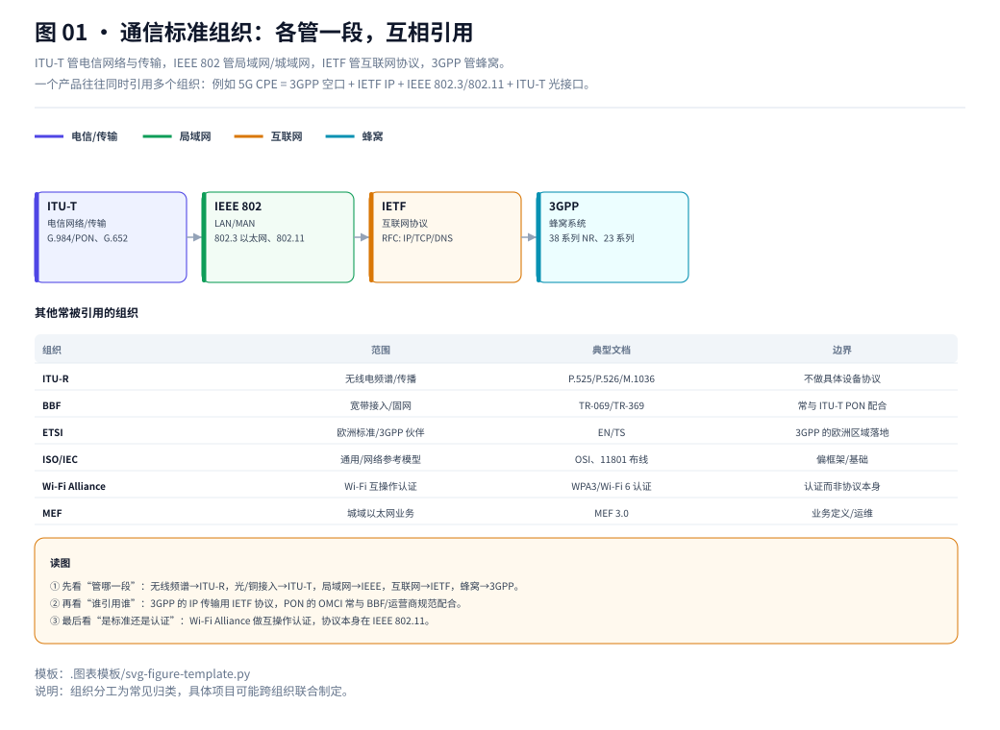

# 通信标准组织与文档体系

通信标准不是“一份文档”，而是“多个组织各管一段、互相引用”的体系。同样一个产品，空口看 3GPP，以太网看 IEEE，IP 看 IETF，光接口看 ITU-T，管理看 BBF/运营商规范。搞清“谁管哪一段”，才知道该查哪份文档。

> 本篇定位：主要标准组织的分工、文档编号的读法、标准/实现/认证的区别。具体接入网标准清单去 [01-接入网标准索引](./01-接入网标准索引.md)。

## 目录

- [1 一句话模型](#s1)
- [2 速览](#s2)
- [3 组织分工](#s3)
- [4 文档编号怎么读](#s4)
- [5 状态机与定时器](#s5)
- [6 设计取舍与边界](#s6)
- [7 与相邻主题的关系](#s7)
- [名词解释](#名词解释)
- [8 参考与关联](#s8)

## 1 · 一句话模型：按“层/域”找组织，按“编号”找文档

```text
无线频谱/传播 → ITU-R
光/铜/传输网 → ITU-T
局域网/城域网 → IEEE 802
互联网协议   → IETF（RFC）
蜂窝系统     → 3GPP（TS/TR）
宽带接入/管理 → BBF、运营商规范
```

三个关键认知：

1. **组织按“领域”分工，不按“产品”分工**：一个产品会横跨多个组织。
2. **标准是“接口/行为”的约定，不是实现**：同一标准允许多种实现，只要接口一致。
3. **认证不等于标准**：Wi-Fi Alliance、GCF 等做互操作/一致性认证，协议本身在 IEEE/3GPP。

## 2 · 速览

| 项 | 内容 |
| --- | --- |
| 所属领域 | 通信标准/规范 |
| 核心对象 | 组织、文档编号、版本/Release |
| 常见组织 | ITU-T/ITU-R、IEEE、IETF、3GPP、BBF、ETSI、ISO/IEC |
| 常见文档 | G.984、802.11、RFC、TS 38.211、TR-069、DOCSIS |
| 关键动作 | 定位领域 → 找文档 → 核对版本 → 看引用链 |

## 3 组织分工



**读图**：四个主组织分别对应电信/传输、局域网、互联网、蜂窝；下方矩阵补充 ITU-R/BBF/ETSI/ISO/Wi-Fi Alliance/MEF。先看“管哪一段”，再看“谁引用谁”。

> 图源：`images/图01-标准组织分工.svg`

| 组织 | 范围 | 典型文档 | 备注 |
| --- | --- | --- | --- |
| ITU-T | 电信网络、传输、接入 | G.652、G.984、G.9807 | 光/铜/PON 的主战场 |
| ITU-R | 无线电频谱、传播 | P.525、P.526、M.1036 | 不做设备协议 |
| IEEE 802 | LAN/MAN | 802.3、802.11、802.1Q | 以太网/Wi-Fi/桥接 |
| IETF | 互联网协议 | RFC 791、RFC 8200、RFC 1035 | IP/TCP/DNS/HTTP |
| 3GPP | 蜂窝系统 | TS 36/38（空口）、TS 23（架构） | LTE/NR/5GC |
| BBF | 宽带接入/固网 | TR-069、TR-369 | 与 PON/DSL 配合 |
| ETSI | 欧洲标准/3GPP 伙伴 | EN/TS | 区域落地 |
| ISO/IEC | 通用/参考模型/布线 | OSI、11801 | 基础框架 |
| Wi-Fi Alliance | Wi-Fi 互操作认证 | WPA3、Wi-Fi 6/7 认证 | 认证非协议 |
| MEF | 城域以太网业务 | MEF 3.0 | 业务/运维定义 |

### 3.1 为什么会有这么多组织

通信系统天然分层：物理介质、链路、网络、业务、管理。每层的历史、参与者和商业模式不同，很难由一个组织统管。于是形成“ITU-T 管传输、IEEE 管局域网、IETF 管互联网、3GPP 管蜂窝”的格局，层与层之间靠引用衔接。

### 3.2 标准与开源/厂商规范

- **de jure 标准**：ITU-T/IEEE/ISO 等正式标准。
- **de facto 标准**：市场形成的实现（如某些 API/芯片接口）。
- **厂商规范**：SDK、硬件寄存器、私有管理接口，通常不公开或受 NDA 限制。
- **运营商规范**：在公开标准之上加剖面、配置、运维要求。

> **边界**：公开仓库只引用公开标准，不复制 SDK 源码、原理图、运营商内部规范或现网数据。

## 4 文档编号怎么读

| 编号形式 | 例子 | 读法 |
| --- | --- | --- |
| ITU-T G.x | G.984.3 | G 系列=传输系统/介质/网络；984.3=GPON TC 层 |
| ITU-T G.98x | G.9807.1 | XGS-PON |
| IEEE 802.x | 802.11ax | 802.11=WLAN；ax=高效（Wi-Fi 6） |
| IEEE 802.3xx | 802.3bt | 802.3=以太网；bt=4 对 PoE |
| RFC xxxx | RFC 791 | IETF 文档编号，按发布顺序，不按主题 |
| 3GPP TS xx.yyy | TS 38.211 | 38=NR 无线；211=物理信道与调制 |
| 3GPP TR xx.yyy | TR 38.901 | TR=技术报告（研究/模型），TS=技术规范 |
| BBF TR-xxx | TR-069 | 宽带论坛技术报告 |
| DOCSIS x.x | DOCSIS 3.1 | 有线电视数据接入版本 |

### 4.1 版本与 Release

- **3GPP Release**：R15/R16/R17/R18… 每个 Release 是一组功能集合，不是单一文档版本。
- **IEEE 修订**：802.11-2020 是基文本，后续 amendment（ax/be）逐步合入。
- **ITU-T 版本**：同一 G.984.3 会有多个版本/勘误，引用时要写版本号或日期。
- **RFC**：编号固定，更新用新 RFC 取代（obsoletes/updates）。

## 5 状态机与定时器

标准文档本身**没有状态机**；但标准生命周期有阶段：

```text
立项/研究 → 草案（Draft）→ 稳定（Stable）→ 发布（Published）→ 修订/废止
```

工程上关心的是“**我引用的版本是否仍然有效**”，而不是组织内部流程。

## 6 设计取舍与边界

### 6.1 标准的“严格”与“可选”

标准通常定义“必须（shall）/应该（should）/可以（may）”。厂商实现往往只覆盖 must + 部分 should，导致“标准兼容”不等于“功能一致”。排障时要确认双方支持的**可选特性/剖面**。

### 6.2 公开标准 vs 运营商规范

| 类型 | 公开性 | 作用 | 风险 |
| --- | --- | --- | --- |
| 国际标准 | 公开 | 接口/行为基线 | 可能滞后于产品 |
| 运营商规范 | 受限 | 现网配置/运维要求 | 不能随意公开 |
| 厂商实现 | 私有 | 性能/成本优化 | 锁定/兼容性 |

### 6.3 常见误判

1. **“标准一样就能互通”**：可选特性、剖面、版本差异都会导致不兼容。
2. **“RFC 编号越大越新”**：编号只是发布顺序，主题可能完全不同。
3. **“3GPP TS 38.211 就是 5G 全部”**：它只覆盖物理层信道与调制。
4. **“Wi-Fi 6 是 IEEE 标准号”**：Wi-Fi 6 是联盟代称，标准是 802.11ax。
5. **“厂商文档可以当标准引用”**：厂商实现可能偏离标准，引用要区分。

## 7 · 与相邻主题的关系

| 相邻主题 | 关系 |
| --- | --- |
| [01-接入网标准索引](./01-接入网标准索引.md) | 按接入方式查具体标准 |
| [03-光通信/00-PON技术概览](../03-光通信/00-PON技术概览.md) | ITU-T G.984/G.987/G.9807 |
| [04-无线通信/02-Wi-Fi](../04-无线通信/02-Wi-Fi/.readme.md) | IEEE 802.11 |
| [04-无线通信/03-蜂窝通信](../04-无线通信/03-蜂窝通信/.readme.md) | 3GPP 36/38/23 系列 |
| [11-网络科学](../../11-网络科学/.readme.md) | IETF RFC 与 TCP/IP |

一句话：**先按领域找组织，再按编号找文档，最后核对版本与可选特性。**

## 名词解释

> 缩写给出英文全称；非缩写用“—”表示。

| 术语 | 英文全称 | 解释 |
| --- | --- | --- |
| ITU-T | International Telecommunication Union – Telecommunication Standardization Sector | 国际电信联盟电信标准化部门。 |
| ITU-R | International Telecommunication Union – Radiocommunication Sector | 国际电信联盟无线电通信部门。 |
| IEEE | Institute of Electrical and Electronics Engineers | 电气与电子工程师协会。 |
| IETF | Internet Engineering Task Force | 互联网工程任务组。 |
| RFC | Request for Comments | IETF 文档系列。 |
| 3GPP | 3rd Generation Partnership Project | 第三代合作伙伴计划（蜂窝标准）。 |
| TS | Technical Specification | 技术规范。 |
| TR | Technical Report | 技术报告。 |
| BBF | Broadband Forum | 宽带论坛。 |
| ETSI | European Telecommunications Standards Institute | 欧洲电信标准化协会。 |
| ISO | International Organization for Standardization | 国际标准化组织。 |
| IEC | International Electrotechnical Commission | 国际电工委员会。 |
| MEF | Metro Ethernet Forum | 城域以太网论坛。 |
| DOCSIS | Data Over Cable Service Interface Specification | 有线电视数据业务接口规范。 |
| de jure | — | 法定/正式标准。 |
| de facto | — | 事实标准。 |

## 8 · 参考与关联

**标准入口**

- ITU-T：https://www.itu.int/ITU-T/
- IEEE 802：https://www.ieee802.org/
- IETF RFC：https://www.rfc-editor.org/
- 3GPP：https://www.3gpp.org/
- BBF：https://www.broadband-forum.org/

**关联**

- [01-接入网标准索引](./01-接入网标准索引.md)
- [03-光通信](../03-光通信/.readme.md)
- [04-无线通信](../04-无线通信/.readme.md)
- [11-网络科学](../../11-网络科学/.readme.md)

---

> **本篇定位**：标准组织分工与文档编号读法；不复制标准正文，也不引用非公开规范。
> **素材来源**：按 ITU-T/IEEE/IETF/3GPP/BBF 公开信息整理。
> **待验证**：各组织最新版本/Release 与文档编号可能随发布更新，引用时以官网为准。
