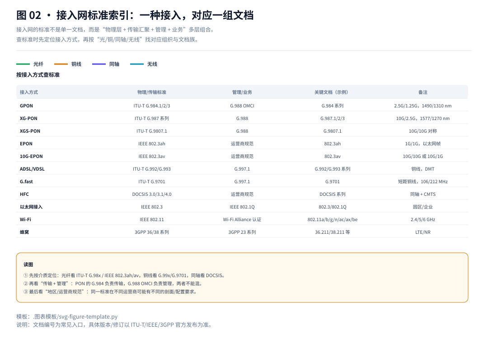

# 接入网标准索引

接入网标准是“一组文档”，不是“一份文档”：物理层定光/电参数，传输汇聚定帧/调度，管理定配置，业务定体验。查标准时先定位接入方式，再按“物理 → 汇聚 → 管理 → 业务”找对应文档。

> 本篇定位：常见有线/无线接入方式与标准族的一页索引，作为本目录的 SSOT。具体机制去 02/03/04 对应笔记，本篇只回答“查哪份标准”。

## 目录

- [1 一句话模型](#s1)
- [2 速览](#s2)
- [3 按接入方式查标准](#s3)
- [4 按层次读标准](#s4)
- [5 状态机与定时器](#s5)
- [6 设计取舍与边界](#s6)
- [7 与相邻主题的关系](#s7)
- [名词解释](#名词解释)
- [8 参考与关联](#s8)

## 1 · 一句话模型：接入方式 → 标准族 → 具体文档

```text
先问“用什么介质接入”
  ├─ 光纤 → ITU-T G.98x / IEEE 802.3ah/av
  ├─ 铜线 → ITU-T G.99x / G.9701
  ├─ 同轴 → DOCSIS
  ├─ 网线 → IEEE 802.3
  └─ 无线 → IEEE 802.11 / 3GPP 36/38
```

三个关键认知：

1. **同一接入方式有多层标准**：PON 的 G.984 管传输，G.988 管 OMCI 管理，不能只看一个。
2. **标准编号不是“越大越新”**：G.984（GPON）和 G.9807（XGS-PON）是不同技术，不是版本关系。
3. **运营商规范在标准之上**：剖面、功率、VLAN、认证方式常由运营商补充，公开标准只给基线。

## 2 · 速览

| 项 | 内容 |
| --- | --- |
| 所属领域 | 通信标准/接入网 |
| 核心对象 | 接入方式、标准族、文档编号 |
| 覆盖范围 | PON、xDSL、HFC、以太网接入、Wi-Fi、蜂窝 |
| 使用方式 | 先查本页定位，再读对应主题笔记 |
| 主要组织 | ITU-T、IEEE、3GPP、BBF、DOCSIS/CableLabs |

## 3 按接入方式查标准



**读图**：矩阵按“接入方式 × 物理/传输 × 管理/业务 × 关键文档”排列。先按介质找到行，再看该行对应的文档族；最后一列是备注/边界。

> 图源：`images/图02-接入网标准索引.svg`

| 接入方式 | 物理/传输标准 | 管理/业务 | 关键文档（示例） | 备注 |
| --- | --- | --- | --- | --- |
| GPON | ITU-T G.984.1/2/3 | G.988 OMCI | G.984 系列 | 2.5G/1.25G，1490/1310 nm |
| XG-PON | ITU-T G.987 系列 | G.988 | G.987.1/2/3 | 10G/2.5G，1577/1270 nm |
| XGS-PON | ITU-T G.9807.1 | G.988 | G.9807.1 | 10G/10G 对称 |
| NG-PON2 | ITU-T G.989 系列 | G.988 | G.989.1/2/3 | TWDM 多波长 |
| EPON | IEEE 802.3ah | 运营商规范 | 802.3ah | 1G/1G，以太网帧 |
| 10G-EPON | IEEE 802.3av | 运营商规范 | 802.3av | 10G/10G 或 10G/1G |
| ADSL/ADSL2+ | ITU-T G.992.1/G.992.5 | G.997.1 | G.992 系列 | 铜线，DMT |
| VDSL2 | ITU-T G.993.2 | G.997.1 | G.993.2 | 17/30 MHz |
| 向量化 | ITU-T G.993.5 | G.997.1 | G.993.5 | 抑制 FEXT |
| G.fast | ITU-T G.9701 | G.997.1 | G.9701 | 106/212 MHz，短距 |
| HFC | DOCSIS 3.0/3.1/4.0 | 运营商规范 | DOCSIS 系列 | 同轴 + CMTS |
| 以太网接入 | IEEE 802.3 | IEEE 802.1Q | 802.3/802.1Q | 园区/企业 |
| Wi-Fi | IEEE 802.11 | Wi-Fi Alliance 认证 | 802.11a/b/g/n/ac/ax/be | 2.4/5/6 GHz |
| 蜂窝 | 3GPP 36/38 系列 | 3GPP 23 系列 | 36.211/38.211 等 | LTE/NR |

> **边界**：本表是“入口索引”，不替代标准正文；具体版本、修订、地区差异以官方发布为准。

## 4 按层次读标准

### 4.1 四层读法

| 层次 | 回答什么 | 例子 |
| --- | --- | --- |
| 物理层 | 光/电/无线信号怎么发 | G.984.2 光预算、802.3 PMD、802.11 PHY |
| 传输汇聚 | 帧怎么组织、资源怎么分 | G.984.3（GEM/DBA）、802.3 MAC |
| 管理 | 设备怎么配置/监控 | G.988 OMCI、TR-069、NETCONF |
| 业务 | 业务怎么定义/保障 | MEF、运营商 SLA/QoS |

### 4.2 一个例子：GPON

```text
G.984.1：总体要求/架构
G.984.2：光接口/光预算（物理层）
G.984.3：传输汇聚（帧、GEM、DBA、测距）
G.984.4/G.988：OMCI 管理
运营商规范：VLAN/认证/业务配置
```

查“ONU 为什么注册不上”，先看 G.984.3 的测距/注册，再看 G.984.2 的光预算，最后看运营商注册策略。

### 4.3 一个例子：Wi-Fi

```text
IEEE 802.11-2020：基文本（MAC/PHY）
802.11ax/be：高效/极高吞吐 amendment
802.11k/r/v：测量/快速漫游/网络管理
Wi-Fi Alliance：WPA3、Wi-Fi 6/7 认证
各国法规：信道/功率/DFS
```

查“Wi-Fi 6 为什么没跑满”，要同时看 802.11ax 的 PHY 能力、终端支持、信道/干扰和法规限制。

## 5 状态机与定时器

标准索引本身**没有状态机**。但“标准采用”有生命周期：

```text
研究 → 标准发布 → 芯片/设备实现 → 运营商引入 → 规模部署 → 退网
```

工程上要区分“标准支持”和“设备/网络已启用”：设备支持 XGS-PON，不代表现网 OLT 已升级；终端支持 Wi-Fi 6，不代表 AP 已开 802.11ax。

## 6 设计取舍与边界

### 6.1 标准选择

| 场景 | 优先标准 | 原因 |
| --- | --- | --- |
| 新建 FTTH | GPON/XGS-PON | 生态成熟、成本可控 |
| 对称高带宽 | XGS-PON | 10G/10G |
| 存量铜线 | VDSL2/G.fast | 复用铜线 |
| 园区 | 802.3 以太网 | 独占带宽、简单 |
| 家庭无线 | 802.11ax/be | 高吞吐/低时延 |
| 广域移动 | 3GPP LTE/NR | 覆盖/移动性 |

### 6.2 标准与部署的差距

标准是“能力上限”，部署是“成本/频谱/运维约束下的选择”。例如 802.11be 支持 320 MHz，但很多地区/场景仍以 80 MHz 为主；XGS-PON 支持 10G，但套餐/回传可能先限制在 1G。

### 6.3 常见误判

1. **“支持标准就等于支持全部特性”**：可选特性/剖面可能未实现。
2. **“标准版本越高越好”**：兼容性、成本、生态比“最新”更重要。
3. **“同一个编号只有一份文档”**：ITU-T/3GPP 文档有多个版本/修订。
4. **“运营商规范和标准一样”**：运营商常加私有剖面/认证，不能混用。
5. **“无线标准只看空口”**：还要看管理/漫游/认证/法规。

## 7 · 与相邻主题的关系

| 相邻主题 | 关系 |
| --- | --- |
| [00-通信标准组织与文档体系](./00-通信标准组织与文档体系.md) | 组织分工与编号读法 |
| [02-有线通信](../02-有线通信/.readme.md) | 以太网/xDSL 的机制 |
| [03-光通信](../03-光通信/.readme.md) | PON/光模块/ODN 的机制 |
| [04-无线通信](../04-无线通信/.readme.md) | Wi-Fi/蜂窝的机制 |
| [11-网络科学](../../11-网络科学/.readme.md) | IP/以太网/PPPoE 等协议 |

一句话：**本页负责“查哪份标准”，各主题笔记负责“标准说了什么”。**

## 名词解释

> 缩写给出英文全称；非缩写用“—”表示。

| 术语 | 英文全称 | 解释 |
| --- | --- | --- |
| GPON | Gigabit-capable Passive Optical Network | 千兆级无源光网络。 |
| XG-PON | 10-Gigabit-capable Passive Optical Network | 10G 非对称 PON。 |
| XGS-PON | 10-Gigabit-capable Symmetric Passive Optical Network | 10G 对称 PON。 |
| NG-PON2 | Next-Generation Passive Optical Network 2 | 下一代 PON（TWDM）。 |
| EPON | Ethernet Passive Optical Network | 以太网无源光网络。 |
| OMCI | ONT Management and Control Interface | ONT 管理与控制接口。 |
| DBA | Dynamic Bandwidth Allocation | 动态带宽分配。 |
| GEM | GPON Encapsulation Method | GPON 封装方式。 |
| VDSL | Very-high-bit-rate Digital Subscriber Line | 甚高速数字用户线。 |
| FEXT | Far-End Crosstalk | 远端串扰。 |
| DOCSIS | Data Over Cable Service Interface Specification | 有线电视数据业务接口规范。 |
| CMTS | Cable Modem Termination System | 电缆调制解调器终端系统。 |
| TR-069 | Technical Report 069 | BBF 的 CPE 管理协议。 |
| SLA | Service Level Agreement | 服务等级协议。 |

## 8 · 参考与关联

**标准入口**

- ITU-T G.984/G.987/G.9807/G.989/G.992/G.993/G.9701。
- IEEE 802.3ah/av、802.3、802.11。
- 3GPP TS 36/38/23 系列。
- DOCSIS 3.0/3.1/4.0。
- BBF TR-069/TR-369。

**关联**

- [00-通信标准组织与文档体系](./00-通信标准组织与文档体系.md)
- [02-有线通信/03-有线接入网形态](../02-有线通信/03-有线接入网形态.md)
- [03-光通信/00-PON技术概览](../03-光通信/00-PON技术概览.md)
- [04-无线通信/02-Wi-Fi](../04-无线通信/02-Wi-Fi/.readme.md)
- [04-无线通信/03-蜂窝通信](../04-无线通信/03-蜂窝通信/.readme.md)

---

> **本篇定位**：接入网标准的一页索引（SSOT），只回答“查哪份标准”，不复制标准正文。
> **素材来源**：按 ITU-T/IEEE/3GPP/BBF/DOCSIS 公开信息整理。
> **待验证**：文档编号/版本/地区差异随组织发布更新，引用时以官网为准。
