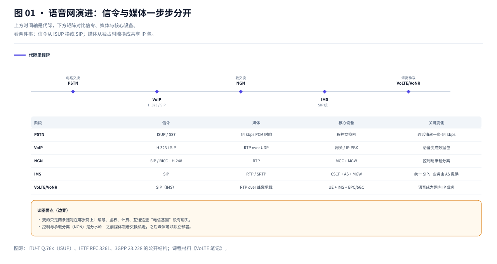

# 语音通信全景与演进

语音通信只做一件事：**把说话人的声音，在 150 ms 内、听不出损伤地送到对方耳朵里**。为此它被拆成两条腿——**信令**负责“找到对方、建路、拆路”，**媒体**负责“把声音搬过去”。从 PSTN 到 IMS，变的只是这两条腿跑在哪张网上；不变的是“实时、小包、不能等重传”这三个约束。

> 本篇定位：语音系统的整体模型、电路域到 IMS 的演进、编号与互通、质量指标。SIP 细节去 [03-SIP协议](./03-SIP协议.md)，媒体传输去 [02-RTP-RTCP与媒体传输](./02-RTP-RTCP与媒体传输.md)，IMS 去 [04-IMS架构与VoLTE](./04-IMS架构与VoLTE.md)，蜂窝上的语音（VoLTE/VoNR/回落）去 [03-蜂窝通信/06-VoLTE与语音方案](../04-无线通信/03-蜂窝通信/06-VoLTE与语音方案.md)。

## 目录

- [1 一句话模型](#s1)
- [2 速览](#s2)
- [3 演进：从电路交换到 IMS](#s3)
- [4 为什么语音要迁到分组网](#s4)
- [5 一条语音的四段链路](#s5)
- [6 编号与路由](#s6)
- [7 互通：PSTN 与 IP 的接缝](#s7)
- [8 质量的三条硬指标](#s8)
- [9 状态机与定时器](#s9)
- [10 设计取舍与边界](#s10)
- [11 与相邻主题的关系](#s11)
- [名词解释](#名词解释)
- [12 参考与关联](#s12)

## 1 · 一句话模型：信令建路，媒体走路

```text
信令面：  拨号 → 找路由 → 建会话 → 振铃 → 接通 → 拆线
            （ISUP / SIP / H.248 管这件事）

媒体面：  话筒 → 采样 → 编码 → 打包 → 网络 → 抖动缓冲 → 解码 → 扬声器
            （RTP 管这件事）
```

三个关键认知：

1. **信令和媒体是两条独立的路径**：SIP 走 TCP/TLS 也好、走 UDP 也好，和 RTP 走哪条路无关；两者只在“协商媒体地址与编码”时握一次手（SDP）。
2. **语音是“恒定小速率 + 强时延约束”**：20 ms 一个包、每包几十字节、每秒 50 个包；晚到的包没有价值，所以宁可丢也不能等。
3. **互通发生在接缝处**：IP 网与 PSTN 之间必须有网关，把 ISUP 转成 SIP、把 G.711 转成对方要的编码——这是所有“打不通/单通/杂音”问题的高发区。

## 2 · 速览

| 项 | 内容 |
| --- | --- |
| 所属领域 | 通信/实时通信 |
| 核心对象 | 信令（SIP/ISUP/H.248）、媒体（RTP）、编码（G.711/AMR/EVS/Opus） |
| 关键约束 | 端到端时延 <150 ms、丢包 <1%、抖动可被缓冲吸收 |
| 典型系统 | PSTN、NGN 软交换、IMS、VoLTE/VoNR、企业 IP-PBX、云呼叫中心 |
| 关键标准 | ITU-T G.711/G.729/H.248、IETF RFC 3261/3550/4566、3GPP 23.228/24.229 |
| 主要指标 | MOS、接续时延、单通率、掉话率 |

## 3 · 演进：从电路交换到 IMS



**读图**：横轴是代际，纵轴分“信令”和“媒体”两条带。看两件事：信令从 ISUP 换成 SIP；媒体从“独占 64 kbps 时隙”换成“共享 IP 包”。到 IMS 这一代，两条带才真正解耦——信令走 SIP，媒体走 RTP，各自可以换传输。

> 图源：`images/图01-语音网演进.svg`

| 阶段 | 信令 | 媒体 | 典型设备 | 核心变化 |
| --- | --- | --- | --- | --- |
| PSTN（电路域） | ISUP / SS7 | 64 kbps PCM 独占时隙 | 程控交换机 | 通话期间独占一条 64 kbps 通道 |
| VoIP 早期 | H.323 / SIP | RTP over UDP/IP | 网关、IP-PBX | 语音变成数据包，开始与数据共享链路 |
| NGN 软交换 | SIP / BICC + H.248 | RTP | MGC + MGW | **呼叫控制与媒体承载分离** |
| IMS | SIP | RTP / SRTP | CSCF + AS + MGW | 统一到 SIP，业务由 AS 提供 |
| VoLTE / VoNR | SIP（IMS） | RTP over 蜂窝承载 | UE + IMS + EPC/5GC | 语音成为运营商网内的一个 IP 业务 |

> **推论**：所谓“VoIP 替代 PSTN”，替代的是**传输方式**，不是“打电话”这件事。编号（E.164）、互通网关、计费与鉴权这些“电信基因”一个都没消失，只是换了实现。

## 4 · 为什么语音要迁到分组网

| 维度 | 电路交换 | 分组交换（VoIP） |
| --- | --- | --- |
| 带宽占用 | 通话全程独占 64 kbps | 只在发包时占用，静音可压到更低 |
| 复用 | 时隙固定，扩容靠加电路 | 统计复用，与数据共享 |
| 业务扩展 | 新业务要改交换机 | 加一个 AS/服务器即可 |
| 终端 | 专用话机 | 软件、话机、网关、浏览器都能接 |
| 质量保障 | 天然独占，时延稳定 | 必须靠 QoS/队列/带宽保证 |

驱动力是成本：电路交换的 64 kbps 在语音压缩后只要 12~30 kbps，静音期还能更低；同样一条链路能承载的通话数翻几倍。

> **边界**：分组化不是“免费变好”。电路网天生没有抖动和乱序，IP 网两样都有；所以 VoIP 必须补上抖动缓冲、丢包隐藏、QoS 队列——这些在电路网里根本不存在。

## 5 · 一条语音的四段链路

| 段 | 做什么 | 关键参数 | 出了问题表现 |
| --- | --- | --- | --- |
| 采集与编码 | 8/16/48 kHz 采样，按 20 ms 一帧压缩 | 采样率、码率、帧长 | 声音闷（窄带）、机械感（低码率） |
| 打包 | 加 RTP/UDP/IP 头，按 ptime 发 | ptime、payload type | 包太大增时延，太小增开销 |
| 传输 | 经接入/核心/骨干，受队列与丢包影响 | 带宽、时延、抖动、丢包 | 断续、机器人音、延迟大 |
| 播放 | 抖动缓冲重排，解码，回声消除 | 缓冲深度、AEC | 回声、双讲断裂、延迟累积 |

四段里只有第二段是“纯软件可控”，其余三段都涉及网络与终端，所以语音排障必须按段切分，而不是一上来就查 SIP 信令。

**端到端时延预算**（走一遍就知道 150 ms 有多紧）：

| 环节 | 典型耗时 | 怎么压 |
| --- | --- | --- |
| 采集 + 编码 | 5~30 ms（含算法 lookahead） | 换低时延编码（G.711/Opus 低延迟模式） |
| 打包等待 | 0~20 ms（等一帧凑满） | 缩短 ptime，代价是头开销上升 |
| 接入 + 骨干 | 10~60 ms | 就近接入、减少跳数与转码 |
| 抖动缓冲 | 20~80 ms | 自适应；低于抖动就吞字 |
| 解码 + 播放 | <5 ms | 基本固定 |
| 合计 | 约 60~195 ms | — |

> **推论**：预算里最容易被忽视的是“打包等待”和“缓冲”——这两项是软件可调的，也最容易配过头；网络段反而常常不是主因。看到“延迟大”，先看 ptime 和缓冲深度，再查路由。

## 6 · 编号与路由

| 标识 | 形式 | 用在哪 | 边界 |
| --- | --- | --- | --- |
| E.164 | `+8613800138000` | PSTN、IMS 的 tel URI | 最长 15 位；国家码/区号决定路由 |
| SIP URI | `sip:alice@example.com` | SIP/IMS 原生寻址 | 需要 DNS（NAPTR/SRV）解析到服务器 |
| ENUM | 把 E.164 反写成 DNS 域名 | 号码 → SIP URI 的桥 | 依赖运营商配置，公网覆盖不全 |

拨号计划（dial plan）决定“什么号码走本地、什么走长途、什么走 SIP 中继”。**大部分“拨号没反应/拨错号”不是协议问题，是 dial plan 的前缀匹配写错了。**

一张可核对的最小拨号计划：

| 匹配模式 | 动作 | 边界与误判 |
| --- | --- | --- |
| `^1[3-9]\d{9}$` | 手机号，补 +86 后走长途 | 不锚定 `^$` 会把分机号当手机号吃掉 |
| `^0\d{2,3}\d{7,8}$` | 固话，按区号选路由 | 区号长度不固定，正则写死会漏 |
| `^9(\d+)$` | 外线前缀 9，剥离后送出 | 前缀与内部分机首位冲突会误判 |
| `110 / 119 / 120 / 122` | 精确匹配，直送本地网关 | 送到异地网关会接不通 |

> **推论**：拨号计划的第一原则是“先匹配最长、最具体的规则”。短前缀写在前面，会吃掉后面所有长号码；这类错配置表现为“本地能打、长途全失败”，很容易被误判成运营商问题。

## 7 · 互通：PSTN 与 IP 的接缝

```text
PSTN（ISUP/SS7） ── SG（信令网关） ──→ MGC/SBC
                                     │
PSTN（64k 时隙） ── MGW（媒体网关） ──→ RTP/IP
```

| 接缝 | 要转换什么 | 典型设备 | 常见问题 |
| --- | --- | --- | --- |
| 信令 | ISUP ↔ SIP（SIP-I/SIP-T） | SG / MGCF | 原因值映射丢失，主叫显示异常 |
| 媒体 | G.711 ↔ AMR/EVS 等 | MGW / IM-MGW | 转码引入时延与音质损失 |
| 传真 | T.38 或 G.711 透传 | 网关 | 丢包导致传真断页 |
| 号码 | E.164 ↔ SIP URI | 网关/SBC | 主叫号码被改写或隐藏 |

> **推论**：跨网呼叫的问题，先问“在哪一侧出的问题”，再看网关的转换日志。只盯着 SIP 侧，永远看不到 ISUP 的原因值。

## 8 · 质量的三条硬指标

| 指标 | 目标 | 超标后的听感 | 主要手段 |
| --- | --- | --- | --- |
| 端到端时延 | <150 ms（单程） | >250 ms 开始抢话 | 减少转码、就近接入、缓冲别配太深 |
| 丢包率 | <1% | 断续、爆音 | FEC、PLC、优先级队列、SBC 抗抖动 |
| 抖动 | 能被缓冲吸收（典型 <30 ms） | 机器人音、吞字 | 自适应 jitter buffer、整形 |

综合成一个主观分就是 **MOS**（1~5）。注意 MOS 是“端到端”指标，链路上任何一段（终端、接入、骨干、网关）恶化都会拉低它，无法从 MOS 反推是哪一段。

## 9 · 状态机与定时器

语音本身有一条清晰的呼叫生命周期（信令状态机在 [03-SIP协议](./03-SIP协议.md) 展开）：

| 状态 | 含义 | 失败表现 |
| --- | --- | --- |
| Idle | 无呼叫 | — |
| Dialing / Setup | 已发起，等路由与应答 | 无振铃、超时 |
| Ringing | 对端振铃 | 回铃音异常、彩铃不播 |
| Talking | 媒体双向通 | 单通、无声、杂音 |
| Releasing | 任一方拆线 | 挂不断、残留会话 |

媒体侧没有状态机，只有**抖动缓冲深度自适应**：网络抖动变大时加深缓冲（增时延），稳定后再收浅。缓冲策略错了，表现为“刚开始正常，几秒后延迟越来越大”。

一次呼叫的**建立阶段**要经过这些步骤，每一步都对应一种“拨号后没反应”：

| 步骤 | 做什么 | 典型耗时 | 卡住的表现 |
| --- | --- | --- | --- |
| DNS/路由 | NAPTR/SRV 找下一跳 | 0~100 ms（可缓存） | 第一次拨号慢、第二次正常 |
| INVITE 事务 | 发 INVITE，等 100 Trying | 1 个 RTT | 连 100 都没有：代理没转发 |
| 鉴权 | 401/407 往返 | 1~2 个 RTT | 反复 401 |
| 振铃 | 180 Ringing | 取决于被叫侧 | 无回铃音（本地音还是带内音） |
| 接通 | 200 OK + ACK | 1 个 RTT | 接通即断（ACK 没到） |

> **推论**：DNS 没缓存时首次呼叫明显慢、第二次正常——这类“第一次慢”不要归因到网络质量。反过来，每次都慢才是链路或代理的问题。

## 10 · 设计取舍与边界

### 10.1 为什么语音不用 TCP

TCP 的重传与拥塞控制会带来“等待”，而语音包里晚到的数据没有价值：等 200 ms 重传回来，播放点早就过了。所以语音用 UDP + 应用层自愈（FEC/PLC），宁可丢一个 20 ms 的片段，也不让整条流卡住。

> **边界**：信令可以用 TCP/TLS（要可靠、要安全），媒体一般不用。看到“SIP over TCP、RTP over UDP”是正常组合，不是配置错误。

### 10.2 为什么固定 20 ms 打包

| ptime | 每秒包数 | 头开销占比 | 时延 | 适用 |
| --- | --- | --- | --- | --- |
| 10 ms | 100 | 更高 | 更低 | 对时延极敏感、带宽充裕 |
| 20 ms | 50 | 适中 | 标准 | 绝大多数语音 |
| 40~60 ms | 17~25 | 更低 | 更高 | 带宽紧张、卫星链路 |

20 ms 是“时延、开销、抗丢包”三者的惯例折中，不是标准强制值。

### 10.3 常见误判

1. **“能振铃就说明网络没问题”**：振铃只证明信令通，媒体可能单向或不通。
2. **“语音质量差就加带宽”**：多数是丢包/抖动/转码，不是带宽不足。
3. **“VoIP 一定比 PSTN 差”**：配置得当的 VoIP 可以到 HD 音质；差的是没做 QoS 的野路子部署。
4. **“有回声是对方话机坏了”**：本端 AEC 没做好、或网关转码引入时延，都会产生回声。
5. **“SIP 通就是端到端通”**：SDP 里的地址可能不可达（NAT），媒体面才是最终判据。

## 11 · 与相邻主题的关系

| 相邻主题 | 关系 |
| --- | --- |
| [01-语音编码与媒体质量](./01-语音编码与媒体质量.md) | 编码器、打包、MOS、回声与丢包隐藏 |
| [02-RTP-RTCP与媒体传输](./02-RTP-RTCP与媒体传输.md) | RTP/RTCP 报文、抖动与丢包统计 |
| [03-SIP协议](./03-SIP协议.md) | 会话建立、注册、SDP 协商 |
| [04-IMS架构与VoLTE](./04-IMS架构与VoLTE.md) | 运营商语音核心网、VoLTE 承载 |
| [05-H248与媒体网关](./05-H248与媒体网关.md) | 软交换的媒体资源控制 |
| [06-VoIP部署与互通](./06-VoIP部署与互通.md) | SBC、NAT、QoS、传真与排障 |
| [03-蜂窝通信/06-VoLTE与语音方案](../04-无线通信/03-蜂窝通信/06-VoLTE与语音方案.md) | 语音在蜂窝网上的承载与回落 |
| [11-网络科学/04-传输层](../../11-网络科学/04-传输层/00-传输层概览.md) | UDP/TCP 的通用行为 |
| [30-产品与方案/36-ONU-ONT/02-VoIP与IPTV业务](../../../30-产品与方案/36-ONU-ONT/02-VoIP与IPTV业务.md) | 光猫语音口的产品配置 |

一句话：**语音系统 = 一条信令路 + 一条媒体路 + 若干接缝上的网关。**

## 名词解释

> 缩写给出英文全称；非缩写用“—”表示。

| 术语 | 英文全称 | 解释 |
| --- | --- | --- |
| PSTN | Public Switched Telephone Network | 公共交换电话网（电路域）。 |
| ISUP | ISDN User Part | SS7 的呼叫控制协议，PSTN 的主力信令。 |
| SS7 | Signalling System No. 7 | 七号信令系统。 |
| PCM | Pulse Code Modulation | 脉冲编码调制，G.711 的基础。 |
| VoIP | Voice over IP | IP 语音。 |
| NGN | Next Generation Network | 下一代网络，软交换是其代表形态。 |
| MGC | Media Gateway Controller | 媒体网关控制器（软交换核心）。 |
| MGW | Media Gateway | 媒体网关，做编解码与承载转换。 |
| SG | Signalling Gateway | 信令网关，SS7 与 IP 信令的转换点。 |
| IMS | IP Multimedia Subsystem | IP 多媒体子系统。 |
| SIP | Session Initiation Protocol | 会话发起协议。 |
| RTP | Real-time Transport Protocol | 实时传输协议。 |
| SDP | Session Description Protocol | 会话描述协议（媒体协商）。 |
| E.164 | — | ITU-T 的国际电话号码编号方案。 |
| ENUM | E.164 Number to URI Mapping | 把电话号码映射为 URI 的机制。 |
| URI | Uniform Resource Identifier | 统一资源标识（如 sip:user@host）。 |
| MOS | Mean Opinion Score | 平均意见分，1~5 的主观语音质量。 |
| AEC | Acoustic Echo Cancellation | 回声消除。 |
| PLC | Packet Loss Concealment | 丢包隐藏（用预测填补丢失片段）。 |
| FEC | Forward Error Correction | 前向纠错。 |
| ptime | packetization time | 打包周期，常见 20 ms。 |
| QoS | Quality of Service | 服务质量。 |
| DTMF | Dual-Tone Multi-Frequency | 双音多频（按键音），可用 RFC 2833/4733 带内或带外传。 |

## 12 · 参考与关联

**标准**

- ITU-T G.711 / G.729：语音编码。
- ITU-T H.248：媒体网关控制协议。
- ITU-T Q.761~Q.764：ISUP 信令。
- IETF RFC 3261：SIP；RFC 3550：RTP/RTCP；RFC 4566：SDP。
- 3GPP TS 23.228 / 24.229：IMS 架构与 SIP 协议。

**关联**

- [01-语音编码与媒体质量](./01-语音编码与媒体质量.md)
- [02-RTP-RTCP与媒体传输](./02-RTP-RTCP与媒体传输.md)
- [03-SIP协议](./03-SIP协议.md)
- [04-IMS架构与VoLTE](./04-IMS架构与VoLTE.md)
- [05-H248与媒体网关](./05-H248与媒体网关.md)
- [06-VoIP部署与互通](./06-VoIP部署与互通.md)
- [03-蜂窝通信/06-VoLTE与语音方案](../04-无线通信/03-蜂窝通信/06-VoLTE与语音方案.md)

---

> **本篇定位**：语音系统的整体模型、演进、编号互通与质量；不展开 SIP 字段与 IMS 流程细节。
> **素材来源**：`studyspace/1.知识体系/9.lte5g相关/lte/VoLTE/VoLTE笔记.md`、`lte/VoLTE/SDX55平台VoLTE简介.pptx`（课程材料）；ITU-T/IETF/3GPP 公开标准结构。素材为二手整理，关键流程已按规范核对。
> **待验证**：各运营商编号与互通策略、网关转码行为、MOS 门限以现网与设备手册为准。
