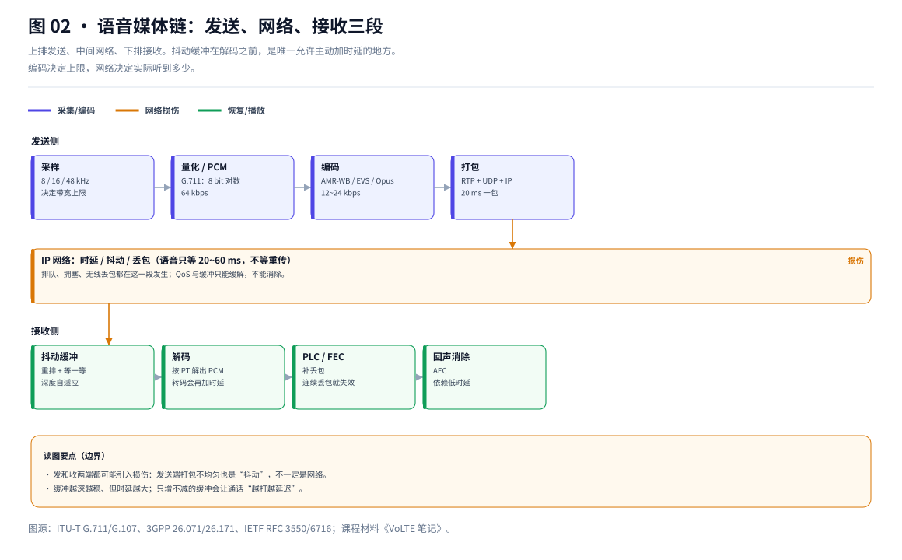

# 语音编码与媒体质量

语音编码要在 12~24 kbps 里保住“听得清、认得出、不累”三件事。它靠的不是无损还原波形，而是**只保留人耳敏感的部分**：窄带先砍掉 4 kHz 以上，再用预测编码把冗余去掉。质量好坏最终不看码率，看 **MOS**——而 MOS 由编码、丢包、抖动、回声四件事共同决定。

> 本篇定位：采样与 PCM、主流编码器选型、打包周期、MOS 与损伤分解、抖动缓冲/PLC/FEC、回声消除。传输承载去 [02-RTP-RTCP与媒体传输](./02-RTP-RTCP与媒体传输.md)，系统全景去 [00-语音通信全景与演进](./00-语音通信全景与演进.md)。

## 目录

- [1 一句话模型](#s1)
- [2 速览](#s2)
- [3 编码之前：采样与 PCM](#s3)
- [4 编码器谱系与选型](#s4)
- [5 打包：ptime 与每包字节](#s5)
- [6 质量：MOS 与损伤分解](#s6)
- [7 抗损伤：缓冲、PLC、FEC](#s7)
- [8 回声与双讲](#s8)
- [9 状态机与定时器](#s9)
- [10 设计取舍与边界](#s10)
- [11 与相邻主题的关系](#s11)
- [名词解释](#名词解释)
- [12 参考与关联](#s12)

## 1 · 一句话模型：用“人耳的偏好”换带宽

```text
8/16 kHz 采样 → PCM（64 kbps）→ 编码器（12~24 kbps）→ 20 ms 一包 → 网络
                                                    ↓
        扬声器 ← 回声消除 ← 解码 ← 抖动缓冲（重排 + 等一等）
```

三个关键认知：

1. **窄带与宽带差在采样率**：8 kHz 采样只能到 4 kHz 带宽（电话音），16 kHz 到 8 kHz（HD Voice），差别是“听得出是谁”和“听不出是谁”。
2. **编码是有损的，但损失可控**：码率越低，模型假设越强，遇到非语音（音乐、噪声）越容易“机器人音”。
3. **端到端质量 = 编码质量 − 网络损伤**：编码选得好只是起点，丢包和抖动会把 MOS 拉下去，且**拉下去容易、补回来难**。

## 2 · 速览

| 项 | 内容 |
| --- | --- |
| 所属领域 | 语音/媒体处理 |
| 核心对象 | 采样率、码率、帧长、ptime、MOS |
| 关键参数 | 8/16/48 kHz；12.2/12.65/24.4 kbps；20 ms |
| 典型编码 | G.711、G.729、AMR-NB、AMR-WB、EVS、Opus |
| 关键损伤 | 丢包、抖动、时延、回声、转码 |
| 主要标准 | ITU-T G.711/G.722/G.729、3GPP 26.071/26.171/26.445、RFC 6716（Opus） |

## 3 · 编码之前：采样与 PCM

| 步骤 | 做什么 | 数字 | 边界 |
| --- | --- | --- | --- |
| 采样 | 按固定间隔取幅度 | 8 kHz（窄带）/16 kHz（宽带）/48 kHz（全带） | 采样率决定上限频率（奈奎斯特） |
| 量化 | 幅度取整 | G.711 为 8 bit 对数压扩 | 对数压扩让小音量也有足够信噪比 |
| PCM | 得到 64 kbps 码流 | 8 kHz × 8 bit = 64 kbps | 20 ms = 160 个样点 = 160 字节 |

G.711 有两个律：**A-law**（欧洲/中国常用）与 **μ-law**（北美/日本）。两边律制不一致时，听到的是“声音发闷/失真”，不是听不见——这类问题常出现在国际长途或进口设备对接。

## 4 · 编码器谱系与选型

| 编码 | 采样率 | 典型码率 | 帧长 | 特点 | 典型用途 |
| --- | --- | --- | --- | --- | --- |
| G.711 | 8 kHz | 64 kbps | 可任意（常 20 ms） | 无压缩、无算法时延、最抗丢包 | PSTN、传真透传、网关兜底 |
| G.722 | 16 kHz | 48/56/64 kbps | 20 ms | 宽带、低算法时延 | 会议、企业话机 |
| G.729 | 8 kHz | 8 kbps | 10 ms | 高压缩、专利历史包袱 | 传统 VoIP 省带宽 |
| AMR-NB | 8 kHz | 4.75~12.2 kbps | 20 ms | 自适应多速率，抗损好 | 2G/3G 语音 |
| AMR-WB | 16 kHz | 6.6~23.85 kbps | 20 ms | HD Voice 主力 | VoLTE/VoNR、IMS |
| EVS | 8/16/32/48 kHz | 5.9~24.4 kbps（含互操作模式） | 20 ms | 质量与抗损更好，支持全带 | 4G/5G 语音 |
| Opus | 8~48 kHz | 6~510 kbps | 2.5~60 ms | 低时延、自适应、开源免费 | WebRTC、会议软件 |

选型的三条判据：

1. **对端支不支持**：SDP 协商取交集，没有交集就是“接通无声”。
2. **链路贵不贵**：卫星/窄带省带宽选 AMR/G.729；企业内网选 G.711/G.722 省转码。
3. **要不要转码**：每转一次码，时延 +20~40 ms、音质掉一档。**能协商成同一编码，就别让网关转码。**

> **边界**：码率不是越高越“保真”。G.711 的 64 kbps 对语音是“透明”的，再高对语音没有意义；但 G.711 对丢包最敏感（没有 FEC），在差链路上反而不如 AMR。

**算法时延也是选型项**，而且它不能靠“加缓冲”消掉：

| 编码 | 帧长 | 典型 lookahead | 算法时延（约） | 说明 |
| --- | --- | --- | --- | --- |
| G.711 | 无帧（逐样点） | ≈0 | ≈0 | 时延最低，但零抗丢包 |
| G.729 | 10 ms | 5 ms | ≈15 ms | 老式省带宽方案 |
| AMR-NB / WB | 20 ms | 约 5 ms | ≈25 ms | VoLTE 主力 |
| EVS | 20 ms | 约 5 ms（随模式） | ≈25 ms | 5G 语音，质量更好 |
| Opus | 2.5~60 ms 可配 | 约 2.5~6.5 ms | ≈5~65 ms | WebRTC，低延迟模式很能打 |

> **推论**：算法时延是“地板”，改 ptime 只影响打包等待，不会让 lookahead 变小。所以“把 ptime 调小就能降时延”只在打包占比大时成立；编码器本身慢（如长帧低码率），怎么调都下不来。
> **待验证**：各编码器的 lookahead 随模式/版本略有差异，精确值以编解码规范与实现为准。

## 5 · 打包：ptime 与每包字节

语音编码器按帧输出，RTP 再把一帧或多帧打成包。**ptime 就是“每包装多少毫秒的语音”**。

算一笔账（AMR-WB 12.65 kbps，ptime=20 ms）：

```text
载荷：12.65 kbps × 0.02 s ≈ 253 bit ≈ 32 字节
RTP 头 12 B + UDP 8 B + IPv4 20 B = 40 B
整包 72 B，每秒 50 包 → 28.8 kbps（是载荷的 2.3 倍）
```

| ptime | 每秒包数 | 头开销 | 时延 | 适用 |
| --- | --- | --- | --- | --- |
| 10 ms | 100 | 最大 | 最低 | 极低时延场景 |
| 20 ms | 50 | 适中 | 标准 | 绝大多数语音 |
| 40~60 ms | 17~25 | 最小 | 更高 | 带宽紧张、卫星 |

> **推论**：语音的带宽账不能只看编码码率。不压缩头部时，空口/广域网上真实占用接近编码码率的 2 倍；语音优化第一刀应该砍在头压缩（ROHC/cRTP）和 ptime 上，而不是换更低码率的编码。

## 6 · 质量：MOS 与损伤分解

| 指标 | 类型 | 怎么来 | 用途 |
| --- | --- | --- | --- |
| MOS | 主观 | 人打分（1~5）平均 | 最终验收口径 |
| PESQ | 客观 | 对比原始与处理后波形 | 编码/设备测试 |
| POLQA | 客观 | PESQ 的继任者，支持超宽带 | 现代语音质量测试 |
| E-model（R 值） | 参数模型 | 由时延/丢包/编码参数推算 | 网络规划，不用真实语音 |

MOS 的损伤是叠加的，且**最差的那一项起决定作用**：

| 损伤 | 典型阈值 | 听感 | 对策 |
| --- | --- | --- | --- |
| 编码低码率 | <8 kbps | 机械感、闷 | 换 AMR-WB/EVS 或提高码率 |
| 丢包 | >1% | 断续、爆音 | FEC/PLC、优先级队列 |
| 抖动 | 超出缓冲 | 吞字、机器人音 | 自适应缓冲、整形 |
| 时延 | >250 ms | 抢话、回声难消 | 减转码、就近接入 |
| 回声 | >-30 dB 残留 | 听到自己 | AEC、减时延 |

E-model 把这些损伤折成一个 R 值（0~100），再映射到 MOS：

```text
R = R0 − Is − Id − Ie + A
R0：基础清晰度（噪声/编码决定）
Is：同时损伤（如侧音、回声）
Id：时延损伤（单程时延、回波）
Ie：设备损伤（编码 + 丢包）
A：用户期望补偿（移动网可加一点）
```

| R 值 | 近似 MOS | 听感 |
| --- | --- | --- |
| 90~100 | 4.3~4.5 | 接近面对面 |
| 80~90 | 4.0~4.3 | 高清、可接受 |
| 70~80 | 3.6~4.0 | 电话音，略疲劳 |
| 60~70 | 3.1~3.6 | 明显损伤，勉强可用 |
| <60 | <3.1 | 不可用 |

> **边界**：R→MOS 的映射是经验曲线，不同资料给的表略有差异；把它当“量级判断”，不要当精确换算。工程上更可靠的做法是同一套工具、同一批场景做前后对比。

## 7 · 抗损伤：缓冲、PLC、FEC



**读图**：上排是发送侧（采样→PCM→编码→打包），中间是网络（时延/抖动/丢包），下排是接收侧（抖动缓冲→解码→PLC/FEC→AEC）。注意**抖动缓冲在解码之前**：它用“多等一会儿”换“顺序正确”，这是语音里唯一允许主动增加时延的地方。

> 图源：`images/图02-语音媒体链.svg`

| 机制 | 解决什么 | 代价 | 边界 |
| --- | --- | --- | --- |
| 抖动缓冲（jitter buffer） | 到达间隔不均匀 | 增加端到端时延 | 配太深会“越打越延迟”，配太浅会吞字 |
| PLC（丢包隐藏） | 单包丢失 | 音质略损 | 连续丢多包就变成“嗡嗡”声 |
| FEC | 丢包后恢复 | 增加带宽（冗余包） | 突发丢包时冗余也一起丢 |
| VAD/CNG/DTX | 静音期省带宽 | 背景音不自然 | 音乐/噪声环境下 VAD 会误判 |

缓冲策略是“自适应”的：网络抖动变大时加深，稳定后再收浅。**如果缓冲只增不减，通话越久延迟越大**——这是实现缺陷，不是网络必然。

缓冲深度怎么定？取抖动的高分位，再加一点余量：

```text
抖动均值 15 ms、P95 40 ms
  → 缓冲取 50~60 ms（覆盖 P95 + 1~2 个包）
  → 剩余时延预算 = 150 − 50 − 编码/网络 ≈ 60~70 ms，仍可接受

抖动 P95 到 90 ms
  → 缓冲要 100 ms 以上，预算立刻被吃光
  → 这时该做的是整形/换链路，而不是继续加深缓冲
```

> **推论**：缓冲深度是“抖动分布”的函数，不是固定值。用均值定缓冲会频繁吞字，用最大值定会时延爆表；工程上按 P95/P99 定，再留 1~2 个包的余量。

## 8 · 回声与双讲

回声有两个来源：

| 类型 | 怎么产生 | 消除者 |
| --- | --- | --- |
| 电学回声 | 2/4 线转换的阻抗不匹配 | 网关/交换机上的回声消除器 |
| 声学回声 | 扬声器声音被话筒拾回 | 终端 AEC（免提时最明显） |

AEC 的原理是“用播放信号估计回声路径，再从话筒信号里减掉”。两个指标决定效果：

- **ERLE**（回声返回损耗增强）：能压掉多少回声，通常要 >30 dB。
- **双讲检测**：双方同时说话时不能把近端人声也当回声消掉，否则“我说话对方听不到”。

> **边界**：回声消除需要“参考信号 + 低时延”。如果端到端时延超过 200 ms，AEC 的搜索窗覆盖不到，回声就消不干净——**回声问题经常是时延问题，不是算法问题**。

## 9 · 状态机与定时器

本主题没有连接状态机，只有三个时间尺度的机制：

| 机制 | 时间尺度 | 作用 |
| --- | --- | --- |
| 帧长/打包周期 | 10~60 ms | 决定时延与开销 |
| 抖动缓冲深度 | 20~200 ms，自适应 | 吸收抖动 |
| DTX hangover | 几十~几百 ms | 静音后延迟停发，避免吞掉字头 |

> 具体默认值随实现与设备型号变化，以终端/网关配置为准；不要背数字，先看它是否自适应。

## 10 · 设计取舍与边界

### 10.1 码率、时延、抗损的三角

| 想要 | 代价 |
| --- | --- |
| 更低码率 | 算法时延更大、抗非语音能力更差 |
| 更低时延 | 帧更短、头开销更高 |
| 更强抗丢包 | FEC 冗余占带宽，或 PLC 牺牲音质 |

> **推论**：没有“全都更好”的编码。卫星链路选低码率 + 长 ptime；游戏语音选短帧 + 低时延；运营商 VoLTE 选 AMR-WB/EVS 是因为带宽不缺、要兼容与抗损。

### 10.2 常见误判

1. **“MOS 低就是编码差”**：先看丢包与抖动，编码往往不是主因。
2. **“G.711 最保真所以最好”**：它对丢包零抵抗，差链路上不如 AMR。
3. **“宽带编码一定好听”**：源如果是窄带（PSTN 接入），转成宽带也不会变 HD。
4. **“回声是对方的问题”**：声学回声多在本端，电学回声多在网关。
5. **“静音检测一定省带宽”**：VAD 误判会吞字，音乐场景要关掉。

## 11 · 与相邻主题的关系

| 相邻主题 | 关系 |
| --- | --- |
| [00-语音通信全景与演进](./00-语音通信全景与演进.md) | 语音系统的整体模型与演进 |
| [02-RTP-RTCP与媒体传输](./02-RTP-RTCP与媒体传输.md) | 打包后的 RTP 头、序号与时间戳 |
| [03-SIP协议](./03-SIP协议.md) | 用 SDP 协商编码与 ptime |
| [01-通信原理/01-调制与编码](../01-通信原理/01-调制与编码.md) | 采样、量化、信噪比的通用原理 |
| [11-网络科学/04-传输层](../../11-网络科学/04-传输层/00-传输层概览.md) | UDP 的丢包与抖动行为 |

一句话：**编码决定上限，网络决定实际听到多少。**

## 名词解释

> 缩写给出英文全称；非缩写用“—”表示。

| 术语 | 英文全称 | 解释 |
| --- | --- | --- |
| PCM | Pulse Code Modulation | 脉冲编码调制，G.711 的基础。 |
| A-law / μ-law | — | G.711 的两种对数压扩律。 |
| AMR | Adaptive Multi-Rate | 自适应多速率语音编码。 |
| Lookahead | — | 编码器的前瞻样点，构成算法时延中不可压缩的那部分。 |
| AMR-NB / WB | AMR Narrowband / Wideband | 窄带（8 kHz）/ 宽带（16 kHz）AMR。 |
| EVS | Enhanced Voice Services | 增强语音服务编码。 |
| Opus | — | IETF 的低时延开源编码（RFC 6716）。 |
| ptime | packetization time | 打包周期。 |
| MOS | Mean Opinion Score | 平均意见分（1~5）。 |
| PESQ | Perceptual Evaluation of Speech Quality | 客观语音质量评估。 |
| POLQA | Perceptual Objective Listening Quality Assessment | PESQ 的继任者。 |
| E-model | — | ITU-T G.107 的参数化质量模型（R 值）。 |
| PLC | Packet Loss Concealment | 丢包隐藏。 |
| FEC | Forward Error Correction | 前向纠错。 |
| VAD | Voice Activity Detection | 语音活动检测。 |
| CNG | Comfort Noise Generation | 舒适噪声生成。 |
| DTX | Discontinuous Transmission | 不连续发送。 |
| AEC | Acoustic Echo Cancellation | 声学回声消除。 |
| ERLE | Echo Return Loss Enhancement | 回声返回损耗增强。 |
| jitter buffer | — | 抖动缓冲。 |
| HD Voice | High Definition Voice | 高清语音（通常指 AMR-WB/EVS）。 |

## 12 · 参考与关联

**标准**

- ITU-T G.711：PCM 语音编码（A-law/μ-law）。
- ITU-T G.722 / G.729：宽带与低码率编码。
- 3GPP TS 26.071 / 26.171：AMR / AMR-WB 编解码。
- 3GPP TS 26.445：EVS 编解码。
- IETF RFC 6716：Opus。
- ITU-T G.107：E-model；ITU-T P.862/P.863：PESQ/POLQA。

**关联**

- [00-语音通信全景与演进](./00-语音通信全景与演进.md)
- [02-RTP-RTCP与媒体传输](./02-RTP-RTCP与媒体传输.md)
- [03-SIP协议](./03-SIP协议.md)
- [01-通信原理/01-调制与编码](../01-通信原理/01-调制与编码.md)

---

> **本篇定位**：语音编码器选型、打包、质量评估与抗损伤；不展开编码算法内部（LPC/ACELP 推导）与厂商实现。
> **素材来源**：ITU-T G.711/G.729、3GPP 26.071/26.171/26.445、RFC 6716 的公开结构；`studyspace/1.知识体系/9.lte5g相关/lte/VoLTE/VoLTE笔记.md`（课程材料）。
> **待验证**：各编码器在具体设备上的帧长/码率档位、抖动缓冲默认值与 AEC 参数以设备手册为准。
