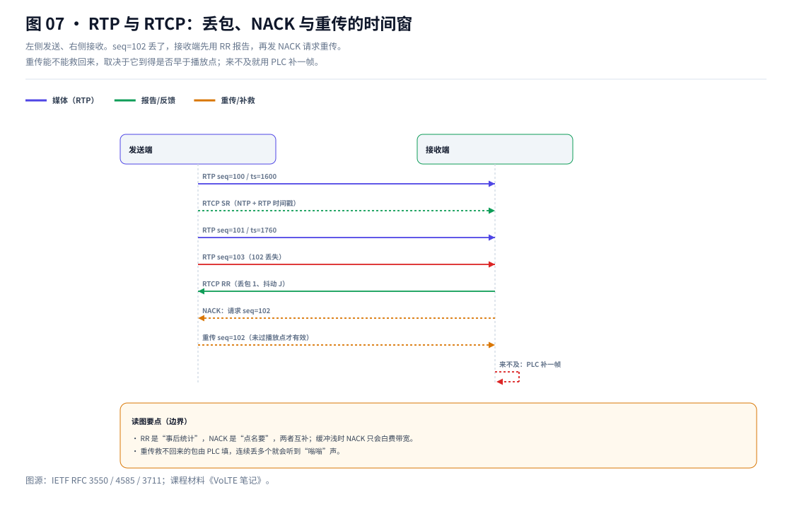

# RTP/RTCP 与媒体传输

RTP 不保证可靠、不保证顺序、不保证时延，它只做三件事：**给包编号（seq）、给时间打戳（timestamp）、标识谁发的（SSRC）**。接收端靠这三样重建播放节奏；RTCP 再补上“我收到了多少、丢了多少、抖了多少”的反馈。语音能不能听，取决于这两层配合得好不好。

> 本篇定位：RTP 头与序号/时间戳的用法、载荷类型与协商、RTCP 报告与反馈、抖动/丢包量化、SRTP。编码与打包去 [01-语音编码与媒体质量](./01-语音编码与媒体质量.md)，会话建立去 [03-SIP协议](./03-SIP协议.md)。

## 目录

- [1 一句话模型](#s1)
- [2 速览](#s2)
- [3 RTP 头字段](#s3)
- [4 序号与时间戳怎么用](#s4)
- [5 载荷类型与协商](#s5)
- [6 RTCP：报告与反馈](#s6)
- [7 抖动与丢包的量化](#s7)
- [8 SRTP 与安全](#s8)
- [9 状态机与定时器](#s9)
- [10 设计取舍与边界](#s10)
- [11 与相邻主题的关系](#s11)
- [名词解释](#名词解释)
- [12 参考与关联](#s12)

## 1 · 一句话模型：给实时流装一个“播放时钟”

```text
发送端：采集 → 每 20 ms 一个包 → seq++ / timestamp += 160
接收端：按 seq 判丢包、按 timestamp 排播放时刻 → 交给抖动缓冲
反馈：  RTCP RR 报告丢包率/抖动 → 发送端调码率或 FEC
```

三个关键认知：

1. **seq 管“有没有丢”，timestamp 管“什么时候播”**：两者分工不同，缺一个就没法既检测丢包又保持节奏。
2. **RTP 是“应用层的事”**：UDP 只负责送到端口，重排、去重、丢包判断全在 RTP/应用里做。
3. **RTCP 是控制流，不是数据流**：它不携带语音，只报告接收质量，带宽占比很小（约 5%）。

## 2 · 速览

| 项 | 内容 |
| --- | --- |
| 所属领域 | 实时媒体传输 |
| 核心对象 | RTP 包、RTCP 报告、SSRC、payload type |
| 关键字段 | seq（16 bit）、timestamp（32 bit）、SSRC（32 bit）、M |
| 关键机制 | 抖动缓冲、丢包检测、NACK/PLI、SR/RR |
| 传输 | UDP 为主（也可 TCP/TLS 做兜底，如 WebRTC 的 ICE-TCP） |
| 主要标准 | RFC 3550（RTP/RTCP）、RFC 4585（反馈）、RFC 3711（SRTP）、RFC 4733（DTMF） |

## 3 · RTP 头字段

固定头 12 字节，后面可跟 CSRC 列表与扩展头：

```text
 0                   1                   2                   3
 0 1 2 3 4 5 6 7 8 9 0 1 2 3 4 5 6 7 8 9 0 1 2 3 4 5 6 7 8 9 0 1
+-+-+-+-+-+-+-+-+-+-+-+-+-+-+-+-+-+-+-+-+-+-+-+-+-+-+-+-+-+-+-+-+
|V=2|P|X|  CC   |M|     PT      |       sequence number         |
+-+-+-+-+-+-+-+-+-+-+-+-+-+-+-+-+-+-+-+-+-+-+-+-+-+-+-+-+-+-+-+-+
|                           timestamp                           |
+-+-+-+-+-+-+-+-+-+-+-+-+-+-+-+-+-+-+-+-+-+-+-+-+-+-+-+-+-+-+-+-+
|           synchronization source (SSRC) identifier            |
+-+-+-+-+-+-+-+-+-+-+-+-+-+-+-+-+-+-+-+-+-+-+-+-+-+-+-+-+-+-+-+-+
```

| 字段 | 位宽 | 作用 | 边界与误判 |
| --- | --- | --- | --- |
| V | 2 | 版本，固定 2 | 不是 2 的包直接丢，别当业务问题查 |
| P | 1 | 末尾有填充 | 填充长度在最后一个字节，解析错会读越界 |
| X | 1 | 有扩展头 | 扩展头长度按 32 bit 对齐，算错会错位 |
| CC | 4 | CSRC 个数 | 混音场景才用，普通点对点为 0 |
| M | 1 | 标记（如一个语音帧/一帧图像结束） | 语音里常用来标“静音后的第一个包” |
| PT | 7 | 载荷类型 | 96~127 是动态类型，必须靠 SDP 解释 |
| seq | 16 | 包序号，每包 +1 | 回绕是正常的，比较要按模 65536 |
| timestamp | 32 | 采样时刻，按采样率递增 | 不是墙钟时间，不能直接当“发送时间” |
| SSRC | 32 | 同步源标识 | 冲突时要换；混流后 SSRC 会变 |

## 4 · 序号与时间戳怎么用

| 用途 | 用什么 | 怎么算 | 出错的表现 |
| --- | --- | --- | --- |
| 丢包检测 | seq | 收到 100、102 → 101 丢了 | 把乱序当丢包，重复请求重传 |
| 乱序重排 | seq | 按 seq 排序后放缓冲 | 缓冲按到达顺序播，听到“倒字” |
| 播放节奏 | timestamp | 每 20 ms 加 160（8 kHz） | 时间戳不连续，播放忽快忽慢 |
| 唇音同步 | timestamp + RTCP SR | 用 NTP 时间对齐音视频 | 音画不同步 |
| 静音/话权 | M + 时间戳跳变 | DTX 期间时间戳仍按真实时间走 | 用“到达时间”补，节奏会漂 |

> **推论**：时间戳的步长由采样率决定，不随 ptime 变。ptime 从 20 ms 改成 40 ms，包数减半，但每个包的时间戳仍然 +=160×2——这是“改 ptime 不影响同步”的原因。

## 5 · 载荷类型与协商

| 类型 | 例子 | 怎么确定 |
| --- | --- | --- |
| 静态 PT | 0 = PCMU（G.711 μ-law）、8 = PCMA（A-law） | RFC 3551 固定 |
| 动态 PT | 96~127 | SDP 的 `a=rtpmap` 指定，如 `96 AMR-WB/16000` |
|  telephone-event | DTMF 按键 | 通常单独协商一个 PT |

**为什么必须协商**：同一个 PT 值在不同会话里可能指不同编码。只抓包看到 `PT=96` 无法判断编码，必须看 SDP。这是“抓包看不出编码”的常见原因。

## 6 · RTCP：报告与反馈

| 包类型 | 全称 | 作用 |
| --- | --- | --- |
| SR (200) | Sender Report | 发送统计 + NTP 时间戳（用于唇音同步） |
| RR (201) | Receiver Report | 丢包率、累计丢包、抖动、最高 seq |
| SDES (202) | Source Description | 携带 CNAME 等标识 |
| BYE (203) | — | 结束一个 SSRC |
| APP (204) | — | 应用自定义 |
| NACK / PLI / FIR | 反馈（RFC 4585） | 请求重传某个包 / 请求关键帧 / 请求重新同步 |
| REMB | Receiver Estimated Max Bitrate | 接收端建议发送码率 |

RTCP 带宽通常按会话带宽的约 5% 计算，发送端与接收端再按比例分。**RTCP 不是“越多越好”**：报告太密会挤占媒体带宽，太稀则反馈滞后。

算一笔：1 Mbps 的语音会话，RTCP 预算约 50 kbps。一个 RR 包几十字节，按 50 kbps 算可以每几十毫秒发一次——但实际实现通常几秒一次，因为**反馈的价值在“趋势”，不在“瞬时”**。



**读图**：左侧发送、右侧接收。seq=102 丢了，接收端先用 RR 报告“丢了 1 个”，再发 NACK 请求重传；重传能不能救回来，取决于它到得是否早于播放点。最后那条虚线是“来不及了，用 PLC 补一帧”。

> 图源：`images/图07-RTP与RTCP交互.svg`

**NACK 到底来不来得及**，可以算：

```text
允许的等待 = 抖动缓冲深度 − 已用缓冲
若缓冲 60 ms、包间隔 20 ms、重传往返 40 ms
  → 重传到达时距播放点还有约 0~20 ms，勉强来得及
若缓冲只有 30 ms
  → 重传必晚，NACK 只是浪费带宽
```

> **推论**：NACK 不是“开了就更好”。缓冲浅的部署开 NACK，只会增加上行请求与重传流量；这类场景应该靠 FEC（提前冗余）而不是 NACK（事后补）。

## 7 · 抖动与丢包的量化

RFC 3550 的抖动估计是一个一阶低通：

```text
D(i-1, i) = (R_i - R_{i-1}) - (S_i - S_{i-1})   // 到达间隔 - 发送间隔
J = J + (|D(i-1, i)| - J) / 16
```

工程上用它做两件事：

| 用途 | 判据 | 说明 |
| --- | --- | --- |
| 抖动缓冲深度 | 取 J 的若干倍（常见 2~4 倍） | 太小吞字，太大增时延 |
| 丢包率 | 1 - 收到包数/期望包数 | 期望包数由 seq 跨度算，不能只看收到多少 |

> **边界**：抖动是“到达间隔的变化”，不是“时延”。一条稳定 200 ms 时延的链路抖动可以是 0；一条平均 30 ms 但忽快忽慢的链路抖动很大。排障时两者要分开看。

## 8 · SRTP 与安全

| 能力 | 机制 | 边界 |
| --- | --- | --- |
| 加密 | AES-CM 等，密钥由主密钥派生 | 只加密载荷，头要留给网络路由 |
| 完整性 | HMAC-SHA1 或 AEAD | 头也被认证（部分字段），防篡改 |
| 密钥管理 | SDES（SDP 里带密钥）或 DTLS-SRTP | SDES 依赖信令加密，否则密钥裸奔 |
| 重放保护 | 滑动窗口 | 窗口太小会误丢迟到包 |

> **推论**：SRTP 解决“别人听不到/改不了”，不解决“别人打得进来”。防 toll fraud、防注册劫持要靠鉴权、限速与 SBC，不是加密。

## 9 · 状态机与定时器

RTP 本身没有连接状态机；它维护的是**每个 SSRC 的接收状态**：

| 状态变量 | 作用 | 算错的后果 |
| --- | --- | --- |
| max_seq + cycles | 处理 16 bit 序号回绕 | 回绕没处理，会误报“一次丢几万个包” |
| 累计丢包 | 由 seq 跨度减收到数算 | 用“收到/发送”算，会把乱序算成丢包 |
| jitter | 滑动估计到达间隔变化 | 单位用错（RTP 时间戳 ≠ 毫秒）会差上百倍 |
| LSR / DLSR | 上次 SR 的 NTP 时间与本地到达时间 | 缺失就没法做唇音同步 |
| SSRC 列表 | 一个会话可能有多个源（混音/切换） | 切换源不重置状态，抖动与丢包统计会串 |

相关定时器：

| 定时器 | 作用 | 典型后果 |
| --- | --- | --- |
| RTCP 报告间隔 | 周期发 SR/RR | 太长反馈慢，太短抢带宽 |
| 抖动缓冲自适应周期 | 调整缓冲深度 | 只增不减会“越打越延迟” |
| NACK 重传窗口 | 等重传的时间 | 窗口太短，重传回来已过播放点 |
| SRTP 重放窗口 | 允许的乱序范围 | 太小会丢合法迟到包 |

## 10 · 设计取舍与边界

### 10.1 为什么 RTP 不自己重传

重传是“用时间换完整”，而语音的播放点固定：20 ms 的包晚到 100 ms 就没有意义。所以 RTP 把重传交给**可选的 NACK + 抖动缓冲**，且只在缓冲还来得及的时候有用。可靠传输交给 TCP 就变成了“卡住等重传”，更糟。

### 10.2 常见误判

1. **“抓包看到 PT=96 就知道编码”**：必须看 SDP 的 rtpmap。
2. **“抖动大就是网络差”**：也可能是发送端打包不均匀（应用层抖动）。
3. **“丢包率按收到/发送算”**：要用 seq 跨度算，否则乱序会被算成丢包。
4. **“RTCP 报告是实时告警”**：它是周期统计，秒级粒度，不适合抓瞬时毛刺。
5. **“SRTP 开了就安全”**：密钥通过 SDES 明文传输时，等于没加密。

## 11 · 与相邻主题的关系

| 相邻主题 | 关系 |
| --- | --- |
| [00-语音通信全景与演进](./00-语音通信全景与演进.md) | 信令与媒体分离的整体模型 |
| [01-语音编码与媒体质量](./01-语音编码与媒体质量.md) | 载荷从哪来、ptime 怎么定 |
| [03-SIP协议](./03-SIP协议.md) | 用 SDP 协商 PT/地址/端口 |
| [06-VoIP部署与互通](./06-VoIP部署与互通.md) | 抖动缓冲、QoS、SBC 的工程配置 |
| [11-网络科学/04-传输层](../../11-网络科学/04-传输层/00-传输层概览.md) | UDP 的校验和、分片与丢包 |

一句话：**RTP 负责“按节奏播放”，RTCP 负责“告诉对方播得好不好”。**

## 名词解释

> 缩写给出英文全称；非缩写用“—”表示。

| 术语 | 英文全称 | 解释 |
| --- | --- | --- |
| RTP | Real-time Transport Protocol | 实时传输协议。 |
| RTCP | RTP Control Protocol | RTP 控制协议。 |
| SRTP | Secure RTP | 安全 RTP（加密与完整性）。 |
| SSRC | Synchronization Source | 同步源标识。 |
| CSRC | Contributing Source | 贡献源标识（混音时用）。 |
| PT | Payload Type | 载荷类型。 |
| seq | sequence number | RTP 包序号。 |
| NTP | Network Time Protocol | 网络时间协议，SR 里用于对齐。 |
| NACK | Negative Acknowledgement | 否定确认（请求重传）。 |
| PLI | Picture Loss Indication | 图像丢失指示（请求关键帧）。 |
| FIR | Full Intra Request | 全帧请求。 |
| REMB | Receiver Estimated Maximum Bitrate | 接收端估计最大码率。 |
| SDES | Source Description | RTCP 源描述包。 |
| CNAME | Canonical Name | 规范名，用于关联同一端的不同流。 |
| SR / RR | Sender / Receiver Report | 发送端/接收端报告。 |
| DTMF | Dual-Tone Multi-Frequency | 双音多频按键音。 |
| AEAD | Authenticated Encryption with Associated Data | 带关联数据的认证加密。 |
| DTLS | Datagram TLS | 数据报 TLS，用于 SRTP 密钥协商。 |

## 12 · 参考与关联

**标准**

- IETF RFC 3550：RTP/RTCP。
- IETF RFC 3551：RTP 的音频/视频载荷类型。
- IETF RFC 4585：RTP 反馈框架（NACK/PLI 等）。
- IETF RFC 3711：SRTP。
- IETF RFC 4733：DTMF 的 RTP 载荷。
- ITU-T G.107：E-model（结合抖动/丢包评估质量）。

**关联**

- [00-语音通信全景与演进](./00-语音通信全景与演进.md)
- [01-语音编码与媒体质量](./01-语音编码与媒体质量.md)
- [03-SIP协议](./03-SIP协议.md)
- [06-VoIP部署与互通](./06-VoIP部署与互通.md)

---

> **本篇定位**：RTP/RTCP 的字段、序号与时间戳用法、质量反馈与 SRTP；不展开拥塞控制算法（GCC/REMB 策略）与具体实现。
> **素材来源**：IETF RFC 3550/3551/3711/4585/4733 的公开结构；`studyspace/1.知识体系/9.lte5g相关/lte/VoLTE/VoLTE笔记.md`（课程材料）。
> **待验证**：各实现的 RTCP 带宽比例、NACK 缓存深度、抖动缓冲策略以设备/框架文档为准。
