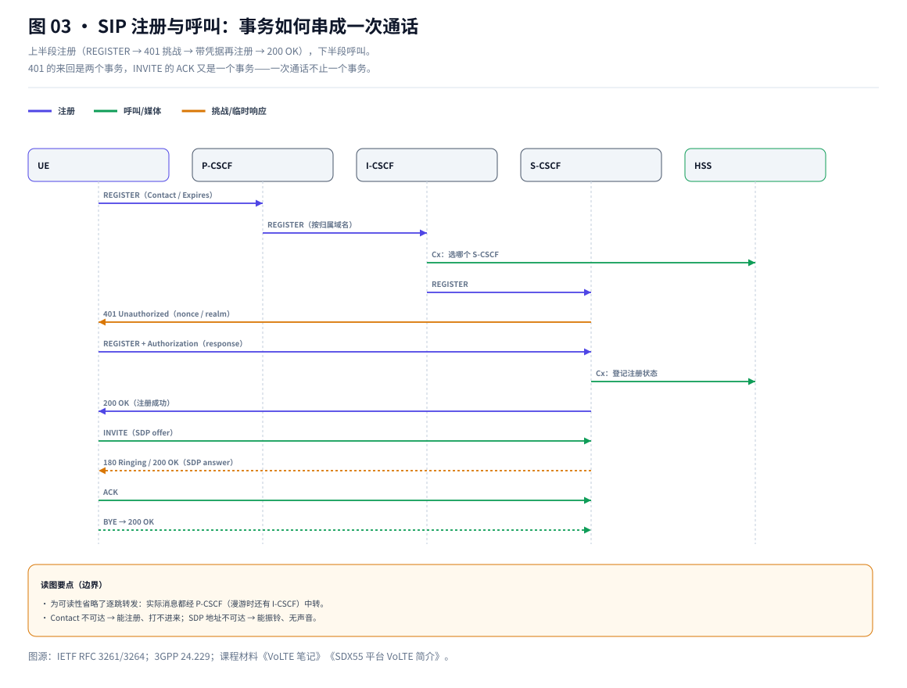

# SIP 协议

SIP 是“电话的信令层”：它不传声音，只负责把双方的**地址、编码、端口**谈拢，然后建会话、改会话、拆会话。它的两个核心抽象是**事务**（一次请求到最终响应）和**对话**（一次会话的完整生命周期）。把这两个分清，SIP 的绝大多数“怪现象”都能归位。

> 本篇定位：SIP 的角色、方法与响应、事务与对话、注册与呼叫、SDP 协商、路由与 NAT、定时器。媒体传输去 [02-RTP-RTCP与媒体传输](./02-RTP-RTCP与媒体传输.md)，运营商 IMS 里的用法去 [04-IMS架构与VoLTE](./04-IMS架构与VoLTE.md)。

## 目录

- [1 一句话模型](#s1)
- [2 速览](#s2)
- [3 角色与网元](#s3)
- [4 方法与响应码](#s4)
- [5 事务与对话](#s5)
- [6 注册](#s6)
- [7 呼叫流程](#s7)
- [8 SDP 协商](#s8)
- [9 路由与关键头字段](#s9)
- [10 传输与 NAT](#s10)
- [11 状态机与定时器](#s11)
- [12 设计取舍与边界](#s12)
- [13 与相邻主题的关系](#s13)
- [名词解释](#名词解释)
- [14 参考与关联](#s14)

## 1 · 一句话模型：SIP 只谈“怎么找到对方、用什么编码”

```text
REGISTER：我在这个地址，能收呼叫         （登记位置）
INVITE  ：我想和你通话，我的媒体能力是…   （发起 + 协商）
200 OK  ：我接受，用这个编码和端口         （应答 + 协商）
ACK     ：确认，媒体可以开始
BYE     ：结束
```

三个关键认知：

1. **SIP 是“带外信令”**：语音走 RTP，SIP 只负责把 RTP 的地址/端口/编码写进 SDP 交给对方。
2. **事务 ≠ 对话**：一次 INVITE 事务可能重传多次，但只对应一个对话；对话用 Call-ID + 两个 tag 唯一标识。
3. **SIP 本身不可靠，可靠靠重传**：UDP 上靠定时器重发，TCP 上靠传输层；所以“没收到响应”要先分清是网络丢包还是对端不回。

## 2 · 速览

| 项 | 内容 |
| --- | --- |
| 所属领域 | 实时通信/信令 |
| 核心对象 | 请求/响应、事务、对话、SDP |
| 关键标识 | Call-ID、From tag、To tag、branch、CSeq |
| 默认端口 | UDP/TCP 5060，TLS 5061 |
| 关键机制 | 注册、代理转发、forking、路由集、会话定时器 |
| 主要标准 | RFC 3261（SIP）、3263（DNS）、3264（offer/answer）、4566（SDP）、3581（rport）、4028（会话定时器） |

## 3 · 角色与网元

| 角色 | 做什么 | 边界 |
| --- | --- | --- |
| UAC | 发起请求的终端 | 一个终端可以同时是 UAC 和 UAS |
| UAS | 接收并应答的终端 | — |
| Proxy | 转发请求/响应，可做鉴权与路由 | 不改 SDP 时是“透明”的，改了就成 B2BUA |
| Redirect Server | 只回 3xx 告诉你去哪 | 不参与后续信令 |
| Registrar | 接收 REGISTER，维护位置绑定 | 常与 proxy 合设 |
| B2BUA | 把一条对话拆成两条，分别终结 | 可改 SDP/编解码，代价是状态与转发开销 |
| SBC | 带安全与 NAT 穿越能力的 B2BUA | 运营商/企业边界的主力（见 [06-VoIP部署与互通](./06-VoIP部署与互通.md)） |

**Proxy 与 B2BUA 的区别决定了排障方式**：proxy 出问题看转发与路由；B2BUA 出问题要看它两侧的对话是否各自正常——一侧 200 OK 不代表另一侧也通。

## 4 · 方法与响应码

| 方法 | 用途 | 备注 |
| --- | --- | --- |
| REGISTER | 注册/刷新/注销位置 | 注销用 Expires: 0 |
| INVITE | 发起会话或改会话（re-INVITE） | 带 SDP 时为 offer |
| ACK | 确认最终响应 | 与 INVITE 同属一个事务的收尾 |
| BYE | 结束对话 | 只能由对话内一方发 |
| CANCEL | 取消尚未最终应答的 INVITE | 不能取消已 200 的呼叫 |
| OPTIONS | 能力查询/保活 | 常被用于 NAT 保活与探测 |
| PRACK | 可靠确认 1xx（100rel） | 需要 Supported: 100rel |
| UPDATE | 会话中改参数（不改变对话） | 会话定时器刷新常用它 |
| INFO | 带内信息（DTMF、按键） | 兼容性参差，DTMF 更推荐 RFC 4733 |
| REFER | 请求对方发起一个新呼叫（转接） | 呼叫转移的基础 |
| SUBSCRIBE/NOTIFY | 事件订阅与通知 | 话机状态、MWI 等 |

| 响应段 | 含义 | 典型码 |
| --- | --- | --- |
| 1xx | 临时响应 | 100 Trying、180 Ringing、183 Session Progress |
| 2xx | 成功 | 200 OK、202 Accepted |
| 3xx | 重定向 | 301 Moved、302 Moved Temporarily |
| 4xx | 客户端错误 | 401/407 鉴权、404 Not Found、486 Busy、488 Not Acceptable |
| 5xx | 服务端错误 | 500 Server Error、503 Service Unavailable |
| 6xx | 全局失败 | 603 Decline、604 Does Not Exist |

**401 与 407 不是一回事**：401 是“源服务器要求鉴权”（`WWW-Authenticate`），407 是“代理要求鉴权”（`Proxy-Authenticate`）。终端对 401 用 `Authorization` 回，对 407 用 `Proxy-Authorization` 回。**回错头就陷入无限挑战**——现象是“一直在鉴权、永远不通”。

## 5 · 事务与对话

这是 SIP 最容易混的一对概念：

| 维度 | 事务（Transaction） | 对话（Dialog） |
| --- | --- | --- |
| 定义 | 一次请求 → 最终响应（含重传） | 一次会话从建立到结束 |
| 标识 | Via 的 branch + CSeq 方法 | Call-ID + 本地 tag + 远端 tag |
| 数量 | 一次呼叫有多个事务（INVITE/ACK/BYE…） | 一次呼叫通常一个对话（转接会多） |
| 状态 | Calling/Proceeding/Completed/Terminated | Early/Confirmed/Terminated |
| 出错表现 | 重传风暴、超时无响应 | 一方认为已挂断、另一方还在通话 |

> **推论**：看到“INVITE 重传很多次”是事务层问题（没收到响应）；看到“挂断后对端还在”是对话层问题（BYE 没送达或路由集错）。两者不要混着查。

## 6 · 注册

注册的报文顺序如下，**时序图见 §7 上半段**（注册和呼叫画在同一张图上）。

```text
1. UE → Registrar：REGISTER（Contact 写明自己可达的地址，Expires 定有效期）
2. Registrar → UE：401 Unauthorized（WWW-Authenticate：nonce/realm）
3. UE → Registrar：REGISTER + Authorization（用凭据算 response）
4. Registrar → UE：200 OK（位置绑定建立，到期前要刷新）
```

三个工程要点：

1. **Contact 必须是对方能访问到的地址**：NAT 后写私网 IP，注册成功但来电打不通。
2. **Expires 要小于 NAT 绑定老化时间**：否则“注册还在、端口已关”，表现为“能打出去、打不进来”。
3. **注销用 `Expires: 0`**：直接断网不会注销，注册服务器要等超时才清。

## 7 · 呼叫流程

```text
主叫 → Proxy：INVITE（SDP offer：编码列表、端口）
Proxy → 被叫：INVITE（可能 forking 到多个 Contact）
被叫 → 主叫：100 Trying → 180 Ringing → 200 OK（SDP answer）
主叫 → 被叫：ACK（确认，媒体开始）
任一方 → 对方：BYE → 200 OK（结束）
```



**读图**：上半段是注册（REGISTER → 401 挑战 → 带凭据再注册 → 200 OK），下半段是呼叫（INVITE → 180 → 200 → ACK → BYE）。注意 401 那一来一回是**两个事务**；INVITE 的 ACK 是**第三个事务**——这就是“一次呼叫不止一个事务”的直观解释。

> 图源：`images/图03-SIP注册与呼叫.svg`

| 阶段 | 关键动作 | 失败表现 |
| --- | --- | --- |
| 路由 | 按 Request-URI 与 DNS（NAPTR/SRV）找下一跳 | 404/503，或“拨号后无声” |
| 鉴权 | 401/407 挑战 | 反复 401，或直接 403 |
| 协商 | SDP offer/answer 取交集 | 488，或 200 但无声 |
| 振铃 | 180/183 | 无回铃音（本地音 vs 带内音） |
| 接通 | 200 + ACK | 接通即断（ACK 没到） |
| 释放 | BYE/200 | 挂不断、残留会话 |

**建立时延花在哪**，按阶段拆：

| 阶段 | 典型耗时 | 备注 |
| --- | --- | --- |
| DNS/路由 | 0~100 ms | 首次查询慢，之后走缓存 |
| INVITE → 100 Trying | 1 个 RTT | 连 100 都没有：代理没转发或端口被挡 |
| 鉴权（401/407） | 1~2 个 RTT | 每多一轮挑战，接续就多一个往返 |
| 180 Ringing / 183 Session Progress | 取决于被叫侧 | 与网络无关，别算进“网络慢” |
| 200 → ACK | 1 个 RTT | 缺 ACK 会重传，最终拆线 |

> **推论**：接续时延由“最慢的那段”决定。跨国链路 RTT 200 ms 时，DNS + 鉴权 + INVITE 就吃掉 600~800 ms——这时“接续慢”是物理距离，不是设备性能。

**forking 的代价**：代理把一个 INVITE 分发到多个 Contact，多个终端同时振铃，第一个 200 之后其余 CANCEL。它提升了“有人接”的概率，代价是信令放大与“多终端同振”的隐私问题。

## 8 · SDP 协商

SDP 是一段文本，描述“我支持什么、往哪发”：

```text
v=0
o=alice 2890844526 2890844526 IN IP4 192.0.2.10
s=-
c=IN IP4 192.0.2.10
t=0 0
m=audio 49170 RTP/AVP 96 97 98
a=rtpmap:96 AMR-WB/16000
a=rtpmap:97 AMR/8000
a=ptime:20
a=sendrecv
```

| 行 | 作用 | 边界与误判 |
| --- | --- | --- |
| `c=` | 媒体连接地址 | NAT 后写私网地址 → 媒体不通 |
| `m=` | 媒体类型、端口、载荷类型列表 | 端口为 0 表示“这条流不用” |
| `a=rtpmap` | 把动态 PT 映射到编码 | 缺了它，PT=96 无法解释 |
| `a=ptime` | 打包周期 | 双方可不同，接收端按自己策略播 |
| `a=sendrecv/sendonly/recvonly/inactive` | 方向 | 单通常因方向被写成 sendonly |

**offer/answer 的规则**（RFC 3264）：主叫给 offer，被叫给 answer；answer 里的每个 `m=` 必须对应 offer，且只能选 offer 里有的编码。**没有交集就是 488，或者协商到最差的兜底编码**——后者听起来“能通但音质差”，更难发现。

协商失败有三种表现，别混着查：

| 表现 | 直接原因 | 判据 |
| --- | --- | --- |
| 488 Not Acceptable Here | 无交集，或必须的编码/方向不被接受 | 对比 offer 与 answer 的 `m=` 和 `a=rtpmap` |
| 200 OK 但无声 | 协商成功，但地址/端口不可达 | 抓 RTP，看双向有没有包 |
| 能通但音质突然变差 | 协商到兜底编码（窄带/G.711） | 看 answer 实际选了哪个 PT |

## 9 · 路由与关键头字段

| 头字段 | 作用 | 写错的后果 |
| --- | --- | --- |
| Via | 记录每一跳，响应按它回 | 回程错，表现为“请求到了、响应没回” |
| Route / Record-Route | 建立对话后的路由集 | 后续请求绕过代理，鉴权/计费失效 |
| Contact | 该实体的直接可达地址 | 来电打不通（NAT 场景最常见） |
| From / To | 逻辑主被叫 + tag | tag 缺失会导致对话无法匹配 |
| Call-ID | 全局唯一标识一次会话 | 复用 Call-ID 会串话 |
| CSeq | 请求序号 + 方法 | 乱序或重复会被当重传丢弃 |
| Max-Forwards | 跳数限制 | 环路时靠它兜底 |
| Expires | 注册/订阅有效期 | 太短风暴，太长掉网后仍被叫 |

路由分两种：**严格路由**（Route 里含下一跳，已很少用）与**松散路由**（带 `lr` 参数，按 Route 列表逐个走）。云化/IMS 环境基本都是松散路由。

## 10 · 传输与 NAT

| 传输 | 端口 | 适用 | 边界 |
| --- | --- | --- | --- |
| UDP | 5060 | 低时延、小消息 | 大包（带长 SDP）会分片，易丢 |
| TCP | 5060 | 大消息、可靠 | 需处理连接复用与半开连接 |
| TLS | 5061 | 加密与身份认证 | 证书/时间不同步会导致握手失败 |
| WebSocket | 80/443 | 浏览器/WebRTC | 需要网关转换到 SIP |

**SIP 为什么难过 NAT**：SIP 把 IP/端口写在三个地方——IP 头、Via、SDP 的 `c=`/`m=`。NAT 只改 IP 头，不改正文，于是对方按正文里的私网地址回包，必然不通。

| 方案 | 做什么 | 代价 |
| --- | --- | --- |
| ALG | 网关改写 SIP 正文 | 各厂商实现不一致，常把加密/分片搞坏 |
| STUN | 终端发现自己的公网映射 | 只解决终端侧，不解决对称 NAT |
| TURN | 媒体中继 | 带宽成本，时延增加 |
| ICE | 多条候选路径择优 | 实现复杂，需要双方支持 |
| SBC | 终结信令与媒体，重新发起 | 最可靠，成本最高 |

> **推论**：企业网里“注册正常、通话无声”九成是 SDP 地址不可达。先看 SDP 的 `c=` 是不是私网地址，再谈编解码。

## 11 · 状态机与定时器

### 11.1 事务状态（INVITE 客户端）

| 状态 | 含义 | 迁移 |
| --- | --- | --- |
| Calling | 已发 INVITE，未见响应 | 收 1xx → Proceeding；收 2xx → Accepted |
| Proceeding | 收到临时响应 | 收 2xx → Accepted；收 3xx-6xx → Completed |
| Completed | 收到最终响应 | 收 ACK 后结束（非 2xx 要自己发 ACK） |
| Terminated | 事务结束 | — |

另外两种状态机经常被忽略：

| 状态机 | 关键点 | 出错表现 |
| --- | --- | --- |
| INVITE 服务端 | 收 INVITE → 发 1xx/最终响应 → 等 ACK | 2xx 后收不到 ACK 会持续重传，最后拆线 |
| 非 INVITE 客户端（BYE/REGISTER/OPTIONS） | 只有 Trying/Proceeding/Completed | 重传比 INVITE 快（Timer E/F），失败感知更灵敏 |

### 11.2 关键定时器

| 定时器 | 默认 | 管什么 | 超时后果 |
| --- | --- | --- | --- |
| T1 | 500 ms | 重传间隔基数 | 按 2 倍退避重传 |
| T2 | 4 s | 非 INVITE 重传上限 | 超过后不再加速 |
| T4 | 5 s | 消息在网络中的最长停留 | 超时视为“对端没收到” |
| Timer A / E | T1 起 | INVITE / 非 INVITE 请求重传 | 逐步退避，直到上限 |
| Timer B | 64×T1（约 32 s） | INVITE 等最终响应 | 事务失败，回 408/超时 |
| Timer F | 64×T1 | 非 INVITE 等响应 | 同上 |
| Timer D | ≥32 s（UDP） | 等 ACK | 期间重传最终响应 |
| Timer H | 64×T1 | 等 ACK（非 2xx） | 事务终止 |
| Timer K | T4 | 等 ACK（2xx，客户端侧） | 防止旧响应串到新事务 |
| 会话定时器 | 由协商定（如 1800 s） | 周期刷新会话 | 超时自动 BYE，防“僵尸会话” |

> 取值以 RFC 3261 与设备配置为准；现网常把 Timer B/F 调短以加快失败感知，代价是弱网下误判。

## 12 · 设计取舍与边界

### 12.1 为什么 SIP 用文本

文本可读、易扩展、跨语言实现简单，排障时直接看消息就能定位。代价是消息比二进制大，UDP 下容易分片——所以大消息（长 SDP、多 Route）应走 TCP/TLS。

### 12.2 常见误判

1. **“注册成功就能被叫”**：还要 Contact 可达、注册未过期、路由集正确。
2. **“200 OK 就说明媒体通了”**：200 只表示信令接受，媒体要看 RTP 有没有双向到达。
3. **“ACK 是可有可无的”**：2xx 的 ACK 缺失会让对端持续重传，最终拆线。
4. **“CANCEL 能取消任何呼叫”**：只能取消未最终应答的 INVITE；已 200 只能 BYE。
5. **“SIP 走 TCP 就不丢消息”**：TCP 断链/半开连接同样丢，只是不重传在应用层。

## 13 · 与相邻主题的关系

| 相邻主题 | 关系 |
| --- | --- |
| [00-语音通信全景与演进](./00-语音通信全景与演进.md) | 信令与媒体分离的整体模型 |
| [02-RTP-RTCP与媒体传输](./02-RTP-RTCP与媒体传输.md) | SDP 协商出来的媒体怎么走 |
| [04-IMS架构与VoLTE](./04-IMS架构与VoLTE.md) | SIP 在运营商网里的部署与鉴权 |
| [05-H248与媒体网关](./05-H248与媒体网关.md) | SIP 管会话，H.248 管媒体网关资源 |
| [06-VoIP部署与互通](./06-VoIP部署与互通.md) | SBC、NAT、QoS 与排障 |
| [11-网络科学/05-应用层](../../11-网络科学/05-应用层/00-应用层概览.md) | HTTP/DNS 等应用层协议的对照 |

一句话：**SIP 谈的是“怎么通”，RTP 才决定“通得好不好”。**

## 名词解释

> 缩写给出英文全称；非缩写用“—”表示。

| 术语 | 英文全称 | 解释 |
| --- | --- | --- |
| SIP | Session Initiation Protocol | 会话发起协议。 |
| UAC | User Agent Client | 发起请求的一方。 |
| UAS | User Agent Server | 接收并应答的一方。 |
| B2BUA | Back-to-Back User Agent | 背靠背用户代理，终结并重建两条对话。 |
| SBC | Session Border Controller | 会话边界控制器。 |
| Registrar | — | 注册服务器，维护位置绑定。 |
| Proxy | — | 代理服务器，转发请求与响应。 |
| Call-ID | — | 一次会话的全局唯一标识。 |
| CSeq | Command Sequence | 命令序号 + 方法。 |
| tag | — | From/To 里的对话标识片段。 |
| branch | — | Via 里的事务标识（含 z9hG4bK 魔术字）。 |
| SDP | Session Description Protocol | 会话描述协议。 |
| offer/answer | — | SDP 的协商模型（RFC 3264）。 |
| RTP | Real-time Transport Protocol | 实时传输协议。 |
| NAT | Network Address Translation | 网络地址转换。 |
| STUN | Session Traversal Utilities for NAT | NAT 会话穿越工具。 |
| TURN | Traversal Using Relays around NAT | 中继式 NAT 穿越。 |
| ICE | Interactive Connectivity Establishment | 交互式连通建立。 |
| ALG | Application Layer Gateway | 应用层网关（改写 SIP 正文）。 |
| forking | — | 代理把一个请求分发到多个 Contact。 |
| 100rel | — | 临时响应可靠传输扩展（配合 PRACK）。 |
| MWI | Message Waiting Indicator | 留言等待指示。 |
| DNS NAPTR/SRV | — | SIP 服务器发现用的 DNS 记录。 |

## 14 · 参考与关联

**标准**

- IETF RFC 3261：SIP。
- IETF RFC 3263：SIP 的 DNS 定位（NAPTR/SRV）。
- IETF RFC 3264：SDP offer/answer。
- IETF RFC 4566：SDP。
- IETF RFC 3581：rport（NAT 回程）。
- IETF RFC 4028：会话定时器。
- IETF RFC 6026：事务修正。

**关联**

- [00-语音通信全景与演进](./00-语音通信全景与演进.md)
- [02-RTP-RTCP与媒体传输](./02-RTP-RTCP与媒体传输.md)
- [04-IMS架构与VoLTE](./04-IMS架构与VoLTE.md)
- [06-VoIP部署与互通](./06-VoIP部署与互通.md)

---

> **本篇定位**：SIP 的事务/对话模型、注册与呼叫、SDP 协商、路由与 NAT、定时器；不展开 IMS 的 Cx/Sh 细节与厂商扩展头。
> **素材来源**：IETF RFC 3261/3263/3264/4566/3581/4028 的公开结构；`studyspace/1.知识体系/9.lte5g相关/lte/VoLTE/VoLTE笔记.md`（课程材料）。
> **待验证**：各设备/平台的定时器取值、扩展头支持与 NAT 策略以设备手册与现网抓包为准。
