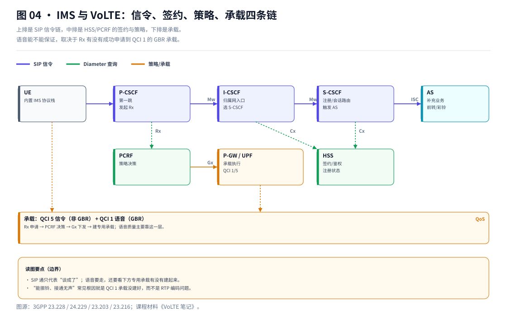

# IMS 架构与 VoLTE

IMS 是“运营商版的 SIP 核心网”：它把 SIP 从“能打通”升级为“可鉴权、可计费、可漫游、可管 QoS、可开业务”。VoLTE 则是 IMS 在 LTE 上的落地——**信令走 QCI 5、语音走 QCI 1，全部由 P-CSCF 通过 Rx 向 PCRF 申请资源**。理解了这条“策略触发承载”的链，VoLTE 的大多数问题就有落点。

> 本篇定位：IMS 的网元与接口、注册与业务触发、VoLTE 的承载与策略链、与蜂窝移动性的衔接。SIP 协议细节去 [03-SIP协议](./03-SIP协议.md)，空口与回落去 [03-蜂窝通信/06-VoLTE与语音方案](../04-无线通信/03-蜂窝通信/06-VoLTE与语音方案.md)，QoS 参数去 [03-蜂窝通信/05-QoS与承载](../04-无线通信/03-蜂窝通信/05-QoS与承载.md)。

## 目录

- [1 一句话模型](#s1)
- [2 速览](#s2)
- [3 为什么运营商要自建 IMS](#s3)
- [4 网元](#s4)
- [5 接口](#s5)
- [6 注册与鉴权](#s6)
- [7 呼叫与业务触发](#s7)
- [8 VoLTE 的承载与策略链](#s8)
- [9 与移动性的衔接](#s9)
- [10 状态机与定时器](#s10)
- [11 设计取舍与边界](#s11)
- [12 与相邻主题的关系](#s12)
- [名词解释](#名词解释)
- [13 参考与关联](#s13)

## 1 · 一句话模型：SIP 做信令，IMS 补“运营”那半边

```text
UE ──Gm(SIP)── P-CSCF ──Mw── I-CSCF/S-CSCF ──ISC── AS（业务）
                  │                 │
                 Rx                Cx/Sh
                  ↓                 ↓
                PCRF              HSS（签约/鉴权）
                  │
                 Gx
                  ↓
             P-GW / UPF ── 承载（QCI 5 信令、QCI 1 语音）
```

三个关键认知：

1. **IMS 的价值不在 SIP，而在“运营能力”**：鉴权（USIM/AKA）、计费、漫游、号码、QoS 申请、业务触发，这些是 OTT 方案没有的。
2. **P-CSCF 是终端进入 IMS 的第一跳，也是 QoS 的发起者**：它看得见 SDP，所以能在呼叫建立时向 PCRF 要资源。
3. **信令与承载是两条链**：SIP 通只代表“谈成了”，语音能不能走要看专用承载有没有建起来。

## 2 · 速览

| 项 | 内容 |
| --- | --- |
| 所属领域 | 运营商语音/IMS |
| 核心对象 | CSCF、HSS、AS、PCRF、承载 |
| 关键接口 | Gm、Mw、Cx、Sh、ISC、Rx、Gx |
| 关键承载 | QCI 5（SIP 信令，非 GBR）、QCI 1（语音，GBR） |
| 关键机制 | AKA 鉴权、iFC 业务触发、Rx 资源申请、SRVCC/EPS Fallback |
| 主要标准 | 3GPP 23.228、24.229、23.203、23.216、23.502 |

## 3 · 为什么运营商要自建 IMS

| 方案 | 谁能保证 QoS | 鉴权/计费 | 漫游 | 号码 | 业务扩展 |
| --- | --- | --- | --- | --- | --- |
| OTT（微信/Skype） | 不能（best effort） | 自有账号 | 无 | 无 | 快 |
| 企业 IP-PBX | 企业内可以 | 企业自管 | 无 | 内部分机 | 快 |
| IMS | 能（专用承载） | 运营商 | 支持 | E.164 | 通过 AS |

> **推论**：所以“VoLTE 音质好”不是编码更高级（OTT 也能用 Opus），而是**有 GBR 承载和运营商级调度**。反过来，OTT 语音在拥塞时没有资源保障，质量随网络波动。

## 4 · 网元

| 网元 | 全称 | 作用 | 边界 |
| --- | --- | --- | --- |
| P-CSCF | Proxy-CSCF | 终端第一跳，SIP 代理，发起 Rx 资源申请 | 漫游时在拜访网络 |
| I-CSCF | Interrogating-CSCF | 归属网入口，查 HSS 选 S-CSCF | 可隐藏网络拓扑 |
| S-CSCF | Serving-CSCF | 注册状态、会话路由、触发 AS | 一个用户同时只有一个服务 S-CSCF |
| HSS | Home Subscriber Server | 签约、鉴权向量、注册状态 | 与 4G/5G 的 UDM 有交集，按部署形态分合 |
| SLF | Subscription Locator Function | 多 HSS 时定位用户属于哪个 HSS | 单 HSS 部署可省 |
| AS | Application Server | 补充业务（前转、彩铃、会议、Voicemail） | 业务逻辑在 AS，不在 CSCF |
| MRF | Media Resource Function | 放音、混音、会议桥 | 与 MGW 的媒体功能有重叠，分工看部署 |
| BGCF | Breakout Gateway Control Function | 选择出网到 PSTN 的出口 | 只做路由选择，不做媒体 |
| MGCF | Media Gateway Control Function | ISUP ↔ SIP 信令转换 | 与 IM-MGW 配对使用 |
| IM-MGW | IMS Media Gateway | 媒体转换（编码、承载） | 由 MGCF 用 H.248 控制 |
| SBC | Session Border Controller | 网络边界、安全、NAT 穿越 | 与 P-CSCF 可能合设 |

## 5 · 接口

| 接口 | 两端 | 协议 | 作用 |
| --- | --- | --- | --- |
| Gm | UE ↔ P-CSCF | SIP | 终端接入 IMS 的信令 |
| Mw | CSCF ↔ CSCF | SIP | IMS 内部会话路由 |
| Mg | MGCF ↔ I-CSCF | SIP | 出网信令 |
| Mj | MGCF ↔ BGCF | SIP | 出网路由 |
| Mi | S-CSCF ↔ BGCF | SIP | 出网路由 |
| Mn | MGCF ↔ IM-MGW | H.248 | 媒体网关控制 |
| Cx | I/S-CSCF ↔ HSS | Diameter | 鉴权、注册状态、用户数据 |
| Sh | AS ↔ HSS | Diameter | 业务侧取用户数据 |
| ISC | S-CSCF ↔ AS | SIP | 业务触发 |
| Rx | P-CSCF ↔ PCRF | Diameter | 申请/释放承载资源 |
| Gx | PCRF ↔ P-GW/PCEF | Diameter | 下发 QoS 策略 |

## 6 · 注册与鉴权

```text
UE → P-CSCF → I-CSCF → HSS(Cx: 选 S-CSCF) → S-CSCF
S-CSCF → UE：401（RAND/AUTN 挑战）
UE：用 USIM 的 Ki 算 RES
UE → S-CSCF：REGISTER + Authorization（RES）
S-CSCF → HSS：登记注册状态（SAR/SAA）
S-CSCF → UE：200 OK
```

三个身份要分清：

| 标识 | 是什么 | 用在哪 |
| --- | --- | --- |
| IMPI | 私有身份（类似用户名） | 鉴权 |
| IMPU | 公共身份（SIP URI / tel URI） | 呼叫寻址、业务 |
| MSISDN | 电话号码 | PSTN 互通、主叫显示 |

> **边界**：注册成功但打不通，先看 IMPU 与 MSISDN 的绑定、以及 AS 的业务触发规则（iFC），而不是怀疑 SIP 栈。

**Cx 上真正跑的消息**（都是 Diameter，但用途不同）：

| 消息对 | 方向 | 作用 | 出错的后果 |
| --- | --- | --- | --- |
| UAR / UAA | I-CSCF → HSS | 查询该用户是否允许注册、选哪个 S-CSCF | 无法选到 S-CSCF，注册卡住 |
| MAR / MAA | I-CSCF/S-CSCF → HSS | 取鉴权向量（RAND/AUTN） | 401 发不出去，或挑战永远不对 |
| SAR / SAA | S-CSCF → HSS | 登记/更新注册状态与用户数据 | 网络侧认为未注册，来电直接失败 |
| LIR / LIA | I-CSCF → HSS | 查用户当前服务的 S-CSCF | 被叫路由错，呼叫进不去 |
| RTR / RTA | HSS → S-CSCF | 通知“该用户被注销/被别的注册覆盖” | 双注册/被顶号后仍收呼 |
| PPR / PPA | HSS → S-CSCF | 推送签约变更（如开通新业务） | 业务开通了但不生效 |

> **推论**：注册类问题的排查顺序是“UAR 过没过 → MAA 有没有向量 → SAR 有没有登记”。只看 401/200，会漏掉 HSS 侧的拒绝原因。

## 7 · 呼叫与业务触发

```text
主叫 INVITE → P-CSCF → S-CSCF
  S-CSCF 按 iFC（初始过滤规则）判断：要不要经过 AS
    → AS 处理（如遇忙前转、彩铃）
      → S-CSCF → 被叫侧 I-CSCF → S-CSCF → P-CSCF → 被叫
```

iFC 是“业务链的路由表”：它决定哪些呼叫要进哪个 AS。**业务没生效，先查 iFC 与 AS 的触发条件，而不是查 SIP 流程。**

iFC 的几个要点：

| 要素 | 含义 | 配错的后果 |
| --- | --- | --- |
| 触发点（Trigger Point） | 按主叫/被叫号码、方法、SDP 等条件匹配 | 条件太宽 → 所有呼叫都进 AS，时延上升 |
| 优先级（Priority） | 多个 iFC 谁先执行 | 顺序错 → 业务叠加错（如前转盖掉彩铃） |
| AS 地址 | 转发到哪个 AS | 写错 → 503，或呼叫卡在业务链 |
| 缺省处理 | AS 不响应时是否放行 | 配成“必须成功” → AS 故障时全网打不通 |

> **推论**：业务链的可用性取决于最弱的一环。生产网里“AS 故障导致全网不通”几乎都是缺省处理配成了“失败即拒绝”，而不是 AS 本身的问题。

## 8 · VoLTE 的承载与策略链



**读图**：上方是 SIP 信令链（UE→P-CSCF→I-CSCF→S-CSCF→AS），中间是 HSS 的签约链（Cx），下方是策略与承载链（P-CSCF→Rx→PCRF→Gx→P-GW/UPF）。关键在**下方那条**：语音能不能保证，取决于 Rx 有没有成功申请到 QCI 1 的 GBR 承载。

> 图源：`images/图04-IMS与VoLTE承载.svg`

| 承载 | QCI | 资源类型 | 用途 | 建立者 |
| --- | --- | --- | --- | --- |
| 默认承载 | 9 | 非 GBR | 上网 | Attach / PDU 会话 |
| IMS 信令 | 5 | 非 GBR | SIP | 注册后建立 |
| 语音媒体 | 1 | GBR | RTP 语音 | 呼叫时由 Rx 触发 |
| 视频媒体 | 2 | GBR | 视频通话 | 呼叫时由 Rx 触发 |

```text
P-CSCF 收到 INVITE/200 OK（含 SDP）
  → Rx AAR：描述媒体流（上下行带宽、QoS 类别）
    → PCRF 决策 → Gx 下发 → P-GW 发起专用承载（QCI 1）
      → MME → eNB → RRC 重配建 DRB → 语音开始
```

> **推论**：如果语音“能振铃、接通后没声音”，先查专用承载有没有建起来（QCI 1 的 DRB），再查 RTP。只查 SIP 会漏掉这半边。

**VoLTE 与 VoNR 的差别只在“承载落在哪张核心网上”**：

| 维度 | VoLTE | VoNR |
| --- | --- | --- |
| 核心网 | EPC | 5GC |
| 承载标识 | QCI 1 / 5 | 5QI 1 / 5 |
| 信令承载 | 默认承载上的 QCI 5 | PDU 会话里的 QoS 流（5QI 5） |
| 承载建立链 | Rx → PCRF → Gx → P-GW | Rx → PCF → N4 → UPF |
| 回落 | CSFB / SRVCC | EPS Fallback |

> **边界**：“QCI”与“5QI”不能混着说。4G 看 QCI + 专用承载，5G 看 5QI + QoS 流，中间还隔着一层 SDAP 映射。排障时看错体系，会对着一个不存在的“QCI 1 承载”找半天。

## 9 · 与移动性的衔接

| 场景 | 机制 | 谁来保证 |
| --- | --- | --- |
| 4G 内移动 | X2/S1 切换 | 接入网 + 核心网路径更新 |
| LTE → 2G/3G（通话中） | SRVCC | MSC 接管语音，IMS 锚点切换 |
| 5G → LTE（呼叫建立时） | EPS Fallback | 在 LTE 上建 VoLTE 承载 |
| 5G 内移动 | Xn/NG 切换 | 接入网 |

细节（门限、失败处理、QCI 参数）在 [03-蜂窝通信/06-VoLTE与语音方案](../04-无线通信/03-蜂窝通信/06-VoLTE与语音方案.md) 与 [02-入网与移动性管理](../04-无线通信/03-蜂窝通信/02-入网与移动性管理.md)。

## 10 · 状态机与定时器

| 状态/定时器 | 作用 | 失败表现 |
| --- | --- | --- |
| 注册状态（未注册/注册中/已注册/鉴权失败） | 决定能否收呼 | 未注册 → 来电直接失败 |
| 注册有效期（Expires） | 到期前刷新 | 过期未刷新 → 掉注册 |
| 会话定时器（Session Timer） | 周期刷新会话，防僵尸 | 超时自动 BYE（“通话 30 分钟必断”） |
| Rx 会话定时器 | 承载资源的生命周期 | 释放不及时 → 资源泄漏、计费异常 |

> 取值由运营商策略与设备配置决定；“通话固定时长断线”优先查会话定时器与刷新机制（UPDATE/re-INVITE），不是网络掉线。

## 11 · 设计取舍与边界

### 11.1 为什么 P-CSCF 在拜访网

漫游时，媒体要从拜访地出口走（本地疏导），P-CSCF 放在拜访网才能就近申请承载、就近处理紧急呼叫。代价是拜访网要信任归属网的鉴权结果。

### 11.2 IMS 与 OTT 的边界

| 维度 | IMS | OTT |
| --- | --- | --- |
| 质量保障 | 专用承载 | 尽力而为 |
| 号码 | E.164，可被叫 | 账号，需 App |
| 紧急呼叫 | 支持（带位置） | 多数不支持 |
| 互通 PSTN | 原生 | 需网关 |
| 创新速度 | 慢（标准与现网约束） | 快 |

### 11.3 SBC 与 P-CSCF 合设的边界

设备上常见“P-CSCF/SBC 合一”，但两者职责不同：

| 职责 | P-CSCF | SBC |
| --- | --- | --- |
| SIP 代理 | 是 | 通常是 B2BUA |
| 发起 Rx 资源申请 | 是（它看得见 SDP） | 一般不做 |
| 拓扑隐藏/NAT | 有限 | 主要职责 |
| 安全（TLS/SRTP/ACL） | 部分 | 主要职责 |

> **推论**：合设时排障容易把“SBC 改写了 SDP”和“P-CSCF 申请了资源”混在一起。先确认这条会话的资源申请是不是由合设体发起，再看媒体地址被谁改过。

### 11.4 常见误判

1. **“SIP 注册成功就能打电话”**：还要看承载、iFC、被叫侧路由。
2. **“VoLTE 是 SIP 应用，和 4G 承载无关”**：语音质量主要靠 QCI 1 的 GBR。
3. **“IMS 网元越多越慢”**：CSCF 只处理信令，媒体不走它；慢通常在承载或转码。
4. **“彩铃/前转是核心网功能”**：在 AS，靠 iFC 触发。
5. **“通话定时断是基站问题”**：先查会话定时器与刷新。

## 12 · 与相邻主题的关系

| 相邻主题 | 关系 |
| --- | --- |
| [03-SIP协议](./03-SIP协议.md) | 注册/呼叫/事务的协议细节 |
| [05-H248与媒体网关](./05-H248与媒体网关.md) | MGCF 如何用 H.248 控制 IM-MGW |
| [06-VoIP部署与互通](./06-VoIP部署与互通.md) | SBC 与企业侧对接 |
| [03-蜂窝通信/06-VoLTE与语音方案](../04-无线通信/03-蜂窝通信/06-VoLTE与语音方案.md) | 空口承载、回落与 SRVCC |
| [03-蜂窝通信/05-QoS与承载](../04-无线通信/03-蜂窝通信/05-QoS与承载.md) | QCI/5QI、PCC 与 AMBR |
| [03-蜂窝通信/00-蜂窝网络架构与演进](../04-无线通信/03-蜂窝通信/00-蜂窝网络架构与演进.md) | EPC/5GC 与 IMS 的连接 |

一句话：**IMS 把 SIP 变成“运营商可运营的语音”，VoLTE 把这条链落到 LTE 的承载上。**

## 名词解释

> 缩写给出英文全称；非缩写用“—”表示。

| 术语 | 英文全称 | 解释 |
| --- | --- | --- |
| IMS | IP Multimedia Subsystem | IP 多媒体子系统。 |
| CSCF | Call Session Control Function | 呼叫会话控制功能（P/I/S 三种）。 |
| P-CSCF | Proxy-CSCF | 终端接入 IMS 的第一跳。 |
| I-CSCF | Interrogating-CSCF | 归属网入口，选 S-CSCF。 |
| S-CSCF | Serving-CSCF | 注册与会话控制核心。 |
| HSS | Home Subscriber Server | 签约与鉴权数据库。 |
| SLF | Subscription Locator Function | 多 HSS 时的定位功能。 |
| AS | Application Server | 业务服务器。 |
| iFC | initial Filter Criteria | 初始过滤规则，决定业务触发。 |
| MRF | Media Resource Function | 放音/混音/会议资源。 |
| BGCF | Breakout Gateway Control Function | 出网路由选择。 |
| MGCF | Media Gateway Control Function | ISUP 与 SIP 的信令转换。 |
| IM-MGW | IMS Media Gateway | IMS 媒体网关。 |
| SBC | Session Border Controller | 会话边界控制器。 |
| IMPI | IP Multimedia Private Identity | IMS 私有身份（鉴权用）。 |
| IMPU | IP Multimedia Public Identity | IMS 公共身份（寻址用）。 |
| MSISDN | Mobile Station ISDN Number | 手机号码（E.164）。 |
| AKA | Authentication and Key Agreement | 3GPP 鉴权与密钥协商。 |
| Rx | — | P-CSCF 与 PCRF 之间的策略接口。 |
| Gx | — | PCRF 与 P-GW/PCEF 之间的策略接口。 |
| Cx | — | CSCF 与 HSS 之间的 Diameter 接口。 |
| UAR / UAA | User Authorization Request / Answer | Cx：查询是否允许注册、选哪个 S-CSCF。 |
| MAR / MAA | Multimedia Authentication Request / Answer | Cx：取鉴权向量。 |
| SAR / SAA | Server Assignment Request / Answer | Cx：登记注册状态与用户数据。 |
| LIR / LIA | Location Information Request / Answer | Cx：查用户当前服务的 S-CSCF。 |
| RTR / RTA | Registration Termination Request / Answer | Cx：通知 S-CSCF 注销或注册被覆盖。 |
| ISC | IMS Service Control | S-CSCF 与 AS 之间的接口。 |
| SRVCC | Single Radio Voice Call Continuity | 单射频语音连续性（LTE→2G/3G）。 |
| VoLTE / VoNR | Voice over LTE / NR | LTE / NR 上的 IMS 语音。 |

## 13 · 参考与关联

**标准**

- 3GPP TS 23.228：IMS 架构。
- 3GPP TS 24.229：IMS 呼叫控制协议。
- 3GPP TS 23.203：PCC 架构（Rx/Gx）。
- 3GPP TS 23.216：SRVCC。
- 3GPP TS 23.502：5G 系统流程（含 EPS Fallback）。

**关联**

- [03-SIP协议](./03-SIP协议.md)
- [05-H248与媒体网关](./05-H248与媒体网关.md)
- [06-VoIP部署与互通](./06-VoIP部署与互通.md)
- [03-蜂窝通信/06-VoLTE与语音方案](../04-无线通信/03-蜂窝通信/06-VoLTE与语音方案.md)
- [03-蜂窝通信/05-QoS与承载](../04-无线通信/03-蜂窝通信/05-QoS与承载.md)

---

> **本篇定位**：IMS 的网元/接口、注册与业务触发、VoLTE 的策略与承载链；不展开 Diameter 消息字段与各厂商 IMS 组网差异。
> **素材来源**：`studyspace/1.知识体系/9.lte5g相关/lte/VoLTE/VoLTE笔记.md`、`lte/VoLTE/SDX55平台VoLTE简介.pptx`（课程材料）；3GPP 23.228/24.229/23.203 的公开结构。
> **待验证**：各运营商 IMS 组网（P-CSCF 位置、SBC 合设、HSS/UDM 分合）、会话定时器取值以现网为准。
