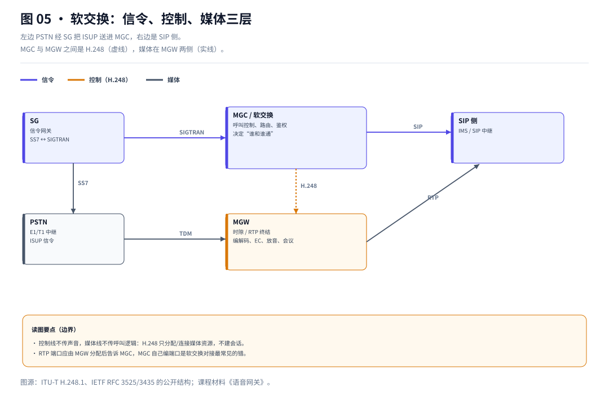

# H.248 与媒体网关

软交换把“呼叫控制”和“媒体承载”拆成两个网元：**MGC 决定“谁和谁通、怎么接”，MGW 负责“声音从哪进、从哪出、怎么转码”**。两者之间的协议就是 H.248（Megaco）。它不建立用户会话——会话由 SIP/ISUP 建——它只**在网关上分配和连接媒体资源**。

> 本篇定位：软交换架构、H.248 的对象模型（Context/Termination）、命令与描述符、一次呼叫里的交互、与 MGCP/SIP 的分工。SIP 去 [03-SIP协议](./03-SIP协议.md)，IMS 里的 MGCF/IM-MGW 去 [04-IMS架构与VoLTE](./04-IMS架构与VoLTE.md)。

## 目录

- [1 一句话模型](#s1)
- [2 速览](#s2)
- [3 为什么要把控制与承载分开](#s3)
- [4 架构：MGC、MGW、SG](#s4)
- [5 H.248 的对象模型](#s5)
- [6 命令](#s6)
- [7 描述符与包](#s7)
- [8 一次呼叫里的交互](#s8)
- [9 传输与编码](#s9)
- [10 与 MGCP、SIP 的分工](#s10)
- [11 状态机与定时器](#s11)
- [12 设计取舍与边界](#s12)
- [13 与相邻主题的关系](#s13)
- [名词解释](#名词解释)
- [14 参考与关联](#s14)

## 1 · 一句话模型：MGC 说“接哪”，MGW 做“怎么接”

```text
ISUP/SIP ──→ MGC（呼叫控制：路由、鉴权、计费、放音逻辑）
               │ H.248（Add / Modify / Subtract）
               ↓
             MGW（媒体：时隙、编解码、回声消除、放音、会议桥）
               ↕ TDM / RTP
```

三个关键认知：

1. **H.248 不建会话**：会话由 SIP/ISUP 建立，H.248 只负责“在这条会话上，网关里要连哪两个端点”。
2. **Context 是“一次关联”，Termination 是“一个端点”**：一个 Context 里放两个 Termination，就等于把两条媒体腿接起来。
3. **MGC 无状态、MGW 有状态**：呼叫状态在 MGC（或它的数据库），媒体资源状态在 MGW；MGC 重启后要能审计并回收 MGW 上的“孤儿”资源。

## 2 · 速览

| 项 | 内容 |
| --- | --- |
| 所属领域 | 语音/软交换、NGN |
| 核心对象 | Context、Termination、Descriptor |
| 关键命令 | Add、Modify、Subtract、Move、AuditValue、Notify、ServiceChange |
| 传输 | UDP/TCP/SCTP，默认端口 2944/2945 |
| 编码 | 文本（H.248.1 附录）或二进制（ASN.1） |
| 主要标准 | ITU-T H.248.1、IETF RFC 3525（Megaco v3） |
| 典型场景 | NGN 软交换、IMS 的 MGCF/IM-MGW、接入网关 |

## 3 · 为什么要把控制与承载分开

电路交换机是“控制 + 交换矩阵”一体的：加一个业务要改交换机软件，扩容要换整机。软交换把它拆开：

| 维度 | 一体化交换机 | 控制/承载分离 |
| --- | --- | --- |
| 业务扩展 | 改交换机 | 只改 MGC/AS |
| 扩容 | 换整机 | MGW 按媒体容量堆叠 |
| 媒体位置 | 集中在机房 | 可分布式部署、就近接入 |
| 故障域 | 整机 | 控制面或媒体面单独故障 |

> **推论**：分离的代价是“两个网元要同步状态”。MGC 认为资源已释放、MGW 还占着时区，就是典型的“资源泄漏”——所以 H.248 必须有审计（Audit）与 ServiceChange 重同步。

## 4 · 架构：MGC、MGW、SG



**读图**：左边是 PSTN/SS7，经 SG 把 ISUP 转成 IP 信令送给 MGC；右边是 SIP 侧。MGC 与 MGW 之间是虚线（H.248 控制），MGW 与两侧之间是实线（TDM 时隙或 RTP 媒体）。**控制线不传声音，媒体线不传呼叫逻辑**——这是理解软交换的关键。

> 图源：`images/图05-软交换与H248.svg`

| 网元 | 全称 | 职责 | 边界 |
| --- | --- | --- | --- |
| MGC | Media Gateway Controller | 呼叫控制、路由、鉴权、计费、资源决策 | 不做媒体处理 |
| MGW | Media Gateway | 时隙/RTP 终结、编解码、EC、放音、会议 | 不懂业务逻辑 |
| SG | Signalling Gateway | SS7 与 IP 信令（SIGTRAN）转换 | 只转信令，不转媒体 |

## 5 · H.248 的对象模型

| 对象 | 是什么 | 类比 | 生命周期 |
| --- | --- | --- | --- |
| Termination | 一个媒体端点（时隙、RTP 流、放音源） | 一根“插孔” | 由 Add 创建、Subtract 删除 |
| Context | 若干 Termination 的关联 | 一条“连线” | 至少两个 Termination 才有意义 |
| Descriptor | 描述 Termination 的属性集合 | 插孔的“参数卡” | 随命令下发 |

Termination 的标识有三类：

| 类型 | 例子 | 说明 |
| --- | --- | --- |
| 物理 | `ds/ds1-1/1` | 固定时隙/端口 |
| 临时（ephemeral） | `$`（由 MGW 分配） | RTP 端点常用，MGC 不关心具体编号 |
| 根（root） | `Root` | 代表整个网关，用于 ServiceChange 与能力查询 |

通配：`$` = 由 MGW 选一个；`*` = 全部匹配。**用 `$` 让 MGW 分配临时端点**是标准做法，MGC 不该自己编 RTP 端口号。

## 6 · 命令

| 命令 | 作用 | 典型用法 |
| --- | --- | --- |
| Add | 在 Context 里加一个 Termination | 呼叫建立：加 TDM 腿 + RTP 腿 |
| Modify | 改 Termination 属性 | 协商好 SDP 后改 Remote 描述符 |
| Subtract | 删除 Termination（可顺带统计） | 挂机释放资源 |
| Move | 把一个 Termination 移到另一个 Context | 会议/转移时重组关联 |
| AuditValue | 查当前属性 | 重同步、排障 |
| AuditCapabilities | 查网关支持哪些能力 | 能力协商 |
| Notify | MGW 主动上报事件 | 摘机、DTMF、放音结束 |
| ServiceChange | 注册/重启/故障切换/优雅退出 | 网关上线、主备倒换 |

一条最小的文本编码消息长这样（结构示意，字段以 H.248.1 为准）：

```text
MEGACO/1 [192.0.2.10]:2944
Transaction = 1001 {
  Context = $ {
    Add = $ {
      Media {
        Stream = 1 {
          LocalControl { Mode = SendReceive }
        }
      }
    }
  }
}
```

三处值得注意：

| 写法 | 含义 | 边界 |
| --- | --- | --- |
| `Context = $` | 由 MGW 新建一个 Context | MGC 指定 Context 号时要保证不冲突 |
| `Add = $` | 由 MGW 分配 Termination | 用 `$` 才能拿到临时 RTP 端点 |
| `Transaction = 1001` | 事务号，回复必须带同一个 | 乱序回复会导致 MGC 匹配错请求 |

## 7 · 描述符与包

| 描述符 | 作用 | 关键点 |
| --- | --- | --- |
| Local | 本端媒体参数（编解码、地址） | 由 MGW 分配，MGC 用来生成 SDP |
| Remote | 对端媒体参数 | 来自 SDP，MGC 改它来“接通” |
| LocalControl | 模式（sendrecv/sendonly/recvonly/inactive） | 单通常因模式配错 |
| Events / ObservedEvents | 订阅与上报事件 | 摘挂机、DTMF、线路事件 |
| Signals | 让网关放信号（拨号音、回铃音） | 与“媒体流”不同，是本地生成 |
| DigitMap | 收号规则 | 收齐几位才上报，决定“拨号后多久有反应” |
| Packages | 能力集合（TO/TD/DT/AN…） | 双方必须支持同一个包才能用 |

> **边界**：H.248 的“信号”（Signals）是网关本地产生的音（拨号音、忙音），不是 RTP 流。把“没有回铃音”当成 RTP 问题，会查错方向——先看 Signals 有没有下发。

## 8 · 一次呼叫里的交互

```text
1. MGC 收到入局呼叫（ISUP IAM 或 SIP INVITE）
2. MGC → MGW：Add（Context 新建，加 TDM 腿 T1，加临时 RTP 腿 T2）
3. MGW → MGC：Reply（T2 的 Local 描述符：IP/端口/编码）
4. MGC 把 T2 的信息写进 SDP，发给对端
5. 对端 answer 到达 → MGC → MGW：Modify（T2 的 Remote 描述符）
6. 双方 media 通；期间 MGW 用 Notify 上报 DTMF/挂机
7. 挂机 → MGC → MGW：Subtract（T1、T2），Context 删除
```

顺序里的关键是**第 3 步**：RTP 端口由 MGW 分配后告诉 MGC，MGC 再写进 SDP。**如果 MGC 自己编端口，媒体一定不通**——这是软交换对接最常见的错。

## 9 · 传输与编码

| 项 | 取值 | 说明 |
| --- | --- | --- |
| 传输 | UDP / TCP / SCTP | SCTP 更可靠，NGN 常用 |
| 端口 | 2944（UDP）、2945（TCP） | IANA 分配 |
| 编码 | 文本 / 二进制（ASN.1） | 文本好排障，二进制省带宽 |
| 事务 | 请求 → 回复（Transaction Reply） | 每个请求带 Transaction ID |
| 重传 | 由定时器驱动 | 超时要重发或判故障 |

## 10 · 与 MGCP、SIP 的分工

| 维度 | H.248/Megaco | MGCP | SIP |
| --- | --- | --- | --- |
| 定位 | MGC ↔ MGW 的资源控制 | 同类，更简单 | 端到端会话信令 |
| 模型 | Context + Termination | Connection + Endpoint | 对话 + 事务 |
| 扩展性 | 强（包机制） | 弱 | 强（头扩展） |
| 典型 | NGN、IMS MGCF/MGW | 早期接入网关 | IMS、企业 VoIP |

一句话分工：**SIP 决定“和谁通”，H.248 决定“网关里怎么接”。** 两者不是替代关系，IMS 里同时存在（SIP 走 Mw/Gm，H.248 走 Mn）。

## 11 · 状态机与定时器

| 状态/机制 | 含义 | 失败表现 |
| --- | --- | --- |
| Termination 生命周期 | 由 Add 创建、Subtract 删除 | 泄漏 → 端口耗尽、新呼叫失败 |
| Context 生命周期 | 关联存在即占用资源 | 挂机未删 → 资源不回收 |
| ServiceChange | 网关注册/重启/优雅退出 | 主备倒换时呼叫丢失 |
| 心跳/审计 | 周期检查状态一致性 | 不一致 → 幽灵呼叫、计费错 |
| 事务超时 | 等 Transaction Reply | 超时重发，仍失败则判 MGW 故障 |

ServiceChange 的几种方法，含义完全不同：

| 方法 | 含义 | 典型场景 |
| --- | --- | --- |
| Restart | 网关/端点重启，MGC 需要重同步 | 上电、进程重启 |
| Graceful | 优雅退出：不再接新呼叫，等存量结束 | 升级、计划下电 |
| Forced | 强制退出：立即断 | 故障、紧急切换 |
| Disconnected | 与 MGC 失联后重连上报 | 网络闪断 |
| Handoff | 控制权移交给另一个 MGC | 主备倒换 |

> **推论**：软交换“越用越接不通”，先查 Termination 泄漏（AuditValue 对比 MGC 与 MGW 的资源数），而不是先扩容。

## 12 · 设计取舍与边界

### 12.1 H.248 为什么在云化里变少

云化/IMS 把媒体功能拆成更细的网元（MRF、SBC、UPF），媒体资源由编排系统管理，H.248 的“集中式网关控制”模型不再是唯一选择。但接入网关、IMS 的 IM-MGW、传统 NGN 仍在用，**存量网络里它是必读项**。

### 12.2 常见误判

1. **“H.248 是信令协议，能建呼叫”**：它只控制媒体资源，不建会话。
2. **“MGW 挂了就是媒体全断”**：控制面可能还活着，表现为“能振铃、无声音”。
3. **“端口由 MGC 指定更可控”**：临时端点应由 MGW 分配，否则冲突。
4. **“没有回铃音是 RTP 问题”**：先看 Signals/DigitMap 有没有下发。
5. **“ServiceChange 只是上线用”**：它还用于主备倒换与优雅退出，忽略会导致倒换丢话务。

## 13 · 与相邻主题的关系

| 相邻主题 | 关系 |
| --- | --- |
| [00-语音通信全景与演进](./00-语音通信全景与演进.md) | NGN 在演进中的位置 |
| [03-SIP协议](./03-SIP协议.md) | 会话信令，与 H.248 分工 |
| [04-IMS架构与VoLTE](./04-IMS架构与VoLTE.md) | MGCF/IM-MGW 的 Mn 接口 |
| [06-VoIP部署与互通](./06-VoIP部署与互通.md) | 网关在组网中的位置与排障 |
| [30-产品与方案/36-ONU-ONT/02-VoIP与IPTV业务](../../../30-产品与方案/36-ONU-ONT/02-VoIP与IPTV业务.md) | 接入侧语音口的实现 |

一句话：**SIP 管“和谁通”，H.248 管“网关里哪两个插孔接起来”。**

## 名词解释

> 缩写给出英文全称；非缩写用“—”表示。

| 术语 | 英文全称 | 解释 |
| --- | --- | --- |
| H.248 | — | ITU-T 的媒体网关控制协议，又称 Megaco。 |
| Megaco | MEdia GAteway COntrol | H.248 的 IETF 名称。 |
| MGC | Media Gateway Controller | 媒体网关控制器。 |
| MGW | Media Gateway | 媒体网关。 |
| SG | Signalling Gateway | 信令网关。 |
| Context | — | 若干 Termination 的关联。 |
| Termination | — | 一个媒体端点。 |
| Descriptor | — | Termination 的属性集合。 |
| Ephemeral | — | 临时端点（由 MGW 动态分配）。 |
| Root | — | 代表整个网关的终止点。 |
| ServiceChange | — | 网关注册/重启/切换命令。 |
| DigitMap | — | 收号规则。 |
| Package | — | 能力集合（事件/信号/属性）。 |
| MGCP | Media Gateway Control Protocol | 早期的媒体网关控制协议。 |
| SIGTRAN | Signalling Transport | SS7 over IP 的传输协议族。 |
| ISUP | ISDN User Part | 电路域呼叫控制信令。 |
| EC | Echo Cancellation | 回声消除（网关侧）。 |
| MRF | Media Resource Function | IMS 的媒体资源功能。 |

## 14 · 参考与关联

**标准**

- ITU-T H.248.1：Gateway Control Protocol（Megaco）。
- IETF RFC 3525：Megaco/H.248 v3。
- IETF RFC 3435：MGCP 1.0。
- ITU-T Q.761~Q.764：ISUP。
- 3GPP TS 23.228：IMS 中 MGCF/IM-MGW 的角色。

**关联**

- [03-SIP协议](./03-SIP协议.md)
- [04-IMS架构与VoLTE](./04-IMS架构与VoLTE.md)
- [06-VoIP部署与互通](./06-VoIP部署与互通.md)
- [00-语音通信全景与演进](./00-语音通信全景与演进.md)

---

> **本篇定位**：软交换架构与 H.248 的对象/命令/交互；不展开 ASN.1 编码细节与各厂商私有包。
> **素材来源**：ITU-T H.248.1、IETF RFC 3525/3435 的公开结构；`studyspace/1.知识体系/9.lte5g相关` 中语音网关相关课程材料。
> **待验证**：各厂商对包/描述符的扩展、端口与心跳默认值以设备手册为准。
