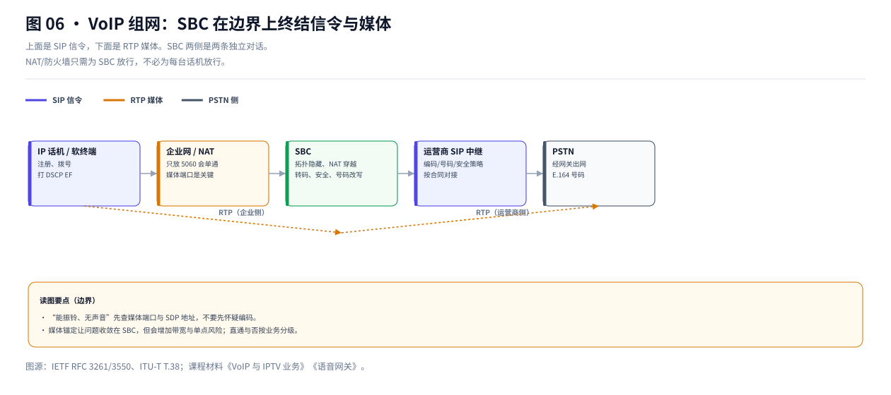

# VoIP 部署与互通

VoIP 落地时，协议本身往往不是难点；难的是**边界**：NAT 改地址、防火墙只放信令不放媒体、运营商只要 G.711、传真一遇丢包就断页、号码前缀少一位就打不出去。部署的本质是**在边界上把信令、媒体、号码、安全四件事同时收口**，而 SBC 就是那个收口点。

> 本篇定位：VoIP 组网形态、SBC 与 NAT、拨号计划、QoS、传真、与 PSTN 互通、安全与故障定位。协议细节去 [03-SIP协议](./03-SIP协议.md)、[02-RTP-RTCP与媒体传输](./02-RTP-RTCP与媒体传输.md)，产品配置去 [30-产品与方案/36-ONU-ONT/02-VoIP与IPTV业务](../../../30-产品与方案/36-ONU-ONT/02-VoIP与IPTV业务.md)。

## 目录

- [1 一句话模型](#s1)
- [2 速览](#s2)
- [3 组网形态](#s3)
- [4 SBC 的角色](#s4)
- [5 编号与拨号计划](#s5)
- [6 NAT 与防火墙](#s6)
- [7 QoS 与承载](#s7)
- [8 传真与 Modem](#s8)
- [9 与 PSTN 互通](#s9)
- [10 安全](#s10)
- [11 故障定位](#s11)
- [12 状态机与定时器](#s12)
- [13 设计取舍与边界](#s13)
- [14 与相邻主题的关系](#s14)
- [名词解释](#名词解释)
- [15 参考与关联](#s15)

## 1 · 一句话模型：边界上收口，内部才简单

```text
话机/软终端 ── SIP+RTP ── 企业网(NAT/防火墙) ── SBC ── SIP 中继 ── PSTN
                                  ↑                ↑
                            媒体端口要放行      信令/媒体都终结，
                                              号码与编码在这里改写
```

三个关键认知：

1. **信令通 ≠ 媒体通**：防火墙常只放行 5060，RTP 的 UDP 高位端口被挡，表现为“能振铃、无声音”。
2. **SBC 的价值是“终结”**：它把一条对话拆成两条，两侧各自处理 NAT、编码、安全，问题被隔离在一边。
3. **号码是部署的一半**：拨号计划、前缀、主叫显示、紧急号码，配错一点就“打不出去/打不进来”。

## 2 · 速览

| 项 | 内容 |
| --- | --- |
| 所属领域 | 语音部署/运维 |
| 核心对象 | SBC、SIP 中继、NAT、拨号计划、DSCP |
| 关键参数 | RTP 端口范围、ptime、编码集、注册有效期、QoS 标记 |
| 典型场景 | 企业 IP-PBX、运营商 SIP 中继、云呼叫中心、住宅光猫语音口 |
| 关键标准 | RFC 3261/3550/4733、ITU-T T.38、3GPP 23.228（IMS 侧） |

## 3 · 组网形态

| 形态 | 信令路径 | 媒体路径 | 主要难点 |
| --- | --- | --- | --- |
| 企业 IP-PBX | 话机 → IP-PBX → 中继 | 话机 ↔ IP-PBX ↔ 中继 | 内部拨号计划、跨网 QoS |
| 运营商 SIP 中继 | 企业 SBC → 运营商 SBC | 企业 SBC ↔ 运营商 | 编码/号码/安全策略对接 |
| 云 PBX | 终端 → 云 | 终端 ↔ 云（可能经 TURN） | NAT 穿越、公网质量 |
| 住宅光猫语音口 | ONT → 运营商 IMS | ONT ↔ 网关 | VLAN、TR-069 下发、FXS 端口 |

## 4 · SBC 的角色



**读图**：上面是信令（SIP），下面是媒体（RTP）。SBC 站在企业网与运营商之间，两侧各是一条独立的对话：企业侧看到的是 SBC 的内网地址，运营商侧看到的是 SBC 的公网地址。NAT/防火墙只需要为 SBC 放行，不需要为每台话机放行。

> 图源：`images/图06-VoIP组网与SBC.svg`

| 能力 | 做什么 | 不做会怎样 |
| --- | --- | --- |
| 拓扑隐藏 | 两侧地址互不可见 | 内网结构暴露，NAT 问题穿透到终端 |
| NAT 穿越 | 重写 SDP、媒体锚定 | 单通、无声 |
| 安全 | TLS/SRTP、ACL、限速、防扫描 | 注册劫持、toll fraud |
| 编码策略 | 转码或强制编码集 | 协商到低质编码，或直接 488 |
| 路由与号码 | 前缀改写、主叫显示 | 打不出、来电显示错 |

**容量估算**（决定 SBC 选型，不是“够用就行”）：

```text
并发 200 路，AMR-WB 不压缩约 30 kbps/路（含头）
  → 媒体带宽 ≈ 200 × 30 kbps × 2（收发） ≈ 12 Mbps
  → 若做转码，再乘 CPU 系数；若做录音/监听，再乘一份
端口数：200 路 × 2 个腿 × 1 个 RTP 端口 ≈ 400 个端口
```

> **推论**：SBC 的瓶颈通常不是带宽，是**每路转码的 CPU** 与**端口/会话表规模**。选型时先问“锚定还是直通、转码比例多少”，再谈吞吐。

## 5 · 编号与拨号计划

| 项 | 规则 | 配错的后果 |
| --- | --- | --- |
| 内部短号 | 2~4 位，首位不与外线前缀冲突 | 拨“1234”被当成外线号码送出去 |
| 外线前缀 | 0/9 等，按需剥离 | 运营商收到带前缀的号码，呼叫失败 |
| 长途/国际 | 00/+ 规则 | 国际呼叫被当本地 |
| 紧急号码 | 110/119/120 等，直送本地网关 | 送到异地网关，定位错、接不通 |
| 主叫显示 | 需运营商允许，常需改写为 E.164 | 对方看到匿名或错号 |

> **推论**：拨号问题先用“话机发出的号码 → SBC 改写后的号码 → 运营商收到的号码”三段对照，而不是猜 SIP 路由。**绝大多数“拨号没反应”是前缀匹配或等待收号的时长问题。**

## 6 · NAT 与防火墙

| 问题 | 现象 | 处理 |
| --- | --- | --- |
| 只放信令 | 能振铃、无声音 | 放行 RTP 端口范围（或交给 SBC 锚定） |
| SDP 私网地址 | 单向无声 | SBC 重写 SDP，或启用媒体锚定 |
| 端口不通 | 单通 | 检查双向 UDP，别只测单向 |
| ALG 改写 | 注册反复失败 | 关掉 SIP ALG，交给 SBC |
| 会话老化 | 通话若干分钟后断 | 缩短注册/保活周期，或用 OPTIONS 保活 |

> **边界**：防火墙“看到 UDP 没响应”不等于被丢——对称 NAT 下，只有从内到外先发包，外部才能回包。媒体锚定的意义就是让 SBC 成为那个“先发包”的一端。

**端口范围要按并发算，不是随便开一段**：

```text
每路语音占两个 RTP 端口（收发各一）或一对（RTP/RTCP）
50 路并发 → 需要约 100~200 个 UDP 端口
开 10000-10200 只够 50 路；扩容后“第 51 路开始单通”很常见
```

| 做法 | 优点 | 代价 |
| --- | --- | --- |
| 固定小范围端口 | 防火墙规则简单 | 并发上限被端口数锁死 |
| 大范围端口 | 扩容方便 | 防火墙规则粗，安全性下降 |
| 收到 SBC | 只需放行 SBC 的端口 | 带宽与单点成本 |

## 7 · QoS 与承载

| 位置 | 做法 | 说明 |
| --- | --- | --- |
| 终端 | 打 DSCP EF（46） | 语音小包优先 |
| 企业接入 | 信任/重标记 DSCP | 别让终端随便标，边界要校验 |
| 队列 | 低时延队列（LLQ/优先队列） | 语音队列不能深 |
| 上行 | 限速留余量（约 20%） | 上行拥塞是语音杀手 |
| 无线 | 关掉省电、保证空口 | Wi-Fi 语音要 WMM/优先队列 |

> **推论**：语音质量问题的第一现场是**上行**，不是下行。下行带宽大、有缓冲；上行一旦被下载 ACK 或备份流量塞满，语音立刻断断续续。

## 8 · 传真与 Modem

| 方式 | 原理 | 适用 | 边界 |
| --- | --- | --- | --- |
| G.711 透传 | 把传真当语音，不做压缩 | 质量好的内网 | 丢包/抖动直接断页 |
| T.38 | 解调后按传真协议重打包 | 跨广域、跨运营商 | 需要两端都支持，时延敏感 |
| 传真中继 | 网关终结传真，走专线 | 运营商 | 成本高 |

**为什么传真怕丢包**：传真不是“听不清还能猜”，它是逐行同步的位流，丢一段就整页失败；而 T.38 的冗余与纠错能补一部分，所以跨网传真优先 T.38。

| 方式 | 带宽（约） | 抗丢包 | 对时延 | 适用 |
| --- | --- | --- | --- | --- |
| G.711 透传 | 64 kbps 载荷 + 头 ≈ 80 kbps | 差，丢包即断页 | 中 | 内网、短途 |
| T.38 | 约等于传真速率 + 开销（14.4 kbps 传真 ≈ 20 kbps） | 较好，有冗余/纠错 | 高，时延大易超时 | 跨网、跨运营商 |

> **待验证**：T.38 的实际带宽随传真速率（V.17/V.34）与冗余配置变化，具体以网关手册为准。

## 9 · 与 PSTN 互通

| 接缝 | 要处理 | 常见问题 |
| --- | --- | --- |
| 信令 | ISUP ↔ SIP 原因值映射 | 忙音/空号被映射成“服务器错误” |
| 号码 | E.164 规范化、主叫显示 | 号码少位、被隐藏 |
| 媒体 | 编码/回声消除/增益 | 转码引入时延、回声 |
| 计费 | 话单（CDR）对齐 | 主被叫/时长不一致 |

## 10 · 安全

| 风险 | 表现 | 防护 |
| --- | --- | --- |
| 注册劫持 | 账号被盗打国际长途 | 强口令、IP 绑定、异常呼叫拦截 |
| Toll fraud | 话单异常暴涨 | 目的地白名单、并发/额度限制 |
| 扫描与暴力破解 | 大量 401/403 | 限速、封禁、隐藏 OPTIONS 响应 |
| 信令窃听 | 号码/内容泄露 | TLS + SRTP |
| 媒体注入 | 杂音/伪造放音 | SRTP 认证、SBC 校验 |

> **边界**：加密不防“合法账号被盗”。90% 的语音资费损失来自弱口令与没做目的地限制，不是协议漏洞。

## 11 · 故障定位

| 现象 | 第一步 | 第二步 | 常见根因 |
| --- | --- | --- | --- |
| 拨号无反应 | 话机有没有发出 INVITE | 号码是否被 dial plan 拦 | 前缀/收号规则 |
| 无振铃 | 有没有 100/180 | 回铃音是本地还是带内 | 本地音未配置 / 被叫无响应 |
| 接通无声 | SDP 地址是否可达 | RTP 双向有没有包 | NAT/防火墙、单向路由 |
| 单通 | 哪个方向没包 | 对端是否收到 | 单向 NAT、媒体锚定缺失 |
| 杂音/断续 | 丢包/抖动统计 | 是否转码、是否 Wi-Fi | 上行拥塞、编码不匹配 |
| 通话定时断 | 会话定时器 | 注册/保活是否过期 | Session Timer、NAT 老化 |
| 传真断页 | 是否 T.38 | 丢包/时延 | 透传遇丢包 |

> 顺序很重要：**先判“信令到没到”，再判“媒体通不通”，最后才看编码与音质**。反过来会把 NAT 问题当编码问题查。

## 12 · 状态机与定时器

| 定时器 | 作用 | 典型后果 |
| --- | --- | --- |
| 注册有效期（Expires） | 位置绑定的寿命 | 过期未刷新 → 打不进来 |
| 注册刷新（一半有效期） | 提前续约 | 刷新失败 → 掉注册 |
| OPTIONS 保活 | 维持 NAT 绑定 | 不保活 → 端口老化，来电不通 |
| 会话定时器 | 周期刷新会话 | 超时 BYE → 固定时长断线 |
| 拨号收号定时 | 等用户拨完 | 太短 → 号码不全；太长 → 反应慢 |
| RTP 超时 | 判断媒体是否中断 | 误判 → 正常静音被当断流 |

**保活必须早于 NAT 老化**：

```text
NAT 绑定老化：常见 60~120 s
注册有效期：常见 3600 s（一半刷新 = 1800 s）
→ 光靠注册刷新，端口早就被回收
→ 需要 OPTIONS/CRLF 保活，周期取老化时间的一半（如 30 s）
```

> **推论**：“能打出去、打不进来”最常见的原因不是注册失败，而是 NAT 绑定过期后 Contact 不可达。注册状态还是“已注册”，但那个地址已经不通了——看注册状态看不出来，要看保活与端口映射。

## 13 · 设计取舍与边界

### 13.1 媒体锚定 vs 直通

| 方案 | 优点 | 代价 |
| --- | --- | --- |
| 媒体直通（不锚定） | 时延低、SBC 压力小 | NAT/防火墙问题穿透到终端 |
| 媒体锚定（SBC 中转） | 问题收敛、可控 | 带宽与转发成本、单点风险 |

> **推论**：小规模、网络可控时直通更划算；跨公网、多租户、要审计时必须锚定。“SBC 性能不够”往往不是设备问题，是锚定策略没按业务分级。

### 13.2 常见误判

1. **“放行 5060 就够了”**：RTP 是另一组 UDP 端口。
2. **“关了防火墙就好了”**：能通不等于安全，正确做法是收敛到 SBC。
3. **“语音差是运营商的问题”**：先看本地上行与 Wi-Fi。
4. **“传真和语音一样传”**：传真对丢包零容忍，跨网要 T.38。
5. **“加密了就不会被盗打”**：弱口令与无目的地限制才是主因。

## 14 · 与相邻主题的关系

| 相邻主题 | 关系 |
| --- | --- |
| [00-语音通信全景与演进](./00-语音通信全景与演进.md) | 语音系统整体与互通接缝 |
| [03-SIP协议](./03-SIP协议.md) | 注册、路由、NAT 的协议层原因 |
| [02-RTP-RTCP与媒体传输](./02-RTP-RTCP与媒体传输.md) | 媒体端口、抖动与丢包 |
| [05-H248与媒体网关](./05-H248与媒体网关.md) | 运营商侧网关如何接入 |
| [04-IMS架构与VoLTE](./04-IMS架构与VoLTE.md) | 运营商 IMS 侧的对接 |
| [11-网络科学/03-网络层/05-NAT](../../11-网络科学/03-网络层/05-NAT.md) | NAT 的通用行为 |
| [30-产品与方案/36-ONU-ONT/02-VoIP与IPTV业务](../../../30-产品与方案/36-ONU-ONT/02-VoIP与IPTV业务.md) | 光猫语音口的产品配置 |

一句话：**VoIP 部署的功夫都在边界：把信令、媒体、号码、安全各自收口，内部就只剩“打电话”。**

## 名词解释

> 缩写给出英文全称；非缩写用“—”表示。

| 术语 | 英文全称 | 解释 |
| --- | --- | --- |
| VoIP | Voice over IP | IP 语音。 |
| SBC | Session Border Controller | 会话边界控制器。 |
| SIP trunk | — | 运营商的 SIP 中继（替代 E1/T1 中继）。 |
| PBX | Private Branch Exchange | 用户交换机。 |
| IP-PBX | IP Private Branch Exchange | IP 用户交换机。 |
| NAT | Network Address Translation | 网络地址转换。 |
| ALG | Application Layer Gateway | 应用层网关。 |
| DSCP | Differentiated Services Code Point | 差分服务代码点（QoS 标记）。 |
| EF | Expedited Forwarding | 加速转发（语音常用 DSCP 46）。 |
| LLQ | Low Latency Queueing | 低时延队列。 |
| T.38 | — | IP 传真协议。 |
| CDR | Call Detail Record | 话单。 |
| E.164 | — | 国际电话号码编号方案。 |
| FXS / FXO | Foreign eXchange Subscriber / Office | 用户侧/局侧模拟话口。 |
| SRTP | Secure RTP | 安全 RTP。 |
| TLS | Transport Layer Security | 传输层安全。 |
| toll fraud | — | 话费欺诈（盗打）。 |

## 15 · 参考与关联

**标准**

- IETF RFC 3261：SIP；RFC 3550：RTP/RTCP。
- IETF RFC 4733：DTMF。
- ITU-T T.38：IP 传真。
- ITU-T G.711：PCM 语音（传真透传的兜底）。
- 3GPP TS 23.228：IMS 侧互通。

**关联**

- [00-语音通信全景与演进](./00-语音通信全景与演进.md)
- [03-SIP协议](./03-SIP协议.md)
- [04-IMS架构与VoLTE](./04-IMS架构与VoLTE.md)
- [05-H248与媒体网关](./05-H248与媒体网关.md)
- [11-网络科学/03-网络层/05-NAT](../../11-网络科学/03-网络层/05-NAT.md)

---

> **本篇定位**：VoIP 组网、SBC、NAT、拨号计划、QoS、传真与排障；不展开具体厂商配置命令。
> **素材来源**：IETF/ITU-T 公开标准结构；`studyspace/1.知识体系/9.lte5g相关` 中语音网关与 VoLTE 课程材料；`30-产品与方案/36-ONU-ONT/02-VoIP与IPTV业务.md` 的现场问题类型。
> **待验证**：各运营商 SIP 中继的编码/号码/安全要求、设备默认端口与定时器以合同与手册为准。
