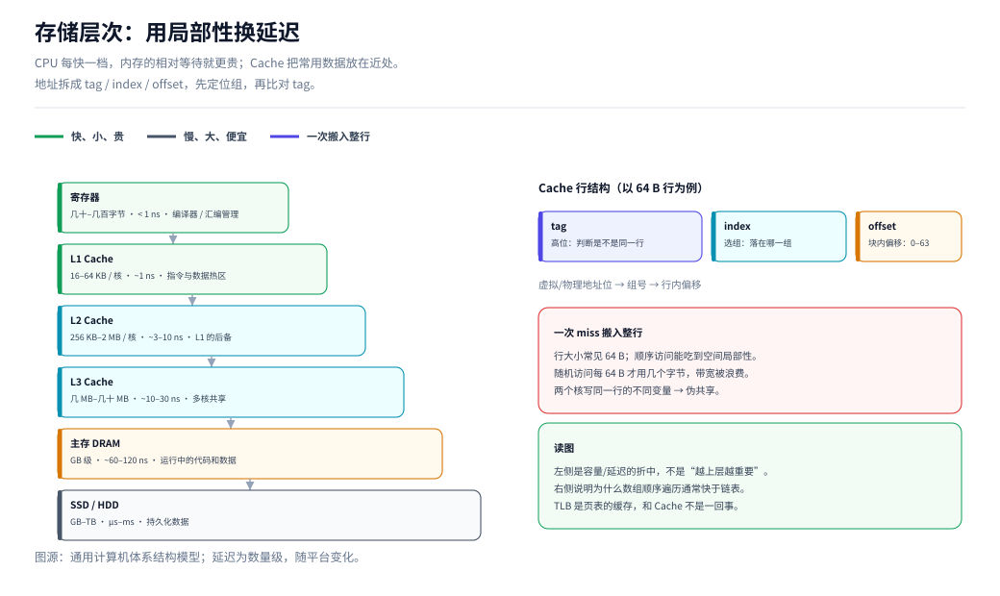
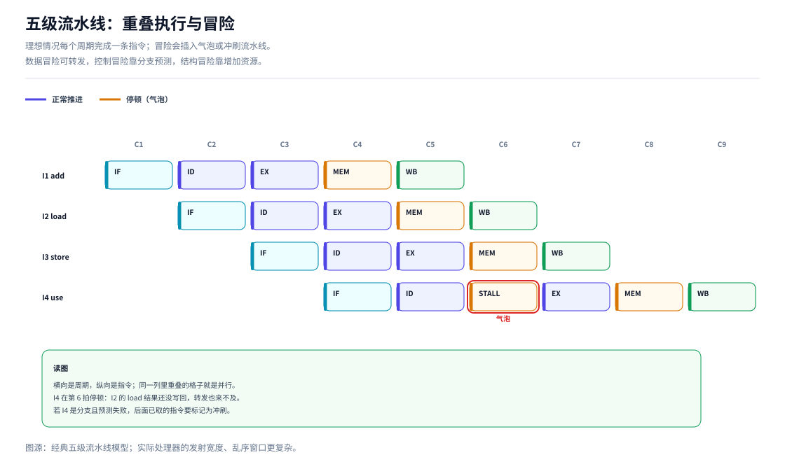
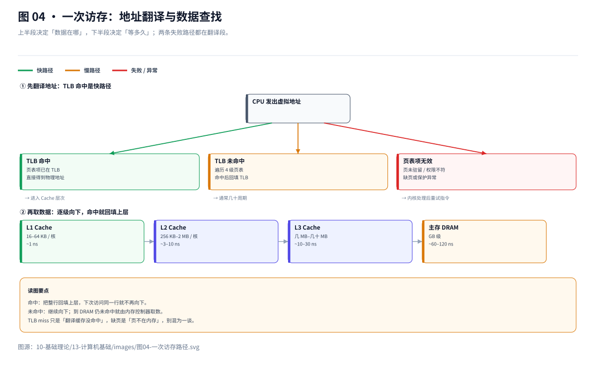
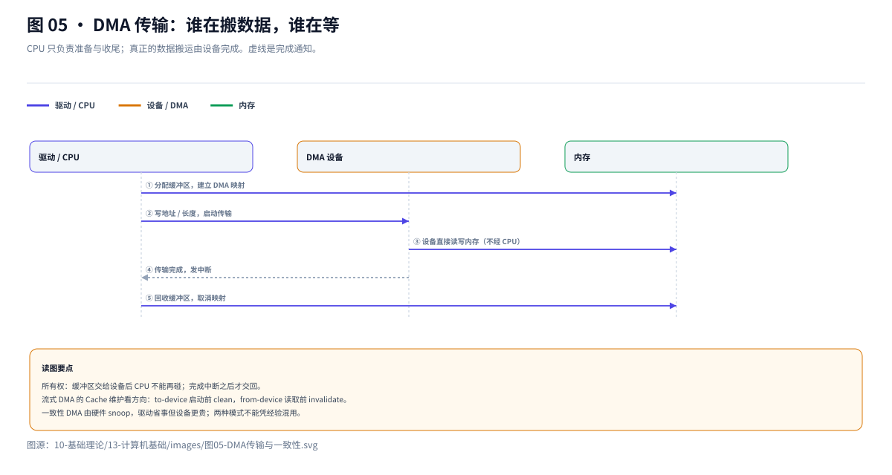

# 计算机组成与存储层次

程序跑得快不快，最终落在三个数上：**执行了多少条指令、每条指令平均花几个周期、每个周期多长**。存储层次存在的理由只有一个——CPU 很快，内存和磁盘很慢，用“小而快”的缓存把常用数据放在离 CPU 更近的地方。

把 CPU 想成一张只摆得下当天活儿的工作台，Cache 是旁边的货架，内存是仓库，磁盘是远处的总库。**类比失效的地方**：搬货是显式动作，Cache 的搬运由硬件自动完成，程序员只能通过访问模式影响它——所以“优化存储”实际是“优化访问顺序”，不是“把数据放进去”。

读完这一篇，你应该能回答四个问题：一条指令在 CPU 里经过哪几步、为什么会停顿；一次访存从虚拟地址到物理地址再到数据，在哪几层可能失败；多核写同一行数据为什么会互相拖慢；DMA 为什么不是“免费加速”。

> 本篇定位：CPU/ISA、流水线、Cache/内存层次、总线与 DMA 的通用模型。具体芯片的寄存器、主频、缓存大小放到 30-平台与芯片；Linux 侧的驱动和调优放到 20-平台与系统。

## 目录

- [1 一句话模型](#s1)
- [2 速览](#s2)
- [3 结构与字段](#s3)
- [4 执行与访问流程](#s4)
- [5 状态机与定时器](#s5)
- [6 设计取舍与边界](#s6)
- [7 与相邻主题的关系](#s7)
- [名词解释](#名词解释)
- [8 参考与关联](#s8)

## 1 · 一句话模型

```text
取指 → 译码 → 执行 → 访存 → 写回
  ↑      ↑      ↑      ↑      ↑
  └──── 流水线重叠，理想情况每个周期完成一条 ────┘

寄存器 → L1 → L2 → L3 → 内存 → 磁盘
  快、小、贵                慢、大、便宜
```

三个关键认知：

1. **CPU 只认机器指令和地址**，不认 C 语句、变量名和文件。编译器负责把高级语言翻译成 ISA 指令，操作系统负责把虚拟地址翻译成物理地址。
2. **性能不是“主频越高越快”**。主频只决定周期长度；指令数（算法/编译器）和 CPI（流水线、缓存缺失、分支预测）同样决定结果。
3. **存储层次靠局部性工作**。时间局部性让刚访问的数据留在缓存，空间局部性让相邻数据一次搬入；局部性差的程序会把“缓存命中”打成“内存等待”。

> **一句话收束**：性能 = 指令数 × CPI × 周期时间。三个因子分别由算法/编译器、微架构、工艺与频率决定；只盯其中一个，就会把瓶颈归错地方。

不用这套模型会怎样：看到“CPU 占用高”只会加机器，看到“程序慢”只会换编译器；实际瓶颈可能是一条 cache line 的伪共享、一次未对齐访问，或者一次把 4KB 数据拆成随机小 IO 的循环。

## 2 · 速览

| 项 | 内容 |
| --- | --- |
| 所属层/领域 | 计算机体系结构，硬件与软件的接口 |
| 核心对象 | CPU 核心、寄存器、Cache、内存控制器、总线、外设 |
| 关键参数 | 字长、主频、CPI、Cache 容量/行大小/关联度、内存延迟、带宽 |
| 典型场景 | 性能分析、驱动开发、交叉编译、平台选型 |
| 主要标准 | ISA 手册（x86-64/ARMv8）、ABI、PCIe/USB 规范、JEDEC 内存规范 |

## 3 · 结构与字段

### 3.1 CPU 核心

| 部件 | 作用 | 容易误解的点 |
| --- | --- | --- |
| PC（Program Counter） | 指向下一条指令地址 | 异常/中断时保存的是“下一条”还是“当前”，不同架构不同 |
| 寄存器堆 | 存放操作数和地址 | 数量由 ISA 规定，编译器按 ABI 分配 |
| ALU | 整数/逻辑运算 | 浮点、SIMD 通常有独立单元 |
| 控制单元 | 译码、发控制信号、处理冒险 | 微码/硬布线是实现方式，不影响 ISA 契约 |
| MMU | 虚拟地址→物理地址 | 只有开启分页才工作；MMU 不是 Cache |
| TLB | 页表项缓存 | TLB miss 不等于缺页，可能只是页表遍历 |
| 中断控制器 | 接收外设中断并分发给 CPU | 中断优先级、屏蔽、亲和性由平台决定 |

### 3.2 ISA 与 ABI

ISA（Instruction Set Architecture）是**软件能看到的最小硬件契约**：有哪些指令、寄存器、地址模式、特权级、内存序。ABI（Application Binary Interface）在 ISA 之上再约定：参数怎么传、栈怎么长、哪些寄存器由谁保存、结构体怎么对齐、符号怎么命名。

| 概念 | 回答的问题 | 例子 |
| --- | --- | --- |
| ISA | CPU 能执行什么 | `mov`、`ldr`、`add`、`svc` |
| ABI | 编译器和链接器怎么协作 | x86-64 System V：前 6 个整型参数放 `rdi/rsi/rdx/rcx/r8/r9` |
| 调用约定 | 函数调用前后谁保存寄存器 | caller-saved / callee-saved |
| 字节序 | 多字节数据在内存中的顺序 | 小端：低字节在低地址 |
| 对齐 | 数据地址是否必须是宽度的倍数 | 未对齐访问可能变慢或直接异常 |
| 微架构 | ISA 怎么被实现 | 流水线级数、发射宽度、Cache 大小；同一份 ARMv8 二进制在不同核上快慢不同 |
| 内存序 | 多核看到的读写顺序 | x86 近似 TSO，ARMv8 是弱序；无锁代码要显式屏障 |

**ISA 是契约，微架构是实现**。同一份 ARMv8 二进制可以跑在 2 核 A53 和 8 核 A78 上，结果必须一致，快慢可以差几倍——这就是“契约不变、实现可变”。所以看到“ARM 快/慢”的说法先别信，要问是哪颗核、什么工艺、Cache 多大。

**ABI 不兼容时**，目标文件即使能链接，运行时也可能读错参数或踩坏栈。交叉编译工具链必须同时匹配 ISA、ABI、浮点 ABI 和 C 库。一个常见边界：软浮点与硬浮点 ABI 混用，编译能过，调用约定却在“浮点参数放寄存器还是压栈”上分岔。

### 3.3 存储层次



**读图**：越往上容量越小、延迟越低；CPU 访问先查 L1，逐级向下。右侧是 Cache 的行结构：地址拆成 tag/index/offset，先定位组，再比对 tag。

| 层级 | 典型容量 | 典型延迟（数量级） | 谁管理 | 作用 | 边界与误判 |
| --- | --- | --- | --- | --- | --- |
| 寄存器 | 几十到几百字节 | < 1 ns | 编译器/汇编 | 当前运算的操作数 | 数量由 ISA/ABI 固定；寄存器不够时编译器 spill 到栈，别以为“放寄存器”是免费的 |
| L1 Cache | 16–64 KB/核 | ~1 ns（几周期） | 硬件 | 指令/数据热区 | 通常分 I-Cache/D-Cache；容量含 tag，不是“净数据” |
| L2 Cache | 256 KB–2 MB/核 | ~3–10 ns | 硬件 | L1 的后备 | 私有还是共享随平台；跨核共享时会被别的核挤掉 |
| L3 Cache | 几 MB–几十 MB | ~10–30 ns | 硬件 | 多核共享 | 多 die/多 CCX 时“L3 命中”也有远近之分 |
| 主存 DRAM | GB 级 | ~60–120 ns | 内存控制器 | 运行中的代码和数据 | 带宽被所有核和设备共享；NUMA 远端延迟接近翻倍 |
| SSD/Flash | GB–TB | ~10–100 µs | 存储控制器 | 持久化数据 | 随机写有写放大和 GC 抖动；它不是“慢一点的内存” |
| HDD | TB 级 | ~5–10 ms | 存储控制器 | 大容量冷数据 | 随机寻道主导；顺序与随机访问能差两个数量级 |

> 延迟数字是数量级，随工艺、频率、NUMA 位置变化；写进代码里的优化假设要用实测校准。

Cache 的三个关键参数：

- **行大小（line size）**：常见 64 B。一次 miss 会把整行搬入，所以顺序访问比随机访问更划算。
- **关联度（associativity）**：一组里能放几行。直接映射简单但冲突多，全相联命中率高但比较器贵。
- **替换与写策略**：LRU/伪 LRU 决定淘汰谁；写回（write-back）减少写内存，写直达（write-through）实现简单。

地址怎么落到 Cache 上，用一个具体例子算一遍：

```text
32 KB L1、8 路、64 B 行
组数 = 32768 / (64 × 8) = 64 组

虚拟/物理地址（以 48 位为例）：
  tag（36 bit） | index（6 bit） | offset（6 bit）
                  选哪一组        行内第几个字节
```

先拿 index 定位到 64 组中的一组，再用 tag 并行比较这一组的 8 行；tag 对上才算命中，offset 决定取行内哪几个字节。**为什么一次搬 64 B 而不是 1 B**：DRAM 本身按突发（burst）成块读出，行尾的相邻字节几乎不增加成本；同时 tag 比较和替换决策按行摊销，行太小会让 tag 开销占比过高。行也不是越大越好——行越大，一次没用到的字节越多，冲突和带宽浪费也越明显。

> **边界**：64 B 是常见值，不是标准。部分处理器用 32 B 或 128 B；跨架构移植做对齐优化时，以目标平台手册为准。
> **推论**：顺序遍历数组通常比“跳着访问”快，不只是因为预取，还因为每次 miss 搬进来的整行都被用上了。

### 3.4 总线、MMIO 与 DMA

| 机制 | 谁发起 | 数据怎么走 | 适用 | 边界与误判 |
| --- | --- | --- | --- | --- |
| Port I/O | CPU | 专用 IN/OUT 指令 | x86 传统设备，地址空间独立 | ARM 没有这套端口空间；现代设备基本不用 |
| MMIO | CPU | 像访问内存一样读写寄存器 | 主流设备寄存器 | 必须用 `readl/writel` 一类访问器；直接指针会被编译器合并/删除，或被 CPU 乱序 |
| PIO | CPU | CPU 逐字节/逐字搬运 | 小数据、调试 | 搬运期间 CPU 被占住；大块传输应换 DMA |
| DMA | 设备/控制器 | 设备直接读写内存，完成后中断 | 大块传输 | 要处理地址映射与缓存一致性；小传输的启动开销可能高于 PIO |

**易错点**：MMIO 寄存器不能用普通指针随便读写——编译器可能合并/删除访问，CPU 可能乱序。驱动里要用 `readl/writel`、`ioremap` 和内存屏障，而不是直接解引用。另一个常见误判：把 MMIO 当成“普通内存”做 `memcpy`，读出来的是设备当前值，写进去可能触发一次硬件动作，语义完全不同。

**IOMMU 是设备侧的 MMU**：没有它，设备拿到的是物理地址，驱动写错一个字段就能 DMA 到任意内存；有了它，设备地址先经过一层页表翻译，既能做隔离（虚拟化直通），也能拦住越界 DMA。代价是多一次 IOTLB 查找，映射/取消映射也有开销——所以高性能驱动常用“批量映射 + 复用缓冲区”，而不是每包 map/unmap。

## 4 · 执行与访问流程

### 4.1 一条指令的流水线



**读图**：理想情况下五个阶段每个周期都有一条指令在跑；数据冒险靠转发或停顿，控制冒险靠分支预测，预测失败要冲刷流水线。

```text
周期:    1     2     3     4     5     6     7
I1:    IF    ID    EX    MEM   WB
I2:          IF    ID    EX    MEM   WB
I3:                IF    ID    EX    MEM   WB
```

三类冒险：

- **数据冒险**：后一条指令要用前一条还没写回的结果。能转发就转发，不能就插入气泡（stall）。
- **控制冒险**：分支指令还没算出方向，后面已经取了指。靠分支预测 + 推测执行；预测错要丢弃错误路径。
- **结构冒险**：两条指令抢同一个硬件资源（如单端口内存、执行单元）。

### 4.2 一次访存的完整路径



**读图**：上半段是地址翻译的分水岭——TLB 命中走快路径，未命中才查页表；页表项无效则掉进缺页异常。拿到物理地址后进入下半段的 Cache 层次，逐级向下，命中就回填上层。

一次访存分两段，顺序不能反：

1. **翻译地址**：CPU 发出虚拟地址，先查 TLB。命中直接得到物理地址；未命中则按页表基址逐级遍历（x86-64 常见 4 级），把结果写回 TLB。
2. **取数据**：用物理地址查 L1，未命中查 L2、L3，最后到 DRAM。命中后把整行回填到上层，下次同行的访问就不再下去。

```text
CPU 发出虚拟地址
  └─ TLB 命中？──是──→ 得到物理地址
        │否
        └─ 查页表（可能多级）→ 得到物理地址 / 触发缺页
              └─ 访问 L1 → L2 → L3 → 内存
                    └─ 命中：填上层；未命中：继续向下
```

异常分支：

| 现象 | 根因 | 处理方向 |
| --- | --- | --- |
| TLB miss | 页表项存在，只是 TLB 没缓存 | 硬件或软件页表遍历后继续；通常几十周期，别和缺页混为一谈 |
| 缺页（page fault） | 页不在内存，或权限/映射不完整 | 内核分配页、读文件或做 COW，然后重试指令；机械盘上可能到毫秒级 |
| 保护异常 | 越权写只读页、用户态访问内核页 | 通常变成 `SIGSEGV`；先查指针、越界和释放后使用 |
| 总线错误 | 访问不存在的物理地址，或设备被拔出 | 可能触发机器检查异常；查地址映射与热插拔路径 |

> **推论**：TLB miss 不等于缺页。前者只是“翻译缓存没命中”，后者是“页根本不在内存”；把两者混在一起，会把正常的页表遍历误判成内存不足。
> **边界**：大页（huge page）能显著减少 TLB 覆盖不足，但不是所有分配路径都支持；透明大页的合并/拆分还会带来延迟抖动。

### 4.3 DMA 传输



**读图**：驱动先准备并映射缓冲区，再把地址/长度写给设备；设备直接读写内存，完成后发中断。CPU 全程不搬数据，但要负责“缓冲区在传输期间有效”和“Cache 里不能是旧副本”两件事。

```text
驱动准备缓冲区 → 写 DMA 地址/长度 → 启动设备
  → 设备直接读写内存 → 传输完成发中断
  → 驱动回收缓冲区、唤醒等待者
```

**正常路径**要保证缓冲区在传输期间不被换出、不被 CPU 改写；**异常路径**包括传输超时、设备复位、部分完成和中断丢失。DMA 不是“免费加速”：小包/小块传输的启动开销可能比 PIO 还高。

缓存一致性与地址隔离要解决两个问题，常见手段如下：

| 方式 | 谁保证一致 | 代价与边界 |
| --- | --- | --- |
| 一致性 DMA（coherent） | 硬件 snoop Cache，或设备与 CPU 共享一致性域 | 驱动简单；设备侧更贵，频繁 snoop 可能拖慢内存 |
| 流式 DMA（streaming） | 驱动在 map/unmap 时做 cache clean/invalidate | 便宜；漏一次维护就读到旧行，方向（to/from device）弄反也会错 |
| IOMMU 映射 | 硬件翻译设备地址并做隔离 | 防野指针 DMA、支持虚拟化；多一次 IOTLB 查找，映射有开销 |

| 异常现象 | 根因方向 | 处理方向 |
| --- | --- | --- |
| 传输永不完成 | 设备没启动、描述符格式错、时钟/电源没开 | 查启动寄存器与描述符所有权位，先确认设备真的在跑 |
| 数据是旧的 | 非一致性架构漏了 cache invalidate，或缓冲区被复用 | 按方向补维护；用 DMA API 而不是自己猜 |
| 数据被踩 | 缓冲区提前释放、越界 DMA、CPU 同时写 | 用 IOMMU 隔离；检查生命周期与所有权交接 |
| 中断没来 | 中断被屏蔽、共享中断没识别、设备已复位 | 查中断状态寄存器；不要只等中断，必要时加超时轮询 |

> **推论**：DMA 的正确性靠“所有权”而不是“时间差”——缓冲区交给设备后，CPU 不能再碰；设备交回后，CPU 才能读。用 `volatile` 或加个 `sleep` 掩盖竞争，只是把问题推后。

## 5 · 状态机与定时器


**读图**：左侧是 x86 的四级特权，越靠内权限越高；右侧是缓存行的 M/E/S/I 四态，写入共享行要先让其他核失效。

本主题**没有协议连接状态机**，但有三类与硬件相关的状态/机制需要单独看：

### 5.1 特权级

| 架构 | 典型层级 | 用途 |
| --- | --- | --- |
| x86-64 | Ring 0–3 | Ring 0 内核，Ring 3 用户态 |
| ARMv8-A | EL0–EL3 | EL0 应用，EL1 内核/虚拟化，EL2 Hypervisor，EL3 安全监控 |

特权级切换只能通过受控入口（中断、异常、系统调用）发生；这是“用户态不能直接碰硬件”的硬件基础。

### 5.2 Cache 一致性状态（MESI）

多核各自有 Cache，同一行可能有四类状态：**M**odified（已修改，独占）、**E**xclusive（独占且干净）、**S**hared（共享只读）、**I**nvalid（无效）。

| 状态 | 含义 | 怎么进入 | 怎么离开 | 代价 |
| --- | --- | --- | --- | --- |
| M | 只有本核有，且比内存新 | 本地写命中，或写 miss 拿到所有权 | 被其他核读 → S（先写回）；被其他核写 → I | 写回内存 |
| E | 只有本核有，且与内存一致 | 读 miss，且没有其他核持有 | 本地写 → M（无需总线事务）；被 snoop → S/I | 无 |
| S | 多个核共享，且干净 | 读 miss，且其他核也有 | 本地写 → M（先让其他副本失效）；被 snoop 写 → I | 失效广播 |
| I | 本地副本无效 | 初始、被其他核失效、被替换 | 读 miss → S/E；写 miss → M（先 RFO） | 取数或取所有权 |

```text
I --读 miss--> S/E --本地写--> M
S --本地写（发 invalidate）--> M
M --被其他核读--> S（先写回）
任意状态 --被其他核写--> I
```

**为什么需要状态机**：写之前必须确认“没有别的副本”，否则两个核各写各的，内存最后只剩一个版本。状态机把“谁能写”变成显式状态，避免每次写都广播问一遍——E 态下本地写完全不用上总线，这就是它存在的价值。

伪共享的根因也在这里：两个核写同一行的不同变量，地址不同但 cache line 相同，每次写都要把对方的副本打成 I，行就在两个核之间来回搬。

> **边界**：MESI 只保证单个地址的写序列化，不保证跨地址的内存序；它也只覆盖 CPU 缓存一致性域。DMA 是否参与 snoop 取决于架构——x86 通常参与，很多 ARM 平台要驱动显式维护。

### 5.3 定时器与时钟中断

| 机制 | 管什么 | 边界与误判 |
| --- | --- | --- |
| 时钟中断 | 调度节拍、计时、超时检查 | 频率可调（NO_HZ、tickless），不能假设固定 tick；虚拟化下可能被合并 |
| 本地 APIC / Arch Timer | 每个核自己的高精度定时、per-CPU 事件 | 虚拟化下访问可能被 trap；迁移后要重新编程 |
| TSC / CNTVCT | 低成本时间戳，用于打点和测量 | 跨核是否同步、频率是否恒定要看平台（x86 `constant_tsc`/`nonstop_tsc`，ARM 看 `CNTFRQ`）；不能直接当墙钟 |
| 看门狗 | 系统卡死后强制复位 | 喂狗不能放在可能被阻塞的路径；调试时先确认不是“狗把现场清了” |

## 6 · 设计取舍与边界

### 6.1 缓存：容量、延迟与功耗的三角

缓存越大命中率越高，但访问延迟、面积和功耗也上升。于是做成多级：L1 追求低延迟，L3 追求容量和共享。**不用缓存**的代价是每次都等内存，CPU 大部分时间在 stall；**缓存过大**的代价是芯片成本和功耗，移动/嵌入式尤其敏感。

把开头那个公式代进数字，就知道“提主频”不一定有用：

```text
1e9 条指令，CPI = 1.5，3.0 GHz
  → 1e9 × 1.5 / 3e9 = 0.5 s

主频提到 3.6 GHz，但 Cache 变小/争抢变多，CPI 升到 1.8
  → 1e9 × 1.8 / 3.6e9 = 0.5 s（白提）
```

**存储墙（memory wall）**说的就是这件事：CPU 每周期能执行的指令数增长远快于内存延迟下降，于是“等数据”在总时间里的占比越来越大。判断一段代码是不是 memory-bound，先看它每取一个有用字节要等多少次 miss，而不是先看主频。

> **边界**：缓存优化只对“有局部性可挖”的程序有效。流式处理一遍大数据、随机哈希查找这类访问模式，Cache 再大也救不了，应该改数据布局或换算法。

### 6.2 RISC vs CISC

RISC 指令定长、简单、易流水线；CISC 指令复杂、编码紧凑、能减少指令数。现代处理器早已互相借鉴：x86 前端把复杂指令译成微操作，ARM 也有复杂的寻址和 SIMD。**对软件工程师的实际影响**主要是 ABI、内存序和可移植性，而不是“谁更先进”。

### 6.3 顺序执行 vs 乱序执行

乱序执行用重排序窗口找并行，提升吞吐，但增加功耗、面积和推测执行的安全风险。实时/低功耗场景可能更偏好顺序核或锁步核。

### 6.4 写回 vs 写直达

写回减少内存流量，但一致性维护复杂；写直达简单，适合共享性强或设备寄存器场景。Cache 一致性协议（MESI/MOESI）是多核正确性的基础，不是“性能选项”。

伪共享是“一致性协议在工作，但工作得不是地方”的典型：

```c
struct counter {
    int a;   /* 线程 1 反复写 */
    int b;   /* 线程 2 反复写 —— 和 a 在同一 cache line */
};
```

两个线程写的地址不同，却落在同一行。每次写都要把对方的副本失效，行在两个核之间来回搬，性能可能比单线程还差。修法不是加锁，而是把热变量分开：

```c
struct counter {
    _Alignas(64) int a;
    _Alignas(64) int b;
};
```

> **边界**：填充会浪费内存，只对“高频写且真竞争”的变量值得做；普通只读共享数据不会伪共享，给它填充只是白白占 Cache。

### 6.5 大端 vs 小端

网络字节序是大端，x86/ARM 常见小端。跨主机传多字节字段必须用 `htonl/ntohl` 一类转换；结构体直接 `send` 会同时踩字节序和对齐两个坑。

### 6.6 什么时候这套模型不适用

- **IO 密集型程序**：瓶颈在磁盘/网络延迟，不在 CPU 流水线。
- **NUMA 系统**：访问远端内存的延迟和带宽与本地不同，“内存”不再是均匀的一层。
- **加速器/异构计算**：GPU/NPU 有自己的存储层次和编程模型，不能直接套 CPU Cache 结论。

### 6.7 内存序：x86 的 TSO 与 ARM 的弱序

x86 大体遵循 TSO（Total Store Order）：允许“写后读”重排，但写与写、读与读基本保序。ARMv8 是弱内存模型，几乎任何读写都可能被重排或延迟可见。**后果**：同一段无锁代码在 x86 上“碰巧能跑”，换到 ARM 就可能读到半初始化对象。

正确做法是把顺序写成代码的一部分：

- 编译器侧用 `READ_ONCE`/`WRITE_ONCE` 防止合并、重排和重复读；
- CPU 侧用 `smp_mb()`、`smp_rmb()`、`smp_wmb()` 建立 happens-before；
- 设备侧用 `dma_wmb()`/`dma_rmb()`，并在 DMA 前后正确交接所有权。

> **边界**：单线程程序、全程加锁的临界区不需要额外屏障；`volatile` 只阻止编译器优化，不产生 CPU 屏障，不能拿来替代内存序。

## 7 · 与相邻主题的关系

| 相邻对象 | 关系 | 边界 |
| --- | --- | --- |
| [操作系统抽象](./01-操作系统抽象.md) | OS 用 MMU/中断/特权级把硬件虚拟化成进程和地址空间 | 本篇讲硬件提供了什么，不讲调度、分配和文件抽象 |
| [编译与链接](./02-编译与链接.md) | 编译器按 ISA/ABI 生成指令和目标文件 | 不讲 ELF 格式与重定位细节 |
| [网络编程基础](./03-网络编程基础.md) | 字节序、对齐、缓冲区生命周期直接影响协议实现 | 不讲 TCP 状态机与 IO 模型 |
| [21-Linux/02-驱动与设备树](../../20-平台与系统/21-Linux/02-驱动与设备树/00-驱动模型与设备树.md) | MMIO/DMA/中断在 Linux 驱动里的具体写法 | 这里只给机制，API 与设备树绑定规则以那边为准 |
| [30-平台与芯片](../../30-平台与芯片/.readme.md) | 具体 SoC 的核数、Cache、主频和外设差异 | 本篇不复制任何型号参数，选型先看平台手册 |
| [07-调试与追踪](../../20-平台与系统/21-Linux/07-调试与追踪/00-调试与追踪概览.md) | perf 计数、cache miss、分支预测失败的实际观测 | 本篇不给命令和采样流程，只解释指标含义 |

一句话边界：**本篇讲“硬件提供什么能力”，20/30 讲“某个平台怎么用这些能力”。**

## 名词解释

> 缩写给出英文全称；非缩写用“—”表示。

| 术语 | 英文全称 | 解释 |
| --- | --- | --- |
| CPU | Central Processing Unit | 中央处理器，执行指令的核心。 |
| ISA | Instruction Set Architecture | 指令集架构，软件可见的硬件契约。 |
| ABI | Application Binary Interface | 应用二进制接口，规定调用约定、数据布局和符号规则。 |
| ALU | Arithmetic Logic Unit | 算术逻辑单元。 |
| PC | Program Counter | 程序计数器，指向下一条指令。 |
| CPI | Cycles Per Instruction | 每条指令平均消耗的时钟周期数。 |
| IPC | Instructions Per Cycle | 每周期完成的指令数，CPI 的倒数。 |
| L1/L2/L3 | Level 1/2/3 Cache | 分级缓存，数字越大越慢越大。 |
| TLB | Translation Lookaside Buffer | 页表项缓存，加速虚拟地址翻译。 |
| MMU | Memory Management Unit | 内存管理单元，负责地址翻译和保护检查。 |
| DRAM | Dynamic Random Access Memory | 动态随机存取存储器，主存。 |
| SRAM | Static Random Access Memory | 静态随机存取存储器，常用作 Cache。 |
| DMA | Direct Memory Access | 直接内存访问，设备不经过 CPU 搬运数据。 |
| MMIO | Memory-Mapped I/O | 内存映射 IO，用访存指令访问设备寄存器。 |
| PIO | Programmed I/O | 程序控制 IO，CPU 逐字搬运。 |
| MESI | Modified/Exclusive/Shared/Invalid | 一种 Cache 一致性协议的四态。 |
| 微架构 | Microarchitecture | ISA 的具体实现，决定流水线、发射宽度和 Cache 大小。 |
| 缓存行 | Cache Line | Cache 与内存之间搬运的最小单位，常见 64 B。 |
| 伪共享 | False Sharing | 多个核写同一缓存行内的不同变量，导致副本反复失效。 |
| 页表 | Page Table | 虚拟地址到物理地址的映射表，通常多级。 |
| 大页 | Huge Page | 用更大的页减少 TLB 覆盖压力和页表层级。 |
| RFO | Read For Ownership | 写 miss 时先取得缓存行独占权，再修改。 |
| 写回 | Write-back | 写命中只改 Cache，淘汰时再写回内存。 |
| 写直达 | Write-through | 写命中同时更新 Cache 和内存。 |
| 内存序 | Memory Ordering | 多核观察到的读写顺序规则，x86 与 ARM 不同。 |
| 局部性 | Locality | 时间/空间上相邻的访问更可能命中缓存。 |
| 预取 | Prefetch | 提前把可能用到的数据搬入缓存，猜错会浪费带宽。 |
| SIMD | Single Instruction, Multiple Data | 一条指令处理多个数据元素。 |
| SMT | Simultaneous Multithreading | 单核同时执行多个线程，共享执行单元。 |
| IOMMU | Input/Output Memory Management Unit | 设备侧地址翻译与隔离单元。 |
| TSO | Total Store Order | x86 采用的内存序模型，允许写后读重排。 |
| DDR | Double Data Rate | 双倍数据率内存接口，每个时钟沿传一次数据。 |
| RISC | Reduced Instruction Set Computer | 精简指令集计算机。 |
| CISC | Complex Instruction Set Computer | 复杂指令集计算机。 |
| OoO | Out-of-Order | 乱序执行。 |
| NUMA | Non-Uniform Memory Access | 非一致内存访问，远端内存更慢。 |
| TSC | Time-Stamp Counter | x86 时间戳计数器。 |
| APIC | Advanced Programmable Interrupt Controller | 高级可编程中断控制器。 |
| PCIe | Peripheral Component Interconnect Express | 高速串行外设总线。 |
| SoC | System on Chip | 片上系统，把 CPU、外设、控制器集成在一颗芯片。 |
| JEDEC | Joint Electron Device Engineering Council | 内存等器件的标准化组织。 |

## 8 · 参考与关联

**标准与教材**

- Intel 64 and IA-32 Architectures Software Developer's Manual
- ARM Architecture Reference Manual (ARMv8-A)
- Patterson & Hennessy, *Computer Organization and Design*
- Bryant & O'Hallaron, *Computer Systems: A Programmer's Perspective*（CSAPP）

**关联**

- [01-操作系统抽象.md](./01-操作系统抽象.md)
- [02-编译与链接.md](./02-编译与链接.md)
- [03-网络编程基础.md](./03-网络编程基础.md)
- [21-Linux/05-内存与性能/00-虚拟内存.md](../../20-平台与系统/21-Linux/05-内存与性能/00-虚拟内存.md)

---

> **本篇定位**：CPU/ISA、流水线、Cache 层次、总线与 DMA 的通用模型。
> **素材来源**：通用计算机体系结构知识补写；源仓库 `studyspace/1.知识体系/4.linux源码/Linux011启动流程.md`（分段/分页与特权级背景）。
> **待验证**：各级缓存延迟、行大小、TLB 级数随具体 CPU 型号变化；以平台手册和实测为准。
