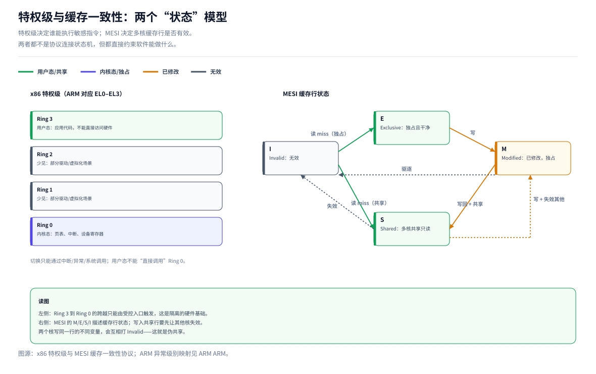

# 计算机组成与存储层次

程序跑得快不快，最终落在三个数上：**执行了多少条指令、每条指令平均花几个周期、每个周期多长**。存储层次存在的理由只有一个——CPU 很快，内存和磁盘很慢，用“小而快”的缓存把常用数据放在离 CPU 更近的地方。

> 本篇定位：CPU/ISA、流水线、Cache/内存层次、总线与 DMA 的通用模型。具体芯片的寄存器、主频、缓存大小放到 30-平台与芯片；Linux 侧的驱动和调优放到 20-平台与系统。

## 目录

- [1 一句话模型](#s1)
- [2 速览](#s2)
- [3 结构与字段](#s3)
- [4 执行与访问流程](#s4)
- [5 状态机与定时器](#s5)
- [6 设计取舍与边界](#s6)
- [7 与相邻主题的关系](#s7)
- [名词解释](#名词解释)
- [8 参考与关联](#s8)

## 1 · 一句话模型

```text
取指 → 译码 → 执行 → 访存 → 写回
  ↑      ↑      ↑      ↑      ↑
  └──── 流水线重叠，理想情况每个周期完成一条 ────┘

寄存器 → L1 → L2 → L3 → 内存 → 磁盘
  快、小、贵                慢、大、便宜
```

三个关键认知：

1. **CPU 只认机器指令和地址**，不认 C 语句、变量名和文件。编译器负责把高级语言翻译成 ISA 指令，操作系统负责把虚拟地址翻译成物理地址。
2. **性能不是“主频越高越快”**。主频只决定周期长度；指令数（算法/编译器）和 CPI（流水线、缓存缺失、分支预测）同样决定结果。
3. **存储层次靠局部性工作**。时间局部性让刚访问的数据留在缓存，空间局部性让相邻数据一次搬入；局部性差的程序会把“缓存命中”打成“内存等待”。

不用这套模型会怎样：看到“CPU 占用高”只会加机器，看到“程序慢”只会换编译器；实际瓶颈可能是一条 cache line 的伪共享、一次未对齐访问，或者一次把 4KB 数据拆成随机小 IO 的循环。

## 2 · 速览

| 项 | 内容 |
| --- | --- |
| 所属层/领域 | 计算机体系结构，硬件与软件的接口 |
| 核心对象 | CPU 核心、寄存器、Cache、内存控制器、总线、外设 |
| 关键参数 | 字长、主频、CPI、Cache 容量/行大小/关联度、内存延迟、带宽 |
| 典型场景 | 性能分析、驱动开发、交叉编译、平台选型 |
| 主要标准 | ISA 手册（x86-64/ARMv8）、ABI、PCIe/USB 规范、JEDEC 内存规范 |

## 3 · 结构与字段

### 3.1 CPU 核心

| 部件 | 作用 | 容易误解的点 |
| --- | --- | --- |
| PC（Program Counter） | 指向下一条指令地址 | 异常/中断时保存的是“下一条”还是“当前”，不同架构不同 |
| 寄存器堆 | 存放操作数和地址 | 数量由 ISA 规定，编译器按 ABI 分配 |
| ALU | 整数/逻辑运算 | 浮点、SIMD 通常有独立单元 |
| 控制单元 | 译码、发控制信号、处理冒险 | 微码/硬布线是实现方式，不影响 ISA 契约 |
| MMU | 虚拟地址→物理地址 | 只有开启分页才工作；MMU 不是 Cache |
| TLB | 页表项缓存 | TLB miss 不等于缺页，可能只是页表遍历 |
| 中断控制器 | 接收外设中断并分发给 CPU | 中断优先级、屏蔽、亲和性由平台决定 |

### 3.2 ISA 与 ABI

ISA（Instruction Set Architecture）是**软件能看到的最小硬件契约**：有哪些指令、寄存器、地址模式、特权级、内存序。ABI（Application Binary Interface）在 ISA 之上再约定：参数怎么传、栈怎么长、哪些寄存器由谁保存、结构体怎么对齐、符号怎么命名。

| 概念 | 回答的问题 | 例子 |
| --- | --- | --- |
| ISA | CPU 能执行什么 | `mov`、`ldr`、`add`、`svc` |
| ABI | 编译器和链接器怎么协作 | x86-64 System V：前 6 个整型参数放 `rdi/rsi/rdx/rcx/r8/r9` |
| 调用约定 | 函数调用前后谁保存寄存器 | caller-saved / callee-saved |
| 字节序 | 多字节数据在内存中的顺序 | 小端：低字节在低地址 |
| 对齐 | 数据地址是否必须是宽度的倍数 | 未对齐访问可能变慢或直接异常 |

**边界**：ABI 不兼容时，目标文件即使能链接，运行时也可能读错参数或踩坏栈。交叉编译工具链必须同时匹配 ISA、ABI、浮点 ABI 和 C 库。

### 3.3 存储层次


**读图**：越往上容量越小、延迟越低；CPU 访问先查 L1，逐级向下。右侧是 Cache 的行结构：地址拆成 tag/index/offset，先定位组，再比对 tag。

| 层级 | 典型容量 | 典型延迟（数量级） | 谁管理 | 作用 |
| --- | --- | --- | --- | --- |
| 寄存器 | 几十到几百字节 | < 1 ns | 编译器/汇编 | 当前运算的操作数 |
| L1 Cache | 16–64 KB/核 | ~1 ns（几周期） | 硬件 | 指令/数据热区 |
| L2 Cache | 256 KB–2 MB/核 | ~3–10 ns | 硬件 | L1 的后备 |
| L3 Cache | 几 MB–几十 MB | ~10–30 ns | 硬件 | 多核共享 |
| 主存 DRAM | GB 级 | ~60–120 ns | 内存控制器 | 运行中的代码和数据 |
| SSD/Flash | GB–TB | ~10–100 µs | 存储控制器 | 持久化数据 |
| HDD | TB 级 | ~5–10 ms | 存储控制器 | 大容量冷数据 |

> 延迟数字是数量级，随工艺、频率、NUMA 位置变化；写进代码里的优化假设要用实测校准。

Cache 的三个关键参数：

- **行大小（line size）**：常见 64 B。一次 miss 会把整行搬入，所以顺序访问比随机访问更划算。
- **关联度（associativity）**：一组里能放几行。直接映射简单但冲突多，全相联命中率高但比较器贵。
- **替换与写策略**：LRU/伪 LRU 决定淘汰谁；写回（write-back）减少写内存，写直达（write-through）实现简单。

### 3.4 总线、MMIO 与 DMA

| 机制 | 谁发起 | 数据怎么走 | 适用/代价 |
| --- | --- | --- | --- |
| Port I/O | CPU | 专用 IN/OUT 指令 | x86 传统设备，地址空间独立 |
| MMIO | CPU | 像访问内存一样读写寄存器 | 主流；需要 `volatile`/屏障防止优化 |
| PIO | CPU | CPU 逐字节/逐字搬运 | 简单但占 CPU，适合小数据 |
| DMA | 设备/控制器 | 设备直接读写内存，完成后中断 | 大块传输；要处理缓存一致性、地址映射 |

**易错点**：MMIO 寄存器不能用普通指针随便读写——编译器可能合并/删除访问，CPU 可能乱序。驱动里要用 `readl/writel`、`ioremap` 和内存屏障，而不是直接解引用。

## 4 · 执行与访问流程

### 4.1 一条指令的流水线


**读图**：理想情况下五个阶段每个周期都有一条指令在跑；数据冒险靠转发或停顿，控制冒险靠分支预测，预测失败要冲刷流水线。

```text
周期:    1     2     3     4     5     6     7
I1:    IF    ID    EX    MEM   WB
I2:          IF    ID    EX    MEM   WB
I3:                IF    ID    EX    MEM   WB
```

三类冒险：

- **数据冒险**：后一条指令要用前一条还没写回的结果。能转发就转发，不能就插入气泡（stall）。
- **控制冒险**：分支指令还没算出方向，后面已经取了指。靠分支预测 + 推测执行；预测错要丢弃错误路径。
- **结构冒险**：两条指令抢同一个硬件资源（如单端口内存、执行单元）。

### 4.2 一次访存的完整路径

```text
CPU 发出虚拟地址
  └─ TLB 命中？──是──→ 得到物理地址
        │否
        └─ 查页表（可能多级）→ 得到物理地址 / 触发缺页
              └─ 访问 L1 → L2 → L3 → 内存
                    └─ 命中：填上层；未命中：继续向下
```

异常分支：

- **TLB miss**：页表项存在，只是缓存没命中；硬件或软件页表遍历后继续。
- **缺页（page fault）**：页不在内存，内核分配页/读文件/做 COW，然后重试指令。
- **保护异常**：越权写只读页、用户态访问内核页，通常变成 `SIGSEGV`。
- **总线错误**：访问不存在的物理地址或设备被拔出，可能触发机器检查异常。

### 4.3 DMA 传输

```text
驱动准备缓冲区 → 写 DMA 地址/长度 → 启动设备
  → 设备直接读写内存 → 传输完成发中断
  → 驱动回收缓冲区、唤醒等待者
```

**正常路径**要保证缓冲区在传输期间不被换出、不被 CPU 改写；**异常路径**包括传输超时、设备复位、部分完成和中断丢失。DMA 不是“免费加速”：小包/小块传输的启动开销可能比 PIO 还高。

## 5 · 状态机与定时器



**读图**：左侧是 x86 的四级特权，越靠内权限越高；右侧是缓存行的 M/E/S/I 四态，写入共享行要先让其他核失效。

本主题**没有协议连接状态机**，但有三类与硬件相关的“状态”：

### 5.1 特权级

| 架构 | 典型层级 | 用途 |
| --- | --- | --- |
| x86-64 | Ring 0–3 | Ring 0 内核，Ring 3 用户态 |
| ARMv8-A | EL0–EL3 | EL0 应用，EL1 内核/虚拟化，EL2 Hypervisor，EL3 安全监控 |

特权级切换只能通过受控入口（中断、异常、系统调用）发生；这是“用户态不能直接碰硬件”的硬件基础。

### 5.2 Cache 一致性状态（MESI）

多核各自有 Cache，同一行可能有四类状态：**M**odified（已修改，独占）、**E**xclusive（独占且干净）、**S**hared（共享只读）、**I**nvalid（无效）。写入共享行要先让其他核失效，这就是“伪共享”伤性能的原因：两个核写同一行的不同变量，也会互相打 invalid。

### 5.3 定时器与时钟中断

- **时钟中断**：周期性触发，给内核提供调度、计时、超时检查的节拍。
- **本地 APIC/Arch Timer**：每个核自己的定时器，用于高精度定时和 per-CPU 事件。
- **TSC/CNTVCT**：时间戳计数器，读取开销低，但跨核一致性和频率稳定性要看平台。

## 6 · 设计取舍与边界

### 6.1 缓存：容量、延迟与功耗的三角

缓存越大命中率越高，但访问延迟、面积和功耗也上升。于是做成多级：L1 追求低延迟，L3 追求容量和共享。**不用缓存**的代价是每次都等内存，CPU 大部分时间在 stall；**缓存过大**的代价是芯片成本和功耗，移动/嵌入式尤其敏感。

### 6.2 RISC vs CISC

RISC 指令定长、简单、易流水线；CISC 指令复杂、编码紧凑、能减少指令数。现代处理器早已互相借鉴：x86 前端把复杂指令译成微操作，ARM 也有复杂的寻址和 SIMD。**对软件工程师的实际影响**主要是 ABI、内存序和可移植性，而不是“谁更先进”。

### 6.3 顺序执行 vs 乱序执行

乱序执行用重排序窗口找并行，提升吞吐，但增加功耗、面积和推测执行的安全风险。实时/低功耗场景可能更偏好顺序核或锁步核。

### 6.4 写回 vs 写直达

写回减少内存流量，但一致性维护复杂；写直达简单，适合共享性强或设备寄存器场景。Cache 一致性协议（MESI/MOESI）是多核正确性的基础，不是“性能选项”。

### 6.5 大端 vs 小端

网络字节序是大端，x86/ARM 常见小端。跨主机传多字节字段必须用 `htonl/ntohl` 一类转换；结构体直接 `send` 会同时踩字节序和对齐两个坑。

### 6.6 什么时候这套模型不适用

- **IO 密集型程序**：瓶颈在磁盘/网络延迟，不在 CPU 流水线。
- **NUMA 系统**：访问远端内存的延迟和带宽与本地不同，“内存”不再是均匀的一层。
- **加速器/异构计算**：GPU/NPU 有自己的存储层次和编程模型，不能直接套 CPU Cache 结论。

## 7 · 与相邻主题的关系

| 相邻对象 | 关系 |
| --- | --- |
| [操作系统抽象](./01-操作系统抽象.md) | OS 用 MMU/中断/特权级把硬件虚拟化成进程和地址空间 |
| [编译与链接](./02-编译与链接.md) | 编译器按 ISA/ABI 生成指令和目标文件 |
| [网络编程基础](./03-网络编程基础.md) | 字节序、对齐、缓冲区生命周期直接影响协议实现 |
| [21-Linux/02-驱动与设备树](../../20-平台与系统/21-Linux/02-驱动与设备树/00-驱动模型与设备树.md) | MMIO/DMA/中断在 Linux 驱动里的具体写法 |
| [30-平台与芯片](../../30-平台与芯片/.readme.md) | 具体 SoC 的核数、Cache、主频和外设差异 |
| [07-调试与追踪](../../20-平台与系统/21-Linux/07-调试与追踪/00-调试与追踪概览.md) | perf 计数、cache miss、分支预测失败的实际观测 |

一句话边界：**本篇讲“硬件提供什么能力”，20/30 讲“某个平台怎么用这些能力”。**

## 名词解释

> 缩写给出英文全称；非缩写用“—”表示。

| 术语 | 英文全称 | 解释 |
| --- | --- | --- |
| CPU | Central Processing Unit | 中央处理器，执行指令的核心。 |
| ISA | Instruction Set Architecture | 指令集架构，软件可见的硬件契约。 |
| ABI | Application Binary Interface | 应用二进制接口，规定调用约定、数据布局和符号规则。 |
| ALU | Arithmetic Logic Unit | 算术逻辑单元。 |
| PC | Program Counter | 程序计数器，指向下一条指令。 |
| CPI | Cycles Per Instruction | 每条指令平均消耗的时钟周期数。 |
| IPC | Instructions Per Cycle | 每周期完成的指令数，CPI 的倒数。 |
| L1/L2/L3 | Level 1/2/3 Cache | 分级缓存，数字越大越慢越大。 |
| TLB | Translation Lookaside Buffer | 页表项缓存，加速虚拟地址翻译。 |
| MMU | Memory Management Unit | 内存管理单元，负责地址翻译和保护检查。 |
| DRAM | Dynamic Random Access Memory | 动态随机存取存储器，主存。 |
| SRAM | Static Random Access Memory | 静态随机存取存储器，常用作 Cache。 |
| DMA | Direct Memory Access | 直接内存访问，设备不经过 CPU 搬运数据。 |
| MMIO | Memory-Mapped I/O | 内存映射 IO，用访存指令访问设备寄存器。 |
| PIO | Programmed I/O | 程序控制 IO，CPU 逐字搬运。 |
| MESI | Modified/Exclusive/Shared/Invalid | 一种 Cache 一致性协议的四态。 |
| RISC | Reduced Instruction Set Computer | 精简指令集计算机。 |
| CISC | Complex Instruction Set Computer | 复杂指令集计算机。 |
| OoO | Out-of-Order | 乱序执行。 |
| NUMA | Non-Uniform Memory Access | 非一致内存访问，远端内存更慢。 |
| TSC | Time-Stamp Counter | x86 时间戳计数器。 |
| APIC | Advanced Programmable Interrupt Controller | 高级可编程中断控制器。 |
| PCIe | Peripheral Component Interconnect Express | 高速串行外设总线。 |
| SoC | System on Chip | 片上系统，把 CPU、外设、控制器集成在一颗芯片。 |
| JEDEC | Joint Electron Device Engineering Council | 内存等器件的标准化组织。 |

## 8 · 参考与关联

**标准与教材**

- Intel 64 and IA-32 Architectures Software Developer's Manual
- ARM Architecture Reference Manual (ARMv8-A)
- Patterson & Hennessy, *Computer Organization and Design*
- Bryant & O'Hallaron, *Computer Systems: A Programmer's Perspective*（CSAPP）

**关联**

- [01-操作系统抽象.md](./01-操作系统抽象.md)
- [02-编译与链接.md](./02-编译与链接.md)
- [03-网络编程基础.md](./03-网络编程基础.md)
- [21-Linux/05-内存与性能/00-虚拟内存.md](../../20-平台与系统/21-Linux/05-内存与性能/00-虚拟内存.md)

---

> **本篇定位**：CPU/ISA、流水线、Cache 层次、总线与 DMA 的通用模型。
> **素材来源**：通用计算机体系结构知识补写；源仓库 `studyspace/1.知识体系/4.linux源码/Linux011启动流程.md`（分段/分页与特权级背景）。
> **待验证**：各级缓存延迟、行大小、TLB 级数随具体 CPU 型号变化；以平台手册和实测为准。
