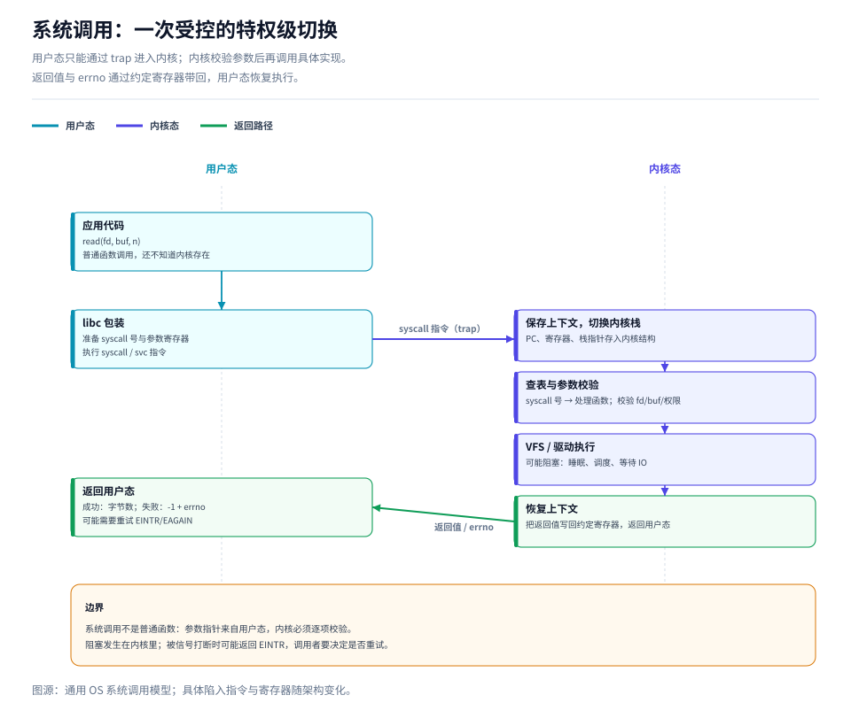
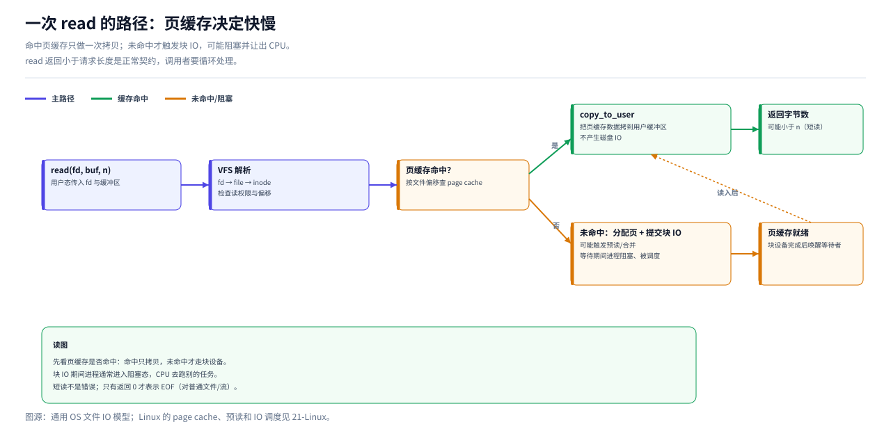

# 操作系统抽象

操作系统的核心工作不是“管理硬件”这么笼统，而是把硬件包装成四类稳定抽象：**进程/线程、虚拟地址空间、文件描述符、进程间通信**。应用程序只通过这些抽象和系统调用使用硬件，不直接碰页表、中断控制器和设备寄存器。

> 本篇定位：通用 OS 的抽象模型、系统调用边界、进程状态与一次 IO 的主线。Linux 的 `task_struct`、CFS、VMA、VFS 实现细节放到 20-平台与系统/21-Linux；本篇只讲“为什么有这层抽象”。

## 目录

- [1 一句话模型](#s1)
- [2 速览](#s2)
- [3 结构与字段](#s3)
- [4 交互与流程](#s4)
- [5 状态机与定时器](#s5)
- [6 设计取舍与边界](#s6)
- [7 与相邻主题的关系](#s7)
- [名词解释](#名词解释)
- [8 参考与关联](#s8)

## 1 · 一句话模型

```text
应用程序
  │  open/read/write/fork/exec/mmap ...（系统调用）
  ▼
内核：把“文件、进程、地址空间”翻译成“页、块、中断、寄存器”
  │
  ▼
硬件：CPU / MMU / 内存 / 磁盘 / 网卡
```

三个关键认知：

1. **系统调用是唯一受控入口**。用户态不能直接改页表、关中断、访问设备寄存器；必须陷入内核，由内核检查参数和权限后代为执行。
2. **进程 = 地址空间 + 执行上下文 + 资源表**。地址空间决定“能看见什么”，执行上下文决定“执行到哪”，资源表（fd、信号、凭证）决定“能用什么”。
3. **抽象会泄漏，但泄漏点固定**。`read` 可能短读，`write` 可能部分写，`fork` 可能失败，`mmap` 可能缺页；这些不是异常，而是抽象契约的一部分。

不用这层抽象会怎样：每个程序都要自己管理物理内存、磁盘块和设备寄存器；一个野指针就能覆盖别的进程；换一块网卡就要重写所有网络程序。OS 抽象的价值是**隔离、复用和可移植**，代价是系统调用开销和“看不见的缓存/调度”。

## 2 · 速览

| 项 | 内容 |
| --- | --- |
| 所属层/领域 | 操作系统原理，硬件与应用的中间层 |
| 核心对象 | 进程、线程、地址空间、文件、fd、inode、信号、管道、socket |
| 关键参数 | 页大小、时间片、fd 上限、打开文件数、内存 overcommit 策略 |
| 典型场景 | 程序启动、文件 IO、网络服务、容器隔离、故障定位 |
| 主要标准 | POSIX、Linux syscall ABI、ELF、文件系统与虚拟内存接口 |

## 3 · 结构与字段

### 3.1 进程与线程

| 对象 | 拥有什么 | 共享什么 | 切换成本 |
| --- | --- | --- | --- |
| 进程 | 独立地址空间、fd 表、信号处理、凭证 | 通常不共享（除显式 IPC） | 高：换页表、刷 TLB |
| 线程 | 寄存器、栈、TLS、调度状态 | 地址空间、fd、全局变量 | 中：换栈和寄存器 |
| 协程 | 用户态栈和上下文 | 所在线程的一切 | 低：用户态切换 |

进程控制块（PCB，Linux 里是 `task_struct`）至少包含：

| 字段类别 | 作用 | 容易误解的点 |
| --- | --- | --- |
| 标识 | pid/tgid、父进程、用户/组 | 容器里的 pid 是命名空间视角，不是全局唯一 |
| 状态 | running/ready/blocked/zombie | “可运行”不等于“正在 CPU 上” |
| 地址空间 | 页表、VMA、brk、栈 | 线程共享 mm，进程各自一份 |
| 执行上下文 | PC、栈指针、寄存器 | 切换时必须保存/恢复 |
| 资源表 | fd 表、信号、定时器、cgroup | `fork` 会复制 fd 表，但共享打开文件描述 |
| 调度信息 | 优先级、时间片、CPU 亲和性 | nice 值影响权重，不是硬实时优先级 |

### 3.2 虚拟地址空间

| 区域 | 典型内容 | 权限 | 增长方向 |
| --- | --- | --- | --- |
| text | 机器指令 | r-x | 固定 |
| rodata | 常量、字符串 | r-- | 固定 |
| data | 已初始化全局/静态变量 | rw- | 固定 |
| bss | 未初始化全局/静态变量 | rw- | 固定，运行时清零 |
| heap | `malloc` 的小块内存 | rw- | 向高地址 |
| mmap | 文件映射、大块匿名内存、共享库 | 按映射 | 任意 |
| stack | 函数栈帧、局部变量 | rw- | 向低地址 |

页表项（PTE）常见标志：present、read/write、user/supervisor、executable、accessed、dirty、COW。**页表不是“内存分配表”**：它描述虚拟页到物理页的映射；没有映射的页在访问时才触发缺页。

### 3.3 文件与文件描述符

```text
fd 表（每进程） → struct file（打开文件描述） → inode（文件元数据） → 数据块
```

| 对象 | 作用 | 关键点 |
| --- | --- | --- |
| fd | 进程内的整数句柄 | 只是数组下标，0/1/2 通常是 stdin/stdout/stderr |
| 打开文件描述 | 偏移、状态标志、引用计数 | `fork`/`dup` 共享偏移；`open` 新开一份 |
| inode | 类型、权限、大小、块指针 | 硬链接共享 inode；删除目录项不等于立刻释放数据 |
| dentry | 目录项到 inode 的映射 | 路径解析缓存，不是持久化结构 |
| VFS | 统一文件接口 | 不同文件系统实现同一组操作 |

### 3.4 系统调用接口

| 元素 | 作用 | 边界 |
| --- | --- | --- |
| 系统调用号 | 内核分发表索引 | 不同架构/内核版本可能不同，不要硬编码 |
| 参数寄存器 | 传递用户指针/整数 | 内核必须校验用户指针，不能直接信任 |
| 返回值 | 成功返回结果，失败返回 `-1` 并设 `errno` | 不是所有失败都能重试 |
| libc 包装 | 把 syscall 指令封装成函数 | `errno` 是线程局部变量 |
| 权限检查 | 用户/组、capability、namespace | root 在容器里也可能被限制 |

## 4 · 交互与流程

### 4.1 系统调用：从用户态到内核态



**读图**：应用调用 libc 包装函数，后者把系统调用号和参数放进约定的寄存器，执行陷入指令；CPU 切到内核态，内核按号查表、校验参数、调用具体实现，最后恢复用户态并把返回值带回。

```text
用户态                     内核态
read(fd, buf, n)
  └─ libc 包装
       └─ syscall 指令 ──→ 保存上下文
                            查 syscall table
                            校验 fd/buf/权限
                            调用 VFS/驱动
                            可能阻塞/调度
                          ←── 恢复上下文
  ←── 返回字节数或 -1/errno
```

异常分支：

- **参数非法**：fd 不存在、buf 不可写、长度越界 → `EBADF`/`EFAULT`/`EINVAL`。
- **被信号打断**：慢系统调用可能返回 `EINTR`，调用者要判断是否重试。
- **暂时不可用**：非阻塞 fd 没有数据 → `EAGAIN`/`EWOULDBLOCK`。
- **资源不足**：fd 用完、内存不足、进程数达上限 → `EMFILE`/`ENOMEM`/`EAGAIN`。
- **权限不足**：`EACCES`/`EPERM`，容器里还要看 capability 和 LSM。

### 4.2 进程创建与程序装载

```text
fork()
  ├─ 复制父进程的 PCB、fd 表、地址空间（页表先共享只读）
  └─ 子进程从 fork 返回 0，父进程返回子进程 pid

execve(path, argv, envp)
  ├─ 校验可执行文件（ELF magic/架构/权限）
  ├─ 替换地址空间：text/data/heap/stack 重新建立
  ├─ 保留 fd 表（除非 FD_CLOEXEC）
  └─ 跳到入口点（如 _start）

waitpid(pid, &status, 0)
  └─ 回收子进程退出状态，释放僵尸 PCB
```

异常分支：

- `fork` 失败：进程数/内存不足 → `EAGAIN`/`ENOMEM`。
- `execve` 失败：文件不存在、格式错误、解释器缺失、权限不足；失败后**原进程仍继续执行**，这是 shell 能报错的原因。
- 子进程退出但父进程不 `wait`：留下僵尸进程；父进程先退出则由 init/子收割者接管。
- `FD_CLOEXEC` 没设：敏感 fd 被 `exec` 后的新程序继承，可能泄漏。

### 4.3 一次文件读取



**读图**：`read` 先经过 VFS 找到打开文件描述和 inode；如果页缓存命中，直接拷贝到用户缓冲区；未命中则从块设备读入页缓存，再拷贝。真正的磁盘 IO 可能被调度、合并、预读。

```text
read(fd, buf, n)
  └─ VFS：fd → file → inode
       └─ 页缓存命中？
            ├─ 是：copy_to_user
            └─ 否：分配页 → 提交块 IO → 等待/异步 → 读入后 copy_to_user
```

**短读/短写**是正常契约：`read` 返回小于 `n` 不代表出错；`write` 可能只写一部分。正确做法是循环处理剩余部分，除非使用了 `readv/writev` 或明确知道语义。

### 4.4 缺页与写时复制

```text
访问未映射/只读页 → CPU 触发 page fault
  ├─ 地址在合法 VMA 内？
  │    ├─ 匿名页：分配零页/新页
  │    ├─ 文件页：从页缓存/磁盘读入
  │    └─ COW：复制一份，改 PTE 为可写
  └─ 不在 VMA：SIGSEGV
```

`fork` 之所以便宜，是因为父子先共享只读页；任一方写入才复制。代价是写入放大和延迟抖动，内存紧张时更明显。

## 5 · 状态机与定时器

### 5.1 进程状态机


**读图**：新建的进程进入就绪队列；调度器选中后运行；等待 IO/事件时阻塞；事件完成回到就绪；运行结束进入僵尸，等父进程回收。

| 状态 | 含义 | 常见转移 |
| --- | --- | --- |
| New | 正在创建 | → Ready |
| Ready | 可运行，等 CPU | → Running（被调度） |
| Running | 正在 CPU 上执行 | → Ready（时间片到/被抢占）、→ Blocked（等 IO/锁） |
| Blocked | 等待事件 | → Ready（事件完成/信号） |
| Zombie | 已退出，PCB 未回收 | → 释放（父进程 wait） |

### 5.2 定时器

- **时间片**：调度器给每个可运行进程一个运行预算，用完触发抢占；时间片太小切换开销大，太大交互延迟高。
- **睡眠定时器**：`sleep`/`nanosleep`/`poll` 超时，依赖内核定时器 wheel 或高精度定时器。
- **TCP 定时器**：重传、延迟 ACK、TIME_WAIT 等属于协议栈，不在通用 OS 抽象里展开，见 [TCP](../11-网络科学/04-传输层/01-TCP.md)。
- **看门狗**：硬件/软件定时器，超时复位系统；它不经过普通进程调度，属于可靠性机制。

## 6 · 设计取舍与边界

### 6.1 宏内核 vs 微内核

宏内核把文件系统、网络栈、驱动都放在内核态，调用直接、性能好，但一处崩溃可能拖垮全系统。微内核把服务移到用户态，隔离好、可恢复，但 IPC 和上下文切换开销大。Linux 是宏内核，通过模块、namespace、cgroup 和用户态服务弥补隔离性。

### 6.2 进程 vs 线程

进程隔离强、切换贵、通信要显式 IPC；线程共享地址空间、切换便宜、但一个线程踩内存会拖垮整个进程。选择原则：**需要故障隔离用进程，需要共享大量数据用线程，IO 密集高并发可用事件循环/协程**。

### 6.3 缓冲 IO vs 直接 IO

缓冲 IO 经过页缓存，读多写少、重复访问友好；直接 IO 绕过页缓存，适合数据库自管缓存，但要求对齐、失去预读和合并。`O_SYNC`/`fsync` 解决持久性，不解决吞吐。

### 6.4 COW 与 overcommit

COW 让 `fork` 和 `mmap` 便宜，但写入时复制会放大内存和延迟。overcommit 允许虚拟内存超过物理内存，提升利用率，但可能触发 OOM。实时/关键业务要预留内存或限制 overcommit。

### 6.5 什么时候这套抽象不适用

- **实时系统**：通用调度器不保证最坏延迟，需要 RT 调度或专用 RTOS。
- **裸机/RTOS**：没有 MMU 或不需要进程隔离，抽象层次要简化。
- **DPDK/用户态协议栈**：绕过内核网络栈以减少拷贝和中断，代价是失去内核的隔离与统一管理。
- **容器**：namespace 改变“看见什么”，cgroup 改变“能用多少”，但内核仍是共享的；隔离不等于虚拟化。

## 7 · 与相邻主题的关系

| 相邻对象 | 关系 |
| --- | --- |
| [计算机组成与存储层次](./00-计算机组成与存储层次.md) | MMU/TLB/中断/特权级是 OS 抽象的硬件基础 |
| [编译与链接](./02-编译与链接.md) | `execve` 装载 ELF，地址空间布局由链接脚本和 ELF 段决定 |
| [网络编程基础](./03-网络编程基础.md) | socket 也是 fd，`read/write` 的短读/阻塞语义同样适用 |
| [21-Linux/04-进程与并发](../../20-平台与系统/21-Linux/04-进程与并发/00-进程与线程.md) | Linux 的 `task_struct`、调度、IPC 实现 |
| [21-Linux/05-内存与性能/00-虚拟内存.md](../../20-平台与系统/21-Linux/05-内存与性能/00-虚拟内存.md) | VMA、缺页、COW 的 Linux 实现 |
| [21-Linux/06-网络子系统/03-socket与epoll.md](../../20-平台与系统/21-Linux/06-网络子系统/03-socket与epoll.md) | socket fd 的内核对象与等待队列 |

一句话边界：**本篇讲“OS 提供哪些抽象、契约是什么”，21-Linux 讲“Linux 用什么结构体和代码实现”。**

## 名词解释

> 缩写给出英文全称；非缩写用“—”表示。

| 术语 | 英文全称 | 解释 |
| --- | --- | --- |
| OS | Operating System | 操作系统，管理硬件并向应用提供抽象。 |
| PCB | Process Control Block | 进程控制块，保存进程状态和资源。 |
| TCB | Thread Control Block | 线程控制块，保存线程上下文。 |
| MMU | Memory Management Unit | 内存管理单元，负责地址翻译和保护。 |
| TLB | Translation Lookaside Buffer | 页表项缓存。 |
| PTE | Page Table Entry | 页表项。 |
| VMA | Virtual Memory Area | 虚拟内存区域，描述一段地址的用途和权限。 |
| COW | Copy-On-Write | 写时复制。 |
| fd | File Descriptor | 文件描述符，进程内的整数句柄。 |
| VFS | Virtual File System | 虚拟文件系统，统一不同文件系统的接口。 |
| inode | Index Node | 文件元数据对象。 |
| IPC | Inter-Process Communication | 进程间通信。 |
| TLS | Thread-Local Storage | 线程局部存储。 |
| ELF | Executable and Linkable Format | 可执行与可链接格式。 |
| EINTR | Interrupted system call | 系统调用被信号打断的错误码。 |
| EAGAIN | Try again | 资源暂时不可用，稍后重试。 |
| OOM | Out Of Memory | 内存耗尽，内核可能触发 killer。 |
| RTOS | Real-Time Operating System | 实时操作系统。 |
| LSM | Linux Security Module | Linux 安全模块框架。 |
| POSIX | Portable Operating System Interface | 可移植操作系统接口标准族。 |
| CFS | Completely Fair Scheduler | Linux 的完全公平调度器。 |

## 8 · 参考与关联

**标准与教材**

- POSIX.1-2017 / IEEE Std 1003.1
- Silberschatz, Galvin & Gagne, *Operating System Concepts*
- Tanenbaum & Bos, *Modern Operating Systems*
- Bryant & O'Hallaron, *Computer Systems: A Programmer's Perspective*（CSAPP）

**关联**

- [00-计算机组成与存储层次.md](./00-计算机组成与存储层次.md)
- [02-编译与链接.md](./02-编译与链接.md)
- [03-网络编程基础.md](./03-网络编程基础.md)
- [21-Linux/01-内核基础/00-内核概览.md](../../20-平台与系统/21-Linux/01-内核基础/00-内核概览.md)

---

> **本篇定位**：OS 的四类抽象、系统调用边界、进程状态与一次 IO 的主线。
> **素材来源**：通用操作系统原理补写；源仓库 `studyspace-v2/6.系统软件/1.Linux内核与驱动/02-进程管理与文件系统.md`（进程/文件系统主线）。
> **待验证**：时间片、fd 上限、overcommit 默认值随内核配置和发行版变化；以目标系统为准。
