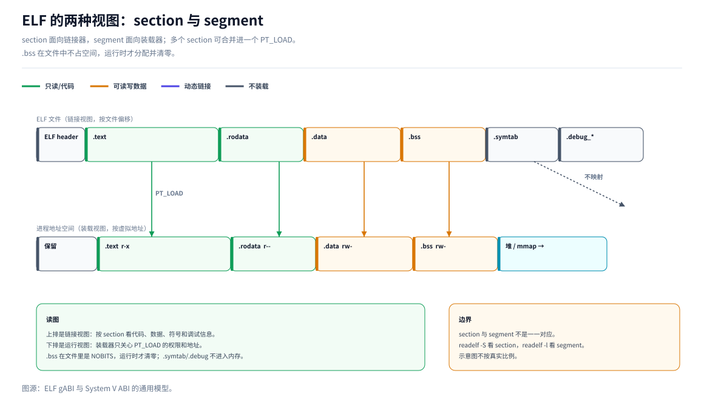
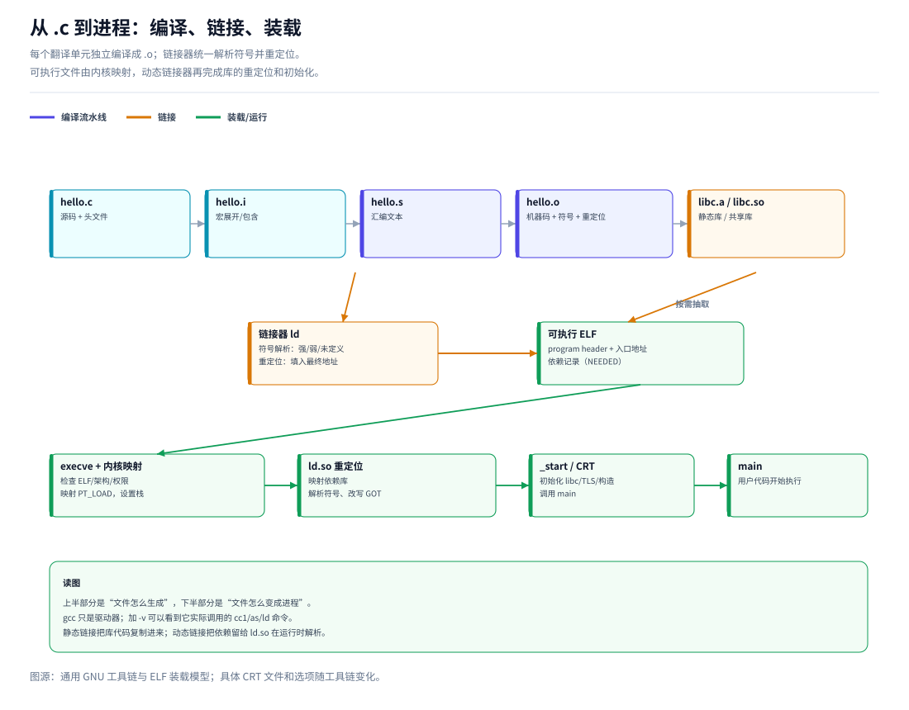
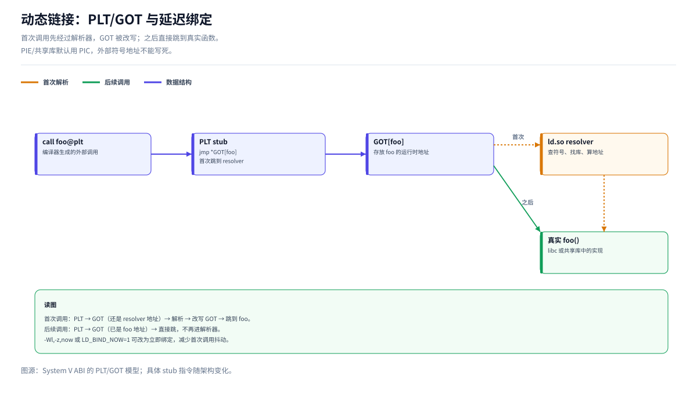
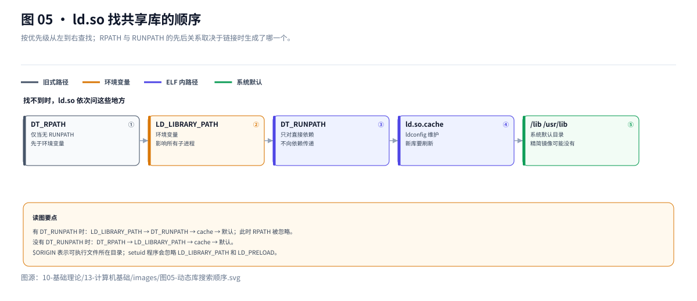

# 编译与链接

从 `.c` 到能运行的程序，中间不是“一个 gcc 命令”，而是**预处理 → 编译 → 汇编 → 链接 → 装载**五段流水线。编译负责把单个源文件翻译成机器指令，链接负责把多个目标文件和库拼成一个整体，装载器负责把它映射进进程地址空间。

> 本篇定位：工具链各阶段做什么、ELF 里有什么、符号和重定位怎么工作、静态/动态链接的边界。Make/CMake/OpenWrt 的构建规则放到 20/50；C 语言语法和运行时库 API 放到 50-软件开发。

## 目录

- [1 一句话模型](#s1)
- [2 速览](#s2)
- [3 结构与字段](#s3)
- [4 交互与流程](#s4)
- [5 链接与装载的阶段模型](#s5)
- [6 设计取舍与边界](#s6)
- [7 与相邻主题的关系](#s7)
- [名词解释](#名词解释)
- [8 参考与关联](#s8)

## 1 · 一句话模型

```text
hello.c ──预处理──→ hello.i ──编译──→ hello.s ──汇编──→ hello.o
                                                          │
                          libc.a / libc.so ──链接──────────┤
                                                          ▼
                                                    hello（ELF）
                                                          │ execve
                                                          ▼
                                              进程地址空间 + 动态装载器
```

三个关键认知：

1. **编译是“按翻译单元独立进行”的**。每个 `.c` 只知道自己看到的声明，不知道别的 `.c` 里有什么；跨文件的名字靠链接器解析。
2. **链接器只做两件事**：符号解析（这个名字到底指哪个地址）和重定位（把占位地址改成最终地址）。大部分“undefined reference / multiple definition”都是这两步失败。
3. **可执行文件不是“内存镜像”**。ELF 用 section 描述链接视图，用 segment 描述装载视图；`.bss` 在文件里不占空间，运行时才清零分配。

不用这套模型会怎样：看到 `undefined reference` 只会到处加 `.c` 文件；看到 `cannot open shared object file` 只会重装库；把 `-static` 当万能药，最后二进制膨胀、glibc 静态链接的限制全踩一遍。

## 2 · 速览

| 项 | 内容 |
| --- | --- |
| 所属层/领域 | 工具链与二进制接口，源码到进程的中间层 |
| 核心对象 | 翻译单元、目标文件、符号、重定位、ELF section/segment、共享库 |
| 关键参数 | `-O` 优化级别、`-fPIC/-pie`、`-static`、`-Wl,-rpath`、`-g`、`-s` |
| 典型场景 | 交叉编译、库升级、崩溃定位、二进制体积裁剪、ABI 兼容 |
| 主要标准 | ELF gABI、System V ABI（x86-64/ARM64）、C/C++ ABI、DWARF |

## 3 · 结构与字段

### 3.1 工具链各阶段的产物

| 阶段 | 典型命令 | 输入 → 输出 | 主要工作 | 边界与误判 |
| --- | --- | --- | --- | --- |
| 预处理 | `gcc -E` | `.c` → `.i` | 展开宏、包含头文件、条件编译 | 只做文本替换，不理解类型和作用域；宏错误在这里埋下 |
| 编译 | `gcc -S` | `.i` → `.s` | 语法/语义分析、优化、生成汇编 | 每个翻译单元独立；看不到别的 `.c` 里有什么定义 |
| 汇编 | `gcc -c` / `as` | `.s` → `.o` | 汇编指令编码、生成符号与重定位 | 外部符号先留空；汇编器不负责跨文件解析 |
| 链接 | `ld` / `gcc` | `.o` + 库 → 可执行/共享库 | 符号解析、段合并、重定位、布局 | 只检查符号与地址，不检查程序逻辑；未定义/重复在这里才暴露 |
| 装载 | 内核 + `ld.so` | ELF → 进程 | 映射段、重定位、初始化、跳入口 | 内核只负责映射；libc/TLS/构造函数由 `ld.so` 和 CRT 接手 |

> `gcc` 是驱动器（driver），它按后缀和选项调用 `cc1`、`as`、`ld`；真正干活的是这些子工具。

### 3.2 ELF 文件头

| 字段 | 作用 | 容易误解的点 |
| --- | --- | --- |
| `e_ident` | magic、位数、字节序、ABI 版本 | 前 4 字节 `\x7fELF`；架构不匹配会直接拒绝装载 |
| `e_type` | 可重定位/可执行/共享库/core | `.o` 是 `ET_REL`，`.so` 是 `ET_DYN` |
| `e_machine` | 目标架构 | x86-64、ARM64、MIPS 等，交叉编译必须匹配 |
| `e_entry` | 入口虚拟地址 | 通常不是 `main`，而是 `_start` |
| `e_phoff/e_phnum` | 程序头表位置/数量 | 装载器看 program header（segment） |
| `e_shoff/e_shnum` | 节头表位置/数量 | 链接器/调试器看 section header |
| `e_shstrndx` | 节名字符串表索引 | 用 `readelf -S` 可读 |

### 3.3 Section：链接视图



**读图**：上排按文件偏移看 section，下排按虚拟地址看装载后的区域；`.text/.rodata/.data/.bss` 进入 `PT_LOAD`，`.symtab/.debug` 留在文件里不映射。

| Section | 内容 | 运行时 | 备注 |
| --- | --- | --- | --- |
| `.text` | 机器指令 | r-x | 可执行、通常只读 |
| `.rodata` | 常量、字符串字面量 | r-- | 放进只读段 |
| `.data` | 已初始化全局/静态变量 | rw- | 文件中有初值 |
| `.bss` | 未初始化全局/静态变量 | rw- | 文件中不占空间，装载时清零 |
| `.symtab/.strtab` | 符号表/字符串表 | 不映射 | `strip` 可删除；调试需要保留 |
| `.rela.text/.rela.data` | 重定位表 | 不映射 | 链接时使用，动态链接用 `.rela.dyn/.rela.plt` |
| `.dynamic/.dynsym/.dynstr` | 动态链接元数据 | 映射 | 共享库/动态可执行需要 |
| `.got/.plt` | 全局偏移表/过程链接表 | 映射 | 动态链接的跳转与地址间接层 |
| `.init/.fini`、`.init_array/.fini_array` | 初始化/析构函数 | 映射 | `main` 前后的构造/析构 |
| `.debug_*` | DWARF 调试信息 | 不映射 | `-g` 生成，`strip` 删除 |

**Section 是给链接器看的，segment 是给装载器看的**。链接器关心“这些节怎么合并、每个符号落在哪”；装载器只关心“哪些区间要映射、给什么权限”。所以多个权限相同的 section 会被合并进同一个 `PT_LOAD`，而 `.symtab`、`.debug_*` 这种不需要进内存的节只留在文件里。`strip` 能删掉符号表却还能运行，就是因为运行时不需要 `.symtab`。

`.bss` 是最容易被误判的一个：它的类型是 `SHT_NOBITS`，文件里只有“要多大”，没有实际字节；装载时 `p_memsz > p_filesz` 的差额由内核清零。**因此 `.bss` 大不会撑大文件，但会实打实占内存**，共享库的 `.bss` 还会按进程计。

> **边界**：`readelf -S` 里的 offset 是文件偏移，不是运行时虚拟地址；要看“装到哪里、什么权限”，用 `readelf -l` 看 program header。反过来，`readelf -l` 看不到 section 名，两套视图不能互相替代。

### 3.4 Segment：装载视图

| Segment | 典型包含 | 权限 | 作用 | 边界与误判 |
| --- | --- | --- | --- | --- |
| `PT_LOAD` | `.text/.rodata`、`.data/.bss` | r-x / rw- | 真正要映射到内存的段 | 按页对齐；同一段权限必须一致，W^X 要靠拆分实现 |
| `PT_DYNAMIC` | `.dynamic` | r-- | 告诉装载器依赖哪些库、重定位表在哪 | 损坏或缺失时 `ld.so` 直接拒绝，不会“部分运行” |
| `PT_INTERP` | 解释器路径 | r-- | 动态可执行指定 `ld.so` | 路径写死在 ELF 里；chroot/精简镜像缺这个路径就启动失败 |
| `PT_NOTE` | 构建 ID、ABI 标记 | r-- | core dump/调试匹配 | 没有 build-id 时，调试符号很难和二进制对上 |
| `PT_GNU_STACK` | 栈权限 | — | 是否可执行，关系 NX | 标记为可执行会扩大攻击面；老代码/内联汇编可能强制这样 |
| `PT_TLS` | 线程局部存储模板 | — | TLS 的初始化镜像 | `dlopen` 的库可能触发动态 TLS 分配，有上限 |
| `PT_GNU_RELRO` | 重定位后只读区域 | r-- | 把 GOT 等改成只读 | 只有 RELRO 不够，GOT 仍可能被延迟绑定改写；配合 `-z now` 才是 full RELRO |

**Section 与 segment 的关系**：多个 section 可以合并进一个 `PT_LOAD`；`readelf -S` 看链接布局，`readelf -l` 看装载布局。两者不是一一对应。

### 3.5 符号与重定位

符号表条目至少包含：名字、绑定（LOCAL/GLOBAL/WEAK）、类型（OBJECT/FUNC/SECTION/FILE）、可见性、所属 section、值（地址/偏移）、大小。

| 重定位类型（x86-64 示例） | 用途 | 说明 |
| --- | --- | --- |
| `R_X86_64_64` | 绝对 64 位地址 | 非 PIC 代码常见 |
| `R_X86_64_PC32` | 相对当前指令的 32 位偏移 | 同模块内调用/访问 |
| `R_X86_64_PLT32` | 通过 PLT 的调用 | 外部函数调用 |
| `R_X86_64_GOTPCREL` | 通过 GOT 取地址 | PIC 代码访问外部数据 |

重定位条目 = **在哪里改（offset）+ 按什么规则改（type）+ 加数（addend）+ 指向哪个符号**。链接器把占位值替换成最终地址或偏移。

符号的“绑定”和“可见性”决定链接器怎么处理冲突，也决定动态库导出多少东西：

| 属性 | 含义 | 链接行为 | 边界与误判 |
| --- | --- | --- | --- |
| `LOCAL` | 文件内私有（`static`） | 不进动态符号表 | 多个文件可以有同名 local，不冲突 |
| `GLOBAL` | 强符号，对外可见 | 多个强定义 → `multiple definition` | C 的 tentative definition 在旧标准下可能合并成 common |
| `WEAK` | 弱符号 | 有强符号时让位；未解析的弱引用可为 0 | “弱符号没定义也不报错”会变成运行时空指针 |
| `HIDDEN` | 隐藏可见性 | 不进入 `.dynsym`，不能被外部/预加载替换 | 插件 API 需要 `default`，全 hidden 会导致 `dlsym` 找不到 |
| `PROTECTED` | 导出但内部绑定 | 库内引用不走 PLT，不能被 interpose | 与 `LD_PRELOAD` 的替换预期冲突 |

> **推论**：`-fvisibility=hidden` 能减小动态符号表、让内部调用直接绑定，是共享库的常见优化；代价是“默认不导出”，需要导出的接口要显式标 `__attribute__((visibility("default")))`。

## 4 · 交互与流程

### 4.1 从源码到可执行文件



**读图**：上半部分是编译流水线，每个 `.c` 独立生成 `.o`；链接器把多个 `.o` 和库合并，解析符号并重定位；下半部分是 `execve` 后的装载过程。

```text
gcc -E hello.c -o hello.i      # 预处理
gcc -S hello.i -o hello.s      # 编译
gcc -c hello.s -o hello.o      # 汇编
gcc hello.o -o hello           # 链接（自动带上 crt 和 libc）

# 近似分解（实际还需 crti/crtn、动态链接器参数等）
ld -o hello /usr/lib/crt1.o hello.o -lc
```

链接器的内部顺序：

```text
读取所有输入目标文件
  → 合并同名 section（.text 拼在一起）
  → 建立全局符号表（强符号/弱符号/未定义）
  → 解析每个未定义符号
  → 为每个输入段分配虚拟地址
  → 应用重定位
  → 生成 program header 和入口地址
```

### 4.2 静态链接与动态链接


**读图**：链接器按命令行从左到右扫描。先看到 `main.o` 的未定义 `foo`，才会从 `libfoo.a` 里抽出 `foo.o`；`foo.o` 又引入未定义 `bar`，所以 `libbar.a` 必须排在后面。左边没被需要的成员不会被拉进来。

| 维度 | 静态链接 | 动态链接 |
| --- | --- | --- |
| 输入 | `.a`（目标文件归档） | `.so`（共享对象） |
| 代码是否复制进可执行文件 | 是 | 否，运行时映射 |
| 体积 | 大 | 小（多个进程共享） |
| 库升级 | 需要重新链接 | 替换 `.so` 即可（ABI 兼容时） |
| 启动 | 快，无装载器解析 | 有符号解析/重定位开销 |
| 故障面 | 单文件，依赖少 | 缺库、版本冲突、`LD_LIBRARY_PATH` 污染 |

静态库的抽取规则：链接器**只把满足当前未定义符号的成员**从 `.a` 中拉进来；因此库的顺序很重要（通常把依赖方放前面，被依赖方放后面）。循环依赖可用 `-Wl,--start-group ... -Wl,--end-group`。

```text
gcc main.o -lfoo -lbar      # foo 依赖 bar：先 foo 后 bar
gcc main.o -lbar -lfoo      # 扫到 bar 时还没有未定义 bar，bar.o 不会被拉入
```

> **边界**：顺序问题只发生在静态归档上；共享库默认会记录 `DT_NEEDED`，不会因为 `-l` 顺序就漏掉。`--start-group` 解决的是循环依赖，不是“把所有库都重复扫一遍”的万能药。

### 4.3 动态链接：PLT/GOT 与装载



**读图**：第一次调用外部函数时，PLT 跳到 GOT 里保存的解析器地址；`ld.so` 找到真实函数后改写 GOT，后续调用直接走真实地址。这就是“延迟绑定”。

```text
call foo@plt
  └─ PLT stub：jmp *GOT[foo]
       ├─ 首次：GOT 指向 ld.so 的 resolver
       │    └─ 解析符号 → 改写 GOT → 跳到 foo
       └─ 之后：GOT 已指向 foo，直接跳
```

装载流程：

```text
execve("hello")
  └─ 内核读 ELF header，检查架构/权限
       └─ 映射 PT_LOAD 段，设置栈和 auxv
            └─ 若有 PT_INTERP，跳到 ld.so
                 └─ ld.so 映射依赖库、重定位、跑 init
                      └─ 跳到 e_entry（_start）
                           └─ __libc_start_main → main
```

`_start` 不是 `main`：C 运行时（CRT）先初始化 libc、TLS、构造函数，再调用 `main`，最后用 `exit` 回收。

**动态库不是“在当前目录找”**。`ld.so` 有一套固定顺序，理解它才能解释“为什么本机跑得好、目标机找不到库”：



**读图**：从左到右是典型顺序；`DT_RPATH` 只在该 ELF 没有 `DT_RUNPATH` 时生效，一旦有 `DT_RUNPATH`，顺序就变成 `LD_LIBRARY_PATH` → `DT_RUNPATH`。`ld.so.cache` 由 `ldconfig` 维护，最后才落到默认目录。

| 来源 | 谁设置 | 边界与误判 |
| --- | --- | --- |
| `DT_RPATH` | 链接时 `-Wl,--disable-new-dtags,-rpath,...`（旧式） | 会传递给依赖库；有 `DT_RUNPATH` 时被忽略 |
| `LD_LIBRARY_PATH` | 运行时环境变量 | 影响所有子进程；setuid 程序会忽略它 |
| `DT_RUNPATH` | 链接时 `-Wl,-rpath,...`（新式，通常默认） | 只对直接依赖生效，不传递 |
| `ld.so.cache` | `ldconfig` 扫描后生成 | 新装库没跑 `ldconfig` 可能找不到 |
| `/lib`、`/usr/lib` | 系统默认 | 精简镜像/交叉根文件系统里可能不存在 |

`-Wl,-rpath,'$ORIGIN/../lib'` 用 `$ORIGIN` 表示“可执行文件所在目录”，适合自包含发布；注意用单引号防止 shell 提前展开。`LD_PRELOAD` 会在正常搜索前强制加载指定库，可用来替换符号，但 setuid 程序出于安全会忽略它。

> **边界**：延迟绑定让首次调用多一次解析开销，也意味着 GOT 在首次调用前仍可写。安全敏感场景用 `-z now`（或 `LD_BIND_NOW`）在启动时解析全部符号，配合 RELRO 把 GOT 改成只读。

### 4.4 常见失败路径

| 现象 | 根因 | 排查方向 |
| --- | --- | --- |
| `undefined reference to 'foo'` | 没链接实现、库顺序不对、C++ 名字修饰 | `nm` 看符号、检查 `-l` 顺序、`extern "C"` |
| `multiple definition of 'x'` | 多个强符号；C tentative definition | 改 `static`/`extern`、检查头文件定义 |
| `cannot open shared object file` | 运行时找不到 `.so` | `ldd`、`readelf -d` 看 `NEEDED`/`RPATH`、`ldconfig` |
| `version 'GLIBC_2.xx' not found` | 构建机 glibc 比目标机新 | 在旧环境构建、静态链接、容器化 |
| `relocation R_X86_64_32 ... can not be used when making a PIE` | 非 PIC 目标文件进共享库/PIE | 编译加 `-fPIC`，链接加 `-pie` |
| `text relocations` | 共享库里有绝对地址改写 | 用 `-fPIC` 重编；检查内联汇编 |
| 程序启动即崩，栈回溯正常 | 构造函数顺序/ABI 不匹配 | 检查 `.init_array`、编译器/标准库版本 |
| `main` 没被调用 | 入口被链接脚本改错、CRT 缺失 | `readelf -h` 看 `e_entry`，检查 `crt*.o` |

## 5 · 链接与装载的阶段模型

本主题**没有协议状态机，也没有定时器**。但有两个阶段模型值得记住：

### 5.1 链接器的两个阶段

1. **符号解析**：建立全局符号表，区分强符号、弱符号、未定义符号；静态库按需抽取。
2. **重定位**：给每个段分配地址，改写所有重定位条目；生成可执行文件或共享库。

### 5.2 装载器的状态

```text
读取 ELF → 映射 PT_LOAD → 处理 PT_INTERP → 重定位 → 初始化 → 跳入口
```

失败会停在对应阶段。先判断“停在哪一段”，比盲猜库版本有效：

| 阶段 | 典型现象 | 常见原因 | 下一步看什么 |
| --- | --- | --- | --- |
| 读取 ELF | `Exec format error` / 直接拒绝执行 | 架构不匹配、magic 损坏、权限不对 | `file`、`readelf -h` |
| 映射 `PT_LOAD` | 启动早期段错误 | 段权限/对齐异常、文件被截断 | `readelf -l`、`dmesg` |
| 处理 `PT_INTERP` | `No such file or directory`（指向解释器） | 目标机缺 `ld.so`、chroot 路径不对 | `readelf -l` 看 INTERP，检查根文件系统 |
| 重定位/找库 | `cannot open shared object` / `version not found` | `NEEDED` 缺失、搜索路径不对、glibc 版本新 | `ldd`、`readelf -d`、`LD_DEBUG=libs` |
| 初始化 | `main` 之前崩溃 | 构造函数、TLS、ABI 不匹配 | gdb 断在 `_start`/`__libc_start_main` |
| 跳入口 | `main` 没被调用 | `e_entry` 被链接脚本改错、CRT 缺失 | `readelf -h`、检查 `crt*.o` |

## 6 · 设计取舍与边界

### 6.1 静态链接 vs 动态链接

静态链接把依赖固化进二进制，部署简单、启动确定，但体积大、库升级要重编，且某些库（如 glibc 的 NSS、dlopen）静态链接有额外限制。动态链接节省内存、便于升级，但引入运行时依赖和版本兼容问题。**嵌入式/救援工具**常偏静态，**通用发行版**常偏动态。

### 6.2 优化级别

`-O0` 便于调试，`-O2` 是通用平衡，`-O3` 可能增大体积并触发更激进的向量化，`-Os` 优先体积。优化会改变指令顺序、内联和变量可见性，**不能用 `-O0` 的调试体验去推断 `-O2` 的行为**。未定义行为在优化后可能表现完全不同。

### 6.3 PIC/PIE 与 ASLR

PIC 让代码不依赖固定加载地址，PIE 让可执行文件也能随机化基址。代价是多一层 GOT/PLT 间接和少量性能开销。**不用 PIE** 的代价是代码段地址固定，增加 ROP 攻击面；**全静态 + 非 PIE** 在安全敏感场景要谨慎。

### 6.4 LTO 与调试信息

LTO 把优化推迟到链接期，能跨翻译单元内联和裁剪，但编译变慢、调试信息可能变形、不同编译器/版本的 LTO 字节码不兼容。`-g` 生成 DWARF，`strip` 删除符号和调试信息；发布版常保留独立 debug 文件（`.debug`）用于事后分析。

### 6.5 ABI 兼容

ABI 不只是“函数名一样”：调用约定、结构体布局、枚举大小、异常处理、C++ 名字修饰、标准库版本都算。**共享库升级必须保持 ABI 兼容**；否则需要 soname 版本升级（如 `libfoo.so.1` → `libfoo.so.2`），让链接器和新旧程序各取所需。

### 6.6 什么时候这套模型不适用

- **解释型/字节码语言**：没有传统链接阶段，但有模块解析和运行时链接。
- **JIT**：编译发生在运行时，优化基于运行时类型信息。
- **固件/裸机**：链接脚本直接控制地址布局，没有操作系统装载器。
- **容器镜像**：动态库依赖被固化在镜像层里，“运行时缺库”更多是镜像构建问题。

### 6.7 交叉编译：三处必须同时对齐

| 维度 | 要对齐什么 | 错了的表现 |
| --- | --- | --- |
| ISA/ABI | 指令集版本、端序、浮点 ABI、结构体对齐 | 上机就 `Illegal instruction`，或参数读错、浮点结果乱 |
| sysroot | 目标机的头文件 + 库，而不是构建机的 | 编译能过，链接到主机 glibc，运行时版本不匹配 |
| 装载路径 | `PT_INTERP`、`DT_NEEDED`、`RPATH/RUNPATH` | 目标机报 `No such file or directory` 或找不到 `.so` |

> **边界**：`-march=native` 只对“编译机和运行机同一颗 CPU”成立；交叉编译或分发二进制时用它，等于把非法指令留给用户。用目标平台的基线 `-march`，再对热点函数做多版本派发。

## 7 · 与相邻主题的关系

| 相邻对象 | 关系 | 边界 |
| --- | --- | --- |
| [计算机组成与存储层次](./00-计算机组成与存储层次.md) | ISA/ABI 决定指令编码、寄存器使用和结构体布局 | 本篇不讲流水线、Cache 和内存序 |
| [操作系统抽象](./01-操作系统抽象.md) | `execve` 装载 ELF，地址空间布局由 segment 决定 | 本篇不讲进程调度、VMA 和缺页处理 |
| [网络编程基础](./03-网络编程基础.md) | 结构体对齐、字节序、缓冲区生命周期直接影响协议代码 | 本篇不讲 socket API 和 TCP 状态机 |
| [50-软件开发](../../50-软件开发/.readme.md) | C 语法、Make/CMake、调试工具的使用 | 本篇只讲“从源码到二进制”的阶段模型 |
| [55-构建与调试](../../50-软件开发/55-构建与调试/.readme.md) | 工具链参数、库顺序、交叉编译的工程实践 | 构建系统怎么组织目标，不在本篇展开 |
| [21-Linux/03-启动与根文件系统](../../20-平台与系统/21-Linux/03-启动与根文件系统/00-启动链.md) | 用户态 init 之前的启动链与根文件系统 | 本篇从 `execve` 开始，不覆盖 bootloader/kernel 启动 |
| [22-OpenWrt/01-构建与包管理](../../20-平台与系统/22-OpenWrt/01-构建与包管理/00-构建体系总览.md) | 交叉编译、包 Makefile、镜像打包 | 具体包规则和 SDK 目录结构以那边为准 |

一句话边界：**本篇讲“源码怎么变成可装载的二进制”，构建系统和平台打包讲“怎么批量、可复现地做这件事”。**

## 名词解释

> 缩写给出英文全称；非缩写用“—”表示。

| 术语 | 英文全称 | 解释 |
| --- | --- | --- |
| ELF | Executable and Linkable Format | 可执行与可链接格式。 |
| gABI | Generic ABI | ELF 的通用二进制接口规范。 |
| ABI | Application Binary Interface | 应用二进制接口，规定调用约定和数据布局。 |
| TU | Translation Unit | 翻译单元，一个 `.c` 及其包含的头文件。 |
| CRT | C Runtime | C 运行时启动代码，如 `crt1.o`。 |
| PIC | Position-Independent Code | 位置无关代码。 |
| PIE | Position-Independent Executable | 位置无关可执行文件。 |
| GOT | Global Offset Table | 全局偏移表，存放外部符号地址。 |
| PLT | Procedure Linkage Table | 过程链接表，延迟绑定的跳转桩。 |
| LTO | Link-Time Optimization | 链接时优化。 |
| ASLR | Address Space Layout Randomization | 地址空间布局随机化。 |
| RELRO | Relocation Read-Only | 重定位后只读，保护 GOT。 |
| NX | No-eXecute | 数据页不可执行。 |
| soname | Shared Object Name | 共享库的稳定版本名。 |
| DWARF | Debugging With Attributed Record Formats | 调试信息格式。 |
| COFF | Common Object File Format | 另一种目标文件格式，Windows 常用。 |
| Mach-O | Mach Object | macOS/iOS 的目标文件格式。 |
| ODR | One Definition Rule | C++ 单一定义规则。 |
| TLS | Thread-Local Storage | 线程局部存储。 |
| SHT_NOBITS | Section Header Type: No Bits | 文件不占空间、运行时分配并清零的节类型，如 `.bss`。 |
| RUNPATH | Run-Time Search Path | 动态库搜索路径，只对直接依赖生效。 |
| RPATH | Run-Time Search Path | 旧式搜索路径，会传递给依赖库。 |
| visibility | Symbol Visibility | 控制符号是否导出到动态符号表。 |
| common | Common Symbol | C tentative definition 的旧式合并方式。 |
| `$ORIGIN` | — | 链接器展开为可执行文件所在目录的占位符。 |
| build-id | Build Identifier | 二进制唯一标识，用于匹配调试符号。 |
| IFUNC | Indirect Function | 运行时选择函数实现的符号类型。 |
| `ld.so` | Dynamic Loader | 动态链接器/装载器。 |

## 8 · 参考与关联

**标准与文档**

- System V ABI（x86-64 / ARM64）
- ELF gABI（Generic ABI）
- `man elf`、`man ld`、`man ld.so`
- Bryant & O'Hallaron, *Computer Systems: A Programmer's Perspective*（CSAPP）第 7 章
- Levine, *Linkers and Loaders*

**关联**

- [00-计算机组成与存储层次.md](./00-计算机组成与存储层次.md)
- [01-操作系统抽象.md](./01-操作系统抽象.md)
- [03-网络编程基础.md](./03-网络编程基础.md)
- [23-嵌入式基础/01-交叉编译与工具链](../../20-平台与系统/23-嵌入式基础/01-交叉编译与工具链/.readme.md)

---

> **本篇定位**：编译/汇编/链接/装载五段流程，ELF section/segment、符号与重定位、静态/动态链接边界。
> **素材来源**：通用工具链与 ELF 知识补写；源仓库 `studyspace/1.知识体系/0.学习计划/2-openwrt-make调用链.md`（构建链背景）。
> **待验证**：不同架构的重定位类型、CRT 文件名和默认链接选项随工具链变化；以 `gcc -v`/`ld --verbose` 为准。
