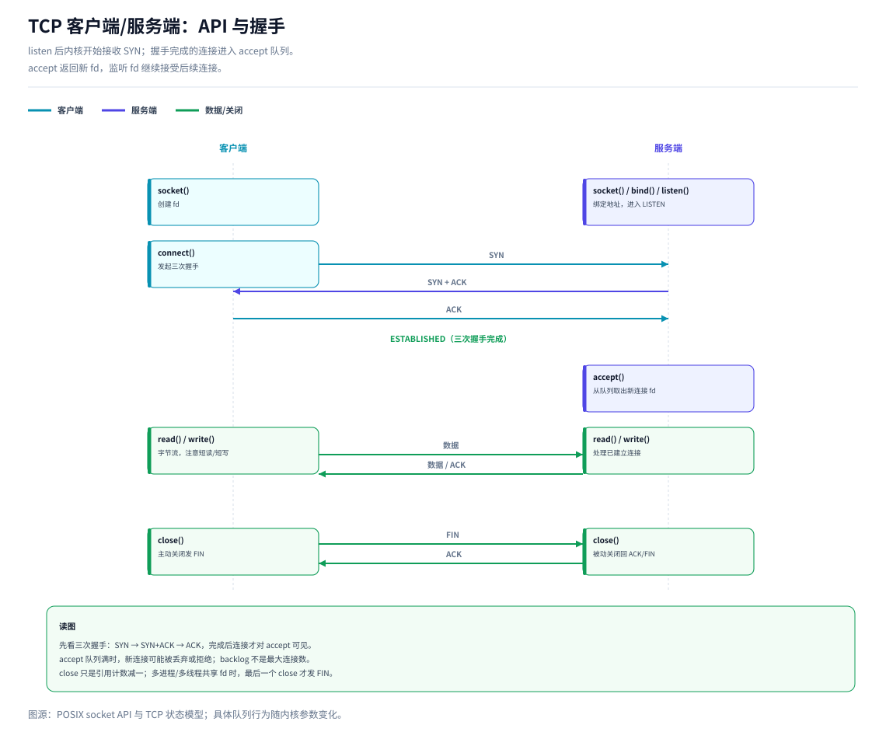
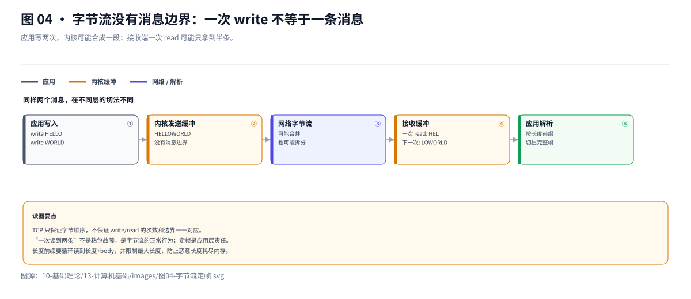
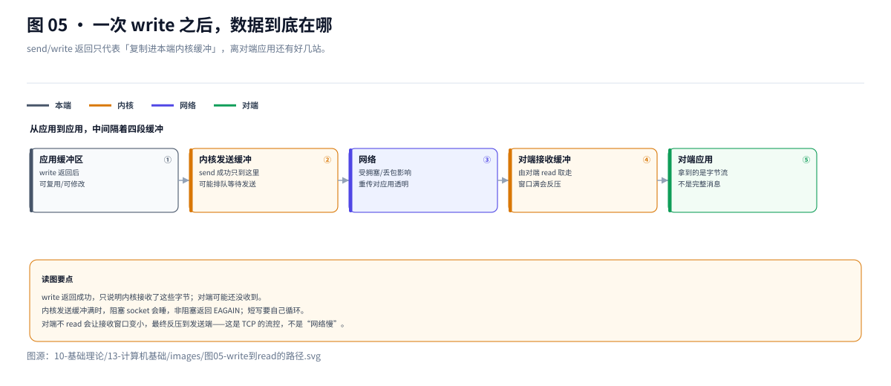
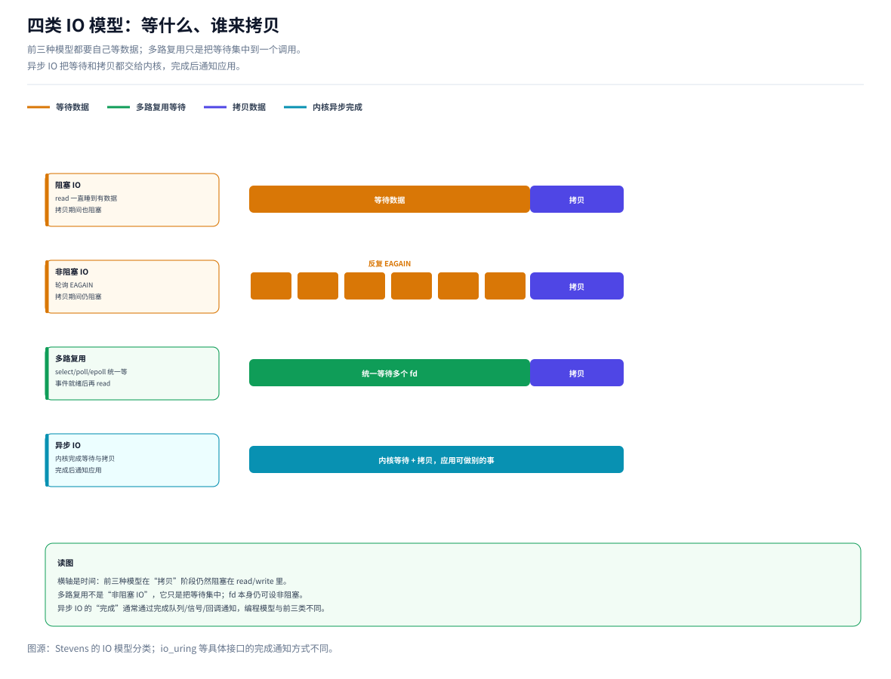
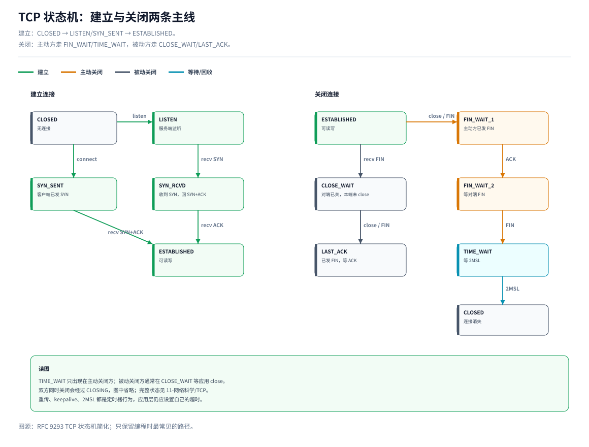

# 网络编程基础

网络编程的核心不是“记住 socket 函数”，而是理解三件事：**socket 是一个文件描述符**、**TCP 是字节流而不是消息队列**、**并发模型决定程序怎么等 IO**。把这三件事想清楚，API 只是查手册的问题。

> 本篇定位：socket API 的通用编程模型、TCP/UDP 的读写语义、阻塞/非阻塞/多路复用/异步四类 IO 模型。TCP 报文、握手、拥塞控制的协议细节见 [11-网络科学/04-传输层/01-TCP.md](../11-网络科学/04-传输层/01-TCP.md)；Linux `epoll` 的内核实现见 [21-Linux/06-网络子系统/03-socket与epoll.md](../../20-平台与系统/21-Linux/06-网络子系统/03-socket与epoll.md)。

读完这一篇，你应该能回答四个问题：`send` 返回成功到底保证了什么；为什么一次 `recv` 可能读到半条消息；LT 和 ET 的代码差在哪；`CLOSE_WAIT` 堆积和 `TIME_WAIT` 堆积分别是谁的问题。

## 目录

- [1 一句话模型](#s1)
- [2 速览](#s2)
- [3 结构与字段](#s3)
- [4 交互与流程](#s4)
- [5 状态机与定时器](#s5)
- [6 设计取舍与边界](#s6)
- [7 与相邻主题的关系](#s7)
- [名词解释](#名词解释)
- [8 参考与关联](#s8)

## 1 · 一句话模型

```text
socket() → bind() → listen() → accept() → read()/write() → close()
   │          │         │          │
   │          │         │          └─ 返回“新连接”的 fd
   │          │         └─ 把主动 socket 变成监听 socket
   │          └─ 绑定本地地址 + 端口
   └─ 创建内核 socket 对象，返回 fd
```

三个关键认知：

1. **socket 就是 fd**。`read/write/close/poll/epoll` 对 socket 和普通文件一样适用；区别在底层对象和阻塞语义。
2. **TCP 是字节流**。`send` 成功只表示“交给内核缓冲区”，不表示对端收到；`recv` 返回多少字节没有消息边界，应用层必须自己定帧。
3. **“等 IO”有四种基本姿势**：阻塞等、非阻塞轮询、多路复用统一等、异步通知。选错模型，后面加多少线程都救不回来。

> **一句话收束**：socket API 把“连接状态、发送/接收缓冲区、超时与重传”都放在内核里，应用只看到一个 fd 和四个动作：等、读、写、关。大部分坑都来自把这四个动作想得太简单。

不用这套模型会怎样：把 `send` 当成“发送成功”、把一次 `recv` 当成一条消息、在 ET 模式下不读到 `EAGAIN`、`accept` 后忘了关闭监听 fd——这些都是网络编程里最典型的错误。

## 2 · 速览

| 项 | 内容 |
| --- | --- |
| 所属层/领域 | 传输层 API 与并发 IO 模型 |
| 核心对象 | socket fd、地址结构、连接、监听队列、读写缓冲区 |
| 关键参数 | backlog、SO_RCVBUF/SO_SNDBUF、超时、TCP_NODELAY、SO_REUSEADDR |
| 典型场景 | 客户端/服务端、长连接、短连接、代理、RPC、嵌入式 Web |
| 主要标准 | POSIX socket API、RFC 9293（TCP）、RFC 768（UDP） |

## 3 · 结构与字段

### 3.1 socket 创建参数

| 参数 | 常见值 | 作用 | 边界 |
| --- | --- | --- | --- |
| domain | `AF_INET`、`AF_INET6`、`AF_UNIX` | 地址族 | IPv4/IPv6 双栈要单独处理 |
| type | `SOCK_STREAM`、`SOCK_DGRAM`、`SOCK_RAW` | 语义：流/数据报/原始 | `SOCK_STREAM` 不一定是 TCP（也可以是 Unix 流） |
| protocol | 通常 0 | 具体协议 | 0 表示按 domain+type 选默认 |

### 3.2 地址结构

```c
struct sockaddr_in {
    sa_family_t    sin_family;  /* AF_INET */
    in_port_t      sin_port;    /* 网络字节序 */
    struct in_addr sin_addr;    /* 网络字节序 */
    char           sin_zero[8]; /* 填充，通常置 0 */
};
```

| 字段 | 作用 | 容易踩的点 |
| --- | --- | --- |
| `sin_family` | 地址族 | 必须与 socket 的 domain 一致 |
| `sin_port` | 端口 | 必须用 `htons` 转网络字节序 |
| `sin_addr` | IPv4 地址 | `INADDR_ANY` 表示本机所有地址 |
| `sin_zero` | 对齐填充 | 不要求全 0，但建议 `memset` 整个结构 |

IPv6 用 `sockaddr_in6`，还有 `sin6_scope_id` 处理链路本地地址；通用接口用 `sockaddr_storage` 承载。地址转换优先用 `inet_pton/inet_ntop` 和 `getaddrinfo`，不要用不可重入的 `gethostbyname`。

**为什么端口和地址必须转网络字节序**：TCP/IP 头按大端定义，而 x86/ARM 常见小端。以端口 8080（0x1F90）为例，不调 `htons` 直接放到小端内存，线路上会被解释成 0x901F（36895）。地址是 32 位整数，错一个字节就是另一台主机。

> **边界**：`sockaddr_in` 只用于 IPv4；传给 `bind/connect` 时要强转成 `struct sockaddr *` 并给对长度。结构体里不要直接 `send`——字节序、对齐和填充都可能和协议字段不一致。

### 3.3 监听与连接

| 对象 | 作用 | 关键点 |
| --- | --- | --- |
| 监听 fd | 只负责接受新连接 | `accept` 返回新 fd，监听 fd 继续用 |
| 连接 fd | 一条已建立的连接 | 每个连接独立读写、独立关闭 |
| backlog | 已完成握手、等待 `accept` 的队列长度 | Linux 还受 `somaxconn` 限制；不是“最大连接数” |
| SYN 队列 | 半连接（收到 SYN、未完成握手） | 受 `tcp_max_syn_backlog` 影响 |

**`accept4` 比 `accept` 多两个原子标志**：`SOCK_NONBLOCK` 和 `SOCK_CLOEXEC`，省掉“accept 后再 fcntl”的窗口，避免 fd 在 exec 时泄漏。监听 fd 设成非阻塞后，`accept` 必须循环到 `EAGAIN`，否则一次事件只取一个连接，队列会越积越满。

### 3.4 常用 socket 选项

| 选项 | 作用 | 什么时候用 | 代价/边界 |
| --- | --- | --- | --- |
| `SO_REUSEADDR` | 允许绑定 TIME_WAIT 地址/端口 | 服务端重启 | 不等于允许多个进程同时监听同一端口 |
| `SO_REUSEPORT` | 多个 socket 绑定同一端口并负载分担 | 多进程/多线程 accept | 内核版本和分发策略有差异 |
| `TCP_NODELAY` | 关闭 Nagle | 低延迟小包（RPC、游戏） | 小包变多，带宽利用率下降 |
| `SO_RCVBUF/SO_SNDBUF` | 设置内核缓冲区 | 高带宽时延积链路 | 内核会加倍/限制，不是越大越好 |
| `SO_KEEPALIVE` | 开启 TCP keepalive | 长期空闲连接 | 默认 2 小时，通常不如应用层心跳 |
| `SO_LINGER` | 控制 close 行为 | 需要发 RST/等待发送完 | 设置不当会阻塞或丢数据 |
| `SO_RCVTIMEO/SO_SNDTIMEO` | 读写超时 | 防止永久阻塞 | 与多路复用混用要小心 |

### 3.5 返回值与错误码

| 返回值/错误 | 含义 | 正确处理 |
| --- | --- | --- |
| `> 0` | 读到的字节数/写入的字节数 | 可能小于请求长度 |
| `0` | 对端关闭（TCP EOF） | 关闭本端或处理半关闭 |
| `-1, EINTR` | 被信号打断 | 判断是否重试 |
| `-1, EAGAIN/EWOULDBLOCK` | 非阻塞下暂时没数据/缓冲区满 | 等下一次可读/可写事件 |
| `-1, ECONNRESET` | 对端发 RST | 连接已失效，清理资源 |
| `-1, EPIPE` | 向已关闭连接写 | 忽略 `SIGPIPE` 或使用 `MSG_NOSIGNAL` |
| `-1, ETIMEDOUT` | 连接/传输超时 | 重试或降级 |
| `-1, EINPROGRESS` | 非阻塞 `connect` 正在进行 | 等可写事件，再用 `getsockopt(SO_ERROR)` 取结果 |
| `-1, ECONNREFUSED` | 对端端口没监听，回 RST | 查服务是否启动、端口和防火墙 |
| `-1, EADDRINUSE` | `bind` 的地址/端口被占 | 查残留进程与 TIME_WAIT；必要时 `SO_REUSEADDR` |
| `-1, ENOTCONN` | 对未连接 socket 读写 | 先 `connect` 或 `accept` |
| `-1, EMSGSIZE` | 数据报超过限制 | 减小单包，或改应用层分片 |

## 4 · 交互与流程

### 4.1 TCP 服务端与客户端



**读图**：服务端先 `socket/bind/listen`，内核开始接收 SYN；三次握手完成后连接进入 accept 队列，`accept` 取出并返回新 fd。客户端 `connect` 完成握手后即可读写。

```text
服务端                                客户端
socket()                              socket()
bind()                                │
listen()                              │
  │                                   │
  │ ←──── SYN ─────────────────────── connect()
  │ ──── SYN + ACK ─────────────────→ │
  │ ←──── ACK ─────────────────────── │
  │   （连接进入 accept 队列）          │
accept() → 新 fd                       │
read()/write() ←──── 数据 ──────────→ read()/write()
close()                               close()
```

关键点：

- `listen` 的 backlog 是**已完成握手队列**的提示值，不是连接总数；队列满时新 SYN 可能被丢弃或回 RST。
- `accept` 可能返回 `EINTR`、`EAGAIN`（非阻塞监听 fd）；要循环 accept 直到 `EAGAIN`。
- `accept` 出来的 fd 默认继承监听 fd 的部分属性，但**不继承** `O_NONBLOCK`（Linux 上需要显式设置）。
- 服务端通常设置 `SO_REUSEADDR`，避免重启时被 TIME_WAIT 挡住。

> **边界**：`backlog` 不是“最大连接数”，Linux 实际取 `min(backlog, somaxconn)`；SYN 队列和 accept 队列是两套限制。SYN 队列被打满时，是否启用 syncookies 决定新连接是被丢弃还是继续握手。
> **推论**：多个进程/线程同时阻塞在同一个监听 fd 上，新连接会唤醒谁并不确定，这就是“惊群”。`SO_REUSEPORT` 让每个 worker 有自己的监听队列，或 `EPOLLEXCLUSIVE` 只唤醒一个，都是缓解手段，不是语义保证。

### 4.2 读写语义：字节流没有边界



**读图**：应用两次 `write` 的数据进入内核发送缓冲区后，会被合并成连续字节流；接收端一次 `read` 可能拿到半条、一条或多条。定帧只能靠应用层自己加边界。

```text
发送端: write(fd, "HELLO", 5) + write(fd, "WORLD", 5)
接收端: read(fd, buf, 1024) 可能返回 "HELLOWORLD"
        也可能只返回 "HEL"，下一次再返回 "LOWORLD"
```

| 操作 | 语义 | 常见错误 |
| --- | --- | --- |
| `read/recv` | 返回当前可读的最多 n 字节 | 以为一次读到一条完整消息 |
| `write/send` | 返回已复制进内核缓冲区的字节数 | 以为对端已收到 |
| `send` + `MSG_NOSIGNAL` | 避免 `SIGPIPE` | 没处理 `EPIPE` |
| `shutdown(SHUT_WR)` | 发送 FIN，仍可读 | 把 `close` 当半关闭 |
| `close` | 减少引用计数，可能发 FIN/RST | 多线程/多进程共享 fd 时提前关闭 |



**读图**：`write` 把数据从应用缓冲区复制到本端内核发送缓冲区就返回；之后由 TCP 自己排队、分段、重传，直到对端 `read` 把它取走。中间任何一段都可能让数据停住，但应用看到的只是“写成功”。

应用层定帧的常见方法：长度前缀、分隔符、固定长度、自描述格式（JSON/Protobuf）。**不要依赖 TCP 的发送边界**，也不要把“一次读到两条消息”叫“粘包”——TCP 本来就没有包，只有字节流。

长度前缀的读法必须循环到读满，且要限制上限：

```c
ssize_t read_full(int fd, void *buf, size_t n) {
    size_t off = 0;
    while (off < n) {
        ssize_t r = read(fd, (char *)buf + off, n - off);
        if (r == 0) return 0;                  /* EOF */
        if (r < 0) {
            if (errno == EINTR) continue;
            return -1;
        }
        off += (size_t)r;
    }
    return (ssize_t)n;
}

uint32_t len;
if (read_full(fd, &len, 4) != 4) { /* 处理短读/EOF */ }
len = ntohl(len);
if (len > MAX_FRAME) { /* 拒绝，防止恶意长度耗尽内存 */ }
if (read_full(fd, body, len) != (ssize_t)len) { /* 处理短读/EOF */ }
```

> **边界**：长度前缀本身也要防溢出和恶意值；`len` 来自网络，不能直接拿去 `malloc`。分隔符方案还要处理“分隔符出现在 payload 里”的转义问题。

### 4.3 四类 IO 模型



**读图**：前三种模型都要经历“等待数据”和“拷贝数据”两个阶段；多路复用只是把“等待”集中到一个系统调用里，拷贝仍然是阻塞的；异步 IO 把等待和拷贝都交给内核，完成后通知应用。

经典 Stevens 分类有五种，其中信号驱动 IO 现在很少用；本篇按常用的四类讲，表里保留它作对照。

| 模型 | 等待数据 | 拷贝数据 | 典型接口 | 适用 |
| --- | --- | --- | --- | --- |
| 阻塞 IO | 进程睡眠 | 阻塞 | `read` | 简单、连接数少 |
| 非阻塞 IO | 轮询 | 阻塞 | `O_NONBLOCK` + 循环 | 少量 fd、状态机 |
| IO 多路复用 | 统一等待 | 阻塞 | `select/poll/epoll` | 高并发、事件驱动 |
| 信号驱动 IO | 信号通知 | 阻塞 | `SIGIO` | 少见，信号处理复杂 |
| 异步 IO | 内核完成 | 内核完成 | POSIX AIO、`io_uring` | 高吞吐、低延迟 |

`select/poll/epoll` 的差异：

| 维度 | `select` | `poll` | `epoll` |
| --- | --- | --- | --- |
| fd 上限 | `FD_SETSIZE`（常见 1024） | 无固定上限 | 无固定上限 |
| 每次调用 | 拷贝/扫描整个集合 | 拷贝/扫描整个数组 | 内核维护兴趣列表 |
| 触发方式 | 水平触发 | 水平触发 | LT/ET |
| 跨平台 | POSIX 广泛 | POSIX | Linux 特有（BSD 用 kqueue） |
| 边界与误判 | 每次返回后要重建 fd 集合；fd 号超过上限要改实现 | 大集合仍是线性扫描 | ET 必须配非阻塞并读到 `EAGAIN`；不是所有 fd 都支持 |

**ET（边缘触发）必须一次读到 `EAGAIN`**，否则缓冲区里剩下的数据不会再触发事件；LT（水平触发）可以只读一部分，下次还会通知。多线程下还要考虑 `EPOLLONESHOT`（处理期间不再通知）和 `EPOLLEXCLUSIVE`（只唤醒一个 waiter），否则同一连接可能被多个线程同时处理。

### 4.4 UDP 与“连接”

```text
服务端: socket(AF_INET, SOCK_DGRAM) → bind → recvfrom/sendto
客户端: socket(AF_INET, SOCK_DGRAM) → sendto/recvfrom
```

- UDP 保留消息边界：一次 `sendto` 对应一次 `recvfrom`（或丢弃/截断），不会合并。
- UDP 不保证可靠、有序、不重复；需要应用层做序号、重传、去重。
- `connect` 一个 UDP socket 只是设置默认对端，之后可用 `send/recv`；它不会建立连接，但会过滤其他来源。
- UDP 没有拥塞控制，发太快会丢包；大包会被 IP 分片，增加丢失放大。
- `recvfrom` 的缓冲区不够时，数据报会被截断，剩下的部分直接丢弃；它不会像 TCP 那样分多次读完。需要看真实长度时用 `MSG_TRUNC`，并据此调整缓冲区。
- `connect` 过的 UDP socket 会把 ICMP 错误带回后续 `send/recv`（如 `ECONNREFUSED`），未连接的 socket 通常看不到。

> **边界**：UDP 的“消息边界”只在单次数据报内成立；超过路径 MTU 会被 IP 分片，任一分片丢失整个数据报就没了。应用层要么控制包大小，要么自己做分片与重组。

### 4.5 关闭、半关闭与 TIME_WAIT

```text
主动关闭方: close() → FIN → 对端 ACK → 对端 FIN → 本端 ACK → TIME_WAIT（2MSL）
被动关闭方: 收到 FIN → ACK → 应用 read 返回 0 → close() → FIN
```

| 动作 | 效果 | 适用 |
| --- | --- | --- |
| `shutdown(SHUT_WR)` | 发 FIN，仍可读 | 请求-响应后优雅半关闭 |
| `shutdown(SHUT_RDWR)` | 关闭读写 | 需要同时停止两个方向 |
| `close` | 引用计数减一，最后一个关闭才发 FIN | 普通清理 |
| `SO_LINGER {1,0}` | close 时发 RST | 明确要丢弃未发数据（慎用） |

TIME_WAIT 的意义：保证最后一个 ACK 能重传、让旧连接的重复报文在网络中消失。它占用端口资源，但不是“泄漏”；服务端用 `SO_REUSEADDR` 合法复用。

`CLOSE_WAIT` 则是另一回事：它表示**对端已经发来 FIN，本端还没 `close`**。堆积说明应用层收到 EOF 后没有关闭 fd——通常是代码漏了 `close`，不是内核参数问题。两者别混：TIME_WAIT 在主动关闭方，靠时间自然消失；CLOSE_WAIT 在被动关闭方，只能靠应用修。

> **边界**：`SO_LINGER {1,0}` 让 `close` 发 RST，会丢弃未发送数据，也可能让对端读不到完整响应；只在明确要“立即断”的场景用。

## 5 · 状态机与定时器

### 5.1 TCP 状态机（编程视角）



**读图**：服务端从 LISTEN 进入 SYN_RCVD，客户端从 SYN_SENT 进入 ESTABLISHED；主动关闭走 FIN_WAIT_1/2，被动关闭走 CLOSE_WAIT/LAST_ACK；主动关闭方最后停在 TIME_WAIT。

| 状态 | 谁在这里 | 编程含义 |
| --- | --- | --- |
| LISTEN | 服务端 | 监听 fd 可 `accept` |
| SYN_SENT | 客户端 | `connect` 进行中（非阻塞返回 EINPROGRESS） |
| SYN_RCVD | 服务端 | 半连接，等待最后一个 ACK |
| ESTABLISHED | 双方 | 可读写 |
| FIN_WAIT_1/2 | 主动关闭方 | 已发 FIN，等对端 FIN |
| CLOSE_WAIT | 被动关闭方 | 对端已关，应用还没 `close` |
| LAST_ACK | 被动关闭方 | 已发 FIN，等最后 ACK |
| TIME_WAIT | 主动关闭方 | 等 2MSL，端口暂不可重用 |
| CLOSED | — | 连接不存在 |

完整的报文/序号/窗口细节见 [TCP](../11-网络科学/04-传输层/01-TCP.md)，本篇只保留编程时需要的状态。

> **编程视角的推论**：`ss -tan state close-wait` 很多，先查应用收到 EOF 后有没有 `close`；`time-wait` 很多且短连接频繁，才考虑连接复用或端口范围。看到状态名先分清“谁主动关”，再决定是改代码还是改参数。

### 5.2 定时器

| 定时器 | 作用 | 编程影响 |
| --- | --- | --- |
| 重传定时器（RTO） | 超时重发未确认数据 | 应用可能感到“卡住”，不是立刻报错 |
| 延迟 ACK | 合并 ACK，减少开销 | 与 Nagle 叠加可能增加小包延迟 |
| 坚持定时器（persist） | 窗口为 0 时探测 | 接收端不读，发送端会等 |
| keepalive | 探测空闲连接是否还活着 | 默认 2 小时，通常用应用层心跳替代 |
| TIME_WAIT（2MSL） | 让旧报文消失 | 频繁短连接会占用端口 |

**应用层超时**不能省：TCP 重传可能持续几分钟，业务通常需要自己的请求超时和重试预算。

## 6 · 设计取舍与边界

### 6.1 TCP vs UDP

TCP 提供可靠、有序、流量/拥塞控制，代价是握手、ACK、重传和队头阻塞；UDP 简单、低延迟、保留消息边界，但可靠性要自己做。**不要因为“UDP 快”就选 UDP**：如果业务需要可靠有序，最终会在应用层重造一个更差的 TCP。

### 6.2 阻塞 + 多线程 vs 非阻塞 + 事件循环

阻塞模型代码直观，一个连接一个线程；连接数一多，线程栈和切换成本爆炸。事件循环用少量线程管理大量 fd，但代码被拆成状态机，阻塞调用会卡死整个 loop。**折中**：每核一个 event loop + 线程池处理阻塞任务，或使用协程。

### 6.3 LT vs ET

LT 编程简单，漏读还会再通知；ET 减少重复通知、性能更好，但必须读到 `EAGAIN`，且要处理 `EPOLLONESHOT`/多线程惊群。**没有把握就用 LT**，ET 是优化不是默认。

### 6.4 Nagle vs TCP_NODELAY

Nagle 把小包合并，减少网络开销，但会增加交互延迟；`TCP_NODELAY` 关闭它，适合 RPC/游戏/实时控制。代价是小包和 ACK 增多，带宽效率下降。**不要全局无脑开**，按业务延迟要求选。

### 6.5 `SO_REUSEADDR` vs `SO_REUSEPORT`

`SO_REUSEADDR` 解决 TIME_WAIT 绑定问题；`SO_REUSEPORT` 让多个进程/线程绑定同一端口并由内核分发。后者能提升 accept 扩展性，但连接分布不一定均匀，调试也更复杂。

### 6.6 什么时候这套模型不适用

- **内核旁路/DPDK**：用户态直接收包，不走 socket API。
- **QUIC/HTTP3**：在 UDP 上实现可靠传输，拥塞控制和多路复用都在用户态。
- **RDMA**：绕过内核网络栈，提供远程内存语义。
- **嵌入式裸机**：没有 socket 抽象，直接用 lwIP 等协议栈回调。

### 6.7 容量估算：fd、内存与端口

| 资源 | 怎么估 | 边界与误判 |
| --- | --- | --- |
| fd | 每连接至少 1 个，加监听、日志、定时器 eventfd | 受 `ulimit -n` / `LimitNOFILE` 限制；超了是 `EMFILE`，不是“内存不足” |
| 内存 | 每连接内核读/写缓冲 + 应用对象 + TLS 状态 | `SO_RCVBUF` 设置值会被内核加倍/截断；不能只按 fd 数算 |
| 端口 | 主动连接占本地临时端口，受四元组限制 | `TIME_WAIT` 会占端口约 2MSL；高并发客户端要扩大范围或复用连接 |
| accept 能力 | `backlog` 与 `somaxconn` 决定突发容忍度 | backlog 大不等于处理快；accept 慢仍会丢连接 |

> **推论**：先算“每连接要多少 fd、多少内存、多少端口”，再谈并发数。只盯着线程数或 `backlog`，会把 `EMFILE` 误判成网络故障。

## 7 · 与相邻主题的关系

| 相邻对象 | 关系 | 边界 |
| --- | --- | --- |
| [计算机组成与存储层次](./00-计算机组成与存储层次.md) | 字节序、对齐、DMA/中断影响收发路径 | 本篇不讲 CPU Cache 一致性和驱动 DMA 细节 |
| [操作系统抽象](./01-操作系统抽象.md) | socket 是 fd，`read/write` 的短读/阻塞语义一致 | 本篇不讲进程调度、VMA 和文件系统 |
| [编译与链接](./02-编译与链接.md) | 结构体布局、ABI、库依赖影响网络程序的可移植性 | 本篇不讲 ELF/链接过程 |
| [11-网络科学/04-传输层/01-TCP.md](../11-网络科学/04-传输层/01-TCP.md) | 报文格式、握手、拥塞控制的协议细节 | 本篇只保留编程需要的状态和定时器 |
| [21-Linux/06-网络子系统/03-socket与epoll.md](../../20-平台与系统/21-Linux/06-网络子系统/03-socket与epoll.md) | socket 内核对象、等待队列、epoll 实现 | 本篇不讲内核结构体和红黑树/就绪链表 |
| [22-OpenWrt/03-网络数据面](../../20-平台与系统/22-OpenWrt/03-网络数据面/00-数据面总览.md) | 设备侧转发、NAT、防火墙与用户态服务 | 本篇讲应用编程，不讲转发面实现 |

一句话边界：**本篇讲“应用怎么用 socket 编程”，11 讲“协议怎么工作”，21 讲“内核怎么实现”。**

## 名词解释

> 缩写给出英文全称；非缩写用“—”表示。

| 术语 | 英文全称 | 解释 |
| --- | --- | --- |
| socket | — | 网络通信的端点抽象，在 Linux 中表现为 fd。 |
| fd | File Descriptor | 文件描述符，进程内的整数句柄。 |
| TCP | Transmission Control Protocol | 传输控制协议，可靠有序的字节流。 |
| UDP | User Datagram Protocol | 用户数据报协议，保留消息边界、不保证可靠。 |
| backlog | — | 监听队列长度提示值。 |
| SYN | Synchronize | TCP 握手第一个报文。 |
| ACK | Acknowledgment | TCP 确认。 |
| FIN | Finish | TCP 关闭连接的报文。 |
| RST | Reset | TCP 复位连接。 |
| MSL | Maximum Segment Lifetime | 报文最大生存时间。 |
| RTO | Retransmission Timeout | 重传超时。 |
| MTU | Maximum Transmission Unit | 链路最大传输单元。 |
| MSS | Maximum Segment Size | TCP 最大段大小。 |
| EINTR | Interrupted system call | 系统调用被信号打断。 |
| EAGAIN | Try again | 资源暂时不可用。 |
| EINPROGRESS | In Progress | 非阻塞 `connect` 已启动但尚未完成。 |
| ECONNREFUSED | Connection Refused | 对端端口未监听，收到 RST。 |
| EADDRINUSE | Address Already In Use | 绑定的地址/端口已被占用。 |
| SIGPIPE | Signal: Broken Pipe | 向已关闭连接写时产生的信号，默认终止进程。 |
| MSG_NOSIGNAL | — | `send` 标志，出错时返回 `EPIPE` 而不发 `SIGPIPE`。 |
| accept4 | — | 带原子 `SOCK_NONBLOCK`/`SOCK_CLOEXEC` 的 `accept`。 |
| Nagle | — | 合并小包的算法，与延迟 ACK 叠加会增加延迟。 |
| HOL | Head-of-Line Blocking | 队头阻塞，前一个包/流挡住后面的数据。 |
| QUIC | Quick UDP Internet Connections | 基于 UDP 的可靠传输协议，多路复用与拥塞控制在用户态。 |
| DPDK | Data Plane Development Kit | 用户态高性能收包框架，绕过内核协议栈。 |
| RDMA | Remote Direct Memory Access | 远程直接内存访问，绕过内核网络栈。 |
| lwIP | lightweight IP | 面向嵌入式的小型 TCP/IP 协议栈。 |
| sockaddr_storage | — | 足够容纳 IPv4/IPv6 地址的通用地址结构。 |
| getaddrinfo | — | 协议无关的地址解析接口，替代 `gethostbyname`。 |
| ephemeral port | — | 客户端主动连接时由内核分配的临时端口。 |
| EOF | End Of File | 读到流结束（TCP 返回 0）。 |
| LT | Level Triggered | 水平触发，条件满足就持续通知。 |
| ET | Edge Triggered | 边缘触发，状态变化时通知一次。 |
| epoll | event poll | Linux 的 IO 多路复用接口。 |
| kqueue | — | BSD/macOS 的 IO 事件通知接口。 |
| AIO | Asynchronous I/O | 异步 IO。 |
| io_uring | — | Linux 的异步 IO 框架。 |
| RPC | Remote Procedure Call | 远程过程调用。 |
| POSIX | Portable Operating System Interface | 可移植操作系统接口标准族。 |
| RFC | Request for Comments | IETF 的标准/文档编号体系。 |

## 8 · 参考与关联

**标准与文档**

- POSIX.1-2017 socket API
- RFC 9293（TCP）、RFC 768（UDP）
- `man 7 socket`、`man 7 tcp`、`man 2 epoll`
- Stevens, *UNIX Network Programming, Volume 1*
- Stevens, *TCP/IP Illustrated, Volume 1*

**关联**

- [00-计算机组成与存储层次.md](./00-计算机组成与存储层次.md)
- [01-操作系统抽象.md](./01-操作系统抽象.md)
- [02-编译与链接.md](./02-编译与链接.md)
- [11-网络科学/04-传输层/01-TCP.md](../11-网络科学/04-传输层/01-TCP.md)

---

> **本篇定位**：socket API 编程模型、TCP/UDP 读写语义、四类 IO 模型与状态机。
> **素材来源**：通用 socket 编程知识补写；源仓库 `studyspace/1.知识体系/5.linux网络/`（收发路径与 epoll 背景）。
> **待验证**：backlog 上限、TIME_WAIT 时长、keepalive 默认值随内核参数变化；以目标系统 `sysctl` 为准。
