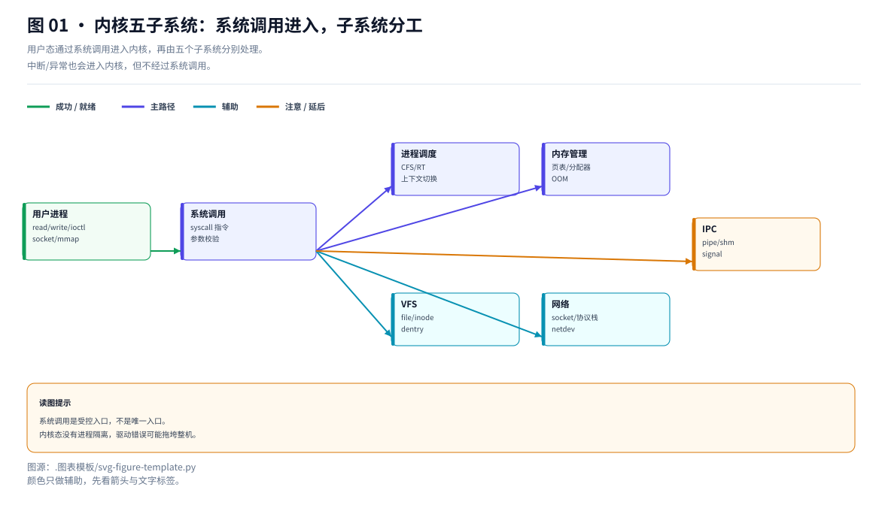

# Linux 内核概览

内核是硬件与进程之间的仲裁层：它把 CPU、内存、设备和网络抽象成统一接口，并决定谁在什么时候使用它们。

> 本篇定位：Linux 内核的全局地图。先看五个子系统、用户态/内核态和一次系统调用怎么走，再进入模块、中断、锁等专题。

## 目录

- [1 一句话模型](#s1)
- [2 速览](#s2)
- [3 五个子系统](#s3)
- [4 一次系统调用怎么走](#s4)
- [5 内核态与上下文](#s5)
- [6 设计取舍与边界](#s6)
- [7 与相邻主题的关系](#s7)
- [名词解释](#名词解释)
- [8 参考与关联](#s8)

## 1 · 一句话模型：内核是资源仲裁者

```text
应用进程
  │ 系统调用 / 异常 / 中断
  ▼
内核：调度 CPU、分配内存、访问设备、收发网络、提供 IPC
  │
  ▼
硬件
```

三个关键认知：

1. **内核不是“一个大函数”**，而是五个子系统加中断/时钟/模块机制的组合。
2. **用户态不能直接碰硬件**，必须通过系统调用、设备文件或 mmap 等受控入口。
3. **内核代码没有“进程隔离”保护**：一个空指针、一次睡在中断里，都可能拖垮整机。

## 2 · 速览

| 项 | 内容 |
| --- | --- |
| 形态 | 宏内核（Monolithic），支持动态模块 |
| 五个子系统 | 进程调度、内存管理、VFS、网络、IPC |
| 用户入口 | 系统调用、/dev、/sys、/proc、netlink |
| 执行上下文 | 进程上下文、中断上下文、软中断上下文 |
| 关键机制 | 中断/异常、时钟、同步、模块、命名空间 |
| 典型源码 | `kernel/`、`mm/`、`fs/`、`net/`、`ipc/`、`drivers/` |
| 主要参考 | Linux 内核文档、《Linux 内核设计与实现》 |

## 3 · 五个子系统



**读图**：用户态通过系统调用进入内核，再由调度、内存、VFS、网络、IPC 五个子系统分工。

> 图源：`images/图01-内核子系统.svg`


| 子系统 | 解决什么 | 典型入口 | 常见排障 |
| --- | --- | --- | --- |
| 进程调度 | 谁先用 CPU、用多久 | `sched_*`、`nice`、cgroup | `ps`、`top`、`/proc/<pid>/sched` |
| 内存管理 | 虚拟地址、物理页、分配与回收 | `mmap`、`brk`、`kmalloc` | `free`、`/proc/meminfo`、OOM 日志 |
| VFS | 统一文件、目录、设备接口 | `open/read/write` | `mount`、`/proc/mounts`、`dmesg` |
| 网络 | socket、协议栈、设备收发包 | `socket`、`send/recv` | `ss`、`ip`、`tcpdump` |
| IPC | 进程间通信 | pipe、消息队列、共享内存、信号 | `ipcs`、`/proc/<pid>/fd` |

外加三个横切机制：

- **中断/异常**：设备事件和 CPU 异常进入内核的入口。
- **时钟/定时器**：延时、超时、调度时间片。
- **模块**：在不重启的情况下加载/卸载内核代码。

## 4 · 一次系统调用怎么走

以 `read()` 为例：

```text
应用调用 read(fd, buf, n)
  └─ libc 把参数放进寄存器，执行 syscall 指令
       └─ CPU 切到内核态，进入 sys_read
            └─ 通过 fd 找到 struct file / file_operations
                 └─ 调用驱动的 read 或 VFS 的通用实现
                      └─ 可能需要等待数据：睡眠、被中断唤醒
                           └─ 拷贝数据到用户缓冲区
                                └─ 返回用户态，恢复现场
```

关键点：

- **系统调用是唯一的“正规入口”**，但不是唯一入口：中断、异常、信号也会进入内核。
- **参数要校验**：用户指针必须用 `copy_from_user` / `copy_to_user`，不能直接解引用。
- **可能睡眠**：文件 IO、内存分配、锁等待都可能让当前进程让出 CPU。

## 5 · 内核态与上下文

| 上下文 | 怎么进入 | 能否睡眠 | 常见限制 |
| --- | --- | --- | --- |
| 进程上下文 | 系统调用、缺页、软中断之外的普通内核代码 | 可以 | 不能长时间占 CPU |
| 硬中断上下文 | 设备中断 | 不可以 | 不能拿 mutex、不能拷贝用户内存 |
| 软中断上下文 | `softirq`、tasklet | 不可以 | 不能睡眠，临界区要短 |
| NMI 上下文 | 不可屏蔽中断 | 不可以 | 连自旋锁都可能不能用 |

“能不能睡眠”是内核开发的第一道分界线：中断上下文只能用自旋锁、原子操作、`GFP_ATOMIC` 分配；进程上下文才可以用 mutex、信号量、`GFP_KERNEL`。

## 6 · 设计取舍与边界

### 6.1 宏内核 vs 微内核

Linux 选择宏内核：文件系统、网络、驱动都在内核地址空间，调用快、共享数据结构方便；代价是一个驱动崩溃可能拖垮整机。微内核把服务放到用户态，隔离好但通信开销大。

### 6.2 模块化

模块让内核可以按需加载驱动和文件系统，减少镜像体积；代价是版本依赖（vermagic）、符号解析和初始化顺序问题。

### 6.3 稳定 ABI 的取舍

内核内部 API 不稳定，驱动要随内核版本适配；用户态 ABI（系统调用、sysfs/procfs 接口）尽量稳定。这是“内核可以演进，用户程序不能天天改”的平衡。

### 6.4 内核不是万能

内核负责资源仲裁和抽象，不负责业务语义。协议细节、设备策略、产品行为通常在上层或驱动中实现；排障时要先判断问题在内核、驱动还是应用。

## 7 · 与相邻主题的关系

| 相邻主题 | 关系 |
| --- | --- |
| 模块与参数 | 驱动/功能如何动态进出内核 |
| 中断与底半部 | 设备事件如何进入内核、如何延后处理 |
| 同步与锁 | 多核、中断、进程之间如何保护共享数据 |
| 驱动与设备树 | 内核如何发现硬件并绑定驱动 |
| 内存与性能 | 虚拟内存、分配器、页缓存 |
| 网络子系统 | socket、协议栈、NAPI、netfilter |
| 启动与根文件系统 | 内核如何被引导、如何找到 init |

一句话：**内核负责“谁能用、什么时候用、怎么安全地用”，不负责“业务要做什么”。**

## 名词解释

> 缩写给出英文全称；非缩写用“—”表示。

| 术语 | 英文全称 | 解释 |
| --- | --- | --- |
| 内核态 | — | CPU 执行内核代码的特权模式。 |
| 用户态 | — | CPU 执行应用代码的非特权模式。 |
| 系统调用 | — | 用户态进入内核的受控入口。 |
| 宏内核 | Monolithic Kernel | 文件系统、网络、驱动都在内核地址空间。 |
| 微内核 | Microkernel | 只保留最小服务，其余放到用户态。 |
| VFS | Virtual File System | 统一文件、目录与设备接口。 |
| IPC | Inter-Process Communication | 进程间通信机制。 |
| 调度器 | — | 决定哪个任务先使用 CPU。 |
| 中断 | — | 设备或 CPU 事件打断当前执行。 |
| 模块 | — | 可运行时加载/卸载的内核代码。 |

## 8 · 参考与关联

**参考**

- Linux 内核文档：`Documentation/`
- 《Linux 内核设计与实现》
- 《深入理解 Linux 内核》
- 《Linux 设备驱动程序》

**关联**

- [01-模块与参数.md](./01-模块与参数.md)
- [02-中断与底半部.md](./02-中断与底半部.md)
- [03-同步与锁.md](./03-同步与锁.md)
- [02-驱动与设备树](../02-驱动与设备树/.readme.md)
- [06-网络子系统](../06-网络子系统/.readme.md)

---

> **本篇定位**：Linux 内核的全局地图，建立“五子系统 + 系统调用 + 上下文”的认知。
> **素材来源**：`studyspace/1.知识体系/3.linux驱动/总结.md`（内核组成）、`studyspace/1.知识体系/4.linux源码/`（Linux011 对照）；通用内核知识补写。
> **待验证**：具体内核版本的结构体/接口会变化，以目标内核源码为准。
