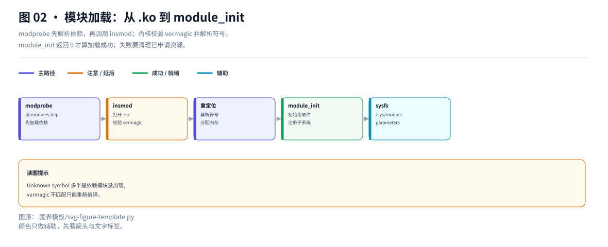

# 内核模块与参数

模块是可以在运行时加载/卸载的内核代码。编译进内核还是做成模块由 Kconfig 决定；模块参数让同一份驱动适配不同硬件。

> 本篇定位：模块的生命周期、Kconfig/Makefile 的分工、`module_param` 与 sysfs 参数、加载失败怎么查。

## 目录

- [1 一句话模型](#s1)
- [2 速览](#s2)
- [3 模块的结构](#s3)
- [4 加载与卸载流程](#s4)
- [5 参数与 sysfs](#s5)
- [6 设计取舍与边界](#s6)
- [7 与相邻主题的关系](#s7)
- [名词解释](#名词解释)
- [8 参考与关联](#s8)

## 1 · 一句话模型：可插拔的内核代码

```text
Kconfig：编不编、编成 built-in 还是 module
Makefile：obj-y / obj-m 决定怎么编
模块：module_init / module_exit + 元信息 + 参数
```

三个关键认知：

1. **`obj-y` 编进内核，`obj-m` 编成 `.ko`**；同一份代码两种形态。
2. **模块只能调用内核导出的符号**，不能直接链接用户态库。
3. **模块参数是“启动时/加载时配置”**，运行期可读；要动态改，通常再加 sysfs 属性。

## 2 · 速览

| 项 | 内容 |
| --- | --- |
| 产物 | `.ko`（kernel object） |
| 加载 | `insmod` / `modprobe` |
| 卸载 | `rmmod` / `modprobe -r` |
| 依赖 | `depmod` 生成 `modules.dep` |
| 元信息 | `MODULE_LICENSE`、`MODULE_AUTHOR`、`MODULE_DESCRIPTION` |
| 版本校验 | vermagic（内核版本、配置、编译器） |
| 参数 | `module_param` / `module_param_array` |
| 运行期视图 | `/sys/module/<name>/parameters/` |
| 配置 | Kconfig + `.config` |
| 构建 | `make modules` / `make modules_install` |

## 3 · 模块的结构

一个最小模块：

```c
#include <linux/module.h>
#include <linux/kernel.h>

static int count = 1;
module_param(count, int, 0644);
MODULE_PARM_DESC(count, "example count");

static int __init demo_init(void)
{
    pr_info("demo: count=%d\n", count);
    return 0;
}

static void __exit demo_exit(void)
{
    pr_info("demo: exit\n");
}

module_init(demo_init);
module_exit(demo_exit);

MODULE_LICENSE("GPL");
MODULE_AUTHOR("example");
MODULE_DESCRIPTION("demo module");
```

四类内容：

| 内容 | 作用 |
| --- | --- |
| 初始化/退出 | `module_init` / `module_exit` |
| 元信息 | 许可证、作者、描述、别名 |
| 参数 | 加载时配置，sysfs 可见 |
| 依赖 | 通过符号引用其他模块/内核 |

`MODULE_LICENSE("GPL")` 不只是形式：非 GPL 模块拿不到部分 GPL-only 符号，内核会标记污染（taint）。

## 4 · 加载与卸载流程



**读图**：modprobe 先解析依赖，内核校验 vermagic 并解析符号，最后调用 module_init。

> 图源：`images/图02-模块加载流程.svg`


```text
modprobe demo
  ├─ 读 modules.dep，先加载依赖
  ├─ 打开 .ko，校验 vermagic
  ├─ 分配内存，重定位，解析未定义符号
  ├─ 调用 module_init
  └─ 在 /sys/module/demo 下暴露参数与节信息
```

失败常见原因：

| 现象 | 原因 |
| --- | --- |
| `Invalid module format` | vermagic 不匹配（内核版本/配置/编译器） |
| `Unknown symbol` | 依赖模块没加载，或符号未导出 |
| `Operation not permitted` | 安全启动/签名/权限限制 |
| init 返回非 0 | 驱动初始化失败，看 `dmesg` |
| 卸载失败 | 模块引用计数不为 0，或有资源未释放 |

`rmmod` 只会在引用计数为 0 时成功；驱动要在 `module_exit` 里注销设备、释放中断、销毁 class/设备节点。

## 5 · 参数与 sysfs

### 5.1 参数类型

| 类型 | 写法 |
| --- | --- |
| 整型 | `module_param(n, int, 0644)` |
| 布尔 | `module_param(enable, bool, 0644)` |
| 字符串 | `module_param(name, charp, 0644)` |
| 数组 | `module_param_array(arr, int, &num, 0644)` |

权限位决定 sysfs 文件权限：`0444` 只读，`0644` 读写（运行期写入是否生效取决于代码）。

### 5.2 参数与 sysfs 的关系

- 加载时：`insmod demo.ko count=3` 或 `modprobe demo count=3`。
- 运行期：`/sys/module/demo/parameters/count` 可读；是否可写由权限和实现决定。
- 更复杂的动态配置通常单独建 sysfs 属性/class，而不是只靠 module_param。

### 5.3 Kconfig 与 Makefile

```text
Kconfig:  config DEMO
            tristate "Demo driver"
            depends on OF
            help ...
Makefile: obj-$(CONFIG_DEMO) += demo.o
```

`tristate` 的三态：`n` 不编、`m` 编模块、`y` 编进内核。`depends on` 决定可见性，`select` 强制带出依赖（慎用）。

## 6 · 设计取舍与边界

### 6.1 built-in vs module

built-in 启动早、无加载失败风险，但增大镜像、不能卸载；module 灵活、便于开发，但依赖根文件系统/initramfs 能拿到 `.ko`，还要处理版本与签名。

### 6.2 参数 vs sysfs vs 设备树

- **module_param**：加载时配置，适合全局开关/调试级别。
- **sysfs 属性**：运行期动态配置，适合设备实例。
- **设备树**：硬件描述，适合板级差异。

同一配置不要三处都放，否则会出现“到底哪个生效”的问题。

### 6.3 版本兼容

内核内部 API 不稳定，模块要针对目标内核编译；`vermagic` 是硬门槛。跨版本移植要重新编译，不能直接拷 `.ko`。

### 6.4 安全边界

模块运行在内核态，权限等于 root 之上；签名、安全启动、模块黑名单都是必要防线。生产设备应限制可加载模块，避免任意内核代码执行。

## 7 · 与相邻主题的关系

| 相邻主题 | 关系 |
| --- | --- |
| 驱动与设备树 | 驱动通常以模块或 built-in 形式存在 |
| 启动与根文件系统 | 模块放在 rootfs/initramfs，启动时由 init/udev 加载 |
| 中断与锁 | 模块 init/exit 要考虑并发与资源释放 |
| 调试与追踪 | `dmesg`、`lsmod`、`/sys/module` 是模块排障入口 |

一句话：**Kconfig 决定“编不编”，模块机制决定“什么时候进内核”，参数决定“这一份代码怎么适配”。**

## 名词解释

> 缩写给出英文全称；非缩写用“—”表示。

| 术语 | 英文全称 | 解释 |
| --- | --- | --- |
| .ko | Kernel Object | 可加载内核模块的产物。 |
| Kconfig | Kernel Configuration | 内核配置系统。 |
| Makefile | — | 构建规则，obj-y/obj-m 决定编入方式。 |
| insmod | Insert Module | 直接插入一个 .ko。 |
| modprobe | Module Probe | 按依赖关系加载模块。 |
| depmod | Dependency Modules | 生成 modules.dep 依赖表。 |
| vermagic | Version Magic | 内核版本/配置/编译器指纹。 |
| module_param | Module Parameter | 模块加载参数宏。 |
| sysfs | System File System | 内核对象导出的虚拟文件系统。 |
| udev | Userspace Device Manager | 用户态设备管理器。 |

## 8 · 参考与关联

**参考**

- Linux 内核文档：`Documentation/kbuild/`、`Documentation/admin-guide/modules.rst`
- `include/linux/module.h`、`include/linux/moduleparam.h`
- 《Linux 设备驱动程序》模块章节

**关联**

- [00-内核概览.md](./00-内核概览.md)
- [02-中断与底半部.md](./02-中断与底半部.md)
- [03-同步与锁.md](./03-同步与锁.md)
- [02-驱动与设备树](../02-驱动与设备树/.readme.md)

---

> **本篇定位**：模块的构建、加载、参数与排障，建立“Kconfig → .ko → module_init”的完整链路。
> **素材来源**：`studyspace/1.知识体系/3.linux驱动/总结.md`；通用内核模块知识补写。
> **待验证**：签名/安全启动策略、vermagic 细节随内核版本与发行版而变。
