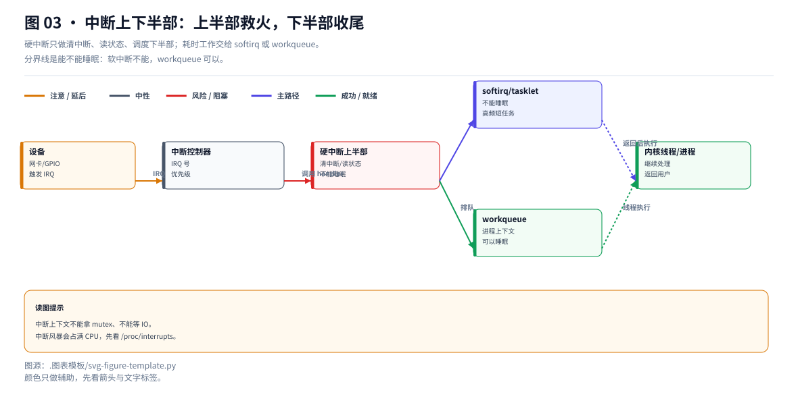

# 中断与底半部

中断让设备在“有事”时主动通知 CPU。上半部只做最紧急的事，耗时工作交给下半部；分界线是“能不能睡眠”。

> 本篇定位：硬中断、软中断、tasklet、workqueue、线程化中断的差别，以及中断上下文能做什么、不能做什么。

## 目录

- [1 一句话模型](#s1)
- [2 速览](#s2)
- [3 中断处理流程](#s3)
- [4 下半部的四种选择](#s4)
- [5 上下文规则与锁](#s5)
- [6 设计取舍与边界](#s6)
- [7 与相邻主题的关系](#s7)
- [名词解释](#名词解释)
- [8 参考与关联](#s8)

## 1 · 一句话模型：上半部救火，下半部收尾

```text
设备触发中断
  └─ CPU 进入硬中断：清中断、读状态、保存关键数据（快进快出）
       └─ 标记软中断 / 调度 tasklet / 排队 work
            └─ 中断返回后：软中断或 workqueue 做耗时处理
```

三个关键认知：

1. **硬中断上下文不能睡眠**：不能拿 mutex、不能等 IO、不能用 `GFP_KERNEL`。
2. **下半部不是“另一个中断”**：软中断仍在中断上下文；workqueue 才在进程上下文。
3. **上半部越短越好**：中断被关得越久，系统时延和丢包越严重。

## 2 · 速览

| 机制 | 上下文 | 能否睡眠 | 典型用途 |
| --- | --- | --- | --- |
| 硬中断 handler | 中断上下文 | 否 | 清中断、读状态、唤醒下半部 |
| softirq | 软中断上下文 | 否 | 网络收包、定时器、RCU |
| tasklet | 软中断上下文 | 否 | 轻量延后处理，同一 tasklet 串行 |
| workqueue | 进程上下文 | 是 | 耗时、可能睡眠的工作 |
| threaded IRQ | 内核线程 | 是 | 大部分工作放到线程，硬中断只唤醒 |
| timer_list | 软中断上下文 | 否 | 延时执行，不能睡眠 |

## 3 · 中断处理流程



**读图**：硬中断只做清中断/读状态/调度下半部；softirq 不能睡眠，workqueue 可以。

> 图源：`images/图03-中断上下半部.svg`


```text
设备 → 中断控制器 → CPU
  ├─ 保存现场，关闭本 CPU 中断（或同优先级）
  ├─ 查中断号，调用 request_irq 注册的 handler
  ├─ handler：确认设备、清中断、读数据、调度下半部
  ├─ 恢复现场
  └─ 在合适时机执行 softirq / workqueue
```

关键 API：

| API | 作用 |
| --- | --- |
| `request_irq` / `devm_request_irq` | 注册中断处理函数 |
| `free_irq` | 注销 |
| `IRQF_SHARED` | 共享中断线 |
| `IRQF_ONESHOT` | 线程化中断，硬中断只唤醒线程 |
| `disable_irq` / `local_irq_save` | 关中断（慎用） |

共享中断的 handler 必须能判断“这次中断是不是我的设备”，不是就快速返回 `IRQ_NONE`。

## 4 · 下半部的四种选择

### 4.1 softirq

- 编译期静态注册，数量有限（网络、定时器、RCU 等）。
- 同一 softirq 可在多个 CPU 并行执行，函数必须可重入。
- 不能睡眠，执行时间要短。

### 4.2 tasklet

- 基于 softirq，动态注册。
- 同一 tasklet 不会并行执行（天然串行）。
- 适合轻量、无睡眠的延后处理。

### 4.3 workqueue

- 运行在进程上下文，可以睡眠、可以拿 mutex。
- 适合耗时任务、需要 IO 的任务。
- 系统有共享工作队列，驱动也可以建自己的队列。

### 4.4 threaded IRQ

- 硬中断只做最少的事，然后唤醒内核线程。
- 大部分处理在线程里完成，可以睡眠。
- 适合中断频繁、处理复杂的设备。

## 5 · 上下文规则与锁

| 操作 | 硬中断/软中断 | 进程上下文 |
| --- | --- | --- |
| `mutex_lock` | 禁止 | 允许 |
| `down` 信号量 | 禁止 | 允许 |
| `spin_lock` | 允许（关中断变体） | 允许 |
| `kmalloc(GFP_KERNEL)` | 禁止 | 允许 |
| `kmalloc(GFP_ATOMIC)` | 允许 | 允许但尽量避免 |
| `copy_to_user` | 禁止 | 允许（需校验） |
| `msleep` | 禁止 | 允许 |

中断上下文保护共享数据要用 `spin_lock_irqsave` / `spin_lock_bh`，而不是普通 `spin_lock`，否则可能被本 CPU 中断打断而死锁。

## 6 · 设计取舍与边界

### 6.1 时延 vs 吞吐

硬中断里做的事越多，关中断时间越长，其他中断和调度被延迟。把耗时工作推到下半部，能降低时延，但增加一次调度/排队开销。

### 6.2 softirq vs workqueue

softirq 快、不能睡眠；workqueue 灵活、可以睡眠但开销大。网络收包这类“高频、短、不能睡眠”的路径用 NAPI/softirq；驱动初始化、固件加载这类“慢、可能睡眠”的路径用 workqueue。

### 6.3 线程化中断

线程化中断把大部分处理移出硬中断，改善时延和实时性；代价是上下文切换和线程优先级设计。实时系统常配合 `IRQF_ONESHOT` 和线程优先级。

### 6.4 中断不是无限的

中断风暴会占满 CPU，导致用户态饿死。要有速率限制、合并中断（NAPI）、屏蔽异常源，并在 `/proc/interrupts` 里观察增长。

## 7 · 与相邻主题的关系

| 相邻主题 | 关系 |
| --- | --- |
| 同步与锁 | 中断上下文只能用自旋锁/原子操作 |
| 进程与调度 | 下半部最终由软中断或内核线程执行 |
| 驱动与设备树 | 驱动在 probe 里申请中断、在 remove 里释放 |
| 网络子系统 | NAPI 用软中断收包，是中断+轮询的混合 |
| 调试与追踪 | `/proc/interrupts`、ftrace irq 事件、perf 定位中断风暴 |

一句话：**中断负责“立刻知道”，下半部负责“慢慢处理”；分界线是能不能睡眠。**

## 名词解释

> 缩写给出英文全称；非缩写用“—”表示。

| 术语 | 英文全称 | 解释 |
| --- | --- | --- |
| IRQ | Interrupt Request | 中断请求。 |
| NMI | Non-Maskable Interrupt | 不可屏蔽中断。 |
| 上半部 | Top Half | 硬中断中紧急、快速的处理。 |
| 下半部 | Bottom Half | 延后执行的耗时处理。 |
| softirq | Software Interrupt | 软中断，运行在中断上下文。 |
| tasklet | — | 基于软中断的轻量延后机制。 |
| workqueue | Work Queue | 进程上下文的工作队列。 |
| threaded IRQ | Threaded Interrupt | 把大部分处理放到内核线程的中断。 |
| 中断上下文 | Interrupt Context | 不能睡眠的执行环境。 |
| timer_list | Timer List | 内核定时器结构。 |

## 8 · 参考与关联

**参考**

- Linux 内核文档：`Documentation/core-api/genericirq.rst`、`Documentation/core-api/workqueue.rst`
- `include/linux/interrupt.h`、`kernel/irq/`、`kernel/softirq.c`
- 《Linux 设备驱动程序》中断章节

**关联**

- [00-内核概览.md](./00-内核概览.md)
- [01-模块与参数.md](./01-模块与参数.md)
- [03-同步与锁.md](./03-同步与锁.md)
- [06-网络子系统](../06-网络子系统/.readme.md)：NAPI 与软中断
- [07-调试与追踪](../07-调试与追踪/.readme.md)

---

> **本篇定位**：中断上下半部的分工与选择，建立“硬中断快进快出、下半部按能否睡眠选型”的模型。
> **素材来源**：`studyspace/1.知识体系/3.linux驱动/总结.md`（中断/底半部/定时器）；通用内核知识补写。
> **待验证**：不同内核版本的 workqueue/threaded IRQ 接口与默认参数可能变化。
