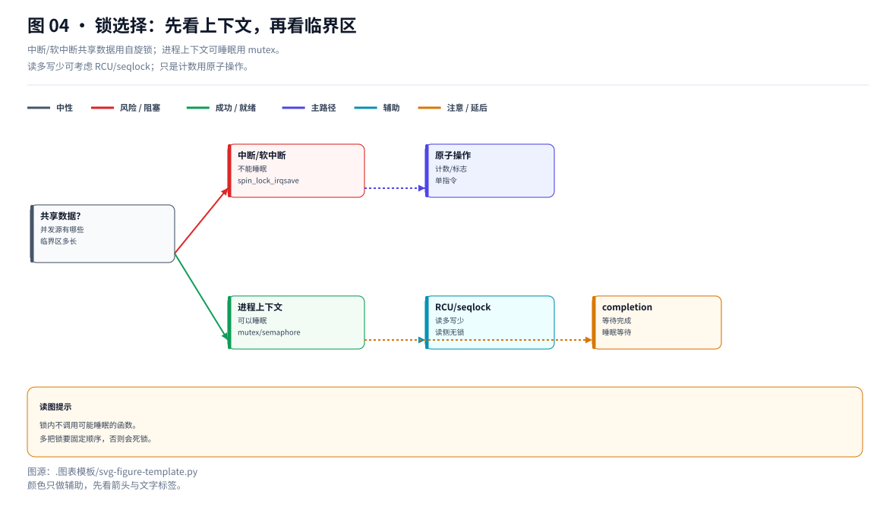

# 同步与锁

竞态来自并发：多核、中断、软中断、抢占都可能同时碰到同一份数据。选锁先看“在什么上下文、能不能睡眠、临界区多长”。

> 本篇定位：内核常用同步原语的适用场景与选择顺序，以及死锁、锁粒度、RCU 的边界。

## 目录

- [1 一句话模型](#s1)
- [2 速览](#s2)
- [3 并发源与临界区](#s3)
- [4 常用同步原语](#s4)
- [5 选择顺序与死锁](#s5)
- [6 设计取舍与边界](#s6)
- [7 与相邻主题的关系](#s7)
- [名词解释](#名词解释)
- [8 参考与关联](#s8)

## 1 · 一句话模型：先看上下文，再看临界区

```text
有共享数据？
  ├─ 否 → 不需要锁
  └─ 是 → 有哪些并发源？
       ├─ 中断/软中断 → spinlock（关中断/关下半部）
       ├─ 多核进程，可睡眠 → mutex / 信号量
       ├─ 只读多、写少 → RCU / seqlock
       └─ 只是计数/标志 → 原子操作
```

三个关键认知：

1. **锁不是越多越好**：锁粒度大，性能差；锁粒度小，容易漏保护。
2. **中断上下文不能睡眠**，所以不能用 mutex/信号量。
3. **加锁顺序要固定**，否则多把锁会死锁。

## 2 · 速览

| 原语 | 能否睡眠 | 适用上下文 | 典型场景 |
| --- | --- | --- | --- |
| 原子操作 | 否 | 任意 | 计数器、标志位 |
| 自旋锁 spinlock | 否 | 进程/中断/软中断 | 短临界区、中断共享数据 |
| 互斥锁 mutex | 是 | 进程上下文 | 较长临界区、可能睡眠 |
| 信号量 semaphore | 是 | 进程上下文 | 资源计数（>1） |
| completion | 是 | 进程上下文 | 等待某件事完成 |
| RCU | 否（读侧） | 任意（读侧） | 读多写少、链表 |
| seqlock | 否 | 读侧不睡眠 | 读多写少、允许重试 |

## 3 · 并发源与临界区

| 并发源 | 例子 | 保护要点 |
| --- | --- | --- |
| 多核 CPU | 两个进程同时 ioctl | 自旋锁/互斥锁 |
| 中断 | 中断 handler 与进程共享缓冲区 | 关中断的自旋锁 |
| 软中断/tasklet | 网络收包与进程 | `spin_lock_bh` |
| 内核抢占 | 进程在临界区被抢占 | 自旋锁已隐含禁用抢占 |
| 信号/异步 | 信号处理与主流程 | 用户态用原子/锁，内核用自旋锁/completion |

临界区要尽量短：锁内不做拷贝、不调用可能睡眠的函数、不访问用户内存。

## 4 · 常用同步原语

### 4.1 原子操作

```c
atomic_t count = ATOMIC_INIT(0);
atomic_inc(&count);
int v = atomic_read(&count);
```

适合计数、引用计数、简单标志；不能保护复合操作（“读-改-写”要原子指令或锁）。

### 4.2 自旋锁

| 变体 | 作用 |
| --- | --- |
| `spin_lock` | 基本自旋，不禁中断 |
| `spin_lock_bh` | 关下半部（软中断） |
| `spin_lock_irq` | 关本 CPU 中断 |
| `spin_lock_irqsave` | 保存中断状态再关，最常用 |
| `spin_unlock_irqrestore` | 恢复中断状态 |

临界区不能睡眠；持有自旋锁时不能调用可能睡眠的函数。

### 4.3 mutex

```c
mutex_lock(&lock);
/* 可能睡眠的操作 */
mutex_unlock(&lock);
```

同一时刻只有一个持有者，持有者负责解锁；不能在中断上下文使用。适合较长的临界区、需要 IO 的场景。

### 4.4 信号量

`count` 表示可用资源数；`down()` 获取、`up()` 释放。count=1 时等价于二值信号量。适合进程上下文、资源池。

### 4.5 completion

一个执行单元等待另一个执行单元完成某件事：

```c
wait_for_completion(&done);
complete(&done);
```

典型用于驱动卸载等待打开的文件关闭、异步 IO 完成通知。

### 4.6 RCU 与 seqlock

- **RCU**：读侧无锁，写侧复制后替换，旧数据等宽限期后释放；适合读多写少的链表/路由表。
- **seqlock**：写侧加锁并递增序号，读侧读序号-读数据-再读序号，不一致就重试；适合读多写少、读侧可重试。

## 5 · 选择顺序与死锁



**读图**：按固定顺序决策——能否睡眠（能 → mutex）→ 是否中断上下文（是 → spinlock）→ 读多写少（是 → RCU/rwlock）。顺序反了会选出「能编译但会睡在原子上下文」的锁。

> 图源：`images/图04-锁选择.svg`


### 5.1 选择顺序

```text
① 能不能用原子操作/无锁？
② 读多写少？→ RCU/seqlock
③ 中断上下文？→ spinlock（irqsave/bh）
④ 进程上下文且可能睡眠？→ mutex
⑤ 需要资源计数？→ semaphore
⑥ 等待完成事件？→ completion
```

### 5.2 死锁的四个条件

互斥、持有并等待、不可抢占、循环等待。内核里最常见的是**加锁顺序不一致**和**中断上下文重复加锁**。

预防：

- 固定锁顺序，文档化。
- 锁内不调用外部回调（可能反向加锁）。
- 中断共享数据用 `irqsave`，避免本 CPU 中断重入。
- 用 lockdep 检查锁依赖。

## 6 · 设计取舍与边界

### 6.1 锁粒度

粗粒度锁简单、不易漏，但并发差；细粒度锁并发好，但容易出现锁顺序、漏锁、ABA。先从粗粒度开始，用性能数据驱动细化。

### 6.2 自旋 vs 睡眠

自旋浪费 CPU 但时延低，适合极短临界区；mutex 让出 CPU，适合可能等待的临界区。临界区里只要可能睡眠，就必须用 mutex/信号量。

### 6.3 RCU 的代价

RCU 读侧几乎零开销，但写侧要复制、替换、等待宽限期，内存和实现复杂度高；不是所有数据结构都适合。

### 6.4 无锁不等于正确

原子操作只保证单个操作原子，不保证复合逻辑；无锁队列需要内存屏障和 ABA 处理。没有把握时，锁更可靠。

## 7 · 与相邻主题的关系

| 相邻主题 | 关系 |
| --- | --- |
| 中断与底半部 | 决定能否睡眠，进而决定锁的类型 |
| 进程与调度 | mutex 等待会触发调度 |
| 驱动与设备树 | probe/remove、ioctl、中断共享数据都要保护 |
| 内存与性能 | 锁竞争会放大 CPU 和时延 |
| 调试与追踪 | lockdep、ftrace、perf 可定位死锁与竞争 |

一句话：**锁的选择不是“哪个高级用哪个”，而是“当前上下文能不能睡眠、临界区有多长”。**

## 名词解释

> 缩写给出英文全称；非缩写用“—”表示。

| 术语 | 英文全称 | 解释 |
| --- | --- | --- |
| 竞态 | Race Condition | 并发访问共享数据导致结果不确定。 |
| 临界区 | Critical Section | 访问共享数据、需要保护的代码段。 |
| spinlock | Spin Lock | 忙等待的自旋锁。 |
| mutex | Mutual Exclusion | 可睡眠的互斥锁。 |
| semaphore | Semaphore | 带计数的同步原语。 |
| atomic | Atomic Operation | 不可分割的指令级操作。 |
| completion | Completion | 等待某件事完成的机制。 |
| RCU | Read-Copy-Update | 读侧无锁、写侧延迟释放。 |
| seqlock | Sequence Lock | 读写序号校验的锁。 |
| 死锁 | Deadlock | 互相等待资源，永远无法推进。 |

## 8 · 参考与关联

**参考**

- Linux 内核文档：`Documentation/locking/`
- `include/linux/spinlock.h`、`include/linux/mutex.h`、`include/linux/rcupdate.h`
- 《Linux 内核设计与实现》同步章节

**关联**

- [00-内核概览.md](./00-内核概览.md)
- [02-中断与底半部.md](./02-中断与底半部.md)
- [04-进程与并发](../04-进程与并发/.readme.md)
- [07-调试与追踪](../07-调试与追踪/.readme.md)：lockdep

---

> **本篇定位**：内核同步原语的选择与死锁预防，建立“上下文 → 能否睡眠 → 锁类型”的判断链。
> **素材来源**：`studyspace/1.知识体系/3.linux驱动/总结.md`（并发/自旋锁/mutex/信号量/原子/completion）；通用内核知识补写。
> **待验证**：RT 内核的 spinlock 可能转为 sleeping lock，行为与主线不同。
