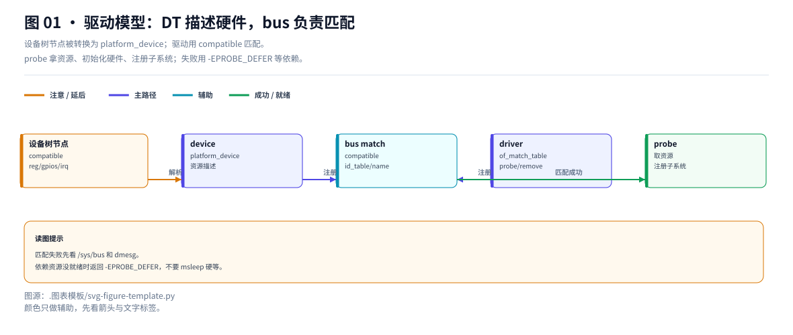

# 驱动模型与设备树

Linux 驱动模型把“硬件”和“驱动”分开：设备树描述硬件，总线负责匹配，驱动在 probe 里拿资源、注册子系统。

> 本篇定位：bus/device/driver 三件套、platform 驱动、设备树语法与匹配、probe/remove 的资源管理。GPIO/LED 作为下一层实例。

## 目录

- [1 一句话模型](#s1)
- [2 速览](#s2)
- [3 三件套与匹配](#s3)
- [4 设备树](#s4)
- [5 probe 与资源管理](#s5)
- [6 设计取舍与边界](#s6)
- [7 与相邻主题的关系](#s7)
- [名词解释](#名词解释)
- [8 参考与关联](#s8)

## 1 · 一句话模型：设备树说“有什么”，驱动说“怎么用”

```text
设备树节点（compatible/reg/interrupts/gpios）
  └─ 内核创建 platform_device
       └─ platform_driver 注册，of_match_table 匹配 compatible
            └─ probe：拿资源、初始化硬件、注册子系统
                 └─ /sys、/dev、class、subsystem 暴露给用户
```

三个关键认知：

1. **设备树是数据，不是代码**：它描述硬件连接，不描述驱动逻辑。
2. **匹配靠 compatible**，不是靠节点名；节点名只是给人看的。
3. **probe 可能失败、可能延迟**：依赖的资源（时钟、 regulator、GPIO）没准备好时要能返回 `-EPROBE_DEFER`。

## 2 · 速览

| 项 | 内容 |
| --- | --- |
| 核心对象 | bus、device、driver |
| 常见总线 | platform、I2C、SPI、PCI、USB |
| 设备树源文件 | `.dts`、`.dtsi` |
| 编译工具 | `dtc` |
| 二进制 | `.dtb` |
| 匹配字段 | `compatible` |
| 资源 | `reg`、`interrupts`、`clocks`、`gpios`、`pinctrl-*` |
| 驱动入口 | `probe` / `remove` |
| 资源管理 | `devm_*` 自动释放 |
| 用户接口 | `/dev`、`/sys/class`、`/sys/bus` |

## 3 · 三件套与匹配



**读图**：DT 节点变成 device，bus 用 compatible 匹配 driver，probe 拿资源并注册子系统。

> 图源：`images/图01-驱动模型与设备树.svg`


| 对象 | 代表什么 | 谁创建 |
| --- | --- | --- |
| bus | 匹配规则与设备/驱动链表 | 内核子系统 |
| device | 一个具体硬件实例 | 设备树、ACPI、板级代码、枚举 |
| driver | 一套操作函数 | 驱动模块 |

匹配过程：

```text
driver_register()
  └─ 遍历 bus 上的 device
       └─ bus->match(device, driver)
            ├─ compatible 匹配（DT）
            ├─ id_table 匹配（I2C/SPI）
            └─ name 匹配（platform）
                 └─ probe(device)
```

platform 驱动最小骨架：

```c
static const struct of_device_id demo_of_match[] = {
    { .compatible = "vendor,demo" },
    { }
};
MODULE_DEVICE_TABLE(of, demo_of_match);

static int demo_probe(struct platform_device *pdev)
{
    struct device *dev = &pdev->dev;
    void __iomem *base;

    base = devm_platform_ioremap_resource(pdev, 0);
    if (IS_ERR(base))
        return PTR_ERR(base);

    return 0;
}

static struct platform_driver demo_driver = {
    .probe = demo_probe,
    .driver = {
        .name = "demo",
        .of_match_table = demo_of_match,
    },
};
module_platform_driver(demo_driver);
```

## 4 · 设备树

### 4.1 三种文件

| 文件 | 作用 |
| --- | --- |
| `.dts` | 板级设备树源文件 |
| `.dtsi` | 可被 include 的公共片段，类似头文件 |
| `.dtb` | `dtc` 编译后的二进制，由 bootloader 传给内核 |

### 4.2 常见属性

| 属性 | 作用 |
| --- | --- |
| `compatible` | 驱动匹配字符串，格式 `vendor,device` |
| `reg` | 寄存器地址与长度 |
| `interrupts` | 中断号与触发类型 |
| `clocks` / `clock-names` | 时钟 |
| `gpios` | GPIO 描述符 |
| `pinctrl-0` / `pinctrl-names` | 引脚复用配置 |
| `status` | `okay` / `disabled` |

示例：

```dts
demo@10000000 {
    compatible = "vendor,demo";
    reg = <0x10000000 0x1000>;
    interrupts = <GIC_SPI 42 IRQ_TYPE_LEVEL_HIGH>;
    clocks = <&clk 1>;
    gpios = <&gpio 16 GPIO_ACTIVE_HIGH>;
    status = "okay";
};
```

### 4.3 设备树不是“万能配置”

设备树适合描述“硬件怎么连”，不适合放业务策略、大量参数或运行时状态。策略应放用户态/驱动参数/sysfs。

## 5 · probe 与资源管理

probe 的典型步骤：

1. 取资源：`devm_platform_ioremap_resource`、`devm_clk_get`、`devm_gpiod_get`、`platform_get_irq`。
2. 初始化硬件：复位、时钟、寄存器。
3. 注册子系统：`register_chrdev`、`devm_led_classdev_register`、`register_netdev`。
4. 保存私有数据：`platform_set_drvdata`。
5. 失败时返回错误码；依赖未就绪用 `-EPROBE_DEFER`。

`devm_*` 资源在 device 解绑/驱动移除时自动释放，减少 remove 里的清理代码；但 manually created 的 class/device/工作队列仍要自己清理。

## 6 · 设计取舍与边界

### 6.1 设备树 vs board file

老内核用 board file 在 C 代码里写硬件；设备树把硬件描述外置，一份内核可支持多块板。代价是 DT 语法/绑定文档/调试更复杂。

### 6.2 设备与驱动分离

分离让一个驱动匹配多个设备、一个设备换多个驱动；代价是匹配失败时现象不直观，需要看 `/sys/bus/*/devices` 和 `dmesg`。

### 6.3 probe 的顺序与延迟

probe 顺序由总线/依赖决定，不能假设“我的驱动一定先跑”。依赖资源用 `-EPROBE_DEFER`，不要用 `msleep` 硬等。

### 6.4 设备树的稳定性

DT 是硬件 ABI，绑定一旦发布就要尽量兼容；改属性名/语义会破坏老驱动。新增属性要可选，驱动要能处理缺失。

## 7 · 与相邻主题的关系

| 相邻主题 | 关系 |
| --- | --- |
| 内核模块 | 驱动通常以模块或 built-in 形式加载 |
| GPIO/LED | 都是 platform 驱动 + DT 匹配的实例 |
| 启动与根文件系统 | bootloader 把 DTB 传给内核 |
| 中断与锁 | probe 里申请中断，remove 里释放 |
| 平台与芯片 | SoC 的时钟/复位/pinctrl 绑定归 30 |

一句话：**设备树负责“硬件在哪”，驱动负责“怎么操作”，总线负责“把两者配上”。**

## 名词解释

> 缩写给出英文全称；非缩写用“—”表示。

| 术语 | 英文全称 | 解释 |
| --- | --- | --- |
| bus | Bus | 设备与驱动的匹配规则。 |
| device | Device | 一个具体硬件实例。 |
| driver | Driver | 操作设备的一套函数。 |
| platform | Platform Bus | SoC 内置外设常用的虚拟总线。 |
| DT | Device Tree | 描述硬件连接的设备树。 |
| dts | Device Tree Source | 设备树源文件。 |
| dtsi | Device Tree Source Include | 可被包含的设备树片段。 |
| dtb | Device Tree Blob | dtc 编译后的二进制。 |
| dtc | Device Tree Compiler | 设备树编译器。 |
| compatible | — | 驱动匹配字符串。 |
| probe | — | 匹配成功后初始化设备的回调。 |
| devm | Device Managed | 设备托管资源，移除时自动释放。 |
| pinctrl | Pin Control | 引脚复用与电气配置子系统。 |

## 8 · 参考与关联

**参考**

- Linux 内核文档：`Documentation/devicetree/`、`Documentation/driver-api/driver-model/`
- `include/linux/platform_device.h`、`include/linux/of.h`
- 《Linux 设备驱动程序》platform/DT 章节

**关联**

- [01-GPIO驱动.md](./01-GPIO驱动.md)
- [02-LED驱动.md](./02-LED驱动.md)
- [01-内核基础/01-模块与参数.md](../01-内核基础/01-模块与参数.md)
- [03-启动与根文件系统](../03-启动与根文件系统/.readme.md)：DTB 传递
- [30-平台与芯片](../../../30-平台与芯片/00-平台对比.md)：SoC 绑定

---

> **本篇定位**：驱动模型与设备树的主线，建立“DT 描述 → bus 匹配 → probe 拿资源 → 注册子系统”的链路。
> **素材来源**：`studyspace/1.知识体系/3.linux驱动/总结.md`（设备树/驱动分层/设备与驱动分离）、`gpio/ARCHITECTURE_ANALYSIS.md`；通用内核知识补写。
> **待验证**：不同 SoC 的 DT 绑定、pinctrl 属性与时钟/复位定义差异较大。
