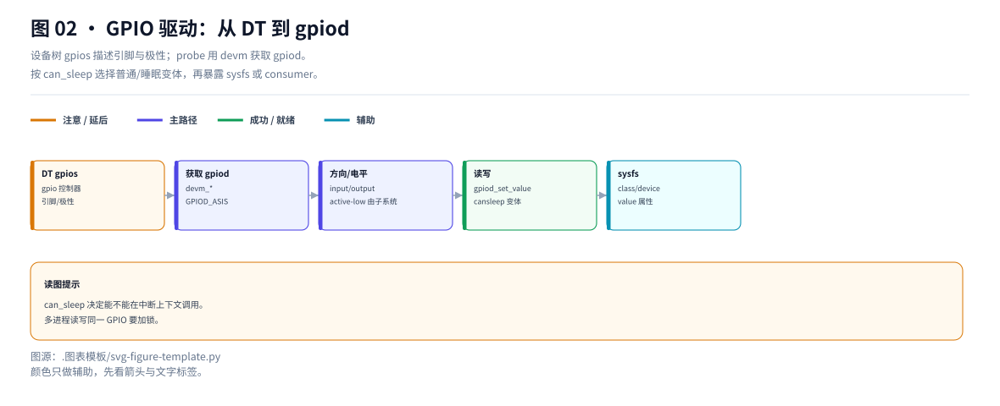

# GPIO 驱动

GPIO 驱动不该直接写寄存器：用 gpiod consumer API 申请引脚、设方向、读写电平，由 GPIO 子系统处理 pinctrl、电平极性和休眠差异。

> 本篇定位：从设备树 `gpios` 到 `gpiod`、再到 sysfs/consumer 的完整链路，以及 `can_sleep`、active-low、资源释放等边界。

## 目录

- [1 一句话模型](#s1)
- [2 速览](#s2)
- [3 从设备树到 gpiod](#s3)
- [4 读写与方向](#s4)
- [5 sysfs 与用户空间](#s5)
- [6 设计取舍与边界](#s6)
- [7 与相邻主题的关系](#s7)
- [名词解释](#名词解释)
- [8 参考与关联](#s8)

## 1 · 一句话模型：先拿描述符，再操作

```text
设备树 gpios = <&gpio 16 GPIO_ACTIVE_HIGH>
  └─ probe：devm_gpiod_get / devm_fwnode_get_gpiod
       └─ gpiod_direction_output / gpiod_set_value
            └─ 用户空间 /sys/class/gpio_customize/<name>/value
```

三个关键认知：

1. **`gpiod` 是句柄**，不是裸引脚号；它绑定设备、方向、极性和归属。
2. **active-low 由子系统处理**：驱动写 1 表示“逻辑有效”，实际电平可能相反。
3. **可能睡眠**：I2C/SPI 扩展 GPIO 读写要睡眠，必须用 `_cansleep` 变体。

## 2 · 速览

| 项 | 内容 |
| --- | --- |
| 核心对象 | gpiochip、gpio_desc、pinctrl |
| 设备树属性 | `gpios`、`gpio-controller`、`#gpio-cells` |
| 获取 API | `devm_gpiod_get`、`devm_fwnode_get_gpiod_from_child` |
| 方向 | `gpiod_direction_input/output` |
| 读写 | `gpiod_get_value` / `gpiod_set_value` |
| 休眠变体 | `_cansleep` |
| 用户接口 | `/sys/class/gpio`（旧）、`/sys/class/<your-class>`（自定义） |
| 典型驱动 | gpio-leds、gpio-keys、自定义 gpio-customize |

## 3 · 从设备树到 gpiod



**读图**：DT 的 gpios 描述引脚与极性，probe 用 devm 获取 gpiod，再设方向、读写或暴露 sysfs。

> 图源：`images/图02-GPIO驱动流程.svg`


设备树：

```dts
gpio_customize {
    compatible = "gpio-customize";

    led0 {
        label = "status";
        gpios = <&gpio 16 GPIO_ACTIVE_HIGH>;
        default-state = "off";
    };
};
```

驱动：

```c
data->gpiod = devm_fwnode_get_gpiod_from_child(dev, NULL, fwnode,
                                               GPIOD_ASIS, NULL);
if (IS_ERR(data->gpiod))
    return PTR_ERR(data->gpiod);

data->can_sleep = gpiod_cansleep(data->gpiod);
```

关键点：

- `GPIOD_ASIS` 表示先不设方向，后面按需要配置。
- `gpiod_cansleep()` 决定后续用普通 API 还是 `_cansleep` 变体。
- `devm_*` 获取的资源在设备移除时自动释放。

## 4 读写与方向

```c
/* 输出 */
gpiod_direction_output(data->gpiod, 0);
gpiod_set_value(data->gpiod, 1);

/* 输入 */
gpiod_direction_input(data->gpiod);
int v = gpiod_get_value(data->gpiod);

/* 可能睡眠的控制器 */
gpiod_set_value_cansleep(data->gpiod, 1);
int v = gpiod_get_value_cansleep(data->gpiod);
```

| 场景 | 选择 |
| --- | --- |
| SoC 内置 GPIO，原子上下文 | `gpiod_set_value` |
| I2C/SPI 扩展 GPIO，进程上下文 | `gpiod_set_value_cansleep` |
| 中断上下文 | 只能用非睡眠变体；若控制器会睡眠，不能用 |
| 输入中断 | `gpiod_to_irq` + `request_irq` |

## 5 · sysfs 与用户空间

旧接口 `/sys/class/gpio` 仍存在，但新驱动应优先用 descriptor API；如果产品需要给用户空间一个稳定接口，可以像 `gpio-customize` 一样建自己的 class：

```text
/sys/class/gpio_customize/status/value
  ├─ cat value   → value_show() → gpiod_get_value()
  └─ echo 1 > value → value_store() → gpiod_set_value()
```

设计要点：

- 每个属性只做一件小事，输入要校验（只允许 0/1）。
- 读失败返回负错误码；写失败返回 `-EINVAL`。
- 多进程并发读写同一 GPIO 时要加锁，否则会出现竞态。

## 6 · 设计取舍与边界

### 6.1 descriptor vs legacy sysfs

descriptor API 有设备归属、极性、休眠处理，适合驱动内部；legacy sysfs 简单、适合调试，但缺少归属和并发保护。新产品不要依赖 legacy 接口。

### 6.2 原子 vs 可睡眠

`gpiod_cansleep()` 必须检查；在中断上下文调用可能睡眠的 GPIO 会直接 BUG。驱动应把 GPIO 操作放在正确的上下文。

### 6.3 active-low 的语义

`GPIO_ACTIVE_LOW` 让“逻辑 1”对应低电平。驱动不要自己反转电平，否则 DT 与代码语义会打架。

### 6.4 GPIO 不是万能

GPIO 只适合简单电平/中断；PWM、ADC、I2C/SPI 外设应使用对应子系统，不要用 GPIO 软件模拟（除非低速、可接受抖动）。

## 7 · 与相邻主题的关系

| 相邻主题 | 关系 |
| --- | --- |
| 驱动模型与设备树 | GPIO 驱动是 platform 驱动 + DT 匹配 |
| LED 驱动 | gpio-leds 是 GPIO consumer 的典型例子 |
| pinctrl | 引脚复用/上下拉由 pinctrl 配置 |
| 中断与底半部 | GPIO 中断走 request_irq |
| 平台与芯片 | SoC GPIO 控制器/寄存器归 30 |

一句话：**GPIO 驱动只描述“哪个引脚、什么方向、什么电平”，控制器细节交给 GPIO 子系统。**

## 名词解释

> 缩写给出英文全称；非缩写用“—”表示。

| 术语 | 英文全称 | 解释 |
| --- | --- | --- |
| GPIO | General-Purpose Input/Output | 通用输入输出引脚。 |
| gpiochip | GPIO Chip | GPIO 控制器。 |
| gpiod | GPIO Descriptor | GPIO 描述符句柄。 |
| pinctrl | Pin Control | 引脚复用与上下拉配置。 |
| active-low | — | 低电平表示逻辑有效。 |
| can_sleep | — | GPIO 操作是否可能睡眠。 |
| sysfs | System File System | 导出的用户态文件接口。 |
| legacy GPIO | — | 旧的 /sys/class/gpio 接口。 |
| GPIO 中断 | GPIO Interrupt | 引脚电平变化触发中断。 |

## 8 · 参考与关联

**参考**

- Linux 内核文档：`Documentation/driver-api/gpio/`
- `include/linux/gpio/consumer.h`
- `drivers/gpio/`、`drivers/leds/leds-gpio.c`
- 源仓库 `gpio/ARCHITECTURE_ANALYSIS.md`

**关联**

- [00-驱动模型与设备树.md](./00-驱动模型与设备树.md)
- [02-LED驱动.md](./02-LED驱动.md)
- [01-内核基础/02-中断与底半部.md](../01-内核基础/02-中断与底半部.md)
- [40-平台与芯片](../../../40-平台与芯片/00-平台对比.md)

---

> **本篇定位**：GPIO consumer 驱动的完整链路，重点讲清 gpiod、can_sleep、active-low 与 sysfs。
> **素材来源**：`studyspace/1.知识体系/3.linux驱动/gpio/ARCHITECTURE_ANALYSIS.md`（主）、`gpio/gpio_customize/README.md`；通用内核知识补写。
> **待验证**：不同内核的 gpiod API、legacy sysfs 开关与 pinctrl 绑定不同。
