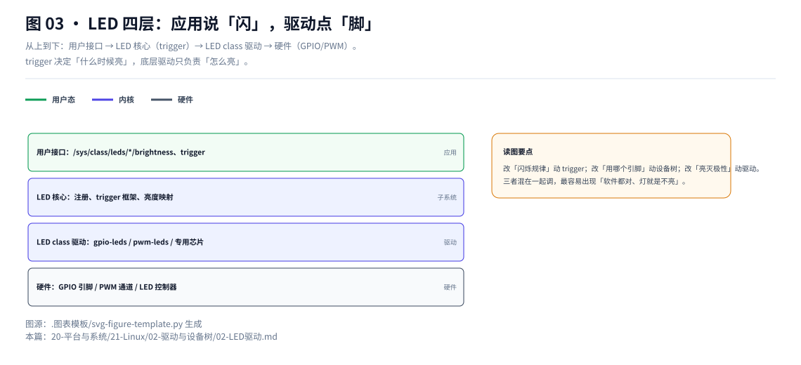

# LED 驱动

LED 子系统把“硬件怎么亮”和“什么时候亮”分开：驱动只实现亮度回调，核心框架负责 sysfs 和触发器的调度。

> 本篇定位：LED 四层架构、`led_classdev`、probe 注册、trigger 机制与亮度回调的上下文选择。

## 目录

- [1 一句话模型](#s1)
- [2 速览](#s2)
- [3 四层架构](#s3)
- [4 驱动注册与亮度回调](#s4)
- [5 触发器](#s5)
- [6 设计取舍与边界](#s6)
- [7 与相邻主题的关系](#s7)
- [名词解释](#名词解释)
- [8 参考与关联](#s8)

## 1 · 一句话模型：驱动管“怎么亮”，框架管“何时亮”

```text
用户：echo 255 > /sys/class/leds/status/brightness
  └─ LED core：记录亮度、通知 trigger
       └─ 驱动回调 brightness_set / brightness_set_blocking
            └─ GPIO / PWM / I2C / SPI 操作硬件
```

三个关键认知：

1. **驱动只注册 `led_classdev`**，sysfs 节点由 LED class 自动创建。
2. **亮度回调分原子/可睡眠两种**：GPIO 可以原子，I2C/SPI 通常要 blocking。
3. **trigger 是“事件源”**：timer、heartbeat、netdev 等决定 LED 何时亮，不改变硬件接口。

## 2 · 速览

| 项 | 内容 |
| --- | --- |
| 核心结构 | `struct led_classdev` |
| 注册 | `devm_led_classdev_register` |
| 亮度 | `brightness`、`max_brightness` |
| 回调 | `brightness_set`、`brightness_set_blocking`、`blink_set` |
| sysfs | `/sys/class/leds/<name>/` |
| 触发器 | timer、heartbeat、disk、netdev、cpu、panic 等 |
| 典型硬件 | GPIO、PWM、I2C/SPI LED 控制器、PMIC |
| 典型驱动 | `leds-gpio.c`、`leds-pwm.c`、`leds-pca955x.c` |

## 3 · 四层架构



**读图**：硬件驱动只实现亮度回调；核心建 sysfs；trigger 决定何时亮。

> 图源：`images/图03-LED四层架构.svg`


```text
用户空间：/sys/class/leds/<led>/
  └─ 触发器层：timer / heartbeat / netdev / disk ...
       └─ 核心层：led-core.c、led-class.c、led-triggers.c
            └─ 硬件驱动层：GPIO / PWM / I2C / SPI / PMIC
```

分层的好处：

- 驱动不关心 sysfs 文件怎么建。
- trigger 不关心硬件是 GPIO 还是 PWM。
- 用户空间用统一接口控制所有 LED。

## 4 · 驱动注册与亮度回调

```c
struct my_led {
    struct led_classdev cdev;
    struct gpio_desc *gpiod;
};

static void my_led_set(struct led_classdev *cdev,
                       enum led_brightness brightness)
{
    struct my_led *led = container_of(cdev, struct my_led, cdev);
    gpiod_set_value(led->gpiod, brightness ? 1 : 0);
}

static int my_led_probe(struct platform_device *pdev)
{
    struct my_led *led;
    int ret;

    led = devm_kzalloc(&pdev->dev, sizeof(*led), GFP_KERNEL);
    if (!led)
        return -ENOMEM;

    led->gpiod = devm_gpiod_get(&pdev->dev, NULL, GPIOD_OUT_LOW);
    if (IS_ERR(led->gpiod))
        return PTR_ERR(led->gpiod);

    led->cdev.name = "status";
    led->cdev.max_brightness = 1;
    led->cdev.brightness_set = my_led_set;

    ret = devm_led_classdev_register(&pdev->dev, &led->cdev);
    return ret;
}
```

要点：

- `max_brightness` 决定 sysfs 可写范围；GPIO LED 通常为 1，PWM 可以 255。
- 如果硬件访问可能睡眠，用 `brightness_set_blocking`，不要用原子回调。
- `devm_led_classdev_register` 自动处理注销。

## 5 · 触发器

| 触发器 | 事件源 | 典型用途 |
| --- | --- | --- |
| timer | 定时器 | 固定频率闪烁 |
| heartbeat | 内核心跳 | 系统存活指示 |
| disk | 块设备 IO | 存储活动 |
| netdev | 网络收发包 | 网口活动 |
| cpu | CPU 负载 | 负载指示 |
| panic | 内核 panic | 故障指示 |
| oneshot | 单次事件 | 按键/告警 |

使用：

```text
echo timer > /sys/class/leds/status/trigger
echo 500 > /sys/class/leds/status/delay_on
echo 500 > /sys/class/leds/status/delay_off
```

触发器与驱动解耦：同一个 LED 可以在 timer/heartbeat/netdev 之间切换，硬件驱动不用改。

## 6 · 设计取舍与边界

### 6.1 原子回调 vs blocking

GPIO  bit-bang 可以在原子上下文完成；I2C/SPI LED 控制器通常要睡眠。选错回调会在中断上下文触发 “scheduling while atomic”。

### 6.2 硬件闪烁 vs 软件闪烁

硬件支持 blink 时用 `blink_set`，CPU 开销低、时序准；不支持时由核心用定时器软件闪烁，占 CPU 但通用。

### 6.3 命名与多实例

LED 名称要稳定、可预测（如 `status`、`wan`、`lan`），否则用户态脚本找不到。多实例用 `devm_led_classdev_register_ext` 或名称后缀区分。

### 6.4 LED 不是状态机

LED 只表达“亮/灭/闪”，不要用它承载复杂业务状态；复杂指示应交给应用层或专用显示设备。

## 7 · 与相邻主题的关系

| 相邻主题 | 关系 |
| --- | --- |
| GPIO 驱动 | gpio-leds 是 LED 驱动的一种硬件实现 |
| 驱动模型与设备树 | LED 驱动是 platform 驱动 + DT 匹配 |
| 中断与底半部 | trigger 可能来自定时器/软中断，回调上下文要匹配 |
| 07-调试与追踪 | LED 常被用作 panic/heartbeat 指示 |

一句话：**LED 驱动只实现“把亮度写进硬件”，何时亮由 trigger 和用户空间决定。**

## 名词解释

> 缩写给出英文全称；非缩写用“—”表示。

| 术语 | 英文全称 | 解释 |
| --- | --- | --- |
| LED | Light-Emitting Diode | 发光二极管。 |
| LED class | LED Class | LED 子系统对用户态的统一类接口。 |
| led_classdev | LED Class Device | LED 设备的核心结构。 |
| brightness | — | 当前亮度。 |
| max_brightness | — | 最大亮度。 |
| trigger | — | 决定 LED 何时亮的触发器。 |
| 硬件闪烁 | Hardware Blink | 由硬件定时器实现的闪烁。 |
| 软件闪烁 | Software Blink | 由内核定时器实现的闪烁。 |
| devm_led_classdev_register | Device Managed LED Class Device Register | 设备托管的 LED 注册接口。 |

## 8 · 参考与关联

**参考**

- Linux 内核文档：`Documentation/leds/`
- `include/linux/leds.h`、`drivers/leds/`
- 源仓库 `led/led_driver_analysis.md`

**关联**

- [00-驱动模型与设备树.md](./00-驱动模型与设备树.md)
- [01-GPIO驱动.md](./01-GPIO驱动.md)
- [01-内核基础/02-中断与底半部.md](../01-内核基础/02-中断与底半部.md)
- [07-调试与追踪](../07-调试与追踪/.readme.md)

---

> **本篇定位**：LED 子系统的四层架构、led_classdev 注册、trigger 与回调上下文。
> **素材来源**：`studyspace/1.知识体系/3.linux驱动/led/led_driver_analysis.md`（主）、`总结.md`；通用内核知识补写。
> **待验证**：不同内核的 LED class/flash/multicolor 接口与 trigger 集合不同。
