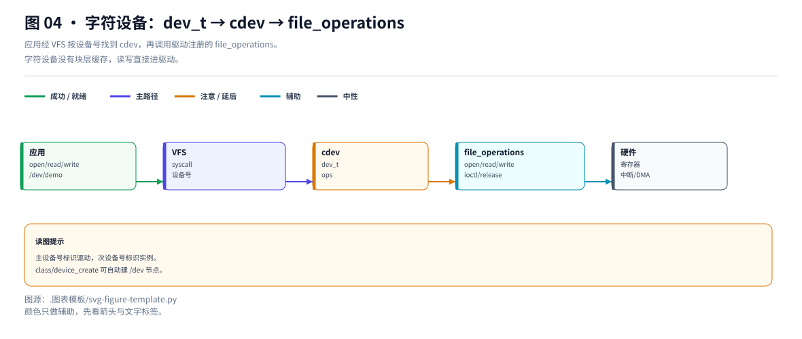

# 字符设备驱动

字符设备按字节流访问：应用 `open/read/write/ioctl` 通过 VFS 找到 `cdev`，再调用驱动注册的 `file_operations`。

> 本篇定位：dev_t/cdev/file_operations 三件套、注册与注销、open/read/write 调用链、用户空间设备节点。

## 目录

- [1 一句话模型](#s1)
- [2 速览](#s2)
- [3 三个核心对象](#s3)
- [4 注册与调用链](#s4)
- [5 设备节点与权限](#s5)
- [6 设计取舍与边界](#s6)
- [7 与相邻主题的关系](#s7)
- [名词解释](#名词解释)
- [8 参考与关联](#s8)

## 1 · 一句话模型：设备号找到驱动，file_operations 决定行为

```text
应用 open("/dev/demo")
  └─ VFS 按 dev_t 找 cdev
       └─ cdev->ops（file_operations）
            ├─ open/read/write/ioctl/release
            └─ 驱动操作硬件
```

三个关键认知：

1. **`dev_t` 是设备号**：主设备号标识驱动，次设备号标识实例。
2. **`cdev` 把设备号和 `file_operations` 绑定**。
3. **字符设备没有块层缓存**，读写直接进驱动；随机访问/缓存要自己实现。

## 2 · 速览

| 对象 | 作用 |
| --- | --- |
| `dev_t` | 主/次设备号 |
| `cdev` | 字符设备对象，绑定 ops |
| `file_operations` | open/read/write/ioctl/poll/mmap |
| `register_chrdev_region` | 静态申请设备号 |
| `alloc_chrdev_region` | 动态申请设备号 |
| `cdev_init/cdev_add` | 初始化/加入 cdev |
| `class_create/device_create` | 自动创建 /dev 节点 |

## 3 · 三个核心对象



**读图**：dev_t 定位设备，cdev 绑定 file_operations，VFS 把系统调用翻译成驱动回调。

> 图源：`images/图04-字符设备驱动.svg`


### 3.1 dev_t

```c
dev_t dev = MKDEV(major, minor);
major = MAJOR(dev);
minor = MINOR(dev);
```

主设备号可以静态指定（`register_chrdev_region`）或动态申请（`alloc_chrdev_region`）。动态更安全，避免冲突。

### 3.2 cdev

```c
struct cdev *cdev;
cdev = cdev_alloc();
cdev_init(cdev, &demo_fops);
cdev_add(cdev, dev, count);
```

`cdev_add` 后，VFS 就能通过设备号找到这个设备。

### 3.3 file_operations

```c
static const struct file_operations demo_fops = {
    .owner   = THIS_MODULE,
    .open    = demo_open,
    .read    = demo_read,
    .write   = demo_write,
    .unlocked_ioctl = demo_ioctl,
    .release = demo_release,
};
```

只实现需要的回调；未实现的返回 `-EINVAL`/`-ENOTTY`。

## 4 · 注册与调用链

```text
module_init
  ├─ alloc_chrdev_region
  ├─ cdev_init/cdev_add
  ├─ class_create
  └─ device_create → /dev/demo
```

应用调用：

```text
open → sys_open → chrdev_open → cdev->ops->open
read → sys_read → vfs_read → cdev->ops->read
ioctl → sys_ioctl → cdev->ops->unlocked_ioctl
close → filp_close → cdev->ops->release
```

模块卸载要反向清理：`device_destroy`、`class_destroy`、`cdev_del`、`unregister_chrdev_region`。

## 5 · 设备节点与权限

- 传统：`mknod /dev/demo c major minor`。
- 现代：`class_create` + `device_create`，udev/mdev 自动建节点。
- 权限：节点 mode/owner 由 udev 规则或 `device_create` 参数决定；不要默认 777。

## 6 · 设计取舍与边界

### 6.1 静态 vs 动态设备号

静态设备号可预测，但容易冲突；动态设备号安全，但节点名/权限要靠 udev 规则稳定。产品通常用动态号 + 固定节点名。

### 6.2 字符设备 vs 块设备

字符设备按字节流、无块层缓存；块设备按块访问、有页缓存/IO 调度。闪存、传感器、控制口多用字符设备；磁盘/MMC 用块设备。

### 6.3 ioctl 的边界

ioctl 灵活但难标准化；能用 sysfs/ioctl 明确命令号就用，避免“魔法数”；用户指针要 `copy_from_user`。

### 6.4 并发与生命周期

open/release 要维护引用计数，防止卸载时还有用户；read/write 共享数据要加锁；热插拔设备要处理 disconnect。

## 7 · 与相邻主题的关系

| 相邻主题 | 关系 |
| --- | --- |
| 驱动模型与设备树 | 字符设备驱动常是 platform 驱动 |
| 文件系统与 VFS | 设备文件通过 VFS 进入驱动 |
| 块设备/网络设备 | 另外两类驱动模型 |
| 中断与锁 | 读写/中断共享数据 |
| 用户空间 | /dev 节点、ioctl、sysfs |

一句话：**字符设备驱动 = 设备号 + cdev + file_operations，把系统调用翻译成硬件操作。**

## 名词解释

> 缩写给出英文全称；非缩写用“—”表示。

| 术语 | 英文全称 | 解释 |
| --- | --- | --- |
| dev_t | Device Type | 主/次设备号。 |
| cdev | Character Device | 字符设备对象，绑定 file_operations。 |
| file_operations | File Operations | open/read/write/ioctl 等回调。 |
| major/minor | Major/Minor Number | 主设备号/次设备号。 |
| register_chrdev_region | Register Character Device Region | 静态申请设备号。 |
| udev | Userspace Device Manager | 用户态设备管理器。 |
| ioctl | Input/Output Control | 设备控制命令。 |

## 8 · 参考与关联

**参考**

- Linux 内核文档：`Documentation/driver-api/`
- `include/linux/cdev.h`、`fs/char_dev.c`
- 《Linux 设备驱动程序》字符设备章节
- 源仓库 `字符设备驱动结构.drawio`

**关联**

- [00-驱动模型与设备树.md](./00-驱动模型与设备树.md)
- [04-块设备与MMC.md](./04-块设备与MMC.md)
- [05-网络设备驱动.md](./05-网络设备驱动.md)
- [08-驱动分层与设备驱动分离.md](./08-驱动分层与设备驱动分离.md)

---

> **本篇定位**：字符设备的 dev_t/cdev/file_operations 与注册/调用链。
> **素材来源**：`studyspace/1.知识体系/3.linux驱动/字符设备驱动结构.drawio`、`文件系统与设备驱动关系.drawio`；通用内核知识补写。
> **待验证**：class/device 创建方式与 udev 规则随发行版而变。
