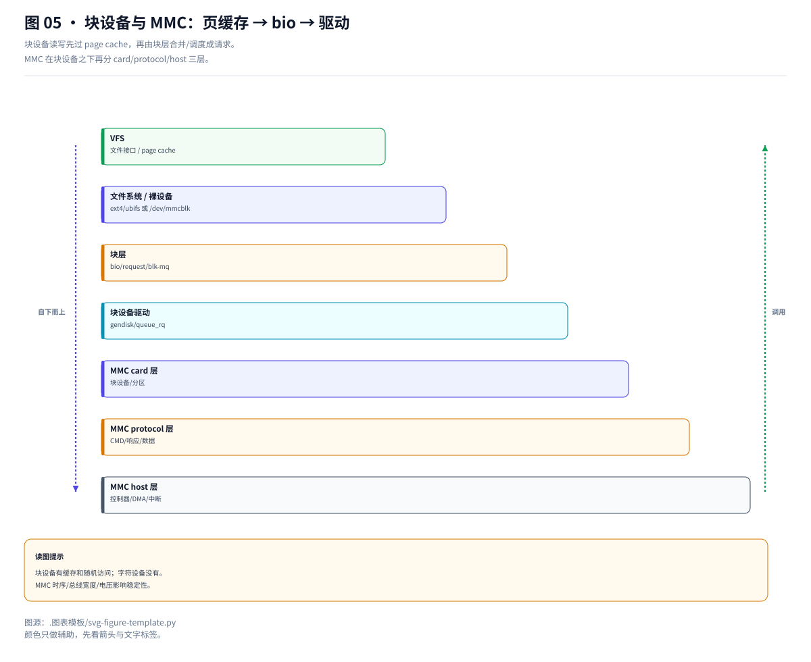

# 块设备与 MMC

块设备按“块”随机访问：VFS 的页缓存、块层的 bio/请求队列、调度器、驱动，最终落到磁盘/MMC。

> 本篇定位：块设备分层（VFS→文件系统/裸设备→块层→驱动）、bio/请求队列、MMC 三层结构、与字符设备的差异。

## 目录

- [1 一句话模型](#s1)
- [2 速览](#s2)
- [3 块设备分层](#s3)
- [4 bio 与请求队列](#s4)
- [5 MMC 三层](#s5)
- [6 设计取舍与边界](#s6)
- [7 与相邻主题的关系](#s7)
- [名词解释](#名词解释)
- [8 参考与关联](#s8)

## 1 · 一句话模型：文件页 → bio → 请求 → 驱动

```text
应用 read/write
  └─ VFS + page cache
       ├─ 文件系统：逻辑块映射
       └─ 裸块设备：直接读写
            └─ 块层：bio → request → 调度
                 └─ 块设备驱动 → 硬件
```

三个关键认知：

1. **块设备有页缓存**，读写通常先经过 page cache；字符设备没有。
2. **块层把 bio 合并/排序/调度**，驱动只需处理请求。
3. **MMC/SD 是块设备的一种**：card 层、协议层、host 层分工明确。

## 2 · 速览

| 层/对象 | 作用 |
| --- | --- |
| VFS | 文件接口、页缓存 |
| 文件系统 | 逻辑块↔物理块映射 |
| 块层 | bio、request、调度器、blk-mq |
| `gendisk` | 一个块设备 |
| `block_device_operations` | open/release/ioctl |
| `request_queue` | 请求队列 |
| MMC card 层 | 把卡当块设备 |
| MMC protocol 层 | 命令/响应/数据传输 |
| MMC host 层 | 控制器驱动 |

## 3 · 块设备分层



**读图**：VFS/page cache→文件系统→块层 bio/请求→驱动；MMC 再分 card/protocol/host。

> 图源：`images/图05-块设备与MMC.svg`


```text
VFS
 ├─ 磁盘文件系统（ext4/ubifs…）
 └─ 原始块设备（/dev/sda）
      └─ 块 IO 调度层
           └─ 块设备驱动
                └─ 硬件
```

- **文件系统**负责目录/文件/元数据，把文件偏移映射为逻辑块。
- **块层**把 bio 合并、排序、调度，提升吞吐/公平性。
- **驱动**实现 `gendisk`、`request_queue`、`queue_rq`（blk-mq）或 `request_fn`（旧）。

## 4 · bio 与请求队列

| 对象 | 作用 |
| --- | --- |
| `bio` | 一次块 IO 描述（页、偏移、长度、方向） |
| `request` | 合并后的请求 |
| `request_queue` | 设备请求队列 |
| 调度器 | none/mq-deadline/kyber/bfq |
| `blk-mq` | 多队列块层，适配多核/高速设备 |

流程：文件系统提交 bio → 块层合并/调度 → 驱动取请求 → DMA 传输 → 完成回调。

## 5 · MMC 三层

```text
文件系统
  └─ MMC/SD card 层（块设备）
       └─ MMC/SD card 层（通信协议：命令/响应/数据）
            └─ MMC/SD host 层（控制器驱动）
                 └─ 硬件
```

- **card 层**：把卡注册为块设备，处理分区/容量。
- **protocol 层**：CMD/ACMD、响应、数据线、CRC。
- **host 层**：SoC 控制器驱动，处理时钟、DMA、中断。

## 6 · 设计取舍与边界

### 6.1 块设备 vs 字符设备

块设备有缓存、随机访问、块层调度；字符设备是字节流、直接进驱动。选择取决于访问模式，不是“哪个高级”。

### 6.2 调度器的选择

`none` 适合高速 NVMe/虚拟设备；`mq-deadline` 保证延迟；`bfq` 适合桌面交互。嵌入式 Flash 常用简单调度/直通。

### 6.3 缓存与掉电

page cache 提升性能，但掉电可能丢未回写数据；`fsync`/`O_DIRECT`/日志文件系统各有取舍。

### 6.4 MMC 的边界

MMC 协议层/主机控制器差异大，时序、电压、总线宽度、HS 模式都可能影响稳定性；量产要按厂商指南调。

## 7 · 与相邻主题的关系

| 相邻主题 | 关系 |
| --- | --- |
| 字符设备驱动 | 另一类驱动模型 |
| 文件系统与 VFS | 块设备的上层 |
| 内存与页缓存 | page cache/writeback |
| 启动与 rootfs | 根文件系统常驻块设备 |
| 平台与芯片 | MMC 控制器/时序归 30 |

一句话：**块设备的核心是“页缓存 + bio/请求队列 + 驱动”，MMC 只是其中一种 host 实现。**

## 名词解释

> 缩写给出英文全称；非缩写用“—”表示。

| 术语 | 英文全称 | 解释 |
| --- | --- | --- |
| block device | Block Device | 按块随机访问的设备。 |
| bio | Block I/O | 一次块 IO 描述。 |
| request | Request | 合并/调度后的块请求。 |
| gendisk | Generic Disk | 一个块设备对象。 |
| blk-mq | Block Multi-Queue | 多队列块层。 |
| MMC card 层 | MMC Card Layer | 把卡注册为块设备。 |
| MMC protocol 层 | MMC Protocol Layer | 命令/响应/数据传输。 |
| MMC host 层 | MMC Host Layer | 控制器驱动。 |
| page cache | Page Cache | 文件页缓存。 |

## 8 · 参考与关联

**参考**

- Linux 内核文档：`Documentation/block/`、`Documentation/driver-api/mmc/`
- `include/linux/blkdev.h`、`block/`、`drivers/mmc/`
- 源仓库 `linux块设备子系统.drawio`、`linuxMMC子系统.drawio`、`Linux011文件系统.md`

**关联**

- [03-字符设备驱动.md](./03-字符设备驱动.md)
- [05-网络设备驱动.md](./05-网络设备驱动.md)
- [05-内存与性能/01-分配器与页缓存.md](../05-内存与性能/01-分配器与页缓存.md)
- [03-启动与根文件系统/01-根文件系统与init.md](../03-启动与根文件系统/01-根文件系统与init.md)

---

> **本篇定位**：块设备分层、bio/请求队列与 MMC 三层结构。
> **素材来源**：`studyspace/1.知识体系/3.linux驱动/linux块设备子系统.drawio`、`linuxMMC子系统.drawio`、`Linux011文件系统.md`；通用内核知识补写。
> **待验证**：blk-mq 调度器、MMC host 能力与 SoC 差异较大。
