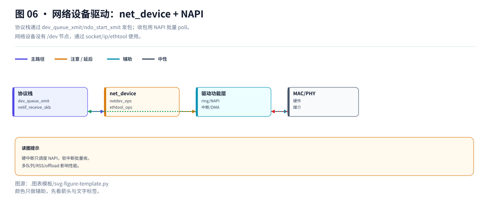

# 网络设备驱动

网络设备驱动不像字符/块设备那样对应 `/dev` 节点：它注册 `net_device`，通过 `ndo_start_xmit` 发包、通过 NAPI 收包，和协议栈直接交互。

> 本篇定位：网络设备驱动的四层结构、net_device/NAPI、收发包入口、与协议栈的边界。

## 目录

- [1 一句话模型](#s1)
- [2 速览](#s2)
- [3 四层结构](#s3)
- [4 net_device 与 NAPI](#s4)
- [5 收发包入口](#s5)
- [6 设计取舍与边界](#s6)
- [7 与相邻主题的关系](#s7)
- [名词解释](#名词解释)
- [8 参考与关联](#s8)

## 1 · 一句话模型：协议栈调 ndo_start_xmit，驱动用 NAPI 收

```text
协议栈 dev_queue_xmit → ndo_start_xmit → 硬件
硬件中断 → NAPI poll → netif_receive_skb → 协议栈
```

三个关键认知：

1. **没有 /dev 节点**：网络设备通过 `net_device` 和 socket 接口使用。
2. **发包入口是 `ndo_start_xmit`**，返回 `NETDEV_TX_OK/BUSY`。
3. **收包用 NAPI**，硬中断只调度 poll，批量收包。

## 2 · 速览

| 对象/接口 | 作用 |
| --- | --- |
| `net_device` | 网络设备抽象 |
| `net_device_ops` | ndo_open/stop/start_xmit |
| `alloc_etherdev` | 分配以太网设备 |
| `register_netdev` | 注册设备 |
| `napi_struct` | 收包轮询 |
| `netif_receive_skb` | 把包交给协议栈 |
| `ethtool_ops` | 速率/统计/自协商 |
| `dev_queue_xmit` | 协议栈发送入口 |

## 3 · 四层结构



**读图**：协议栈通过 net_device/ndo_start_xmit 发包，硬件中断触发 NAPI 收包。

> 图源：`images/图06-网络设备驱动.svg`


| 层 | 作用 |
| --- | --- |
| 网络协议接口层 | `dev_queue_xmit` / `netif_rx` |
| 网络设备接口层 | `net_device`、`net_device_ops` |
| 设备驱动功能层 | 中断、DMA、ring、NAPI |
| 网络设备与媒介层 | PHY/MAC/总线 |

驱动把“硬件收发”适配成 `net_device`，协议栈不关心是 PCIe 网卡、USB 网卡还是虚拟 veth。

## 4 · net_device 与 NAPI

```c
ndev = alloc_etherdev(sizeof(*priv));
ndev->netdev_ops = &demo_netdev_ops;
ndev->ethtool_ops = &demo_ethtool_ops;
register_netdev(ndev);

netif_napi_add(ndev, &priv->napi, demo_poll, 64);
```

- `ndo_open`：申请 ring、注册中断、`napi_enable`、`netif_carrier_on`。
- `ndo_stop`：关中断、释放 ring、`napi_disable`。
- `ndo_start_xmit`：把 skb 写入 tx ring，返回 BUSY 时协议栈会重试。
- `poll`：从 rx ring 取包，`napi_gro_receive`/`netif_receive_skb`。

## 5 · 收发包入口

发包：

```text
dev_queue_xmit → qdisc → ndo_start_xmit → tx ring → 硬件
```

收包：

```text
硬件中断 → napi_schedule → poll → rx ring → netif_receive_skb → 协议栈
```

关键点：

- 发送完成中断/软中断回收 skb 与 DMA 映射。
- 接收要处理 checksum offload、VLAN tag、GRO。
- 统计通过 `netdev_stats`/ethtool 暴露。

## 6 · 设计取舍与边界

### 6.1 中断 vs NAPI

高流量用 NAPI 批量收，低流量可中断；驱动要正确实现 budget 和 `napi_complete`。

### 6.2 硬件 offload

TSO/GSO/checksum/VLAN offload 降低 CPU，但虚拟化/隧道可能失效；抓包看到的是卸载前/后的差异。

### 6.3 多队列

多队列网卡配合 RSS/RPS 把流分散到多核；队列数与 CPU 绑定要调，避免锁竞争/缓存失效。

### 6.4 没有 /dev 节点

网络设备通过 `ip link`、sysfs、ethtool 管理；不要照字符设备的思路找设备节点。

## 7 · 与相邻主题的关系

| 相邻主题 | 关系 |
| --- | --- |
| 驱动模型与设备树 | 网络驱动常是 platform/PCI/USB 驱动 |
| 网络栈概览 | 收包/发包路径 |
| NAPI/中断 | 收包核心机制 |
| 字符/块设备 | 另外两类驱动模型 |
| 平台与芯片 | MAC/PHY/DMA 归 30 |

一句话：**网络设备驱动把硬件收发适配成 net_device，协议栈通过 ndo_start_xmit 发包、通过 NAPI 收包。**

## 名词解释

> 缩写给出英文全称；非缩写用“—”表示。

| 术语 | 英文全称 | 解释 |
| --- | --- | --- |
| net_device | Network Device | 网络设备抽象。 |
| net_device_ops | Network Device Operations | ndo_open/start_xmit 等回调。 |
| NAPI | New API | 中断+轮询收包。 |
| ndo_start_xmit | Network Device Operation Start Transmit | 发包入口。 |
| dev_queue_xmit | Device Queue Transmit | 协议栈发送入口。 |
| ethtool_ops | Ethtool Operations | 速率/统计/自协商。 |
| RSS | Receive Side Scaling | 多队列收包分发。 |

## 8 · 参考与关联

**参考**

- Linux 内核文档：`Documentation/networking/`
- `include/linux/netdevice.h`、`drivers/net/`
- 源仓库 `网络设备驱动体系结构.drawio`
- [06-网络子系统/01-收包流程.md](../06-网络子系统/01-收包流程.md)

**关联**

- [03-字符设备驱动.md](./03-字符设备驱动.md)
- [04-块设备与MMC.md](./04-块设备与MMC.md)
- [08-驱动分层与设备驱动分离.md](./08-驱动分层与设备驱动分离.md)
- [06-网络子系统/00-网络栈概览.md](../06-网络子系统/00-网络栈概览.md)

---

> **本篇定位**：网络设备驱动四层结构、net_device/NAPI 与收发包入口。
> **素材来源**：`studyspace/1.知识体系/3.linux驱动/网络设备驱动体系结构.drawio`；通用内核知识补写。
> **待验证**：不同网卡的 offload/多队列/PHY 支持差异很大。
