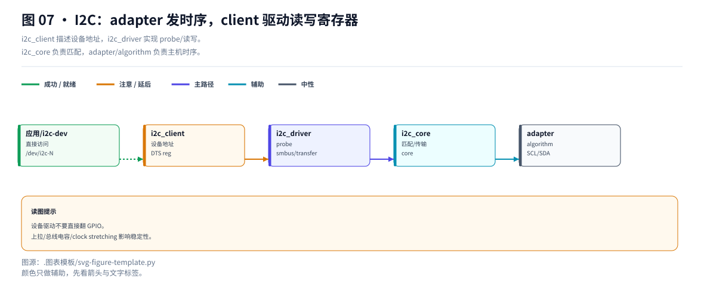

# I2C 驱动

I2C 是两条线（SCL/SDA）的总线：主机控制器驱动（adapter）负责发时序，设备驱动（client）负责读写寄存器。

> 本篇定位：I2C 核心/adapter/algorithm/client/driver 的分层、设备树匹配、smbus 传输与调试。

## 目录

- [1 一句话模型](#s1)
- [2 速览](#s2)
- [3 分层结构](#s3)
- [4 client 与 driver](#s4)
- [5 传输与调试](#s5)
- [6 设计取舍与边界](#s6)
- [7 与相邻主题的关系](#s7)
- [名词解释](#名词解释)
- [8 参考与关联](#s8)

## 1 · 一句话模型：adapter 发时序，client 读写寄存器

```text
i2c_client（设备地址）
  └─ i2c_driver（probe/remove）
       └─ i2c_core
            └─ i2c_adapter + algorithm（主机控制器）
                 └─ SCL/SDA 硬件
```

三个关键认知：

1. **I2C 是总线**：一个 adapter 上可挂多个 client（不同地址）。
2. **设备驱动不直接翻转 GPIO**，通过 `i2c_transfer`/smbus API 发消息。
3. **设备树描述 bus 与设备地址**，驱动用 `of_match_table`/`i2c_device_id` 匹配。

## 2 · 速览

| 对象 | 作用 |
| --- | --- |
| `i2c_adapter` | 一个 I2C 主机控制器 |
| `i2c_algorithm` | 主机传输算法 |
| `i2c_client` | 一个从设备（地址） |
| `i2c_driver` | 设备驱动（probe/remove） |
| `i2c_core` | 注册/匹配/传输核心 |
| `i2c-dev` | 用户态直接访问 `/dev/i2c-N` |
| smbus | 常用寄存器读写封装 |

## 3 · 分层结构



**读图**：client 描述设备地址，driver 做业务，core 匹配，adapter/algorithm 发时序。

> 图源：`images/图07-I2C驱动.svg`


| 层 | 代码 | 作用 |
| --- | --- | --- |
| 用户空间 | 应用、i2c-dev | 直接访问或通过驱动 |
| 设备驱动 | i2c_driver | 业务/寄存器操作 |
| I2C 核心 | i2c-core | 匹配、传输、适配 |
| 算法 | i2c_algorithm | master_xfer/smbus_xfer |
| 适配器 | i2c_adapter | 控制器实例 |
| 硬件 | SCL/SDA | 时序/电平 |

## 4 · client 与 driver

设备树：

```dts
&i2c1 {
    status = "okay";
    sensor@48 {
        compatible = "vendor,sensor";
        reg = <0x48>;
    };
};
```

驱动：

```c
static int sensor_probe(struct i2c_client *client,
                        const struct i2c_device_id *id)
{
    /* 通过 client->addr 访问设备 */
    return 0;
}

static const struct of_device_id sensor_of_match[] = {
    { .compatible = "vendor,sensor" },
    { }
};

static struct i2c_driver sensor_driver = {
    .driver = { .name = "sensor", .of_match_table = sensor_of_match },
    .probe = sensor_probe,
    .id_table = sensor_id,
};
module_i2c_driver(sensor_driver);
```

## 5 · 传输与调试

```c
/* 读寄存器 */
u8 reg = 0x10;
u8 val;
struct i2c_msg msgs[2] = {
    { .addr = client->addr, .flags = 0, .len = 1, .buf = &reg },
    { .addr = client->addr, .flags = I2C_M_RD, .len = 1, .buf = &val },
};
i2c_transfer(client->adapter, msgs, 2);

/* 或 smbus */
val = i2c_smbus_read_byte_data(client, reg);
```

调试：

- `i2cdetect -y 1` 扫描地址。
- `i2cdump`/`i2cget`/`i2cset` 直接读写。
- 逻辑分析仪看 SCL/SDA 时序；注意上拉、 clock stretching、地址冲突。

## 6 · 设计取舍与边界

### 6.1 主机驱动 vs 设备驱动

主机驱动（adapter/algorithm）处理 SoC 控制器；设备驱动（client）处理具体芯片。两者通过 i2c-core 解耦，一个主机可挂多种设备。

### 6.2 smbus vs raw i2c

smbus 封装常用寄存器读写，简单；raw `i2c_msg` 灵活，适合非标准时序。先看设备手册是否兼容 smbus。

### 6.3 用户态 i2c-dev 的边界

i2c-dev 适合调试/简单设备，但缺少驱动层的电源管理/并发/抽象；量产驱动仍应写内核驱动。

### 6.4 电气与时序

上拉电阻、总线电容、clock stretching、重复起始条件都可能影响稳定性；软件调不通时先看波形。

## 7 · 与相邻主题的关系

| 相邻主题 | 关系 |
| --- | --- |
| 驱动模型与设备树 | i2c_driver 是总线驱动模型的一种 |
| GPIO | 常配合复位/中断脚 |
| 字符设备 | i2c-dev 暴露字符设备 |
| 电源管理 | runtime PM/suspend 回调 |
| 平台与芯片 | SoC I2C 控制器归 30 |

一句话：**I2C 驱动分层是“adapter 发时序、core 做匹配、client 驱动做业务”，不要越层直接翻 GPIO。**

## 名词解释

> 缩写给出英文全称；非缩写用“—”表示。

| 术语 | 英文全称 | 解释 |
| --- | --- | --- |
| I2C | Inter-Integrated Circuit | 两线制总线。 |
| i2c_adapter | I2C Adapter | 主机控制器实例。 |
| i2c_algorithm | I2C Algorithm | 主机传输算法。 |
| i2c_client | I2C Client | 一个从设备（地址）。 |
| i2c_driver | I2C Driver | 设备驱动。 |
| smbus | System Management Bus | 常用寄存器读写封装。 |
| i2c-dev | I2C Device | 用户态直接访问接口。 |
| clock stretching | Clock Stretching | 从设备拉低时钟等待。 |

## 8 · 参考与关联

**参考**

- Linux 内核文档：`Documentation/i2c/`
- `include/linux/i2c.h`、`drivers/i2c/`
- 源仓库 `IIC体系结构.drawio`

**关联**

- [00-驱动模型与设备树.md](./00-驱动模型与设备树.md)
- [03-字符设备驱动.md](./03-字符设备驱动.md)
- [07-USB驱动.md](./07-USB驱动.md)
- [01-GPIO驱动.md](./01-GPIO驱动.md)

---

> **本篇定位**：I2C 的 adapter/algorithm/client/driver 分层、DTS 匹配与 smbus 传输。
> **素材来源**：`studyspace/1.知识体系/3.linux驱动/IIC体系结构.drawio`；通用内核知识补写。
> **待验证**：不同 SoC 的 I2C 控制器能力、时钟/上拉要求不同。
