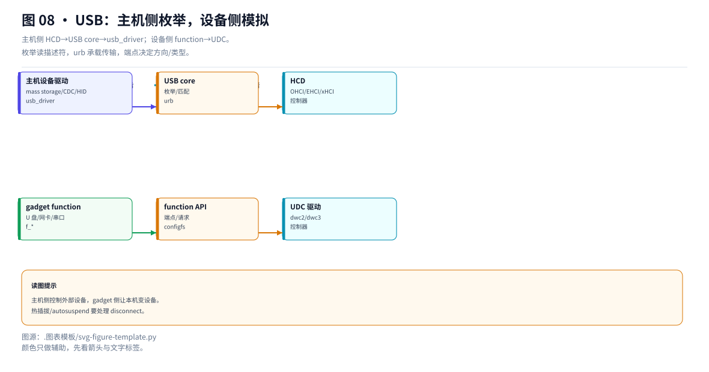

# USB 驱动

USB 分两侧：主机侧（HCD + USB core + 设备驱动）和设备侧（UDC + gadget function）。同一套总线，两种角色。

> 本篇定位：主机侧与 gadget 侧的分层、枚举/端点/urb、usb_driver 与 function 驱动的写法与边界。

## 目录

- [1 一句话模型](#s1)
- [2 速览](#s2)
- [3 主机侧分层](#s3)
- [4 设备侧 gadget](#s4)
- [5 枚举、端点与 urb](#s5)
- [6 设计取舍与边界](#s6)
- [7 与相邻主题的关系](#s7)
- [名词解释](#名词解释)
- [8 参考与关联](#s8)

## 1 · 一句话模型：主机侧枚举设备，设备侧模拟功能

```text
主机：USB 设备 → HCD → USB core → usb_driver
设备：gadget function → function API → UDC → 控制器
```

三个关键认知：

1. **主机控制器驱动（HCD）** 处理 OHCI/EHCI/UHCI/xHCI 寄存器与调度。
2. **usb_driver 用 id_table 匹配设备**，probe 里用 urb 收发。
3. **gadget 侧**把设备模拟成 U 盘/网卡/串口，function 驱动不直接碰控制器。

## 2 · 速览

| 侧 | 层 | 作用 |
| --- | --- | --- |
| 主机 | 设备驱动 | mass storage/CDC/HID/厂商 |
| 主机 | USB core | 枚举、驱动匹配、urb |
| 主机 | HCD | OHCI/EHCI/UHCI/xHCI |
| 主机 | 控制器 | 硬件 |
| 设备 | function | 模拟 U 盘/网卡/串口 |
| 设备 | function API | 端点/请求封装 |
| 设备 | UDC 驱动 | 设备控制器 |
| 设备 | 控制器 | 硬件 |

## 3 · 主机侧分层



**读图**：主机侧 HCD→core→usb_driver；设备侧 function→function API→UDC。

> 图源：`images/图08-USB驱动.svg`


```text
usb_driver（id_table/probe）
  └─ USB core（usb_register_driver、枚举、urb）
       └─ HCD（host controller driver）
            └─ 控制器硬件
```

`usb_driver` 关键字段：`id_table`（VID/PID/class）、`probe`、`disconnect`。probe 里通常：

- `usb_set_intfdata` 保存私有数据。
- 分配 urb/缓冲区，提交中断/批量传输。
- 注册子系统（input/net/tty/block）。

## 4 · 设备侧 gadget

```text
function 驱动（f_mass_storage/f_ecm/f_acm）
  └─ function API（usb_function、端点、请求）
       └─ UDC 驱动（dwc2/dwc3/...）
            └─ 设备控制器
```

gadget 把板子模拟成 USB 设备：U 盘、RNDIS/ECM 网卡、串口。配置通过 configfs 组合 function、绑定 UDC。

## 5 · 枚举、端点与 urb

- **枚举**：主机读设备描述符/配置描述符/字符串，选择配置，加载匹配驱动。
- **端点**：控制/中断/批量/等时；每端点有方向、最大包长、间隔。
- **urb**：USB 请求块，提交给 HCD，完成后回调；要正确取消/回收，避免 UAF。

## 6 · 设计取舍与边界

### 6.1 主机 vs gadget

主机侧是“控制外部设备”，gadget 侧是“让本机变成设备”。两者代码路径/子系统不同，别混用 API。

### 6.2 HCD 的选择

OHCI/UHCI（USB 1.1）、EHCI（2.0）、xHCI（3.x）；SoC 常用 dwc2/dwc3。带宽/调度/电源管理差异大。

### 6.3 用户态 USB

libusb 可绕过内核驱动，适合调试/专用设备；但缺少内核电源管理/标准子系统，量产驱动仍建议内核态。

### 6.4 热插拔与电源

USB 支持热插拔/挂起/唤醒；驱动要处理 disconnect、suspend/resume、autosuspend，避免“拔掉后还访问设备”。

## 7 · 与相邻主题的关系

| 相邻主题 | 关系 |
| --- | --- |
| 驱动模型与设备树 | USB 驱动是总线驱动模型 |
| 字符/块/网络设备 | USB 设备可注册为这些子系统 |
| 电源管理 | autosuspend/runtime PM |
| 平台与芯片 | USB 控制器/PHY 归 30 |
| 调试 | usbmon、dmesg、lsusb |

一句话：**USB 主机侧枚举并驱动外部设备，gadget 侧把本机模拟成设备；核心都是端点/urb/描述符。**

## 名词解释

> 缩写给出英文全称；非缩写用“—”表示。

| 术语 | 英文全称 | 解释 |
| --- | --- | --- |
| USB | Universal Serial Bus | 通用串行总线。 |
| HCD | Host Controller Driver | 主机控制器驱动。 |
| UDC | USB Device Controller | 设备控制器驱动。 |
| urb | USB Request Block | USB 请求块。 |
| endpoint | Endpoint | USB 端点。 |
| enumeration | Enumeration | 主机枚举设备。 |
| usb_driver | USB Driver | 主机侧设备驱动。 |
| gadget | USB Gadget | 设备侧功能模拟。 |
| configfs | Configuration File System | gadget 组合配置。 |

## 8 · 参考与关联

**参考**

- Linux 内核文档：`Documentation/driver-api/usb/`、`Documentation/usb/`
- `include/linux/usb.h`、`drivers/usb/`
- 源仓库 `USB设备驱动结构.drawio`

**关联**

- [00-驱动模型与设备树.md](./00-驱动模型与设备树.md)
- [03-字符设备驱动.md](./03-字符设备驱动.md)
- [05-网络设备驱动.md](./05-网络设备驱动.md)
- [08-驱动分层与设备驱动分离.md](./08-驱动分层与设备驱动分离.md)

---

> **本篇定位**：USB 主机侧与 gadget 侧的分层、枚举/端点/urb、usb_driver 与 function 驱动。
> **素材来源**：`studyspace/1.知识体系/3.linux驱动/USB设备驱动结构.drawio`；通用内核知识补写。
> **待验证**：具体 HCD/UDC 控制器、PHY 与 SoC 支持差异很大。
