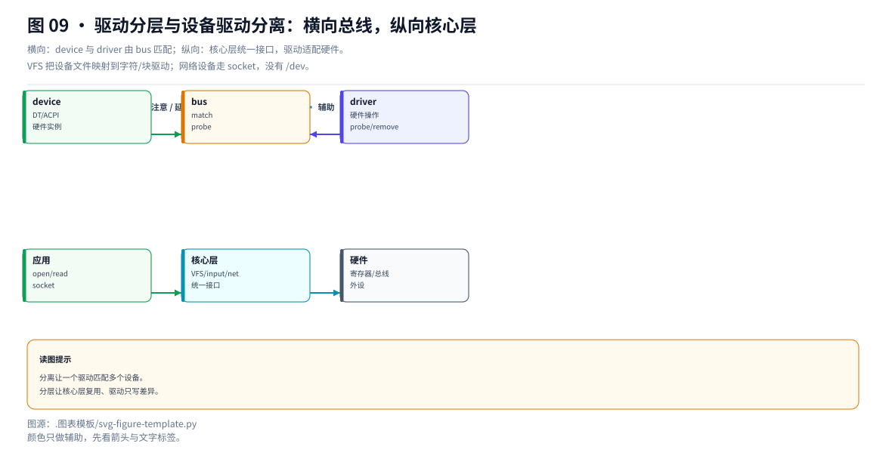

# 驱动分层与设备驱动分离

Linux 驱动有两组重要解耦：**设备与驱动分离**（总线匹配）和**驱动分层**（核心层/驱动层/硬件层）。看懂这两组关系，才能理解字符/块/网络/输入等子系统。

> 本篇定位：内核组成、设备/驱动/总线、驱动分层、VFS 与设备驱动关系。具体总线驱动看字符/块/网络/I2C/USB 篇。

## 目录

- [1 一句话模型](#s1)
- [2 速览](#s2)
- [3 内核组成](#s3)
- [4 设备与驱动分离](#s4)
- [5 驱动分层](#s5)
- [6 VFS 与设备驱动](#s6)
- [7 设计取舍与边界](#s7)
- [名词解释](#名词解释)
- [8 参考与关联](#s8)

## 1 · 一句话模型：横向靠总线匹配，纵向靠核心层抽象

```text
横向：device ←→ bus ←→ driver（一个驱动可匹配多个设备）
纵向：应用 → VFS/子系统核心 → 驱动 → 硬件（核心层统一接口）
```

三个关键认知：

1. **设备与驱动分离**：设备描述硬件，驱动描述操作，总线负责撮合。
2. **驱动分层**：核心层提供统一 API，驱动只实现硬件差异。
3. **VFS 把设备当文件**：字符/块设备通过 `/dev` 进入驱动。

## 2 · 速览

| 概念 | 作用 |
| --- | --- |
| 内核组成 | 调度、内存、VFS、网络、IPC |
| device | 硬件实例 |
| driver | 操作函数 |
| bus | 匹配规则 |
| 核心层 | 统一接口/框架 |
| 驱动层 | 硬件相关实现 |
| 硬件层 | 寄存器/总线/外设 |
| VFS | 文件接口与设备文件 |

## 3 · 内核组成

```text
进程调度 | 内存管理 | 虚拟文件系统 | 网络接口 | 进程间通信
```

五个子系统加上中断/时钟/模块，构成内核的横向能力；驱动是这些能力的“硬件适配器”。

## 4 设备与驱动分离



**读图**：横向 device/bus/driver 匹配，纵向应用→核心层→驱动→硬件。

> 图源：`images/图09-驱动分层与分离.svg`


```text
设备树/ACPI/枚举 → device
driver_register → driver
       └─ bus->match() → probe()
```

好处：

- 一个驱动匹配多个设备（不同实例/型号）。
- 一个设备可换驱动（兼容/调试）。
- 设备描述外置（DT/ACPI），内核不必为每块板写 board file。

代价：匹配失败不直观，要看 `/sys/bus/*`、`dmesg`、`of_match_table`。

## 5 · 驱动分层

以输入子系统为例：

```text
应用 read /dev/input/eventX
  └─ 各种 IO 模型（阻塞/非阻塞/poll）
       └─ input 核心层（统一事件格式）
            └─ 设备驱动（GPIO 按键/触摸/鼠标）
                 └─ 硬件
```

分层的通用形态：

| 层 | 职责 |
| --- | --- |
| 用户接口 | 系统调用、设备节点、sysfs |
| 核心层 | 统一数据结构/API/事件分发 |
| 驱动层 | 硬件初始化、中断、寄存器 |
| 硬件层 | 外设/总线 |

字符设备用 `file_operations`、块设备用 `gendisk/request_queue`、网络设备用 `net_device/NAPI`、输入用 `input_dev`，本质都是“核心层统一接口 + 驱动层适配”。

## 6 VFS 与设备驱动

```text
应用 open/read/write
  └─ VFS
       ├─ 普通文件 → 文件系统 → 块设备
       ├─ 设备文件 /dev/xxx → 字符/块驱动
       └─ 特殊文件 /proc /sys → 内核对象
```

设备文件把“文件操作”映射到驱动回调：字符设备走 `file_operations`，块设备走块层，网络设备没有 `/dev` 节点（走 socket）。这就是“一切皆文件”的边界：网络设备是例外。

## 7 · 设计取舍与边界

### 7.1 分离 vs 直接注册

老驱动可能直接在 board file 里注册设备；现代用 DT/ACPI + bus 匹配。后者可移植性好，但调试链路长。

### 7.2 分层 vs 性能

分层增加抽象/间接调用，但提升复用；性能敏感路径（网络收发包）会用 NAPI/offload 减少层间开销。

### 7.3 核心层不是“万能”

核心层统一接口，但硬件差异仍在驱动；不要把硬件时序/寄存器操作塞进核心层。

### 7.4 设备文件的边界

不是所有设备都有 `/dev`：网络设备用 socket，input 用 event 节点，LED 用 sysfs。排障先确认设备属于哪个子系统。

## 名词解释

> 缩写给出英文全称；非缩写用“—”表示。

| 术语 | 英文全称 | 解释 |
| --- | --- | --- |
| bus | Bus | 设备与驱动的匹配规则。 |
| device | Device | 硬件实例。 |
| driver | Driver | 硬件操作函数。 |
| 核心层 | Core Layer | 统一接口/框架。 |
| VFS | Virtual File System | 文件接口与设备文件。 |
| 分离 | Separation | 设备与驱动解耦。 |
| 分层 | Layering | 核心层/驱动层/硬件层。 |

## 8 · 参考与关联

**参考**

- Linux 内核文档：`Documentation/driver-api/driver-model/`
- `include/linux/device.h`、`drivers/base/`
- 源仓库 `linux内核组成.drawio`、`linux设备和驱动的分离.drawio`、`linux驱动的分层.drawio`、`文件系统与设备驱动关系.drawio`

**关联**

- [00-驱动模型与设备树.md](./00-驱动模型与设备树.md)
- [03-字符设备驱动.md](./03-字符设备驱动.md)
- [04-块设备与MMC.md](./04-块设备与MMC.md)
- [05-网络设备驱动.md](./05-网络设备驱动.md)
- [06-I2C驱动.md](./06-I2C驱动.md)
- [07-USB驱动.md](./07-USB驱动.md)

---

> **本篇定位**：设备/驱动/总线分离、驱动分层与 VFS 设备文件的关系。
> **素材来源**：`studyspace/1.知识体系/3.linux驱动/` 的 `linux内核组成.drawio`、`linux设备和驱动的分离.drawio`、`linux驱动的分层.drawio`、`文件系统与设备驱动关系.drawio`；通用内核知识补写。
> **待验证**：不同子系统的核心层接口/设备节点形式不同。
