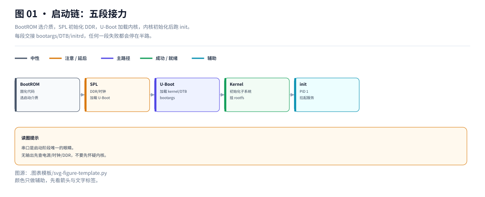

# 启动链

从按下电源到 `init` 运行，中间要经过 BootROM、SPL、U-Boot、内核解压/初始化、挂载根文件系统几段交接。每一段都可能成为“黑屏/无输出”的原因。

> 本篇定位：通用 Linux 启动链与内核初始化顺序，附 Linux 0.11 的历史对照。具体 SoC 的 BootROM/烧录工具归 30/23。

## 目录

- [1 一句话模型](#s1)
- [2 速览](#s2)
- [3 启动链分段](#s3)
- [4 内核初始化顺序](#s4)
- [5 历史对照：Linux 0.11](#s5)
- [6 设计取舍与边界](#s6)
- [7 与相邻主题的关系](#s7)
- [名词解释](#名词解释)
- [8 参考与关联](#s8)

## 1 · 一句话模型：五段接力

```text
BootROM → SPL → U-Boot → Linux kernel → init
  固化       DDR    加载镜像    初始化驱动    用户空间
```

三个关键认知：

1. **每段只负责把下一段拉起来**，交接参数（bootargs、DTB、initrd）是排障重点。
2. **串口是启动阶段唯一的“眼睛”**，earlycon 越早开越好。
3. **内核启动完成不等于系统可用**：还要挂根文件系统、跑 init、拉起服务。

## 2 · 速览

| 阶段 | 运行环境 | 主要工作 | 失败现象 |
| --- | --- | --- | --- |
| BootROM | SoC 固化代码 | 选启动介质、加载 SPL | 完全无输出 |
| SPL | 小内存 | 初始化 DDR/时钟，加载 U-Boot | 串口无输出或反复重启 |
| U-Boot | DRAM | 加载 kernel/DTB/initrd，传 bootargs | 停在 U-Boot 命令行 |
| Kernel | 虚拟内存 | 初始化子系统、挂 rootfs、跑 init | panic、卡在 initcall |
| init | 用户态 | 拉起服务、登录 | 服务失败、反复重启 |

## 3 · 启动链分段



**读图**：BootROM→SPL→U-Boot→Kernel→init 五段接力；每段交接 bootargs/DTB/initrd。

> 图源：`images/图01-启动链.svg`


### 3.1 BootROM → SPL

BootROM 是芯片固化代码，按拨码/熔丝选择 eMMC、SPI Flash、SD、USB 等介质，加载第一阶段引导。SPL（Secondary Program Loader）通常很小，负责初始化 DDR、时钟和串口，再把完整 U-Boot 搬到 DRAM。

### 3.2 U-Boot

U-Boot 负责：

- 加载 kernel、DTB、initrd（可从 Flash、TFTP、USB）。
- 准备 `bootargs`：`console=`、`root=`、`rootfstype=`、`rw`、`init=`。
- 把 DTB 地址、initrd 地址传给内核。
- 支持 FIT 镜像、签名校验、A/B 分区选择。

### 3.3 Kernel

内核入口先做架构相关初始化（异常向量、页表、内存），再进入 `start_kernel()`，依次初始化调度、内存、VFS、驱动、网络，最后挂 rootfs、执行 init。

### 3.4 init

内核执行 `/sbin/init`（或 `rdinit=` 指定的 initramfs init）。init 负责挂载剩余文件系统、启动服务、处理登录。具体是 systemd、BusyBox init 还是自研 init，取决于发行版/产品。

## 4 · 内核初始化顺序

```text
start_kernel
  ├─ setup_arch：解析 DTB、内存、CPU
  ├─ mm_init：伙伴系统、slab、页表
  ├─ sched_init：调度器、时钟
  ├─ vfs_caches_init：dentry/inode 缓存
  ├─ rest_init：创建 kernel_init / kthreadd
  └─ kernel_init：do_initcalls → 挂 rootfs → exec init
```

`initcall` 按级别执行（early、core、postcore、arch、subsys、fs、device、late），驱动 probe 多在 device 级别。启动卡住时可用 `initcall_debug` 看最后执行的 initcall。

## 5 · 历史对照：Linux 0.11

Linux 0.11 的启动链更短，但阶段划分一致：

| 阶段 | 入口 | 工作 |
| --- | --- | --- |
| 引导 | `bootsect.s` | BIOS 读到 0x7C00，搬自身、读 setup/system |
| 过渡 | `setup.s` | 取内存/磁盘参数，开 A20，进保护模式 |
| 初始化 | `head.s` | 建 GDT/IDT、开分页，调用 `main` |
| 主函数 | `main.c` | 初始化子系统，`move_to_user_mode`，fork init |

对照现代启动：BootROM/SPL/U-Boot 取代了 bootsect/setup，设备树取代了 setup 读取的硬件参数，initramfs/rootfs 取代了直接挂 MINIX 根文件系统。**“实模式→保护模式→分页→用户态”的思想没有变。**

## 6 · 设计取舍与边界

### 6.1 SPL + U-Boot vs 单一引导

分离让 SPL 足够小、能放进 SRAM，U-Boot 功能完整；代价是两段交接、调试复杂。某些 SoC 用 BootROM 直接加载 U-Boot，省掉 SPL。

### 6.2 FIT vs 裸镜像

FIT 把 kernel/DTB/initrd/签名打包，便于校验和 A/B 切换；裸镜像简单但缺少完整性保护。

### 6.3 安全启动

安全启动逐级校验签名（BootROM→SPL→U-Boot→kernel）。代价是密钥管理、开发调试麻烦；量产必须开启。

### 6.4 启动时间

启动时间花在 BootROM、U-Boot 延时、内核 initcall、rootfs 挂载、服务启动。优化要先测量每段耗时，不要盲目裁剪内核。

## 7 · 与相邻主题的关系

| 相邻主题 | 关系 |
| --- | --- |
| 根文件系统与 init | 内核启动的最后一步 |
| 驱动与设备树 | DTB 由 bootloader 传给内核 |
| 升级与恢复 | A/B 分区、救援模式依赖启动链 |
| 调试与追踪 | earlycon、initcall_debug、panic 日志 |
| 23-嵌入式基础 | BootROM/烧录/硬件启动细节 |

一句话：**启动链是“逐级信任 + 逐级交接”，排障要按阶段切分，不要一上来就怀疑内核。**

## 名词解释

> 缩写给出英文全称；非缩写用“—”表示。

| 术语 | 英文全称 | 解释 |
| --- | --- | --- |
| BootROM | Boot Read-Only Memory | SoC 固化的第一段引导。 |
| SPL | Secondary Program Loader | 初始化 DDR/时钟并加载 U-Boot。 |
| U-Boot | Universal Boot Loader | 加载内核/DTB/initrd 的引导程序。 |
| DTB | Device Tree Blob | 编译后的设备树二进制。 |
| bootargs | Boot Arguments | 传给内核的启动参数。 |
| initramfs | Initial RAM File System | 内存中的早期根文件系统。 |
| initcall | Initialization Call | 内核初始化阶段的函数调用。 |
| FIT | Flattened Image Tree | U-Boot 的多镜像打包格式。 |
| earlycon | Early Console | 内核早期的串口输出。 |

## 8 · 参考与关联

**参考**

- Linux 内核文档：`Documentation/arch/`、`Documentation/admin-guide/bootconfig.rst`
- U-Boot 文档：`doc/develop/`
- 源仓库 `Linux011启动流程.md`

**关联**

- [01-根文件系统与init.md](./01-根文件系统与init.md)
- [02-启动失败定位.md](./02-启动失败定位.md)
- [02-驱动与设备树](../02-驱动与设备树/.readme.md)
- [23-嵌入式基础](../../23-嵌入式基础/.readme.md)

---

> **本篇定位**：从 BootROM 到 init 的启动链与内核初始化顺序，附 Linux 0.11 对照。
> **素材来源**：`studyspace/1.知识体系/4.linux源码/Linux011启动流程.md`；通用 Linux/U-Boot 知识补写。
> **待验证**：具体 SoC 的 BootROM 流程、U-Boot 配置与启动介质选择差异很大。
