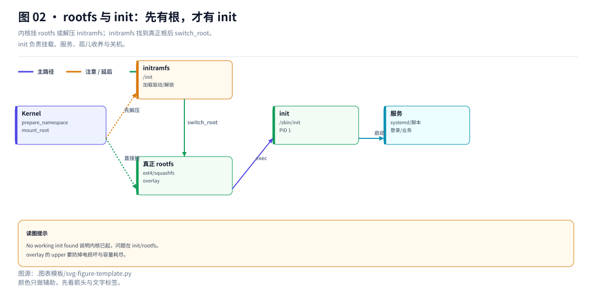

# 根文件系统与 init

内核启动的最后一步是挂根文件系统、执行 init。rootfs 决定“有没有 /bin/sh”，init 决定“系统起来后跑什么”。

> 本篇定位：rootfs/initramfs 的区别、挂载与切换、init 的职责、overlay 的使用与边界。具体发行版的服务管理只做对照。

## 目录

- [1 一句话模型](#s1)
- [2 速览](#s2)
- [3 内核怎么找到根文件系统](#s3)
- [4 initramfs 与 switch_root](#s4)
- [5 init 的职责](#s5)
- [6 设计取舍与边界](#s6)
- [7 与相邻主题的关系](#s7)
- [名词解释](#名词解释)
- [8 参考与关联](#s8)

## 1 · 一句话模型：先有根，才有 init

```text
kernel：挂 rootfs（磁盘分区或 initramfs）
  └─ 执行 /sbin/init（或 rdinit）
       └─ init：挂载其他文件系统、启动服务、处理登录
```

三个关键认知：

1. **rootfs 是路径解析的起点**，没有它 `/bin/sh` 就找不到。
2. **initramfs 是内存中的早期根**，负责加载驱动、找到真正的根，再 `switch_root`。
3. **init 不是“内核的一部分”**，它是第一个用户态进程，PID 1，负责收养孤儿和关机。

## 2 · 速览

| 项 | 内容 |
| --- | --- |
| 根文件系统类型 | ext4、squashfs、ubifs、f2fs、overlay |
| 早期根 | initramfs（cpio 归档） |
| 内核参数 | `root=`、`rootfstype=`、`rootwait`、`init=`、`rdinit=` |
| init 实现 | systemd、BusyBox init、自研 init |
| 关键目录 | `/sbin/init`、`/etc/inittab`、`/etc/fstab` |
| 只读根 | squashfs + overlay |
| 救援 | initramfs shell、A/B 分区、recovery |

## 3 · 内核怎么找到根文件系统



**读图**：内核可先解压 initramfs，再 switch_root 到真正根；最后 exec init。

> 图源：`images/图02-rootfs与init.svg`


```text
start_kernel → prepare_namespace
  ├─ 解析 root= / rootfstype= / rootwait
  ├─ 等待设备就绪
  ├─ mount_root：读超级块，挂到 /
  └─ init_post：执行 /sbin/init 或 init=
```

常见问题：

- `root=` 写错 → `VFS: Unable to mount root fs`。
- 驱动没编进内核/initramfs → 看不到块设备。
- `rootwait` 缺失 → 设备还没枚举就挂载失败。
- rootfs 损坏 → 挂载失败或 init 崩溃。

## 4 initramfs 与 switch_root

initramfs 是一个 cpio 归档，内核启动时解压到内存，作为临时根：

```text
kernel → 解压 initramfs 到 rootfs → 执行 /init
  └─ /init：加载存储/网络驱动，找到真正根
       └─ switch_root /newroot /sbin/init
```

用途：

- 根文件系统在加密/LVM/网络/NFS 上，需要先加载驱动。
- 需要先做 fsck、解锁、选择 A/B 分区。
- 救援模式：挂载失败时给一个 shell。

边界：initramfs 里的工具/驱动要自包含；`switch_root` 后旧根会被清掉，别把必要文件留在旧根。

## 5 init 的职责

| 职责 | 说明 |
| --- | --- |
| 挂载文件系统 | `/etc/fstab`、overlay、数据分区 |
| 启动服务 | systemd unit、BusyBox inittab、自研脚本 |
| 设备管理 | udev/mdev、热插拔 |
| 孤儿收养 | PID 1 收养失去父进程的进程 |
| 关机/重启 | 发送信号、卸载文件系统、断电 |

systemd 用 unit 描述依赖和并行启动；BusyBox init 用 `/etc/inittab` 顺序启动。嵌入式产品常用 BusyBox 或自研 init，桌面/服务器多用 systemd。

## 6 · 设计取舍与边界

### 6.1 initramfs vs 直接挂 rootfs

initramfs 灵活、能处理复杂存储；代价是镜像变大、启动多一次切换。简单设备可以直接 `root=/dev/mmcblk0p2`，省掉 initramfs。

### 6.2 只读根 + overlay

squashfs 只读、抗写坏；overlay 把写操作放 upper（可写层），重启可清空或保留。适合路由器/嵌入式，但要注意 overlay 的 upper 容量和掉电一致性。

### 6.3 systemd vs BusyBox init

systemd 功能强、依赖管理好，但体积大、学习成本高；BusyBox init 简单、启动快，适合资源受限设备。选择取决于产品定位，不是“越新越好”。

### 6.4 init 失败不是内核问题

`Kernel panic - not syncing: No working init found` 说明内核已经起来，但找不到/执行不了 init。先查 `init=`、rootfs 权限、动态库、架构是否匹配。

## 7 · 与相邻主题的关系

| 相邻主题 | 关系 |
| --- | --- |
| 启动链 | init 是启动链最后一段 |
| 驱动与设备树 | 块设备/文件系统驱动决定 rootfs 能否挂载 |
| 升级与恢复 | A/B 分区、recovery initramfs |
| 进程与并发 | init 是 PID 1，负责收养孤儿 |
| 存储与文件系统 | ext4/squashfs/ubifs/overlay 的细节 |

一句话：**rootfs 解决“文件在哪”，init 解决“起来后做什么”；两者任何一个失败，系统都不算启动完成。**

## 名词解释

> 缩写给出英文全称；非缩写用“—”表示。

| 术语 | 英文全称 | 解释 |
| --- | --- | --- |
| rootfs | Root File System | 路径解析的根文件系统。 |
| initramfs | Initial RAM File System | 内存中的早期根文件系统。 |
| switch_root | Switch Root | 从 initramfs 切换到真正根。 |
| overlay | Overlay File System | 只读底层加可写上层的联合文件系统。 |
| squashfs | Squashed File System | 只读压缩文件系统。 |
| inittab | Init Table | BusyBox init 的启动配置。 |
| systemd | System Daemon | 现代 Linux 的服务管理器。 |
| BusyBox init | BusyBox Init | 嵌入式常用的轻量 init。 |
| PID 1 | Process ID 1 | 第一个用户态进程，负责收养孤儿。 |

## 8 · 参考与关联

**参考**

- Linux 内核文档：`Documentation/filesystems/`、`Documentation/admin-guide/initrd.rst`
- `init/initramfs.c`、`init/main.c`
- BusyBox / systemd 文档
- 源仓库 `Linux011文件系统.md`（VFS/挂载对照）

**关联**

- [00-启动链.md](./00-启动链.md)
- [02-启动失败定位.md](./02-启动失败定位.md)
- [04-进程与并发/00-进程与线程.md](../04-进程与并发/00-进程与线程.md)
- [22-OpenWrt/05-升级与恢复](../../22-OpenWrt/05-升级与恢复/.readme.md)

---

> **本篇定位**：rootfs/initramfs/init 的衔接与排障入口，重点讲清“挂根”和“跑 init”两件事。
> **素材来源**：`studyspace/1.知识体系/4.linux源码/Linux011文件系统.md`；通用 Linux 启动知识补写。
> **待验证**：不同发行版的 init/overlay/分区布局差异很大。
