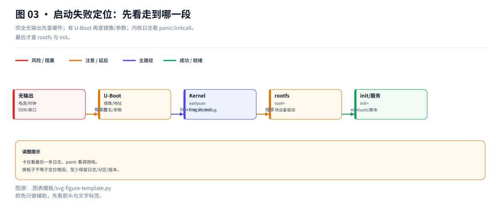

# 启动失败定位

启动问题最怕“一上来就看内核”。先按阶段切分：有没有输出、内核有没有到 init、rootfs 挂没挂上、服务起没起来。

> 本篇定位：启动失败的分阶段判断与常用手段（earlycon、initcall_debug、panic、救援模式），不写具体 SoC 的烧录步骤。

## 目录

- [1 一句话模型](#s1)
- [2 速览](#s2)
- [3 分阶段定位](#s3)
- [4 常见现象与原因](#s4)
- [5 救援与恢复](#s5)
- [6 设计取舍与边界](#s6)
- [7 与相邻主题的关系](#s7)
- [名词解释](#名词解释)
- [8 参考与关联](#s8)

## 1 · 一句话模型：先看走到哪一段

```text
无串口输出 → 电源/时钟/DDR/BootROM/SPL
有 U-Boot 无内核 → 镜像/加载地址/签名/启动参数
内核 panic → 日志最后一行 + initcall
到 init 失败 → rootfs/init/动态库/架构
服务失败 → init 脚本/unit/依赖
```

三个关键认知：

1. **串口是启动阶段唯一的证据**，先确认串口参数和硬件连线。
2. **“卡住”与“panic”不同**：卡住看最后一条日志/initcall，panic 看调用栈。
3. **启动失败不一定在内核**：rootfs、init、库、权限都能让系统停在半路。

## 2 · 速览

| 手段 | 用途 |
| --- | --- |
| `earlycon` | 内核早期串口输出 |
| `console=` | 指定控制台 |
| `initcall_debug` | 打印每个 initcall 耗时与结果 |
| `panic=` / `oops=panic` | 控制 panic 行为 |
| `root=` / `rootwait` | 根文件系统定位 |
| `init=` / `rdinit=` | 指定 init |
| `dmesg` / `pstore` | 事后日志 |
| 救援 initramfs | 挂载失败时给 shell |

## 3 · 分阶段定位



**读图**：无输出→U-Boot→Kernel→rootfs→init/服务，按阶段用日志证明走到哪。

> 图源：`images/图03-启动失败定位.svg`


| 阶段 | 观察 | 判断 |
| --- | --- | --- |
| 上电 | 电源灯、电流、串口 | 完全无输出先查硬件/ BootROM |
| SPL | 串口是否打印 DDR/时钟 | 反复重启多为 DDR/电源 |
| U-Boot | 是否能进命令行 | 能进说明 SoC/DRAM 基本正常 |
| 内核加载 | `Starting kernel ...` | 卡在这查镜像/加载地址/DTB |
| 内核初始化 | 最后一条日志/initcall | 卡住看 `initcall_debug` |
| 挂 rootfs | `VFS: Cannot open root device` | 查 `root=`、驱动、分区 |
| init | `No working init found` | 查 `init=`、权限、动态库、架构 |
| 服务 | 登录/网络/业务 | 查 init 脚本、unit、依赖 |

## 4 · 常见现象与原因

| 现象 | 常见原因 |
| --- | --- |
| 完全无输出 | 电源、时钟、DDR、串口参数、BootROM 启动介质 |
| 反复重启 | watchdog、DDR 不稳定、SPL 加载失败、电源跌落 |
| `Bad Magic Number` | 镜像格式/加载地址/签名不对 |
| `Starting kernel ...` 后无输出 | 串口未初始化、earlycon 未开、DTB 不匹配 |
| `Kernel panic - not syncing` | 根文件系统、init、内存、驱动 |
| `Unable to mount root fs` | `root=` 错、块设备驱动缺失、分区未识别 |
| `No working init found` | init 路径/权限/动态库/架构不对 |
| 启动后网络不通 | 驱动 probe、PHY、配置、init 脚本 |
| 服务反复重启 | 依赖未就绪、配置错、看门狗 |

## 5 · 救援与恢复

- **initramfs shell**：挂载失败时进入 shell，手动 `mount`、`fsck`、检查分区。
- **A/B 分区**：启动失败自动回滚到上一版；要有启动成功标记。
- **recovery 模式**：独立分区/按键组合，用于恢复出厂/升级。
- **pstore/ramoops**：panic 后保留最后日志，重启后读取。
- **watchdog**：防止卡死后系统永久不恢复；但要避免“启动慢被 watchdog 打断”。

## 6 · 设计取舍与边界

### 6.1 日志越多越好吗

启动早期日志太多会拖慢启动、占串口带宽；但排障时 `earlycon` + `initcall_debug` 很值。量产可以关掉详细日志，保留 pstore。

### 6.2 自动回滚 vs 人工救援

自动回滚体验好，但需要可靠的“启动成功”判定和分区管理；人工救援简单，但现场不可用。产品通常两者结合。

### 6.3 不要用“换板子”代替定位

换板能恢复，但没找到根因；同类问题会复发。至少保留串口日志、分区状态、镜像版本。

## 7 · 与相邻主题的关系

| 相邻主题 | 关系 |
| --- | --- |
| 启动链 | 分段定位的依据 |
| 根文件系统与 init | 挂根/init 失败的最后一段 |
| 驱动与设备树 | 块设备/串口/PHY 驱动影响启动 |
| 调试与追踪 | pstore、ftrace、crash 分析 |
| 升级与恢复 | A/B、recovery、回滚 |

一句话：**启动排障先分阶段，再用日志证明“走到哪、为什么停”，不要靠猜。**

## 名词解释

> 缩写给出英文全称；非缩写用“—”表示。

| 术语 | 英文全称 | 解释 |
| --- | --- | --- |
| earlycon | Early Console | 内核早期串口输出。 |
| initcall_debug | Initialization Call Debug | 打印 initcall 耗时与结果。 |
| panic | Kernel Panic | 内核无法继续时的致命错误。 |
| pstore | Persistent Storage | panic 后保留日志的机制。 |
| watchdog | Watchdog Timer | 卡死时复位系统的定时器。 |
| A/B | A/B Partitions | 双分区升级与回滚。 |
| recovery | Recovery Mode | 独立恢复模式/分区。 |

## 8 · 参考与关联

**参考**

- Linux 内核文档：`Documentation/admin-guide/kernel-parameters.txt`
- `Documentation/admin-guide/ramoops.rst`
- U-Boot 文档：启动参数与镜像格式
- 源仓库 `Linux011启动流程.md`（阶段对照）

**关联**

- [00-启动链.md](./00-启动链.md)
- [01-根文件系统与init.md](./01-根文件系统与init.md)
- [07-调试与追踪](../07-调试与追踪/.readme.md)
- [22-OpenWrt/05-升级与恢复](../../22-OpenWrt/05-升级与恢复/.readme.md)

---

> **本篇定位**：启动失败的分阶段定位与救援手段，建立“无输出→U-Boot→内核→rootfs→init→服务”的排查顺序。
> **素材来源**：`studyspace/1.知识体系/4.linux源码/Linux011启动流程.md`；通用 Linux/U-Boot 排障知识补写。
> **待验证**：具体 SoC 的 BootROM 日志、串口参数与 recovery 机制差异很大。
