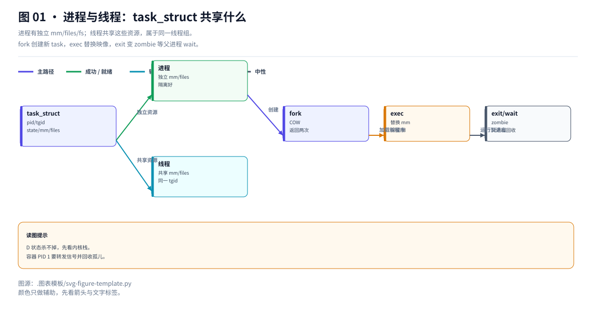

# 进程与线程

Linux 用 `task_struct` 描述调度实体：进程和线程都是 task，区别在于是否共享地址空间、文件表等资源。

> 本篇定位：task_struct、进程状态、fork/exec/exit、线程组与内核线程，附 Linux 0.11 对照。

## 目录

- [1 一句话模型](#s1)
- [2 速览](#s2)
- [3 task_struct 与线程组](#s3)
- [4 fork / exec / exit](#s4)
- [5 进程状态与上下文](#s5)
- [6 设计取舍与边界](#s6)
- [7 与相邻主题的关系](#s7)
- [名词解释](#名词解释)
- [8 参考与关联](#s8)

## 1 · 一句话模型：task 是调度单位，资源共享决定叫进程还是线程

```text
fork/clone
  ├─ 不共享 mm/files → 新进程
  └─ 共享 mm/files → 新线程（同一线程组）
```

三个关键认知：

1. **内核眼里只有 task**，进程/线程是用户态概念。
2. **`task_struct` 里有 mm、files、fs、signal 等指针**，共享与否决定隔离程度。
3. **fork 返回两次**：父进程得到子 pid，子进程返回 0。

## 2 · 速览

| 项 | 内容 |
| --- | --- |
| 核心结构 | `struct task_struct` |
| 标识 | pid、tgid、pgid、sid |
| 状态 | Running、Interruptible、Uninterruptible、Stopped、Zombie |
| 创建 | `fork`、`vfork`、`clone`、`clone3` |
| 执行 | `execve` 替换进程映像 |
| 退出 | `exit` → zombie → 父进程 `wait` |
| 内核线程 | `kthread_create` / `kthread_run` |
| 用户视图 | `ps`、`top`、`/proc/<pid>` |

## 3 · task_struct 与线程组



**读图**：task_struct 是调度单位；共享 mm/files 叫线程，不共享叫进程。

> 图源：`images/图01-进程与线程.svg`


| 字段/资源 | 进程 | 线程 |
| --- | --- | --- |
| `mm`（地址空间） | 独立 | 共享 |
| `files`（fd 表） | 独立 | 共享 |
| `fs`（cwd/root） | 独立 | 共享 |
| `sighand` | 独立 | 共享 |
| `signal` | 独立 | 线程组共享待处理信号 |
| `tgid` | 等于 pid | 等于主线程 pid |

`ps -eLf` 能看到同一 tgid 下的多个 lwp（轻量进程/线程）。`/proc/<pid>/task/` 列出线程。

## 4 · fork / exec / exit

### 4.1 fork

```text
fork → copy_process
  ├─ 复制 task_struct
  ├─ 复制/共享 mm（COW）
  ├─ 复制 files/fs/signal
  ├─ 分配 pid
  └─ 唤醒子进程
```

现代 Linux 用 COW（写时复制）：fork 后父子共享物理页，写入时才复制。比 Linux 0.11 的直接复制页表高效得多。

### 4.2 exec

`execve` 释放旧 mm，加载新程序，重置栈/堆/信号处理，保留 fd（除非 CLOEXEC）。成功后不返回，失败返回 -1。

### 4.3 exit 与 wait

进程退出释放 mm/files，变成 zombie，等父进程 `wait` 回收 task_struct。父进程先死，子进程被 PID 1 收养，避免僵尸泄漏。

## 5 · 进程状态与上下文

| 状态 | 含义 | 常见原因 |
| --- | --- | --- |
| TASK_RUNNING | 运行/可运行 | 正常 |
| TASK_INTERRUPTIBLE | 可中断睡眠 | 等 IO、等锁、sleep |
| TASK_UNINTERRUPTIBLE | 不可中断睡眠 | 等磁盘/驱动，D 状态 |
| TASK_STOPPED | 暂停 | SIGSTOP |
| TASK_ZOMBIE | 已退出未回收 | 父进程没 wait |

D 状态进程杀不掉，通常是驱动/IO 卡住；要看内核栈（`/proc/<pid>/stack`）。

## 6 · 设计取舍与边界

### 6.1 进程 vs 线程

进程隔离好、崩溃影响小，但创建/切换/通信开销大；线程共享内存、通信快，但一个线程崩溃可能拖垮整个进程。选型看隔离与性能需求。

### 6.2 COW 的代价

COW 让 fork 便宜，但写入会触发缺页复制；大量 fork+写会放大内存和延迟。`vfork`/`posix_spawn` 在特定场景更合适。

### 6.3 内核线程

内核线程没有用户 mm，不能访问用户地址；常用于 workqueue、kswapd、kworker。它们也参与调度，但不是用户进程。

### 6.4 PID 1 的特殊性

PID 1 负责收养孤儿、处理关机；它不能随便被杀死。容器里的 PID 1 还需要正确转发信号/回收子进程，否则会出现僵尸。

## 7 · 与相邻主题的关系

| 相邻主题 | 关系 |
| --- | --- |
| 调度 | task_struct 是调度单位 |
| 同步与锁 | 多线程/多进程共享数据要保护 |
| IPC 与信号 | 进程间通信与异步通知 |
| namespace/cgroup | 隔离视图与资源限制 |
| 内存管理 | mm、COW、页表 |

一句话：**进程是资源隔离的单位，线程是调度的单位；Linux 用 task_struct 统一表示，靠共享指针区分。**

## 名词解释

> 缩写给出英文全称；非缩写用“—”表示。

| 术语 | 英文全称 | 解释 |
| --- | --- | --- |
| task_struct | Task Structure | Linux 的进程/线程描述符。 |
| pid | Process ID | 进程标识。 |
| tgid | Thread Group ID | 线程组标识，等于主线程 pid。 |
| fork | Fork | 创建子进程，返回两次。 |
| exec | Execute | 用新程序替换进程映像。 |
| zombie | Zombie Process | 已退出但未被父进程回收。 |
| COW | Copy-On-Write | 写时复制。 |
| 内核线程 | Kernel Thread | 只运行在内核态的线程。 |
| 线程组 | Thread Group | 共享资源的 task 集合。 |

## 8 · 参考与关联

**参考**

- Linux 内核文档：`Documentation/scheduler/`
- `include/linux/sched.h`、`kernel/fork.c`
- 《Linux 内核设计与实现》进程章节
- 源仓库 `Linux011进程管理.md`

**关联**

- [01-调度.md](./01-调度.md)
- [02-IPC与信号.md](./02-IPC与信号.md)
- [03-namespace与cgroup.md](./03-namespace与cgroup.md)
- [05-内存与性能/00-虚拟内存.md](../05-内存与性能/.readme.md)

---

> **本篇定位**：task_struct、fork/exec/exit、线程组与状态，建立“进程=资源隔离、线程=调度”的模型。
> **素材来源**：`studyspace/1.知识体系/4.linux源码/Linux011进程管理.md`；通用 Linux 进程知识补写。
> **待验证**：不同内核版本的 task_struct 字段与 clone 标志会变化。
