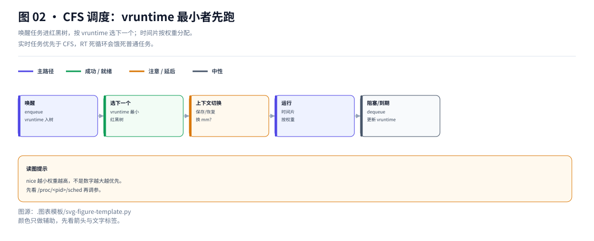

# 进程调度

调度器决定“下一个跑谁、跑多久”。Linux 用调度类分层：实时任务优先，普通任务走 CFS，空闲时才跑 idle。

> 本篇定位：CFS 的 vruntime、nice/优先级、实时调度、CPU 亲和与 cgroup，附 Linux 0.11 时间片对照。

## 目录

- [1 一句话模型](#s1)
- [2 速览](#s2)
- [3 调度类与优先级](#s3)
- [4 CFS 怎么选下一个](#s4)
- [5 调度点与上下文切换](#s5)
- [6 设计取舍与边界](#s6)
- [7 与相邻主题的关系](#s7)
- [名词解释](#名词解释)
- [8 参考与关联](#s8)

## 1 · 一句话模型：按“应得 CPU”排队

```text
实时任务（SCHED_FIFO/RR）优先
  └─ 普通任务（CFS）：vruntime 最小者先跑
       └─ idle：没事干时才跑
```

三个关键认知：

1. **nice 不是“优先级数字越大越优先”**：nice 越小（-20）权重越高。
2. **CFS 追求公平**，不是固定时间片；vruntime 跑得少的人先上。
3. **调度发生在内核边界**：系统调用返回、中断返回、唤醒、阻塞、时间片到期。

## 2 · 速览

| 项 | 内容 |
| --- | --- |
| 调度类 | stop、deadline、RT、CFS、idle |
| 普通策略 | SCHED_NORMAL（CFS）、SCHED_BATCH、SCHED_IDLE |
| 实时策略 | SCHED_FIFO、SCHED_RR |
| 优先级 | nice -20..19；RT 1..99 |
| 关键概念 | vruntime、权重、负载、迁移 |
| 亲和 | `sched_setaffinity`、`taskset` |
| 分组 | cgroup cpu/cpuset |
| 观测 | `ps`、`top`、`/proc/<pid>/sched`、`perf sched` |

## 3 · 调度类与优先级

| 类 | 优先级范围 | 行为 |
| --- | --- | --- |
| stop | 最高 | 内核内部停机/迁移 |
| deadline | 高于 RT | 截止时间保证 |
| RT | 1–99 | FIFO 一直跑，RR 轮转 |
| CFS | nice -20–19 | 按权重分配 CPU |
| idle | 最低 | 无其他任务时运行 |

实时任务会抢占普通任务；如果 RT 任务死循环，可能饿死整机。生产环境要限制 RT 使用（`RLIMIT_RTPRIO`、cgroup）。

## 4 · CFS 怎么选下一个



**读图**：唤醒入红黑树，按 vruntime 最小选下一个；时间片按权重分配。

> 图源：`images/图02-CFS调度.svg`


```text
唤醒 → enqueue_task_fair：vruntime 入红黑树
调度 → pick_next_task_fair：取 vruntime 最小
运行 → 时间片按权重分配
阻塞/到期 → dequeue 或更新 vruntime
```

- **vruntime** 是“虚拟运行时间”，按权重归一化；跑得越多，vruntime 越大，越晚被选。
- **权重**由 nice 映射；nice 越小权重越高，vruntime 增长越慢。
- **最小粒度/调度延迟**决定切换频率；任务太多时，每个任务至少跑一小段。

## 5 · 调度点与上下文切换

| 调度点 | 说明 |
| --- | --- |
| 系统调用返回 | 检查是否需要调度 |
| 中断返回 | 高优先级任务唤醒可抢占 |
| 阻塞 | 等 IO/锁/sleep 主动让出 |
| 时间片到期 | CFS 更新 vruntime |
| 唤醒 | 新任务可能抢占当前任务 |

上下文切换保存/恢复寄存器、栈指针、mm（进程切换才换页表）。线程切换不换 mm，开销更小。

## 6 · 设计取舍与边界

### 6.1 公平 vs 时延

CFS 追求公平，交互任务靠唤醒抢占获得低时延；实时任务靠优先级保证确定性。没有一种策略适合所有负载。

### 6.2 nice 的边界

nice 只影响普通任务相对权重，不能保证绝对 CPU 比例；要硬限制用 cgroup cpu.max/cpuset。

### 6.3 多核与迁移

调度器会把任务迁到空闲 CPU，但缓存亲和性会影响性能；实时/高性能场景常用绑核（`taskset`/cpuset）减少迁移。

### 6.4 观测比调参重要

先看 `/proc/<pid>/sched` 的 vruntime、迁移次数、等待时间，再决定调 nice/亲和/cgroup。盲目调优先级会掩盖真实瓶颈。

## 7 · 与相邻主题的关系

| 相邻主题 | 关系 |
| --- | --- |
| 进程与线程 | task_struct 是调度实体 |
| 同步与锁 | 等锁会阻塞/唤醒，触发调度 |
| 中断与底半部 | 中断返回是抢占点 |
| namespace/cgroup | cgroup 限制 CPU 配额 |
| 性能与调试 | perf sched、ftrace sched 事件 |

一句话：**调度器在“公平、时延、确定性”之间做取舍，先测量再调参。**

## 名词解释

> 缩写给出英文全称；非缩写用“—”表示。

| 术语 | 英文全称 | 解释 |
| --- | --- | --- |
| CFS | Completely Fair Scheduler | 完全公平调度器。 |
| vruntime | Virtual Runtime | 按权重归一化的虚拟运行时间。 |
| nice | Nice Value | 普通任务的权重调节值。 |
| RT | Real-Time | 实时调度类。 |
| SCHED_FIFO | Scheduling First-In-First-Out | 实时先进先出策略。 |
| SCHED_RR | Scheduling Round-Robin | 实时轮转策略。 |
| 亲和 | CPU Affinity | 限制任务可运行的 CPU。 |
| cgroup | Control Group | 资源限制与分组。 |

## 8 · 参考与关联

**参考**

- Linux 内核文档：`Documentation/scheduler/`
- `kernel/sched/fair.c`、`kernel/sched/rt.c`
- 《Linux 内核设计与实现》调度章节
- 源仓库 `Linux011进程管理.md`（counter 时间片对照）

**关联**

- [00-进程与线程.md](./00-进程与线程.md)
- [02-IPC与信号.md](./02-IPC与信号.md)
- [03-namespace与cgroup.md](./03-namespace与cgroup.md)
- [05-内存与性能/02-OOM与性能分析.md](../05-内存与性能/.readme.md)

---

> **本篇定位**：CFS/RT 的选择逻辑、nice/vruntime、调度点与观测方法。
> **素材来源**：`studyspace/1.知识体系/4.linux源码/Linux011进程管理.md`；通用 Linux 调度知识补写。
> **待验证**：EEVDF 等新调度器在较新内核中逐步替代 CFS，细节以目标内核为准。
