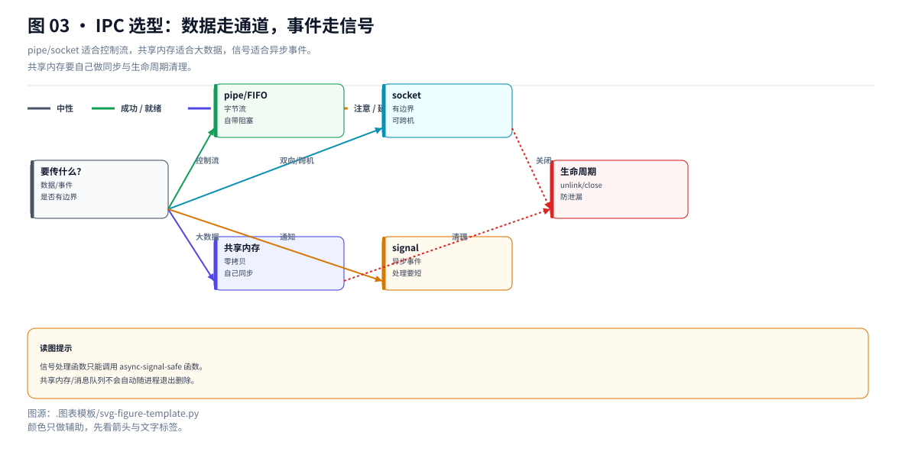

# IPC 与信号

进程之间要么传数据，要么传事件。管道/消息队列/共享内存/socket 负责数据，信号负责异步事件。

> 本篇定位：常用 IPC 的适用场景、阻塞与同步、信号递送与守护进程，不展开协议细节。

## 目录

- [1 一句话模型](#s1)
- [2 速览](#s2)
- [3 数据通道](#s3)
- [4 信号与事件](#s4)
- [5 守护进程](#s5)
- [6 设计取舍与边界](#s6)
- [7 与相邻主题的关系](#s7)
- [名词解释](#名词解释)
- [8 参考与关联](#s8)

## 1 · 一句话模型：数据走通道，事件走信号

```text
数据：pipe / FIFO / 消息队列 / 共享内存 / socket
事件：signal（SIGTERM、SIGCHLD、SIGIO…）
```

三个关键认知：

1. **管道是字节流**，没有消息边界；消息队列/数据报才有边界。
2. **共享内存最快**，但要自己做同步（信号量/互斥锁）。
3. **信号会打断系统调用**，处理函数里只能调用 async-signal-safe 函数。

## 2 · 速览

| 机制 | 方向 | 有无边界 | 典型用途 |
| --- | --- | --- | --- |
| pipe | 亲缘进程 | 字节流 | shell 管道、父子通信 |
| FIFO | 任意进程 | 字节流 | 命名管道 |
| 消息队列 | 任意进程 | 有 | 小消息、控制命令 |
| 共享内存 | 任意进程 | 有（自己管） | 大数据、零拷贝 |
| socketpair | 亲缘/本机 | 有（SOCK_DGRAM） | 双向通信 |
| Unix socket | 本机 | 有/流 | 本地服务 |
| signal | 单向事件 | — | 终止、通知、异步 IO |

## 3 · 数据通道



**读图**：控制流用 pipe/socket，大数据用共享内存，事件用信号。

> 图源：`images/图03-IPC选型.svg`


### 3.1 管道

```text
写端 write → 内核缓冲区 → 读端 read
读空则阻塞；写满则阻塞；读端关闭，写端收到 SIGPIPE
```

管道是半双工、字节流，适合父子/兄弟进程；需要双向就开两条或 socketpair。

### 3.2 共享内存

```text
shm_open/ftok → mmap/at → 读写同一物理页 → shm_unlink
```

最快，但没有内置同步；多个进程要配信号量/文件锁/原子变量。注意生命周期：`shm_unlink` 只是删名字，已有映射仍有效。

### 3.3 消息队列与 socket

- 消息队列：有边界、可按类型取，适合控制消息；内核有大小限制。
- Unix socket：本机双向、可传 fd（`SCM_RIGHTS`），适合服务进程。
- TCP/UDP socket：跨机通信，属于网络栈。

## 4 · 信号与事件

| 信号 | 默认行为 | 常见用途 |
| --- | --- | --- |
| SIGTERM | 终止 | 优雅退出 |
| SIGKILL | 终止（不可捕获） | 强制杀死 |
| SIGINT | 终止 | Ctrl+C |
| SIGCHLD | 忽略 | 子进程退出通知 |
| SIGSTOP | 暂停（不可捕获） | 作业控制 |
| SIGIO | 忽略 | 异步 IO 通知 |
| SIGSEGV | core | 非法内存访问 |

信号处理要点：

- 处理函数要短，只做置标志/写 pipe，不做复杂逻辑。
- 只能调用 async-signal-safe 函数（`write`、`_exit` 等）。
- 用 `sigaction` 而不是老 `signal`；注意 `SA_RESTART` 对系统调用的影响。
- 多线程进程里，信号递送给任意一个未屏蔽线程；要统一用 `sigwait`/signalfd 处理。

## 5 · 守护进程

传统步骤：

```text
fork → 父退出
setsid → 脱离控制终端
再 fork → 不是会话首进程
chdir("/") → 不占挂载点
重定向 stdin/stdout/stderr 到 /dev/null 或日志
```

现代系统可用 systemd 的 `Type=simple/forking` 管理，不一定要自己 daemonize；容器里 PID 1 还要负责信号转发和回收子进程。

## 6 · 设计取舍与边界

### 6.1 管道 vs 共享内存

管道简单、自带同步，但拷贝多、无边界；共享内存零拷贝、快，但要自己同步、容易出错。大数据用共享内存，控制流用 pipe/socket。

### 6.2 信号 vs 事件循环

信号是异步的，处理不好会破坏状态机；高并发服务常用 signalfd/epoll 把信号转成文件事件，统一在事件循环处理。

### 6.3 阻塞 vs 非阻塞

阻塞 IO 简单，但一个慢操作会卡住线程；非阻塞+epoll 适合高并发。选择取决于线程模型和延迟要求。

### 6.4 生命周期与清理

共享内存、消息队列、信号量都是内核对象，进程退出不一定自动删除；要有 `unlink`/`rm` 和异常清理策略，否则会泄漏。

## 7 · 与相邻主题的关系

| 相邻主题 | 关系 |
| --- | --- |
| 进程与线程 | IPC 的主体 |
| 调度 | 阻塞/唤醒影响调度 |
| 网络子系统 | socket 属于网络栈 |
| namespace | IPC namespace 隔离消息队列/共享内存 |
| 调试 | strace、/proc/<pid>/fd、ipcs |

一句话：**数据选通道，事件选信号；共享内存最快，但同步和清理要自己负责。**

## 名词解释

> 缩写给出英文全称；非缩写用“—”表示。

| 术语 | 英文全称 | 解释 |
| --- | --- | --- |
| pipe | Pipe | 亲缘进程间的字节流通道。 |
| FIFO | First-In-First-Out | 命名管道。 |
| 共享内存 | Shared Memory | 多进程映射同一物理页。 |
| 消息队列 | Message Queue | 有边界的消息通道。 |
| socketpair | Socket Pair | 一对双向本机 socket。 |
| signal | Signal | 异步事件通知。 |
| async-signal-safe | Async-Signal-Safe | 信号处理函数可安全调用的函数。 |
| 守护进程 | Daemon | 脱离终端后台运行的进程。 |

## 8 · 参考与关联

**参考**

- `man 2 pipe`、`man 2 shm_open`、`man 2 sigaction`、`man 7 signal`
- 《Unix 环境高级编程》IPC/信号章节
- 源仓库 `Linux011文件系统.md`（pipe 对照）

**关联**

- [00-进程与线程.md](./00-进程与线程.md)
- [01-调度.md](./01-调度.md)
- [03-namespace与cgroup.md](./03-namespace与cgroup.md)
- [06-网络子系统/03-socket与epoll.md](../06-网络子系统/.readme.md)

---

> **本篇定位**：常用 IPC 与信号的选型、阻塞/同步、守护进程步骤。
> **素材来源**：`studyspace/1.知识体系/4.linux源码/Linux011进程管理.md`（信号/pipe 对照）；通用 Linux 知识补写。
> **待验证**：不同 libc/内核的 signal/signalfd 行为与限制可能不同。
