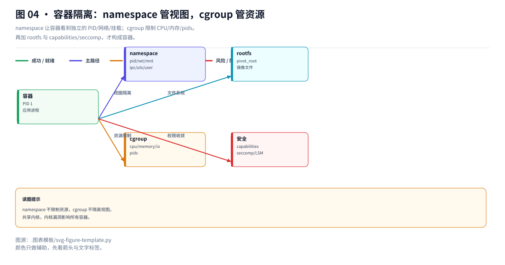

# namespace 与 cgroup

namespace 改“看得见什么”，cgroup 改“能用多少”。容器 = namespace + cgroup + rootfs + 安全策略。

> 本篇定位：常见 namespace 类型、cgroup v1/v2 的控制器、容器隔离的边界，不展开 runc/CRI 实现。

## 目录

- [1 一句话模型](#s1)
- [2 速览](#s2)
- [3 namespace 类型](#s3)
- [4 cgroup 控制器](#s4)
- [5 容器怎么组合](#s5)
- [6 设计取舍与边界](#s6)
- [7 与相邻主题的关系](#s7)
- [名词解释](#名词解释)
- [8 参考与关联](#s8)

## 1 · 一句话模型：隔离视图，限制资源

```text
namespace：pid/net/mnt/ipc/uts/user/cgroup/time → 看到独立的系统视图
cgroup：cpu/memory/io/pids/... → 限制、统计、优先级
```

三个关键认知：

1. **namespace 不是资源限制**：容器能看到独立 PID，但仍可能吃满 CPU。
2. **cgroup 不是隔离**：限制内存不等于看不见别的进程。
3. **容器不是轻量虚拟机**：共享内核，内核漏洞会影响所有容器。

## 2 · 速览

| 项 | 内容 |
| --- | --- |
| namespace 类型 | mnt、pid、net、ipc、uts、user、cgroup、time |
| 查看 | `/proc/<pid>/ns/`、`lsns` |
| cgroup 版本 | v1（多层级）、v2（统一层级） |
| v2 控制器 | cpu、memory、io、pids、cpuset、hugetlb、rdma |
| 查看 | `/sys/fs/cgroup/`、`systemd-cgtop` |
| 创建 | `unshare`、`clone(CLONE_NEW*)`、`nsenter` |
| 容器运行时 | runc、containerd、CRI-O、Docker |

## 3 · namespace 类型

| 类型 | 隔离什么 | 典型现象 |
| --- | --- | --- |
| mnt | 挂载点 | 容器内看不到宿主机目录 |
| pid | 进程号 | 容器内 PID 1 是应用 |
| net | 网络设备/端口/路由 | 独立 IP、独立端口空间 |
| ipc | 消息队列/共享内存/信号量 | 容器间 IPC 隔离 |
| uts | 主机名/域名 | 容器可改 hostname |
| user | uid/gid 映射 | root 映射为非 root |
| cgroup | cgroup 视图 | 容器内看不到宿主 cgroup |
| time | 时钟偏移（新） | 部分内核支持 |

`/proc/<pid>/ns/*` 是命名空间文件描述符；`nsenter` 可进入目标命名空间调试。

## 4 · cgroup 控制器

| 控制器 | 作用 | 关键文件（v2） |
| --- | --- | --- |
| cpu | CPU 配额/权重 | `cpu.max`、`cpu.weight` |
| cpuset | 绑核/内存节点 | `cpuset.cpus`、`cpuset.mems` |
| memory | 内存上限/统计 | `memory.max`、`memory.current` |
| io | 块设备带宽/IOPS | `io.max` |
| pids | 进程数上限 | `pids.max` |
| hugetlb | 大页 | `hugetlb.*` |

v1 每个控制器一棵树，v2 统一一棵树；混合模式常见于老发行版。cgroup 只做“限制/统计/优先级”，不负责隔离视图。

## 5 · 容器怎么组合



**读图**：namespace 管视图，cgroup 管资源，再加 rootfs 与权限控制。

> 图源：`images/图04-namespace与cgroup.svg`


```text
clone(CLONE_NEWPID|CLONE_NEWNET|CLONE_NEWNS|...)
  └─ 新命名空间里的进程
       ├─ pivot_root/chroot 到镜像 rootfs
       ├─ cgroup 限制 CPU/内存/pids
       ├─ capabilities/seccomp/AppArmor 限制权限
       └─ 启动应用作为 PID 1
```

容器内 PID 1 要负责：

- 转发信号（SIGTERM 给子进程）。
- 回收孤儿/僵尸。
- 正确退出码。

否则 `docker stop` 会等超时，或产生僵尸。

## 6 · 设计取舍与边界

### 6.1 隔离强度

namespace/cgroup 提供“视图与资源”隔离，但不隔离内核；需要更强隔离用虚拟机/gVisor/Kata。安全边界要靠 capabilities、seccomp、LSM。

### 6.2 cgroup v1 vs v2

v2 统一层级、规则更一致，但老工具/内核可能只支持 v1；迁移要检查控制器挂载和 systemd 配置。

### 6.3 资源限制不是“越多越好”

内存上限太低会 OOM，太高会拖垮宿主；CPU 配额太低会限流。要结合压测和监控调，不要拍脑袋。

### 6.4 容器不是“轻量”

共享内核意味着内核 bug/配置错误会影响所有容器；宿主机要最小化、及时打补丁，容器要最小权限。

## 7 · 与相邻主题的关系

| 相邻主题 | 关系 |
| --- | --- |
| 进程与线程 | namespace 作用于进程组 |
| 调度 | cgroup cpu 影响调度权重/配额 |
| 内存管理 | cgroup memory 触发回收/OOM |
| 网络子系统 | net namespace 独立协议栈 |
| 调试 | nsenter、cgroup 统计、perf |

一句话：**namespace 让进程“以为自己是独立的”，cgroup 让它“不能吃太多”；容器是两者加 rootfs 和权限控制。**

## 名词解释

> 缩写给出英文全称；非缩写用“—”表示。

| 术语 | 英文全称 | 解释 |
| --- | --- | --- |
| namespace | Namespace | 隔离系统视图的机制。 |
| cgroup | Control Group | 限制/统计/优先级的机制。 |
| PID namespace | PID Namespace | 隔离进程号空间。 |
| net namespace | Network Namespace | 隔离网络设备/端口/路由。 |
| cgroup v2 | Control Group v2 | 统一层级的 cgroup。 |
| controller | Controller | cgroup 的资源控制器。 |
| capability | Capability | 细分的 root 权限。 |
| seccomp | Secure Computing Mode | 限制系统调用的安全机制。 |

## 8 · 参考与关联

**参考**

- Linux 内核文档：`Documentation/admin-guide/cgroup-v2.rst`
- `man 7 namespaces`、`man 7 cgroups`
- `include/uapi/linux/sched.h`（CLONE_*）
- runc/containerd 文档

**关联**

- [00-进程与线程.md](./00-进程与线程.md)
- [01-调度.md](./01-调度.md)
- [05-内存与性能/02-OOM与性能分析.md](../05-内存与性能/.readme.md)
- [06-网络子系统/00-网络栈概览.md](../06-网络子系统/.readme.md)

---

> **本篇定位**：namespace 与 cgroup 的分工、常见类型/控制器与容器组合方式。
> **素材来源**：通用 Linux 容器知识补写；源仓库无对应成稿。
> **待验证**：time namespace、cgroup v2 控制器可用性随内核版本/发行版而变。
