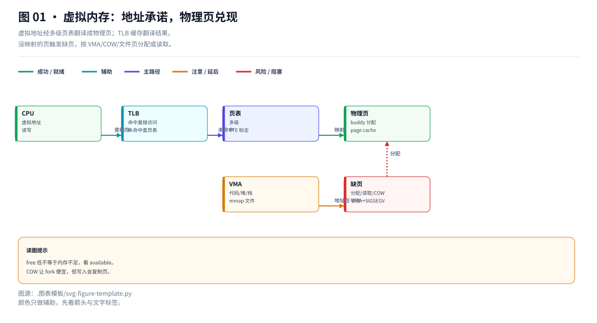

# 虚拟内存

每个进程都以为自己独占地址空间：虚拟地址经页表翻译成物理页，没分配的页在访问时才触发缺页。

> 本篇定位：页表/VMA/缺页/COW/mmap 的主线，附 Linux 0.11 两级页表对照。分配器与页缓存见下一篇。

## 目录

- [1 一句话模型](#s1)
- [2 速览](#s2)
- [3 地址翻译与页表](#s3)
- [4 VMA 与 mmap](#s4)
- [5 缺页与 COW](#s5)
- [6 设计取舍与边界](#s6)
- [7 与相邻主题的关系](#s7)
- [名词解释](#名词解释)
- [8 参考与关联](#s8)

## 1 · 一句话模型：虚拟地址是“承诺”，物理页是“兑现”

```text
进程访问虚拟地址
  └─ TLB 命中？→ 直接访问
       └─ 未命中：查页表
            ├─ 页存在 → 填 TLB
            └─ 页不存在 → 缺页异常 → 分配/映射 → 重试
```

三个关键认知：

1. **虚拟地址连续，物理页可以不连续**；页表负责映射。
2. **VMA 描述“这段地址用来干什么”**（代码、堆、栈、mmap 文件）。
3. **缺页不是错误**，是延迟分配/按需加载的正常机制；非法访问才发 SIGSEGV。

## 2 · 速览

| 项 | 内容 |
| --- | --- |
| 页大小 | 4KB（常见），大页 2MB/1GB |
| 页表 | 多级页表（x86_64 四级/五级） |
| 地址空间描述 | `struct mm_struct` + `vm_area_struct` |
| 映射 | `mmap`、`brk`、文件映射、匿名页 |
| 缺页类型 | 匿名页、文件页、COW、栈扩展 |
| 缓存 | TLB、page cache |
| 观测 | `/proc/<pid>/maps`、`smaps`、`vmstat` |
| 历史对照 | Linux 0.11 两级页表、无 COW |

## 3 · 地址翻译与页表



**读图**：虚拟地址先查 TLB，未命中查页表；页不在内存时触发缺页，按 VMA/COW/文件页处理。

> 图源：`images/图01-虚拟内存翻译.svg`


```text
虚拟地址 → 页目录 → 页表 → 物理页框 → 偏移
```

- **PTE**：页表项，包含物理页号与 present/rw/user/accessed/dirty 等标志。
- **TLB**：页表缓存；切换进程可能刷新（PCID 可减少刷新）。
- **多级页表**：只为用到的地址空间分配页表，节省内存。

Linux 0.11 用两级页表，启动时把前 16MB 一一映射；现代 Linux 用多级页表 + 按需分配，思想一致：**页表把“虚拟”翻译成“物理”**。

## 4 · VMA 与 mmap

`vm_area_struct` 描述一段连续虚拟地址区间：

| 字段 | 作用 |
| --- | --- |
| `vm_start/vm_end` | 区间范围 |
| `vm_flags` | 读/写/执行/共享 |
| `vm_file` | 文件映射的 file |
| `vm_ops` | 缺页/打开/关闭回调 |
| `vm_pgoff` | 文件偏移 |

`mmap` 只建立 VMA，不立即分配物理页；第一次访问才缺页分配/读文件。`brk` 扩展堆，`mmap` 适合大块/文件映射。

## 5 · 缺页与 COW

```text
访问未映射页 → do_page_fault
  ├─ 地址在 VMA 内？
  │    ├─ 匿名页 → 分配零页/新页
  │    ├─ 文件页 → 从 page cache 读入
  │    └─ COW → 复制父进程页，改 PTE 为可写
  └─ 不在 VMA → SIGSEGV
```

COW（写时复制）：fork 后父子共享只读页，任一方写入才复制。它让 fork 便宜，但大量写入会放大内存和延迟。

## 6 · 设计取舍与边界

### 6.1 按需分配 vs 预分配

按需分配省内存、启动快，但首次访问有缺页延迟；预分配/预读降低延迟但浪费内存。数据库/实时系统常用预分配/大页。

### 6.2 overcommit

Linux 默认允许 overcommit：虚拟内存可以超过物理内存，靠回收/OOM 兜底。好处是利用率高，坏处是可能触发 OOM。严格场景可设 `vm.overcommit_memory`。

### 6.3 大页

大页减少 TLB miss、提升大内存应用性能；代价是内存碎片、分配失败、配置复杂。数据库/虚拟化常用。

### 6.4 内存不是“越多越好”

页缓存、匿名页、slab 都在争内存； free 低不等于有问题，要看可用内存和回收情况。`available` 比 `free` 更有意义。

## 7 · 与相邻主题的关系

| 相邻主题 | 关系 |
| --- | --- |
| 分配器与页缓存 | 物理页从伙伴系统来，文件页走 page cache |
| 进程与线程 | mm 决定地址空间共享 |
| OOM 与性能 | 内存压力触发回收/OOM |
| 网络 | skb 也占用内核内存 |
| 调试 | `/proc/<pid>/maps`、`vmstat`、`perf` |

一句话：**虚拟内存把“地址”与“物理页”解耦，用页表和缺页实现隔离、延迟分配与共享。**

## 名词解释

> 缩写给出英文全称；非缩写用“—”表示。

| 术语 | 英文全称 | 解释 |
| --- | --- | --- |
| 虚拟内存 | Virtual Memory | 让每个进程看到独立地址空间。 |
| TLB | Translation Lookaside Buffer | 页表翻译缓存。 |
| PTE | Page Table Entry | 页表项。 |
| VMA | Virtual Memory Area | 一段连续虚拟地址区间。 |
| mmap | Memory Map | 建立文件/匿名映射。 |
| COW | Copy-On-Write | 写时复制。 |
| overcommit | Memory Overcommit | 允许虚拟内存超过物理内存。 |
| 大页 | Huge Page | 2MB/1GB 的大页映射。 |

## 8 · 参考与关联

**参考**

- Linux 内核文档：`Documentation/mm/`
- `mm/memory.c`、`mm/mmap.c`
- 《深入理解 Linux 虚拟内存管理》
- 源仓库 `Linux011启动流程.md`（分页初始化）

**关联**

- [01-分配器与页缓存.md](./01-分配器与页缓存.md)
- [02-OOM与性能分析.md](./02-OOM与性能分析.md)
- [04-进程与并发/00-进程与线程.md](../04-进程与并发/00-进程与线程.md)

---

> **本篇定位**：虚拟地址→页表→物理页的主线，VMA/mmap/缺页/COW 与 overcommit 边界。
> **素材来源**：`studyspace/1.知识体系/4.linux源码/Linux011启动流程.md`（分页）；通用 Linux 内存知识补写。
> **待验证**：页表级数、大页支持、overcommit 默认值随架构/内核/发行版而变。
