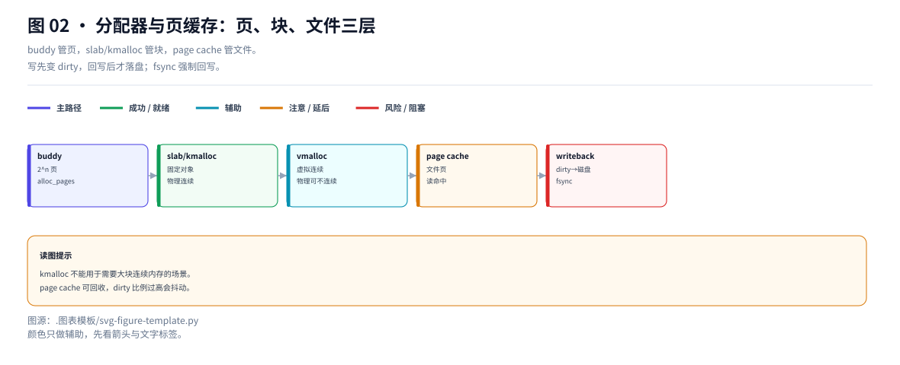

# 分配器与页缓存

物理页由伙伴系统管理，小块内存由 slab/kmalloc 分配；文件数据缓存在 page cache，写回由内核异步完成。

> 本篇定位：buddy→slab→kmalloc/vmalloc 的层次、page cache 的读写与回写、dirty 与内存回收的关系。

## 目录

- [1 一句话模型](#s1)
- [2 速览](#s2)
- [3 物理页分配](#s3)
- [4 小块内存与 vmalloc](#s4)
- [5 页缓存与回写](#s5)
- [6 设计取舍与边界](#s6)
- [7 与相邻主题的关系](#s7)
- [名词解释](#名词解释)
- [8 参考与关联](#s8)

## 1 · 一句话模型：页给 buddy，块给 slab，文件给 page cache

```text
物理页：buddy（2^n 页）
  └─ slab：固定大小对象缓存
       └─ kmalloc：小块连续内存
vmalloc：虚拟连续、物理可不连续
文件：page cache → dirty → writeback → 磁盘
```

三个关键认知：

1. **kmalloc 要物理连续**，vmalloc 只要虚拟连续；大块且不要求物理连续时用 vmalloc。
2. **page cache 是文件内容的缓存**，读命中不碰磁盘，写先变 dirty 再回写。
3. **free 低不等于内存不足**：page cache 可回收，关键看 available 和回收压力。

## 2 · 速览

| 层 | 管理单位 | 典型接口 |
| --- | --- | --- |
| buddy | 2^n 页 | `alloc_pages` |
| slab/slub | 对象 | `kmem_cache_alloc` |
| kmalloc | 字节（连续） | `kmalloc/kzalloc` |
| vmalloc | 字节（虚拟连续） | `vmalloc/vfree` |
| page cache | 文件页 | `read/write/mmap` |
| 回写 | dirty 页 | `writeback`、`fsync` |

## 3 · 物理页分配



**读图**：buddy 管页、slab/kmalloc 管块、page cache 管文件；写先 dirty，回写后落盘。

> 图源：`images/图02-分配器与页缓存.svg`


伙伴系统把空闲页按 2 的幂分组，分配时找最合适的块，不够就拆分；释放时尝试与伙伴合并，减少碎片。

| 场景 | 选择 |
| --- | --- |
| 内核对象/驱动小块 | kmalloc/slab |
| DMA 缓冲区 | `dma_alloc_coherent` |
| 大块虚拟连续 | vmalloc |
| 用户页 | 缺页时从 buddy 取 |

分配标志：

- `GFP_KERNEL`：可睡眠，进程上下文。
- `GFP_ATOMIC`：不可睡眠，中断上下文。
- `GFP_DMA`：DMA 可访问区域（部分架构）。

## 4 · 小块内存与 vmalloc

- **slab/slub**：为固定大小对象建缓存，减少碎片和初始化开销；`task_struct`、`inode` 等都有专用缓存。
- **kmalloc**：基于 slab 的通用小块分配，物理连续，适合 DMA/驱动。
- **vmalloc**：分配虚拟连续区域，物理页可不连续；适合大缓冲区，但不能用于 DMA。

释放要匹配：`kmalloc→kfree`、`vmalloc→vfree`、`kmem_cache_alloc→kmem_cache_free`。

## 5 · 页缓存与回写

```text
read：查 page cache → 命中直接拷贝 → 未命中读磁盘入缓存
write：写 page cache → 标记 dirty → 后台 writeback → 磁盘
fsync：强制把 dirty 页写回
```

- **dirty 页**占内存，回写不及时会触发阈值限流。
- **readahead** 预读相邻页，提升顺序读性能。
- **mmap 文件**共享 page cache；写入最终也走回写。
- **O_DIRECT** 绕过 page cache，适合自管理缓存的应用。

## 6 · 设计取舍与边界

### 6.1 slab vs vmalloc

slab/kmalloc 快、物理连续，但大块容易失败；vmalloc 能分配大块，但页表开销和 TLB 压力大，不能 DMA。

### 6.2 page cache 的“双刃剑”

缓存提升读性能，但占用内存；内存压力时回收 cache，可能造成延迟抖动。数据库等应用常自己管理缓存（O_DIRECT/大页）。

### 6.3 回写策略

dirty 比例太低会频繁写盘，太高会一次性回写造成抖动；内核有 dirty_ratio/dirty_background_ratio 调优，但要结合存储性能。

### 6.4 内存碎片

长期运行后大块连续内存难分配；可预留 CMA/hugepage、减少碎片化分配，或在启动时预留。

## 7 · 与相邻主题的关系

| 相邻主题 | 关系 |
| --- | --- |
| 虚拟内存 | 页表把虚拟页映射到 buddy 页 |
| OOM 与性能 | 回收 page cache/slab，压力过大触发 OOM |
| 文件系统 | page cache 与 writeback |
| 驱动 | DMA 缓冲区、kmalloc/vmalloc |
| 调试 | `/proc/meminfo`、slabinfo、vmstat |

一句话：**buddy 管页、slab 管块、page cache 管文件；三层各司其职，排障要看清是哪一层紧张。**

## 名词解释

> 缩写给出英文全称；非缩写用“—”表示。

| 术语 | 英文全称 | 解释 |
| --- | --- | --- |
| buddy | Buddy Allocator | 按 2^n 页管理物理页。 |
| slab | Slab Allocator | 固定大小对象缓存。 |
| kmalloc | Kernel Malloc | 内核小块连续内存分配。 |
| vmalloc | Virtual Malloc | 虚拟连续、物理可不连续。 |
| page cache | Page Cache | 文件内容的内存缓存。 |
| dirty | Dirty Page | 已修改未回写的页。 |
| writeback | Writeback | 把脏页写回磁盘。 |
| readahead | Read Ahead | 预读相邻页。 |

## 8 · 参考与关联

**参考**

- Linux 内核文档：`Documentation/mm/`、`Documentation/filesystems/`
- `mm/page_alloc.c`、`mm/slab.c`、`mm/page-writeback.c`
- 源仓库 `Linux011文件系统.md`（buffer cache 对照）

**关联**

- [00-虚拟内存.md](./00-虚拟内存.md)
- [02-OOM与性能分析.md](./02-OOM与性能分析.md)
- [03-启动与根文件系统/01-根文件系统与init.md](../03-启动与根文件系统/01-根文件系统与init.md)

---

> **本篇定位**：buddy/slab/kmalloc/vmalloc 与 page cache 的层次、读写回写和排障入口。
> **素材来源**：`studyspace/1.知识体系/4.linux源码/Linux011文件系统.md`（buffer cache）；通用 Linux 内存知识补写。
> **待验证**：slab 实现（SLAB/SLUB/SLOB）、dirty 默认值随内核/发行版而变。
